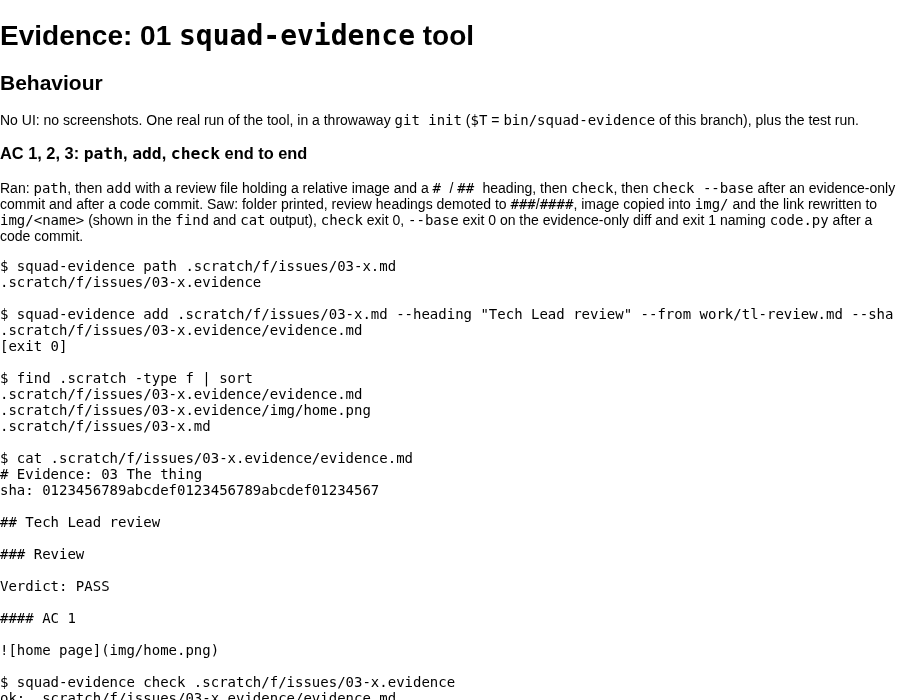

# Evidence: 04 integration and live check
sha: b5123256fc676749b1b1234f84dd27e7ef0f7f27

## Behaviour

Branch squad/plugin/evidence-inline/plugin-dev-evidence-inline-4 from cb14419: commit fb09633 (spec + tickets, copied byte for byte from the project root), then merges of 6069e83 (01), d13660c (02), 0572249 (03). All three merged with no conflict.

### AC 1: merge and targeted tests on the merge sha

```
$ git log --oneline --merges -3
b512325 Merge commit '0572249' into squad/plugin/evidence-inline/plugin-dev-evidence-inline-4
bb53e49 Merge commit 'd13660c' into squad/plugin/evidence-inline/plugin-dev-evidence-inline-4
190298b Merge commit '6069e83' into squad/plugin/evidence-inline/plugin-dev-evidence-inline-4

$ cd tests; PYTHONDONTWRITEBYTECODE=1 python3 -m unittest test_squad_evidence test_process_history test_instructions test_templates test_windows_safe test_processlint
Ran 125 tests in 1.643s
OK
```

### AC 2: assemble Tech Lead reviews, check all four folders

Ran `squad-evidence add <ticket> --heading "Tech Lead review" --from $SCOPE_DIR/evidence/<NN>/tl-review.md` for 01, 02, 03 (each exit 0, each added one `## Tech Lead review` section). Then:

```
$ squad-evidence check .scratch/evidence-inline/issues/01-squad-evidence-tool.evidence
ok: .scratch/evidence-inline/issues/01-squad-evidence-tool.evidence/evidence.md
[exit 0]
$ squad-evidence check .scratch/evidence-inline/issues/02-process-v6.evidence
ok: .scratch/evidence-inline/issues/02-process-v6.evidence/evidence.md
[exit 0]
$ squad-evidence check .scratch/evidence-inline/issues/03-role-files.evidence
ok: .scratch/evidence-inline/issues/03-role-files.evidence/evidence.md
[exit 0]
$ squad-evidence check .scratch/evidence-inline/issues/01-squad-evidence-tool.evidence --base b512325
ok: .scratch/evidence-inline/issues/01-squad-evidence-tool.evidence/evidence.md
[exit 0]
$ squad-evidence check .scratch/evidence-inline/issues/02-process-v6.evidence --base b512325
ok: .scratch/evidence-inline/issues/02-process-v6.evidence/evidence.md
[exit 0]
$ squad-evidence check .scratch/evidence-inline/issues/03-role-files.evidence --base b512325
ok: .scratch/evidence-inline/issues/03-role-files.evidence/evidence.md
[exit 0]
$ squad-evidence check .scratch/evidence-inline/issues/04-integration.evidence --base b512325
ok: .scratch/evidence-inline/issues/04-integration.evidence/evidence.md
[exit 0]
$ git diff --name-only b512325 HEAD
.scratch/evidence-inline/issues/01-squad-evidence-tool.evidence/evidence.md
.scratch/evidence-inline/issues/02-process-v6.evidence/evidence.md
.scratch/evidence-inline/issues/03-role-files.evidence/evidence.md
.scratch/evidence-inline/issues/04-integration.evidence/evidence.md
.scratch/evidence-inline/issues/04-integration.evidence/img/rendered.png
```

### AC 4: live screenshot of a rendered evidence.md

Served a copy of ticket 01's evidence folder on 127.0.0.1:8765 with `python3 -m http.server` (stopped by PID afterwards). `evidence.md` has no renderer in this repo, so a throwaway markdown-to-HTML script outside the repo (headings, fences, paragraphs, image embeds to ``) made the page; `playwright-cli` opened it at 900x700 and took the screenshot below. Seen: the title "Evidence: 01 squad-evidence tool", the "Behaviour" heading, the prose and the fenced command output. Ticket 01 has no real screenshot (its only embed is inside a fenced example), so the page shows that line as text, not an image.



Then rendered this ticket's own evidence.md the same way and reloaded: the page shows the screenshot (img element complete, natural size 900x700, relative src), nested inside the page. Browser closed (`playwright-cli close`), server stopped by PID (port refused afterwards).

```
$ squad-evidence check .scratch/evidence-inline/issues/04-integration.evidence
ok: .scratch/evidence-inline/issues/04-integration.evidence/evidence.md
[exit 0]
```

Note for the Tech Lead: `squad-evidence check` treats an embed written in inline code (backticks) in prose as a real embed (it failed on my first draft: not an image file, target missing); only fenced blocks are skipped. I reworded; the tool is unchanged.
