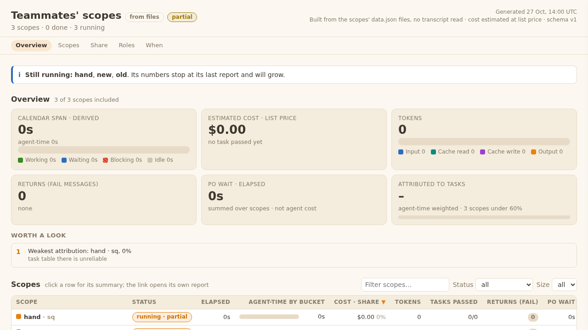
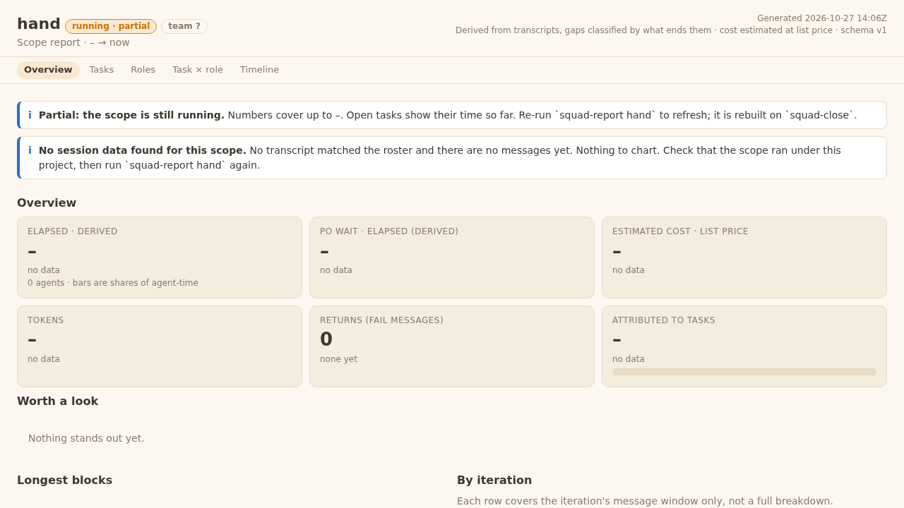
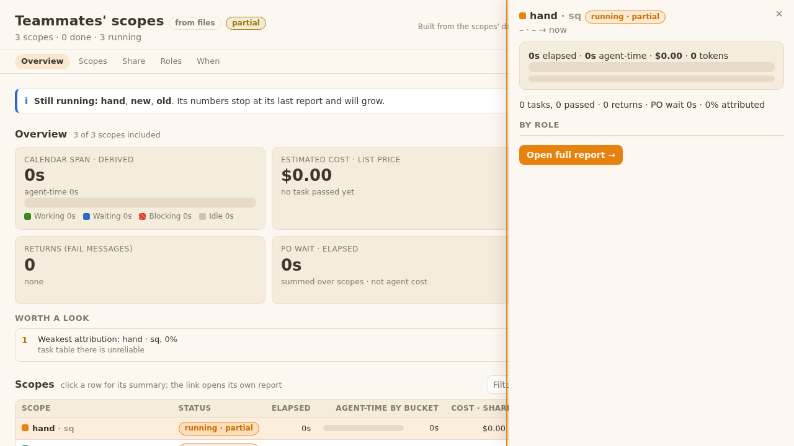

# QA blackbox, task 09 (code sha 95bfcf2, branch squad/plugin/drop-scope-size/plugin-dev-dsz-9)

Scratch squad: three scopes (`size: S`; `team: ba, tech-lead, qa-white`; neither line). `squad-report` per scope, then `squad-report rollup` on the three data.json files; folders served with `python3 -m http.server` on localhost, browsed with Playwright; servers stopped by PID, browser closed. Verdict waits for the Tech Lead's final sha (REV-3).

| AC / check | What I did | What I saw | Result |
|---|---|---|---|
| AC 23: mixed old and new rows | rollup of the old (S) and new (team) scopes (plus a hand-made one) | exit 0, "3 of 3 included"; rows read `old · sq S`, `new · sq ba, tech-lead, qa-white`, `hand · sq` (blank) | PASS |
| Each data.json `scope` has both keys | read the three data.json | old `size S, team ""`; new `size "", team "ba, tech-lead, qa-white"`; hand `size "", team ""` | PASS |
| Report header chip, old | open report.html | `size S` | PASS |
| Report header chip, new | open report.html | `team ba, tech-lead, qa-white` | PASS |
| Scope template | `templates/scope/scope.md` | one `team:` line, no `size:`, `design:`, `architecture:`, `qa-b:` line | PASS |

Notes (not AC failures):
- A scope with neither line (hand-made or undecided) shows the chip `size ?` in its report. It reads as a size even though sizes are gone. `team undecided` would fit better. AC 23 doesn't cover it; Developer's call.
- The rollup still has a "Size" filter (all/S/M/L). Choosing S shows only the old row; a team scope matches no S/M/L value. Consistent with "old size shown as written", but a team scope can only be seen under "all".
- AC 29 (no word "size" in PO-visible output) does not list squad-report, so neither note breaks it.

## Re-check on ce6b3a1 (changed: templates/report/report.js, rollup.js, scope template)
Same scratch squad (old `size: S`, new `team:`, hand-made with neither), report + rollup served and browsed.

| Check | Saw | Result |
|---|---|---|
| Note 1: chip for a scope with neither line | report header chip `team ?` (was `size ?`) | PASS |
| Old and new chips unchanged | `size S`, `team ba, tech-lead, qa-white` | PASS |
| Rollup rows | `hand · sq` (blank), `new · sq ba, tech-lead, qa-white`, `old · sq S`; exit 0 | PASS |
| Rollup drawer for the hand-made scope | opens, shows `–` where team/size would be, no error | PASS |
| Scope template | `team:` then `qa: full`; no `size:`, `design:`, `architecture:`, `qa-b:` | PASS |

Note 2 (rollup "Size" filter cannot pick a team scope) stays open as a recorded gap, accepted by me as non-blocking.
