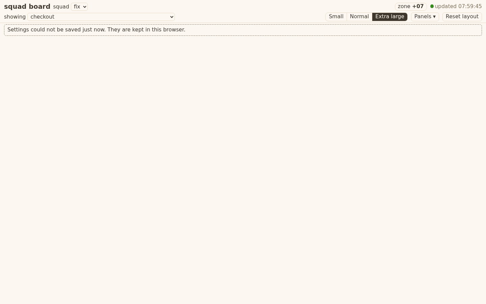

# Evidence 10: page shell and layout

## Behaviour
Run: `cd tests && python3 -m unittest test_squadboard_page` (19 tests, headless Chrome on a harness page that loads the real `templates/board/*.js`; the API JSON comes from a real squadboard server on the ticket-02 fixture).

Shots (harness page with six test panels of 8, 8, 3, 1, 3 and 40 rows; the real page shows the same shell with panels from tickets 11 to 13):

- AC3 to AC9: at Small, Normal and Extra large (1440) and Small and Extra large (1000): nothing overlaps, no blank band over 16 px under the last row of a non-scrolling panel, every panel's right edge meets the page edge or the next panel one gutter (12 px) later, the 40-row panel scrolls inside, no sideways page scroll.
- AC1, AC2, AC7: a synthetic drag (ghost shown) and an east-edge resize change order and span; the saved body has no key `x|y|top|left|px|row` and passes the real `squadboard_ui.validate`; a second page started from that body shows the same order and span; Hide then "Show Tasks" from the Panels list; Reset layout returns the default. The banner slot is outside the panel list (no hide, no drag).
- AC13 to AC15: `titleFor` gives `(3) board` / `board`; `fmtTime` with the zone passed in: 09:00 at +07, `23:30Z` is the next day, Asia/Kolkata gives `+05:30`, an unreadable zone gives `UTC`; New York offsets differ by date (DST); ages 20 s, 3 h, 3 d, and null is "age unknown".
- AC16: a fake-clock poller: failures 1, 2, 3 mark "not updating", one success resets, a load still running is not started again; interval 5000 ms. The real server serves the four files and the shell shows `updated hh:mm:ss`, the zone chip and the tab title `fix` on the fixture.
- AC17: a response with `unknown` and no data renders `unknown: <source>`, never the panel's empty text; an unknown `schema_version` shows `unknown: board version`.
- AC11, AC12: no percent sign in `board.js`, `layout.js`, `index.html` (grep: 0 hits); the only CSS rules using mango are `.count.hot` and `.chip.need`.
- AC10, text-size persistence: font is saved as `small|normal|xl` in the same state body.

Not built here (later tickets): the panels, the permission banner content (slot `setBanner`), the richer picker (11).

Touched: `templates/board/index.html`, `board.css`, `board.js`, `layout.js`, `tests/test_squadboard_page.py` (all new).
Greps: `grep -rl 'templates/board|squadboard\b' tests/` hits `test_squadboard_server.py`, `test_squadboard_ui.py`, `test_squadboard_page.py` (run, pass); also test_windows_safe, test_no_bare_bash, test_old_language_inventory pass (55 tests OK).
`%` hits in page scripts: none. `innerHTML` and friends: none. `method`: only `"PUT"` (to `/api/ui`, with the token header).

## Return 1 fixes (QA whitebox F1-F4)
- F1: a load remembers its query; `onOk` drops a result whose query is no longer the page's; the poller runs one more load right after the current one when asked meanwhile (`now()` while busy is queued, never two at once). Test: held fetch for the old choice, `setChoice`, release: the panel shows the new choice's rows.
- F2: startup (session token, squads, saved state, choice) is `boot()`, run from the poller's load until it has worked once; a failure counts like any failed refresh. "updated" shows only after a load that filled the panels. Test: `/api/session` fails once, then the panels fill and the header says updated.
- F3: `auto` is added to the documented state shape (docstring of `bin/squadboard_ui.py`, one line; no code change). The body stays valid for the real validator (tested).
- F4: removed the no-op `S.needs = S.needs`, the duplicate `query()` branch, the repeated squad filter, and the unused `st0` in `layout.js`.
Run: test_squadboard_page, test_squadboard_ui, test_squadboard_server, test_windows_safe, test_no_bare_bash, test_old_language_inventory: 76 tests OK.

## QA whitebox

### QA whitebox 10: FAIL on ccb313c (base d2bc1b7)
Ran in a clone: `test_squadboard_page` 19 OK (0 skipped, Chrome present); `test_squadboard_server` + `test_squadboard_ui` 33 OK (TC.11 hits).
Greps clean: no innerHTML & co, no http(s)/@import, only `method:"PUT"`, no hex outside `:root`, no `%` in js/html. TA1, TA3-TA11 and TU.1-TU.9 read OK. Presentational values not judged (REV-18a).

#### Findings (one return, REV-17)
**F1 (TU.7 / TA7, correctness) A response for the old choice is shown under the new choice.**
board.js:380 `setChoice` and :387 `switchSquad` call `clearPanels()` then `poller.now()`. If a load is running, `tick` returns at once (busy), and the old load's `onOk` (:469) renders its rows into the cleared panels. Nothing checks that the response belongs to the current squad/choice. The right data comes only on the next 5 s tick.
Probe /tmp/qaw10/probe.py: load for scope `a` held in flight, `setChoice('scope:b')`, release: panel shows `data for a`, `state.choice` is `b`.
Pass: `load()` captures the query it used; `onOk` drops a result whose query is not the current one and starts a new load when one was skipped (poller `now()` while busy must run again after the current one ends). Add a test with the held-fetch pattern.

**F2 (AC16 / AC17, correctness) A failed start never recovers and then says "updated".**
board.js:537 `.catch` sets stale and starts the poller with `S.squad === null`, `S.token === ""`. Later loads only fetch `/api/squads` (query empty, no choice), `onOk` (:475) never sets `S.squad`/`S.choice`, `loadSaved` never runs, `S.status` becomes "ok". Probe (session fetch fails once, then works): after 3 ticks `choice null, squad false, token ""`, panels empty, header says `updated 10:00:00`. The PO sees a fine page that is empty until a manual reload.
Pass: the poller (or onOk) re-runs the startup steps (session, squads, saved state, choice) until they have worked once; "updated" is shown only when the panels have loaded. Add a test: start with a failing `/api/session`, then ok, panels fill.

**F3 (T10.TA2) State body has keys outside the agreed list.** board.js:261 `snapshot()` sends `auto` (and `panels`). TA2 lists `order, span, hidden, max_height, choice, recent, font, saved_at, version`. 09's validator keeps unknown top-level keys so it works. Pass: add `auto` to the documented shape in `bin/squadboard_ui.py` docstring (line 9) and evidence, or drop it; one line either way. (`panels` is 09's own shape: fine.)

**F4 style (all in one list).** board.js:380 `S.needs = S.needs;` is a no-op; board.js:424-425 both branches of `query()` do the same; layout.js `void st0;` and `var st0` unused (drag).

#### Not findings (noted)
- Snapshot in `touch()` is taken before `replan()` under auto: harmless because auto re-plans on load.
- board.js 551 / layout.js 326 lines: under the ~600 discussion line.

### Re-check: PASS on 1410bda (LC-3b: changed files and their AC)
F1 fixed: `load()` carries its query, `onOk` drops a result for another choice, `makePoller` queues one more load when `now()` came while busy (board.js poller `again`). Probe now shows `data for b`. Test added.
F2 fixed: `boot()` (session, squads, saved state, choice) re-runs from the poller until it has worked once; "updated" only after panels load. Probe: choice a, token t, body filled. Test added.
F3: `auto` documented in squadboard_ui.py docstring (line 8). F4: no-op line, duplicate branch and unused `st0` removed.
`test_squadboard_page` 21 OK, 0 skipped. Greps (innerHTML, http, %) still clean. git status clean.

## QA blackbox

### QA blackbox 10: page shell and layout
Sha checked: 1410bda (ccb313c first; return fixes re-checked). Real page (fixture squad `fix`, scope checkout, port 18711, Playwright). Panels come in tickets 11-13, so the real page shows the shell only; layout ACs were judged on the Developer's harness screenshots (6 sample panels) plus the shell on the real page. Layout ACs on real panels must be re-checked after ticket 12.

| AC | What I did | What I saw | Result |
|---|---|---|---|
| AC1, AC2, AC5, AC6, AC7 | Real page: Panels list, Reset layout. Harness shots show Hide buttons and Panels | Real page: "No hidden panels."; Reset works, no error. No panel exists to drag/hide on the real page | PASS on shell; drag/hide/resize not walked live (open) |
| AC3, AC4, AC8, AC9 | Viewed harness shots normal-1440, xl-1440, small-1000 | Panels packed, 12 px gaps, short Files panel full width, no blank bands, 40-row panel scrolls inside | PASS on shots; re-check on real panels (open) |
| AC9/rules, 1000 px | Real page at 1000 and 1440 wide | scrollWidth = window width (no sideways scroll) | PASS (shell). Note: harness shot small-1000 shows a stray JSON debug line and a sideways scrollbar; harness only, not on the real page |
| AC10 | Click Small/Normal/Extra large, reload | Body text 10.8 / 12 / 15.6 px; Extra large stays after reload | PASS |
| AC11 | innerText of the real page at all three sizes | no percent sign; font names Small / Normal / Extra large | PASS |
| AC12 | Real page shell, harness shots | no mango anywhere except the count chips in harness (need) | PASS (shell) |
| AC13 | Real page tab title | `fix` (needs-you count not available until ticket 12; harness test only) | PASS on harness evidence; open |
| AC14 | New browser with TZ=Asia/Kolkata, America/New_York, Invalid/Zone; local +07 | header zone +05:30 (time 06:29 = 00:59Z + 5:30), -05, UTC (unreadable zone), +07 | PASS |
| AC15 | not on page yet (ages live in panels) | harness test per Developer | open until ticket 12 |
| AC16 | Killed the server; watched header; restarted | "not updating (last update hh:mm:ss)" shown by 10 s; after restart back to "updated hh:mm:ss" within 3 s | PASS |
| AC17 | no panel on real page | open until ticket 12 | open |

Header checked: title "squad board", squad switch, "showing" picker, zone chip, "updated hh:mm:ss", Small/Normal/Extra large, Panels, Reset layout.

Note (not an AC): after a server restart, the open page recovers ("updated") but the next setting change (font size) shows "Settings could not be saved just now. They are kept in this browser." until the page is reloaded (old session token). After reload it saves. Suggest the page fetches a new token on that failure.

