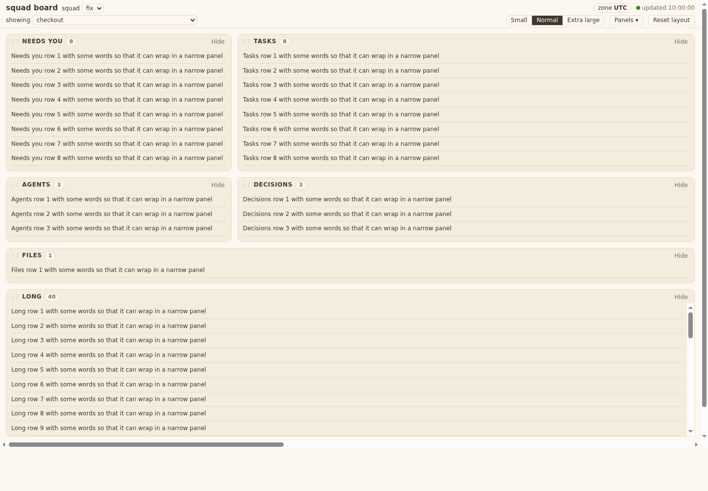
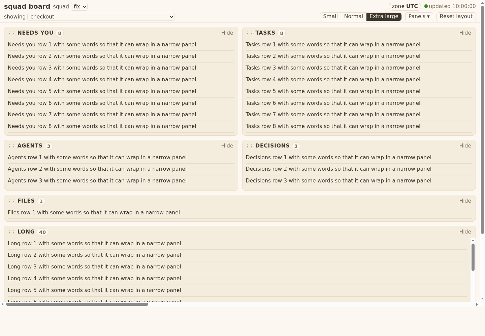
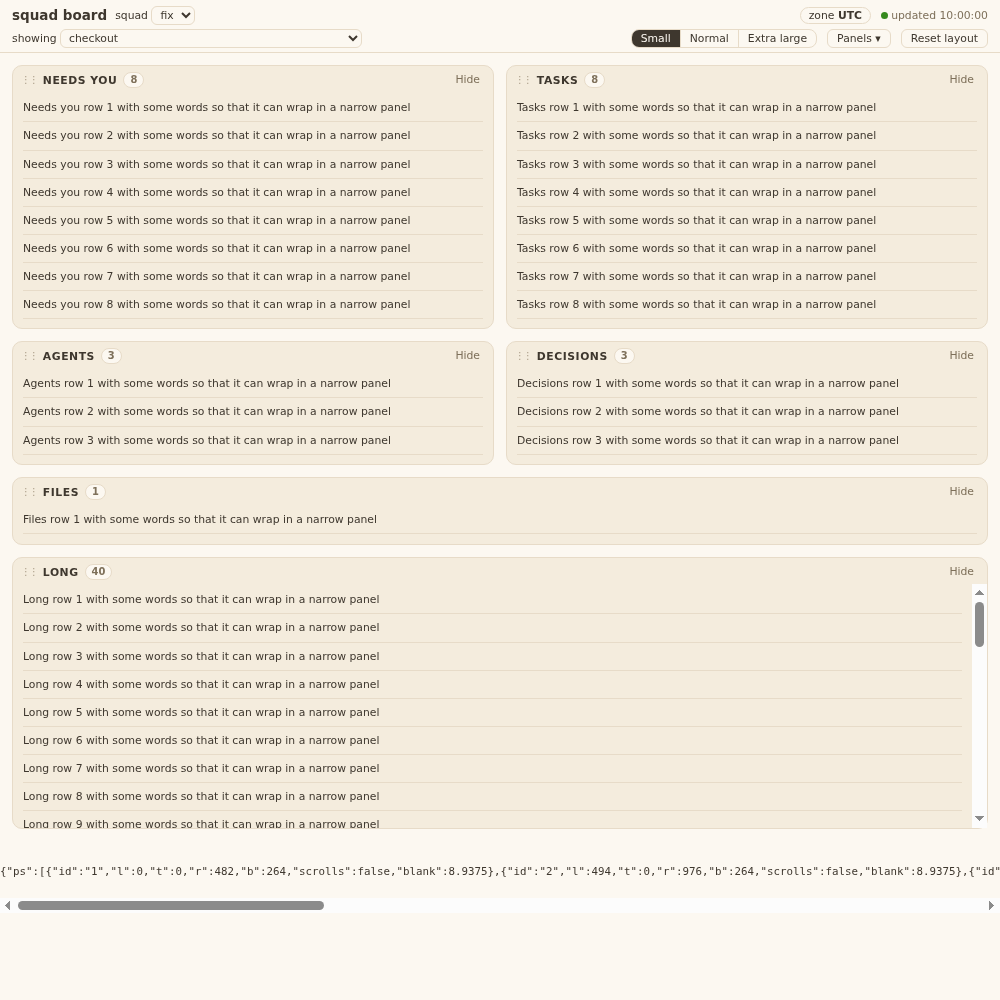

# Evidence 10: page shell and layout

## Behaviour
Run: `cd tests && python3 -m unittest test_squadboard_page` (19 tests, headless Chrome on a harness page that loads the real `templates/board/*.js`; the API JSON comes from a real squadboard server on the ticket-02 fixture).

Shots (harness page with six test panels of 8, 8, 3, 1, 3 and 40 rows; the real page shows the same shell with panels from tickets 11 to 13):

- AC3 to AC9: at Small, Normal and Extra large (1440) and Small and Extra large (1000): nothing overlaps, no blank band over 16 px under the last row of a non-scrolling panel, every panel's right edge meets the page edge or the next panel one gutter (12 px) later, the 40-row panel scrolls inside, no sideways page scroll.
- AC1, AC2, AC7: a synthetic drag (ghost shown) and an east-edge resize change order and span; the saved body has no key `x|y|top|left|px|row` and passes the real `squadboard_ui.validate`; a second page started from that body shows the same order and span; Hide then "Show Tasks" from the Panels list; Reset layout returns the default. The banner slot is outside the panel list (no hide, no drag).
- AC13 to AC15: `titleFor` gives `(3) board` / `board`; `fmtTime` with the zone passed in: 09:00 at +07, `23:30Z` is the next day, Asia/Kolkata gives `+05:30`, an unreadable zone gives `UTC`; New York offsets differ by date (DST); ages 20 s, 3 h, 3 d, and null is "age unknown".
- AC16: a fake-clock poller: failures 1, 2, 3 mark "not updating", one success resets, a load still running is not started again; interval 5000 ms. The real server serves the four files and the shell shows `updated hh:mm:ss`, the zone chip and the tab title `fix` on the fixture.
- AC17: a response with `unknown` and no data renders `unknown: <source>`, never the panel's empty text; an unknown `schema_version` shows `unknown: board version`.
- AC11, AC12: no percent sign in `board.js`, `layout.js`, `index.html` (grep: 0 hits); the only CSS rules using mango are `.count.hot` and `.chip.need`.
- AC10, text-size persistence: font is saved as `small|normal|xl` in the same state body.

Not built here (later tickets): the panels, the permission banner content (slot `setBanner`), the richer picker (11).

Touched: `templates/board/index.html`, `board.css`, `board.js`, `layout.js`, `tests/test_squadboard_page.py` (all new).
Greps: `grep -rl 'templates/board|squadboard\b' tests/` hits `test_squadboard_server.py`, `test_squadboard_ui.py`, `test_squadboard_page.py` (run, pass); also test_windows_safe, test_no_bare_bash, test_old_language_inventory pass (55 tests OK).
`%` hits in page scripts: none. `innerHTML` and friends: none. `method`: only `"PUT"` (to `/api/ui`, with the token header).

## Return 1 fixes (QA whitebox F1-F4)
- F1: a load remembers its query; `onOk` drops a result whose query is no longer the page's; the poller runs one more load right after the current one when asked meanwhile (`now()` while busy is queued, never two at once). Test: held fetch for the old choice, `setChoice`, release: the panel shows the new choice's rows.
- F2: startup (session token, squads, saved state, choice) is `boot()`, run from the poller's load until it has worked once; a failure counts like any failed refresh. "updated" shows only after a load that filled the panels. Test: `/api/session` fails once, then the panels fill and the header says updated.
- F3: `auto` is added to the documented state shape (docstring of `bin/squadboard_ui.py`, one line; no code change). The body stays valid for the real validator (tested).
- F4: removed the no-op `S.needs = S.needs`, the duplicate `query()` branch, the repeated squad filter, and the unused `st0` in `layout.js`.
Run: test_squadboard_page, test_squadboard_ui, test_squadboard_server, test_windows_safe, test_no_bare_bash, test_old_language_inventory: 76 tests OK.
