# Evidence 11 page picker and views

## Behaviour
Code sha `1ec200c`. New `templates/board/panel_scopes.js` (picker, header context line, switcher sheet, opening order, "Scopes of this goal" panel). Run on the ticket-02 fixture through a real squadboard server (routes of 04).

| Screen | Shot |
|---|---|
| Picker: Open rows (needs-you first), Done (20) collapsed, search, no task/inbox/work-time panel | 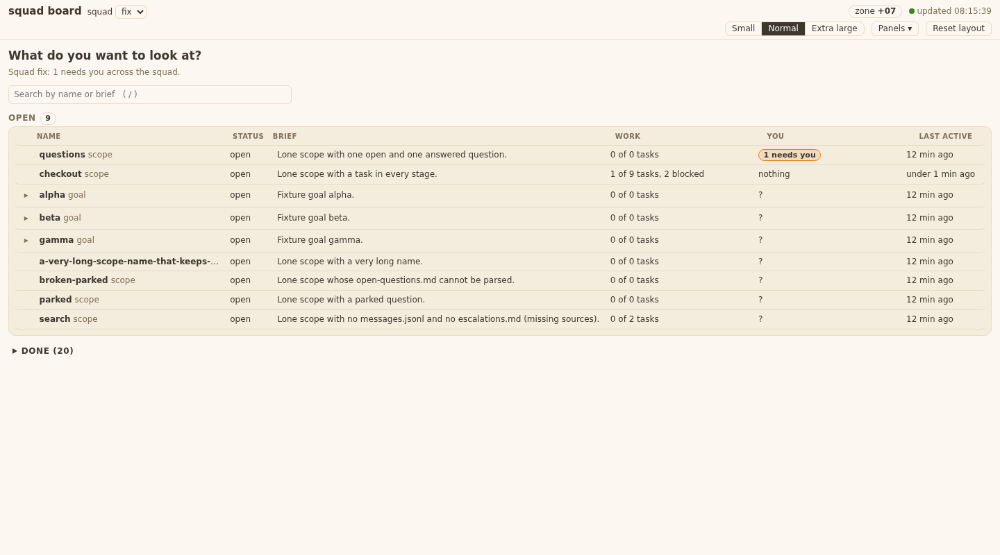 |
| Search with no match: `Nothing matches 'xyz'` | 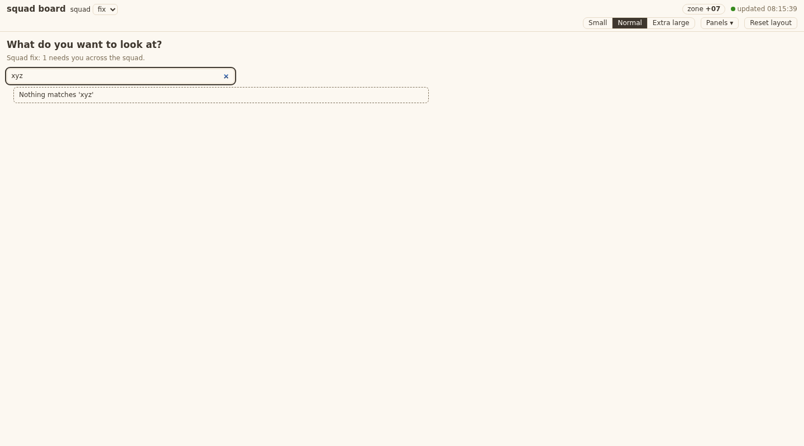 |
| `#/scope/nope`: picker with "scope nope not found" | 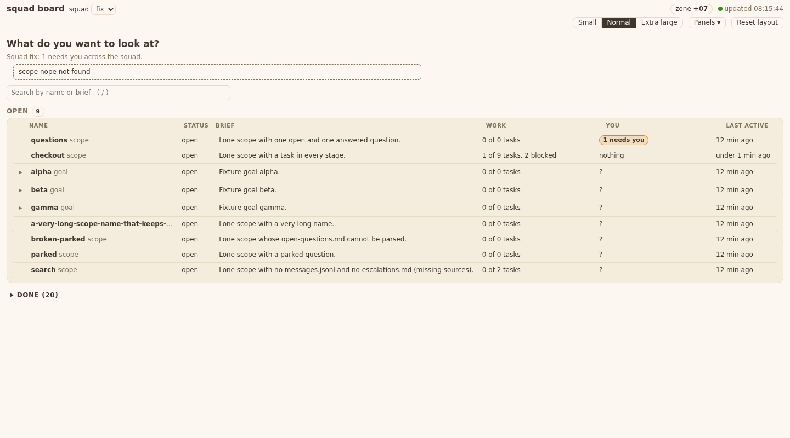 |
| Goal view: Scopes strip (brief, stage, needs you, blocked, tasks x of y, last active) |  |
| Click a scope in the strip: `goal alpha > scope alpha-api`, link up | 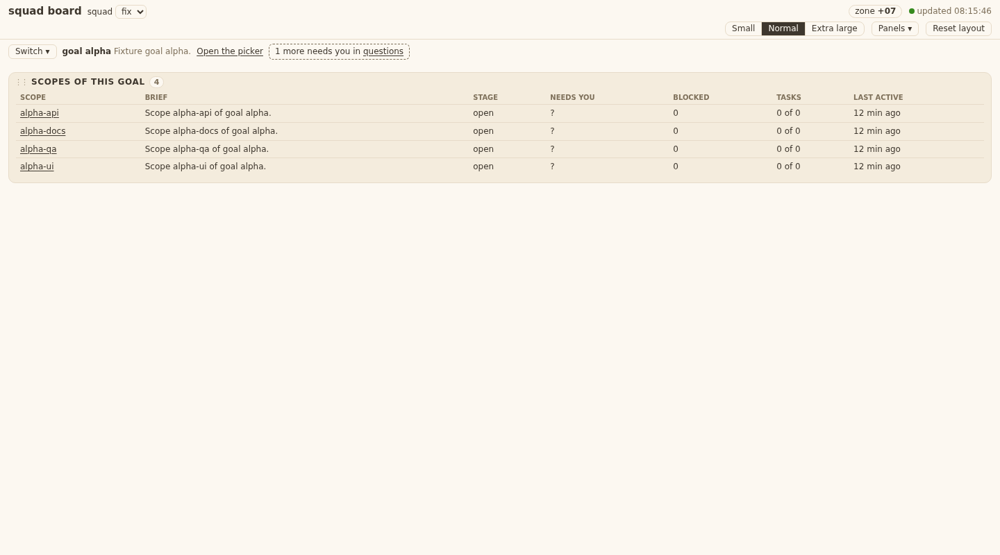 |
| Lone scope: "(no goal)", "1 more needs you in questions" | 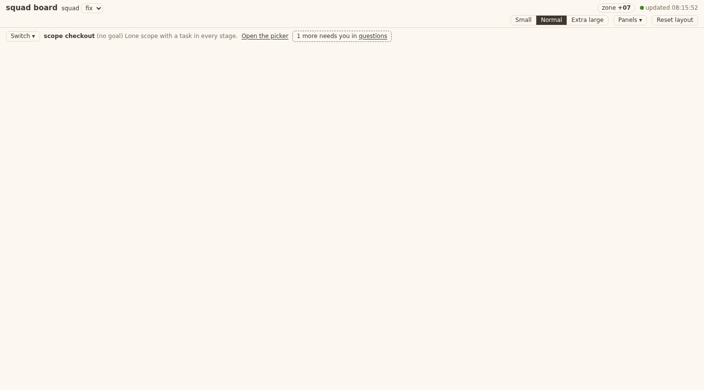 |
| Closed scope: read-only "closed", link to picker | 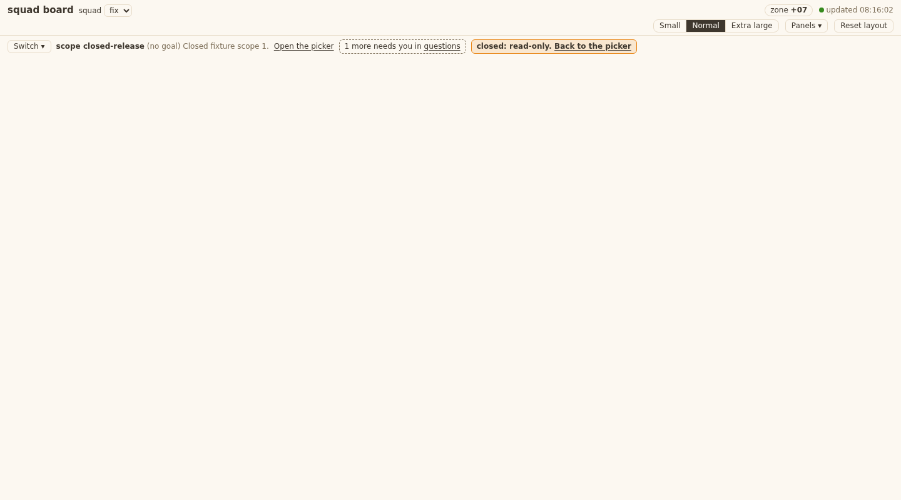 |
| Switcher sheet (Esc closes) | 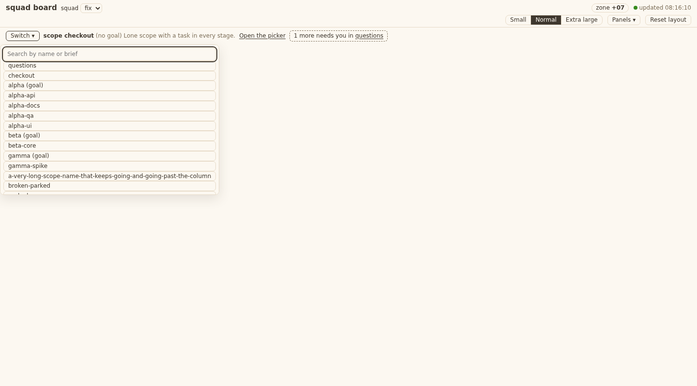 |

- Opening order flag > URL > saved choice > picker (T11.AC7-AC11) is the pure `BOARD.openingOrder`; saved/URL names are checked against the picker lists, else `/api/squads?check=NAME`. Names never reach `innerHTML` (`#/scope/` shows "not found", `window.__x` stays undefined).
- Back returns to the picker: a user choice does `history.pushState('#/scope/S')`; a refresh never pushes (test: 3 ticks, `history.length` unchanged).
- Chosen scope closes while open: the page shows "closed: read-only. Back to the picker", no error.
- Picker row build: one DocumentFragment per list, under 300 ms measured in the harness.
- Stage column = row `status` (open/done): the API has no separate stage field.

## Design match fixes (return of 11: QA blackbox D1-D9), code sha 86315b8
Run live on the fixture (real squadboard server), 1440 px. Pictures compared: `v4-picker-expanded.png`, `v4-combobox-open.png`, `v5-goal.png`.

| Item | Fix | Shot |
|---|---|---|
| D1 Sort | Segment "Last active / Needs you / Name" next to the search. Default is **Needs you**, because AC1 says Open rows are needs-you first (the design picture shows Last active pressed). | 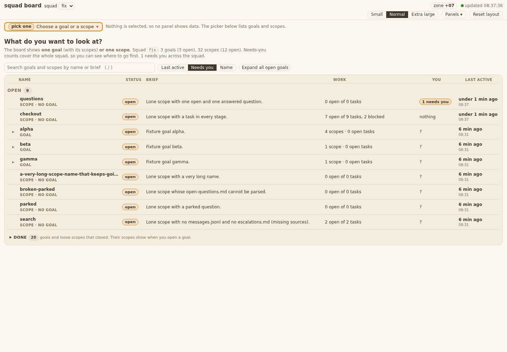 |
| D2 Collapse all | Button "Collapse all goals" / "Expand all open goals" (hidden while searching). | 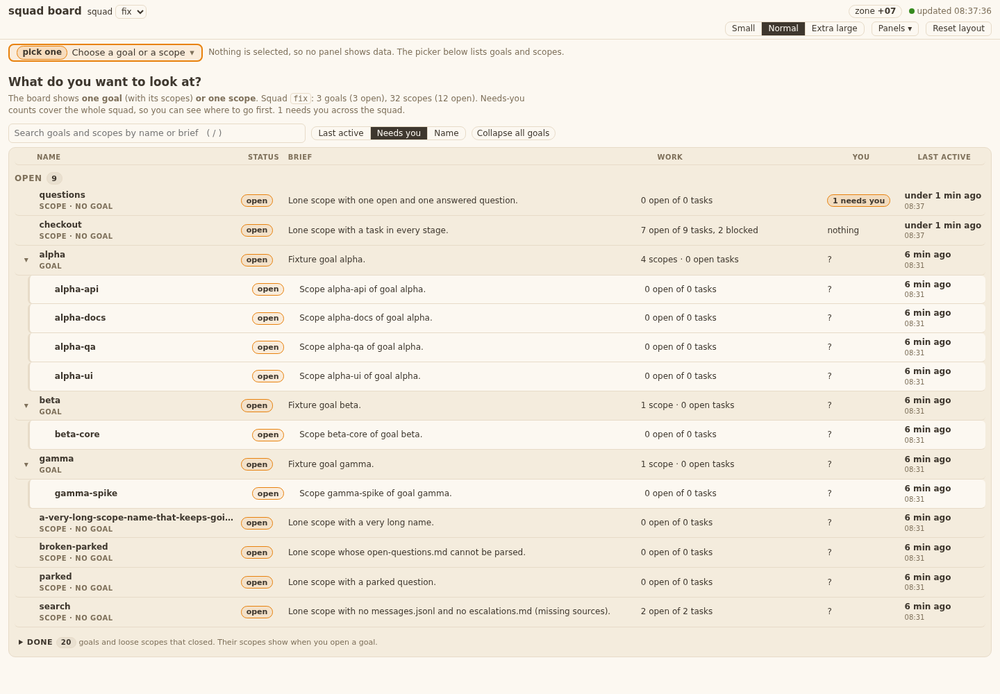 |
| D3 Status chip | `open` / `done` chips in rows, header and strip (tokens `--t-need2`/`--mango`, `--t-work`/`--work`). |  |
| D4 Name cell | Second line "SCOPE · GOAL X", "SCOPE · NO GOAL", "GOAL". |  |
| D5 Last active | Age on line 1, clock on line 2 ("08:37", "Nov 1 14:22" when older than a day); also in the strip. | 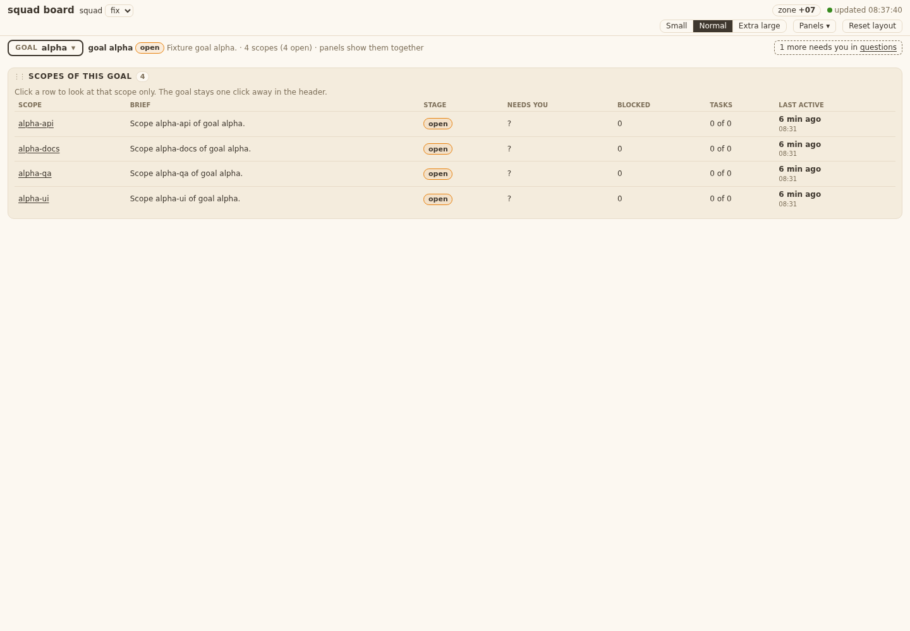 |
| D6 Texts | Intro ("The board shows one goal ... or one scope. Squad X: n goals (m open), ..."), Recent and Open and Done count badges, "what you opened last", Done hint. Work column "N scopes (M open) · K open tasks" / "X open of Y tasks". Done summary is `Done` + badge (aria-label "Done (20)"). |  |
| D7 Header combobox | One button "SCOPE x ▾" / "GOAL x ▾" / "pick one"; opens a combobox: search, groups Recent / Open (goal with its open scopes) / Done (collapsed), needs-you chips, ages, footer "Open the picker · ↑ ↓ Enter · Esc"; search gives Goals / Scopes groups. ARIA combobox, arrows, Enter, Esc. | 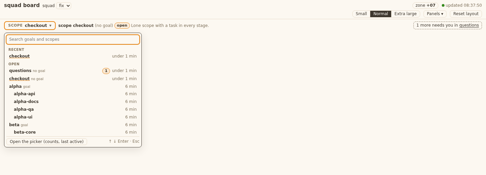 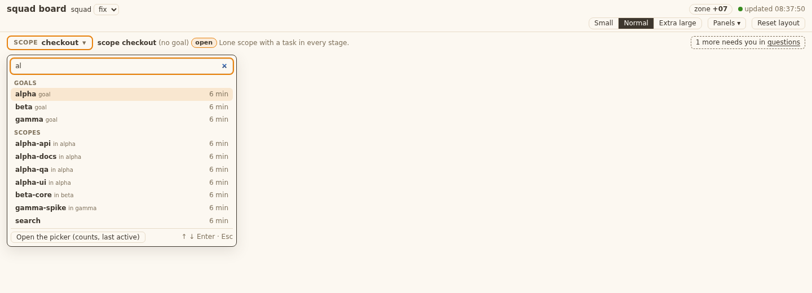 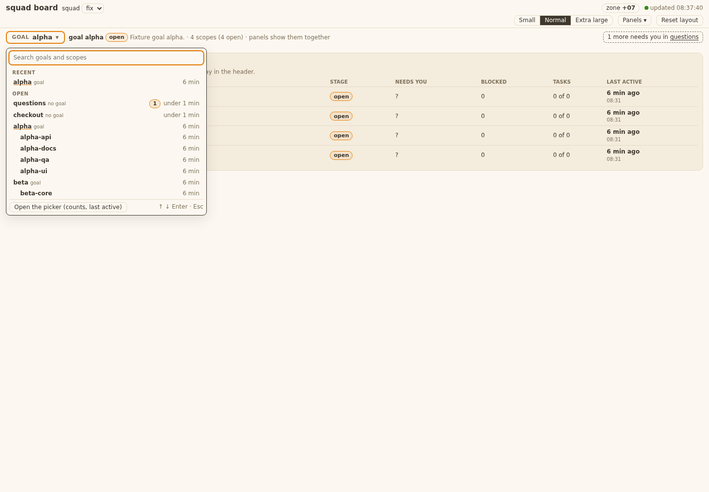 |
| D8 First row cut off | List is its own scroll box under the search input; first row is fully visible (test checks its top against the input bottom). |  |
| D9 Goal header and strip | Header: status chip and "4 scopes (4 open) · panels show them together". Strip: line "Click a row to look at that scope only...", rows clickable, clock line under last active, stage chip. |  |

- Picker with no choice also shows the header button "pick one / Choose a goal or a scope" and the line "Nothing is selected...". Empty squad ("This squad has no goal and no scope") and unknown sources notes are drawn; no-match adds "This squad has n goals and m scopes" and a Clear search button after the AC4 text. Loading and stale are not drawn by this module (the page's own "updated / not updating" status covers them).
- Approved extras kept: "N more need you in X", closed read-only bar, Panels menu hooks, squad-wide needs sentence.
- Not matched on purpose: the combobox is a new `.combo` (was `.sheet`); in Recent a loose scope has no "no goal" tag.
- Test added: `test_T11_design_D1_D9_picker_sort_chips_two_lines_and_combobox`; three existing assertions changed for the new markup (Done badge, one list with Recent inside, strip header text).

## Tests
- New `tests/test_squadboard_panels.py` (Pure, Picker, Opening, Header, ByView, Static): 18 tests, named by AC id.
- Re-ran ticket 10's `tests/test_squadboard_page.py` after the board.js edit (DECISION 11): pass. One assertion changed there: the template file list now includes `panel_scopes.js`.
- Together 39 tests pass. Also pass: test_windows_safe, test_no_bare_bash, test_old_language_inventory, test_squadboard_list.
- TC.11 grep `grep -rl 'templates/board\|board\.js\|index\.html\|panel_scopes' tests/` hits: test_squadboard_page.py, test_squadboard_panels.py (both run), test_squadreport_rollup_ui.py, test_squadreport_rollup.py (run, pass; they match `index.html` of the report, not the board).

## board.js hunks (all approved: DECISION 11 and FINAL 11)
`BOARD.hooks` object; `#view` slot; canvas hidden with no choice; `hooks.paint`; `hooks.data` call in onOk; `hooks.flags` + `d.initial || flags()` (data.initial is gone since 04); `hooks.boot` in boot() (old first-scope fallback kept when no hook); `BOARD.ctx`; byView: renderPop filter, snapshot, resetLayout.
Touched files added by approval: `templates/board/index.html` (one script line), `tests/test_squadboard_page.py` (one assertion).

## Notes for the QAs and tickets 12/19
- The needs-you total in the picker and the tab title bridge is a client sum of open-row `needs_you` (hooks.data sets `S.needs` only when no server count is there). When 05's `count_squad` exists, board.js `needsFrom` overrides it: ticket 12/19 wires it.
- "N more need you in X" is per row from the picker rows (05's `others` will replace it).
- Static literal: one `<style id=view-css>` block in `panel_scopes.js` (tokens as `var(--x)`, no data).
- Scratch: none left in /tmp (browser sessions closed, the two live servers stopped).
