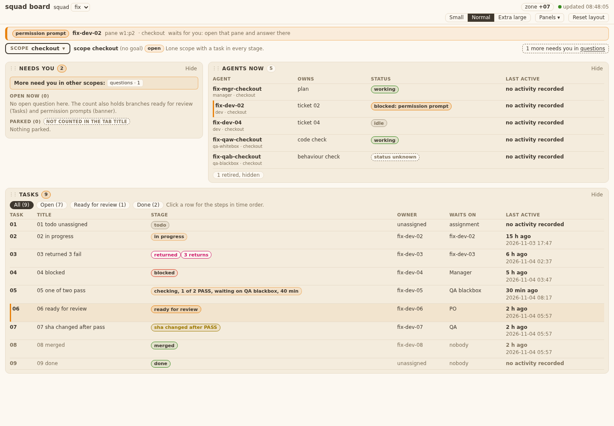
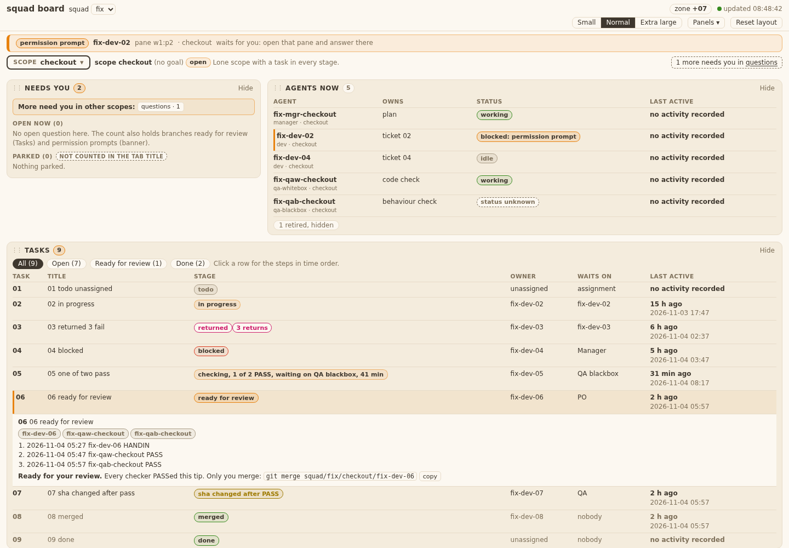
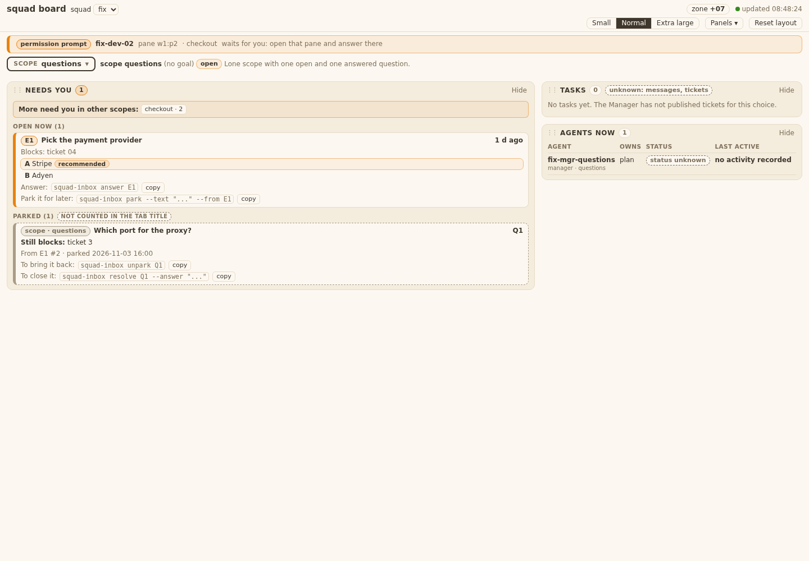
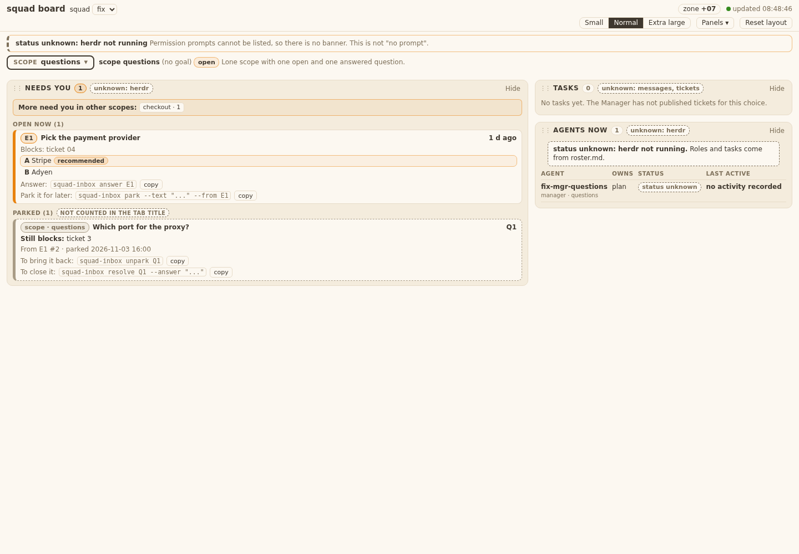

# Evidence 12 page needs you, tasks, agents

## Behaviour
Real server on the ticket-02 fixture (`squad-board --scope checkout`), Chrome 1440 px, light Mango Parrot tokens only.
- T12.AC1/AC3: scope `questions`: row E1 with title, age ("1 d ago"), "Blocks: ticket 04", options A Stripe (recommended mark) and B Adyen (no mark).
- T12.AC2: test with an empty inbox shows "Nothing needs you".
- T12.AC4: "Parked (1)" group; the row names "Still blocks: ticket 3", `From E1 #2`, parked time. Tab title uses the server's `count_squad` (test: payload says 7, title "(7) ..."); the bridge sum from ticket 11 is overridden by `needsFrom`, no board.js edit was needed.
- T12.AC5: `squad-inbox answer E1` is shown; the copy control writes exactly that text (test spies `navigator.clipboard.writeText`).
- T12.AC6: banner has one line per blocked agent with agent and pane; herdr down shows "status unknown: herdr not running".
- T12.AC7/AC9: Tasks shows a row for every stage (todo, in progress, returned, blocked, checking 1 of 2 PASS, ready for review, sha changed after PASS, merged, done) with id, title, stage, owner, waits on, last active; the ready row is tinted and counted.
- T12.AC8: click a row: agents, steps in time order (UTC zone in the test), FAIL reason line first; second click or Esc closes.
- T12.AC10: no button label, aria-label or title matches answer, park, merge, approve or delete; commands are `<code>` text with a "copy" button.
- Data change (FINAL 12): `data.parked_rows` and `data.parked_warnings` added to `/api/inbox` (additive, schema_version 1); files `bin/squadboard_inbox.py` and `tests/test_squadboard_inbox.py` are outside the ticket's touched-files list, approved by the Manager.
- Registration: no board.js edit. Panels register themselves; `index.html` has one script line per panel.

## Tests run
`test_squadboard_panels`, `test_squadboard_page`, `test_squadboard_inbox`: 59 pass. Grep rule (`templates/board`, `index.html`, `panel_scopes`): hits are these three files plus unrelated report tests (`index.html` of the report), not affected.
