# Evidence 12 page needs you, tasks, agents

## Behaviour
Real server on the ticket-02 fixture (`squad-board --scope checkout`), Chrome 1440 px, light Mango Parrot tokens only.
- T12.AC1/AC3: scope `questions`: row E1 with title, age ("1 d ago"), "Blocks: ticket 04", options A Stripe (recommended mark) and B Adyen (no mark).
- T12.AC2: test with an empty inbox shows "Nothing needs you".
- T12.AC4: "Parked (1)" group; the row names "Still blocks: ticket 3", `From E1 #2`, parked time. Tab title uses the server's `count_squad` (test: payload says 7, title "(7) ..."); the bridge sum from ticket 11 is overridden by `needsFrom`, no board.js edit was needed.
- T12.AC5: `squad-inbox answer E1` is shown; the copy control writes exactly that text (test spies `navigator.clipboard.writeText`).
- T12.AC6: banner has one line per blocked agent with agent and pane; herdr down shows "status unknown: herdr not running".
- T12.AC7/AC9: Tasks shows a row for every stage (todo, in progress, returned, blocked, checking 1 of 2 PASS, ready for review, sha changed after PASS, merged, done) with id, title, stage, owner, waits on, last active; the ready row is tinted and counted.
- T12.AC8: click a row: agents, steps in time order (UTC zone in the test), FAIL reason line first; second click or Esc closes.
- T12.AC10: no button label, aria-label or title matches answer, park, merge, approve or delete; commands are `<code>` text with a "copy" button.
- Data change (FINAL 12): `data.parked_rows` and `data.parked_warnings` added to `/api/inbox` (additive, schema_version 1); files `bin/squadboard_inbox.py` and `tests/test_squadboard_inbox.py` are outside the ticket's touched-files list, approved by the Manager.
- Registration: no board.js edit. Panels register themselves; `index.html` has one script line per panel.

## Known limits and differences from the design
- Tab title: `/api/inbox` needs a choice (400 without), so the picker keeps the ticket 11 client sum until a choice is selected. Manager to know.
- AC3 now shows "Manager recommends" (QA blackbox fix).
- The top line "N more need you in <scope>" now uses the same `/api/inbox` `others` data as the panel (`BOARD.inboxOthers`, set by `panel_inbox.js`; `otherNeeds` in `panel_scopes.js` reads it); the picker-derived sum is used only before the inbox answers. Test: header and panel agree in scope questions and checkout. Extra file: `templates/board/panel_scopes.js`.
- Headline of other scopes counts items (sum of chips); the count line explains branches ready for review.
- Other scopes are one chip per scope, not per item: the payload `others` has `{scope, n}` only. Added an "Open the picker" button.
- Approved by the Manager (FINAL 12), data-limited: no "Agents involved" column in Tasks (agents are in the task detail, AC8; ticket 20 drops it from its column list unless data exists); no permission prompt text, "Blocks:", "waiting N min" (banner = agent and pane, AC6).
- AC10: no "Park: copy command" button; the command is text with a "copy" button.
- Not built (no data in the payload): ready-for-review item in Needs you.
- "retired" is a button styled as a disclosure.
- `board.js` diff is 0 lines (TA1 says 3): panels self-register via `BOARD.registerPanel`.
- Files outside the touched list: `bin/squadboard_inbox.py`, `tests/test_squadboard_inbox.py`, `templates/board/index.html`, `tests/test_squadboard_page.py`.
- Screens: the empty, inbox-unknown and herdr-unknown states are covered by tests, not new screenshots.

## Tests run
`test_squadboard_panels`, `test_squadboard_page`, `test_squadboard_inbox`: 91 pass (also `test_squadreport_rollup`, `test_squadreport_rollup_ui`, the grep hits). Grep rule (`templates/board`, `index.html`, `panel_scopes`): hits are these three files plus unrelated report tests (`index.html` of the report), not affected.

## QA whitebox review

### QA whitebox 12 (needs you, tasks, agents), sha 9728aa8: PASS
Clone: /tmp/tmp.cpn4pYWjxd/r (scratch, not deleted). Own diff = 1770fe8..9728aa8 (the branch also carries the integration merges 05-08/19 already passed). Presentational values left to QA blackbox (REV-18a).

| AC | Result |
|---|---|
| TA1 | Panels self-register with `BOARD.registerPanel` (panel_*.js); board.js diff is 0 lines (TA says 3): better than the AC, accepted. index.html 1 script line each. Cut test passes (no panel_agents.js) |
| TA2 | `rowsForInbox`, `rowsForTasks`, `rowsForAgents` are pure on BOARD; test asserts open/parked order, labels "Open now (n)", "Parked (1)", `recommended` word only on the flagged option |
| TA3 | `answerCommand/parkCommand/unparkCommand/resolveCommand` take only the id; `copyText` returns the exact `data-copy` string; test: title `$(rm -rf /) "x"` not in any `<code>`; buttons are labelled "copy"; flags in park/unpark/resolve match `bin/squad-inbox` usage |
| TA4 | Detail uses the `detail` payload, `fmtDate/fmtTime`; Esc handler and body click handler registered once; test opens/closes 10 times, addEventListener calls < 12 |
| TA5 | `bannerLines`: "status unknown: <reason>"; test: 2 lines kept when the choice changes |
| TA6 | Header and tab count from `count_choice`/`count_squad`; Static12 test: no summed count. (Tasks panel header count is its own row count, not the needs-you count) |
| TA7 | retired toggle, no request (test) |
| TU.3/4/5 | grep innerHTML/eval/https/method over `panel_*.js`: nothing; no hex in panels; only copy via clipboard, no write calls |
| Data (FINAL 12) | `parked_rows`/`parked_warnings` additive in `/api/inbox`; each row has id, status, level, scope, text, from, blocks, parked_iso, resolved_iso, answer, file (REV-6 field shape tested incl. warning on broken block) |

Runs (clone, `cd tests`): panels + page + inbox + rollup_ui + rollup + tasks + agents + park = 118 OK, Chrome ran, 0 skipped.

Notes (not blocking):
- N1: `git merge <branch>` (panel_tasks.js, ready row) puts the branch name from data into the shown/copied command unquoted. Branch names are squad-made, but git allows `;` and `$`. Quote it later or restrict to `[A-Za-z0-9._/-]`.
- N2: when `parked_rows` cannot be read the reader adds `open-questions` to `unknown`; the page then shows the "unknown: open-questions" chip in the header but "Nothing parked." in the body. Header signals it; QA blackbox may judge the wording.
- N3: `tests/test_squadboard_page.py` file-list line is changed by both 12 and 16 (iterdir list): the Manager's merge of the two needs both names (panel_inbox/tasks/agents + timeline).
- Full suite not run yet (SUITE-3b).

#### Re-check 3838fb1 (diff 9728aa8..3838fb1): PASS
Only panel_inbox.js (+test lines, evidence). Word "Manager recommends" only on `recommended:true` option (test updated); other-scope headline sums `n`; note when count_choice > rows; "Open the picker" clicks `#selbtn` (exists, panel_scopes.js:569), label not in the forbidden words. TU.3/TU.4 greps clean. Runs (clone /tmp/tmp.rBWaIBLOD... see /tmp/tmp.rRWBaIBLOD/r): panels+page+inbox+rollup_ui+rollup = 90 OK, Chrome ran.

#### Re-check 28e5d70 (top line uses /api/inbox others)
Clone /tmp/tmp.NgVqlyw9xq (never delete). Changed: panel_inbox.js:213-218, panel_scopes.js:85-90, test T12 header/panel agree, evidence.md.
- Repaint loop: guarded by JSON compare; ctx.paint = paintPickers does not re-render panels, so no loop.
- Key check (kind:name) stops stale others after a choice change; falls back to picker sum before inbox answers and on status unknown.
- New test covers scopes questions and checkout against real fixture data.
- Ran test_squadboard_panels, test_squadboard_page, test_squadboard_inbox (62 OK), test_squadreport_rollup_ui, test_squadreport_rollup: all OK, no skips.
- Note N1: panel_scopes.js is outside the TA file list (declared in evidence). Note N2: tab title still uses the picker sum until a choice is selected (known limit, declared).
Verdict: PASS (needs QA blackbox).

## QA blackbox review

### QA blackbox, task 12 (page: Needs you, Tasks, Agents now), sha 9728aa8

Verdict: **FAIL** (design differences, one list). Behaviour AC pass where tested. Build: `git archive 9728aa8`, fixture `--now`, `squad-board --squad fix --herdr-json ...`, scopes checkout, questions, parked; Playwright 1440 px Normal. For the AC1/AC4 cases I added E3, E4 and one parked question to my scratch copy of `scopes/questions`.

#### AC walk
| AC | What I did | What I saw | Result |
|---|---|---|---|
| AC1 | scope questions: E1; then added E3, E4 | Rows with id, title, age ("1 d ago"; my added rows "age unknown": no seen record), Blocks. Order E1, E3, E4. The "unread item" case was not shown: the fixture has no unread answer | pass for open rows; unread **not tested** |
| AC2 | scope parked | "Nothing needs you / No open question, no answer to read, no permission prompt." | pass |
| AC3 | E1 | A Stripe "recommended", B Adyen no mark | pass |
| AC4 | 3 open + 1 parked | Needs you 3 open, "Parked (1)", row names "Still blocks: ticket 12", parked time. Tab "(5) fix" = 3 open + 2 in checkout; parked not counted | pass |
| AC5 | Clicked copy of E1, pasted into a text box | Pasted text is exactly `squad-inbox answer E1` | pass |
| AC6 | Two blocked agents; herdr down | Two banner lines (agent, pane, scope), under every choice. Herdr down: "status unknown: herdr not running" | pass |
| AC7 | scope checkout, 9 tasks | id, title, stage, owner, waits on, last active in ticket 07 words (todo ... done) | pass |
| AC8 | Clicked row 03, again, Esc | Detail with agents and 6 steps in time order, local +07 times, FAIL reason first; second click and Esc close it | pass |
| AC9 | Task 06 | "ready for review", row tinted, counted in the Needs you number | pass |
| AC10 | All buttons and labels | Only copy, Hide, Fit, filters; commands are text | pass |

#### Design differences (design-v5, `img/v5-normal.png`) found in one pass
1. Tasks has no "Agents involved" column (design has it, with PASS/FAIL chips per agent).
2. Needs you: items of other scopes are one chip per scope ("checkout · 3"); design has one button per item ("E8 · board-cli") and an "Open the picker" button.
3. The headline counts scopes ("1 more needs you ...: checkout · 3") while the chip counts items. With checkout open it reads "1 more" next to "3"; in scope parked "2 more need you" next to chips 2 and 1. The numbers disagree.
4. Permission prompt item and banner lack the prompt text, "Blocks: ..." and "waiting N min" of the design (herdr list has no prompt text: if the data cannot give it, the Manager may approve).
5. Option label is "recommended"; design says "Manager recommends" (AC3 wording is fine either way).
6. Checkout: Needs you shows 2 but lists 1 row, nothing says why (the second is the ready-for-review branch; the "count also holds branches ready for review" note shows only when 0 rows).
7. Design shows "Park: copy command" as a button; built has a command text plus copy (accepted if the Manager agrees; AC10 holds).
Screens: 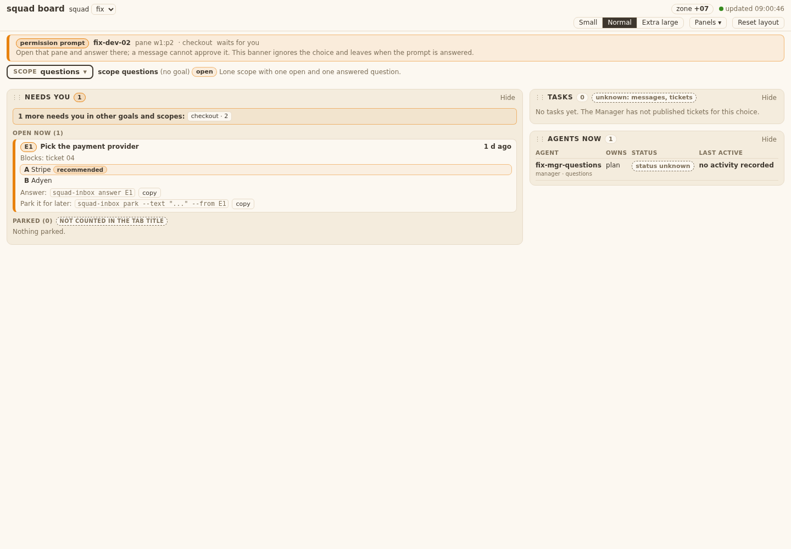 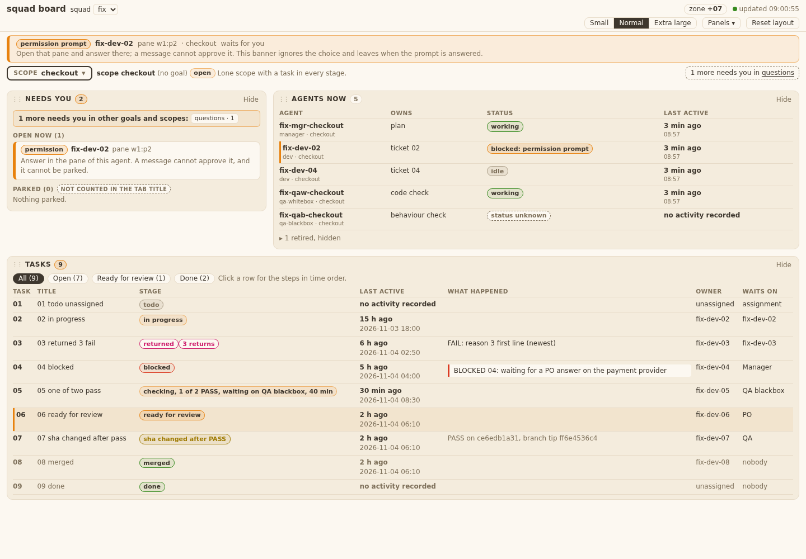 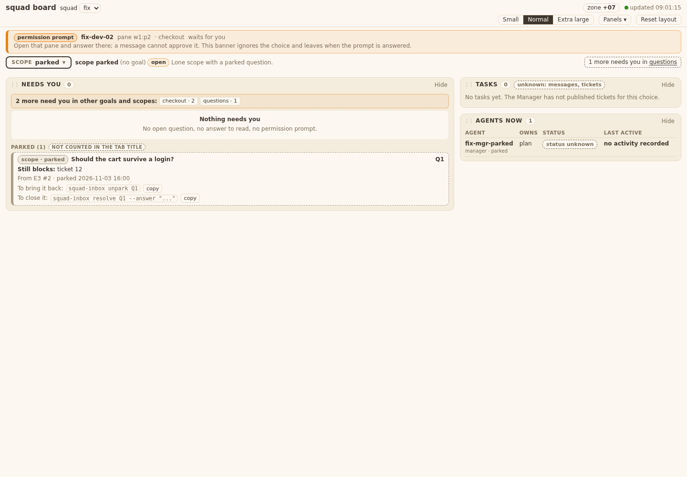 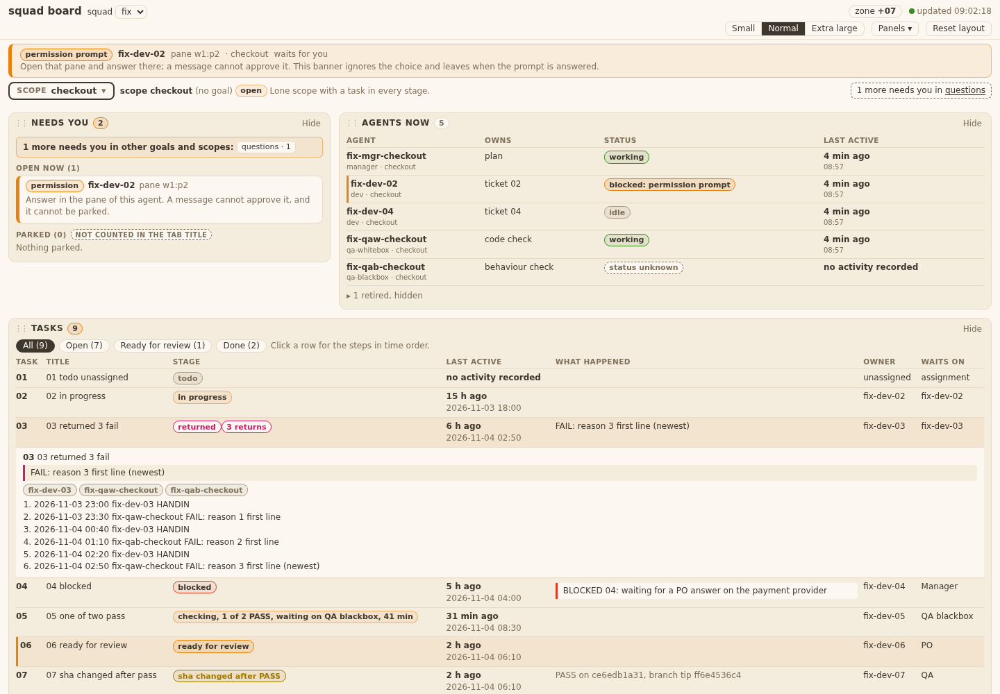 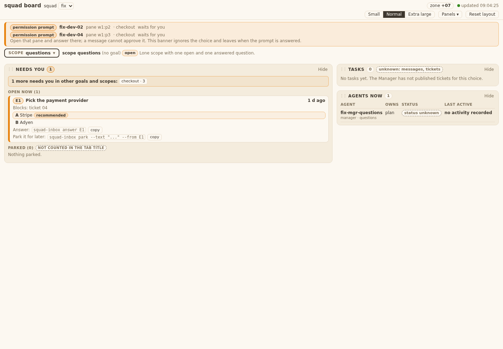 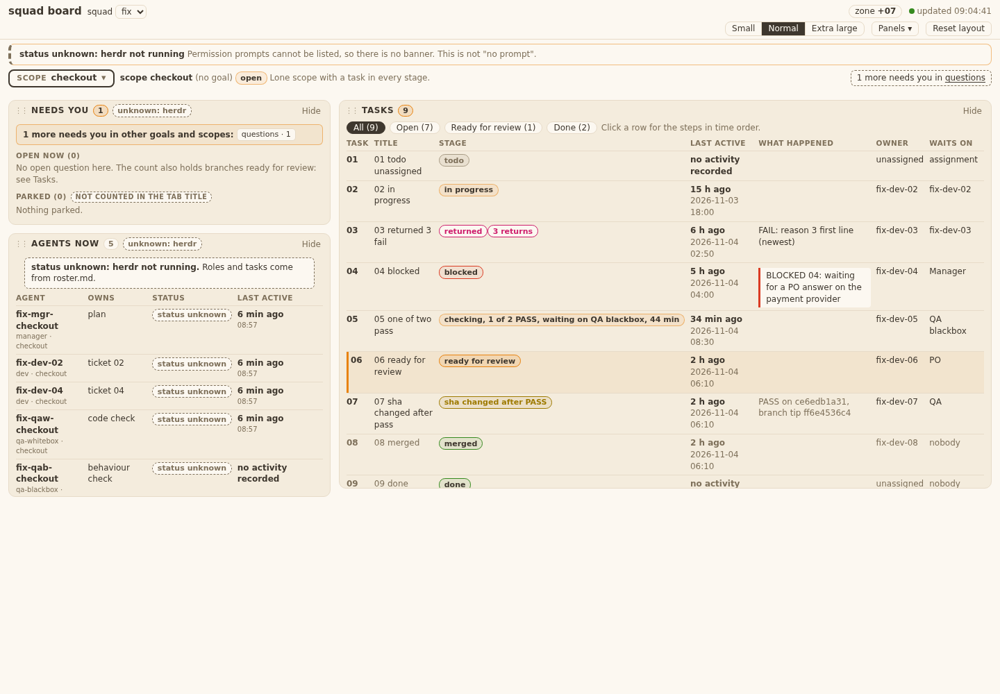 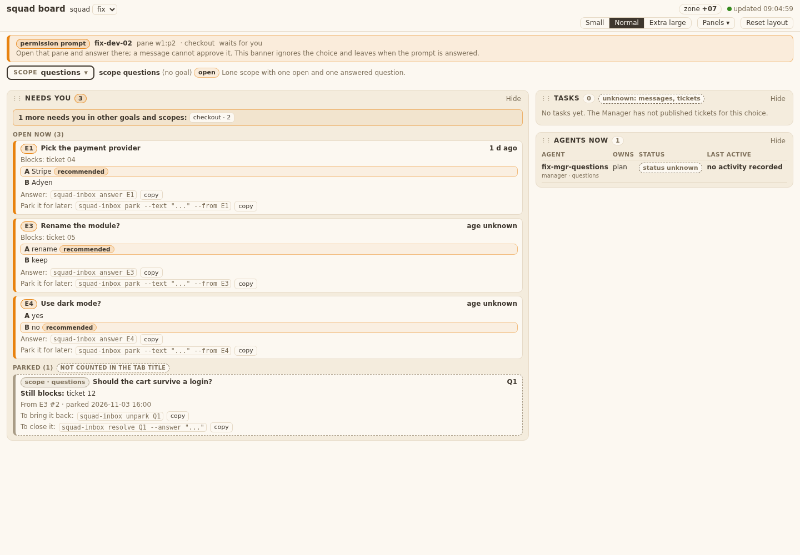
Scratch for PO: /tmp/qb12.NZPQ, /tmp/board-fixture-b6e0_dx_, /tmp/qb12*, /tmp/qb16-img.

---

### Re-check at 3838fb1 (items 3, 5, 6; items 1, 2, 4, 7 accepted by Manager FINAL 12)

Build: `git archive 3838fb1`, new fixture `--now`, `squad-board --squad fix --herdr-json ...` port 18798, Playwright 1440 px.

| Item | What I saw | Result |
|---|---|---|
| 5 label | scope questions, E1: "A Stripe  Manager recommends", "B Adyen" | fixed |
| 6 count vs rows | scope checkout: Needs you 2, one row (permission) and the line "The count of 2 also holds 1 branch ready for review: see Tasks." | fixed |
| 3 numbers agree | Panel headline now counts items and agrees with its chips: scope parked "3 more items need you in other goals and scopes: checkout · 2, questions · 1"; scope questions "2 more items ... checkout · 2". **But** the top-right line of the same screen reads "1 more needs you in questions" in scope parked (3 vs 1), and in scope questions there is no top-right line at all (panel says 2). In checkout both say 1 (agree). | **not fixed** |

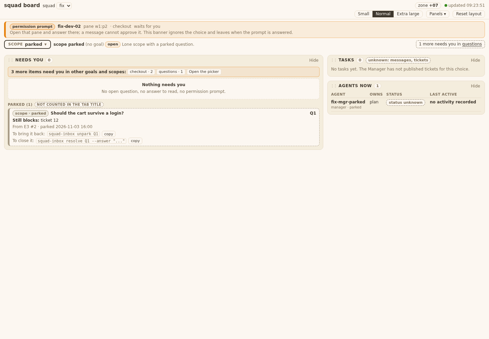
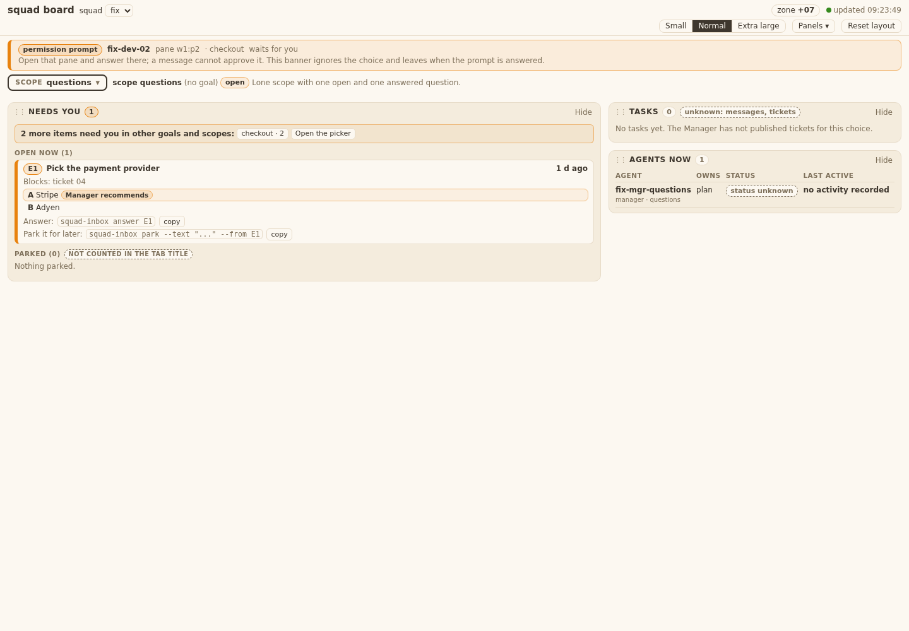
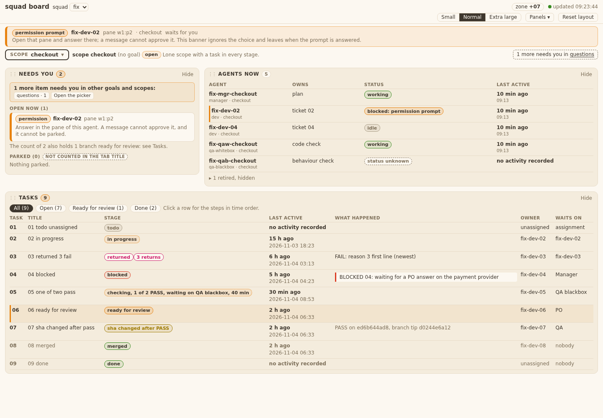

Verdict: **FAIL** 3838fb1, one finding: two "more needs you" counts on one screen disagree (T05.AC8 says a ready-for-review branch of another scope counts in "N more need you in <scope>"; the top-right line leaves checkout's 2 out). Re-check: that line only.
Scratch for PO: /tmp/qb12b.57J7, /tmp/board-fixture-rb672a7w, /tmp/qb12b*.

---

### Re-check at 28e5d70 (item 3 only)

Build: `git archive 28e5d70`, new fixture `--now`, port 18798, Playwright 1440 px.
- scope parked: top-right "2 more need you in checkout" and "1 more needs you in questions" (= 3); panel "3 more items need you ... checkout · 2, questions · 1". Agree.
- scope questions: top-right "2 more need you in checkout"; panel "2 more items ... checkout · 2". Agree.
- scope checkout: top-right "1 more needs you in questions"; panel "1 more item ... questions · 1". Agree.
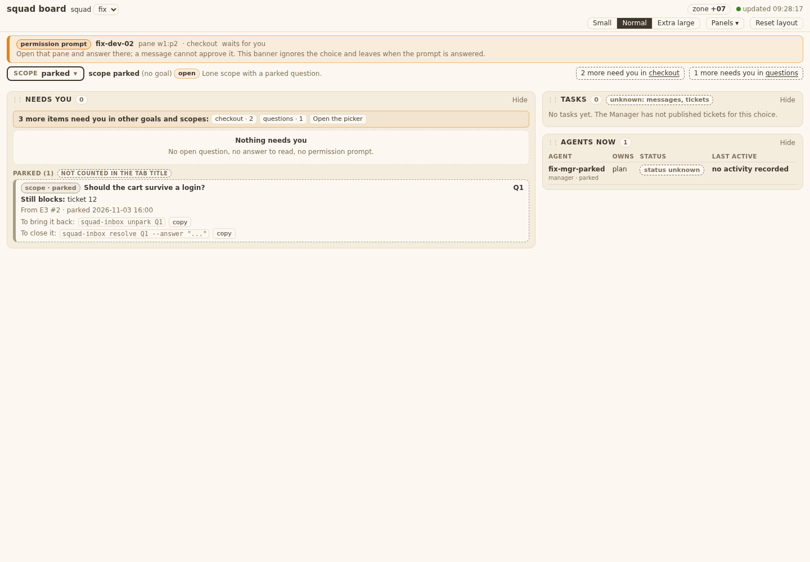
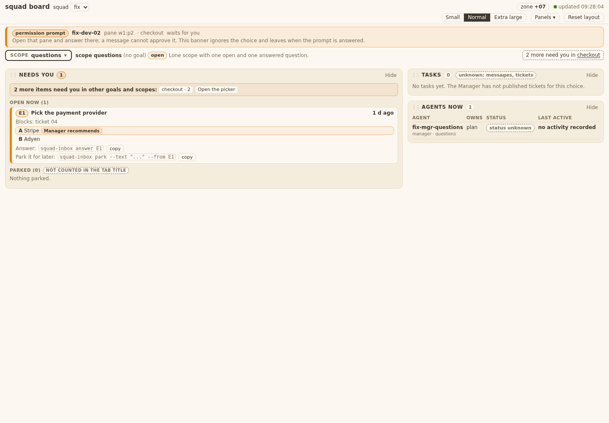
Verdict: **PASS** 28e5d70 (item 3 fixed; items 5, 6 fixed at 3838fb1; items 1, 2, 4, 7 accepted by Manager). Unread-answer case still untested (no fixture data).
Scratch for PO: /tmp/qb12c.4VOT, /tmp/board-fixture-dq5d69nb, /tmp/qb12c*. Server stopped, browser closed.
