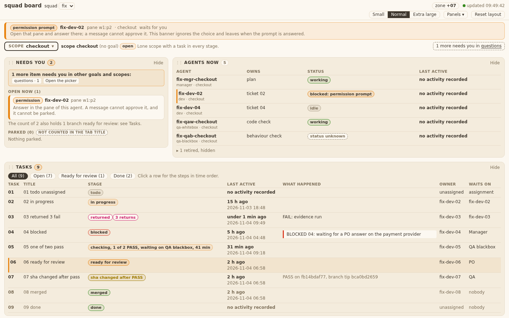
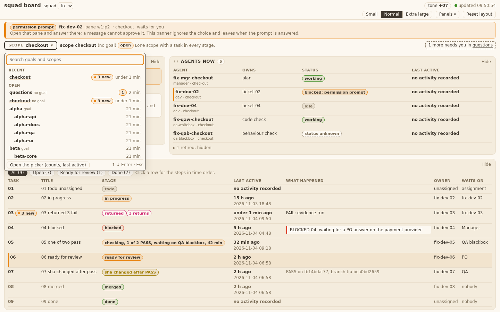
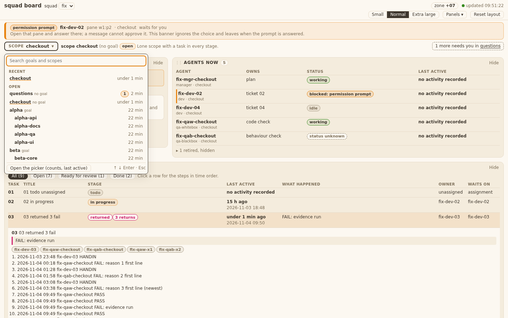
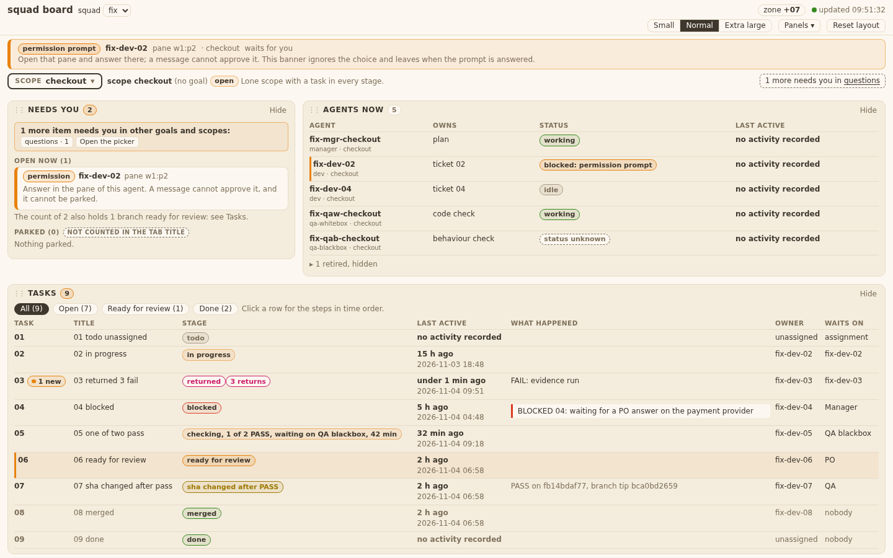

# Evidence 13 page new since last looked

## Behaviour
Real server on the ticket-02 fixture (`BoardServer`, fixture copied with the clock at "now"), real Chrome 1440 px through `playwright-cli`, light Mango Parrot tokens only. Events were appended with `tests/board_fixtures.py append-message`; "away" was done by hiding the tab (`visibilitychange` to hidden) and reloading.
- T13.AC2 first visit: nothing is stored for the choice, so no `since` is sent and no badge shows. 
- T13.AC1: tab hidden (time stored for `scope:checkout`), then 2 PASS and 1 FAIL added to task 03, then the page reopened. Task 03 shows the dot and "3 new"; the other tasks show nothing. 
- T13.AC1 picker row: the scope switcher lists `checkout` with "3 new" (Recent and Open lists). 
- T13.AC3: opening task 03's detail clears its dot; the picker row for `checkout` drops to no badge (3 minus 3). Only that task's count is taken off (test with two tasks: 5 becomes 2). 
- T13.AC4: a new PASS on 03 after the clear brings the dot back as "1 new" (server count 4 minus 3 cleared). 
- Away = the tab hidden or closed (`visibilitychange`, `pagehide`), never the refresh timer. A hidden tab that is closed later does not move the time forward. The time is written when the choice changes, too.
- Storage: browser `localStorage` key `squad-board-seen:<squad key>` only; nothing goes to `board-ui.json`; the only non-GET fetch is still `PUT /api/ui`. Blocked storage: no badge, no error.
- Counts come from the server: `new_count` (tasks) and `new` (picker rows). The page sends `since` (tasks: epoch seconds; `/api/squads` and `/api/scopes`: ISO time, as those readers parse it).

## Design notes (dev)
`design-v5.md` has no screen for "new". Built with existing tokens: a chip with the mango border, a mango dot and "N new" (`.chip.newc`), in the Task cell of a Tasks row, in the Needs column of a picker row, and in the switcher list. Manager to confirm or send it to the Designer.

## Known limits and differences
- Picker rows share one `since`: the one of the open choice (or of the squad on the landing picker). A scope you never opened shows counts since that time.
- Two checkers' messages of one kind within 120 s count once (server rule of ticket 07), so evidence events came from different senders.
- Files outside the "Touched files" list: none apart from `panel_scopes.js` loading goal kids with `since` (one line). `board.js` +105 lines (pure rules and away logic), `panel_tasks.js` +15, `panel_scopes.js` +12.

## Tests run
From `tests/`: `python3 -m unittest test_squadboard_panels test_squadboard_page test_squadboard_inbox` (66 OK; the new ones are `Panels13` and `Static13`). Grep rule `grep -rlE "board\.js|panel_tasks|panel_scopes|templates/board" tests/`: hits `test_squadboard_page.py` and `test_squadboard_panels.py`, both run. `board.js` has no `%` (T10 rule): the dot radius is `999px`.
