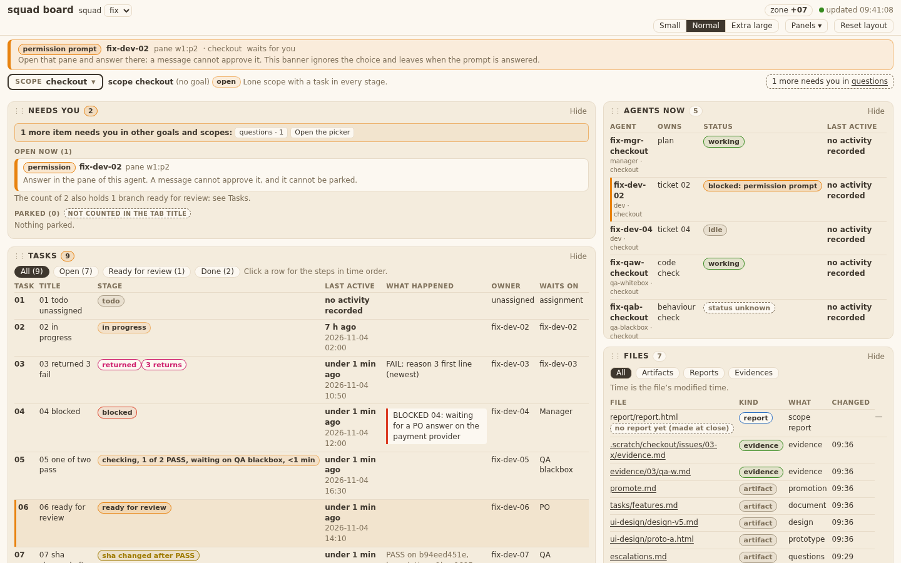
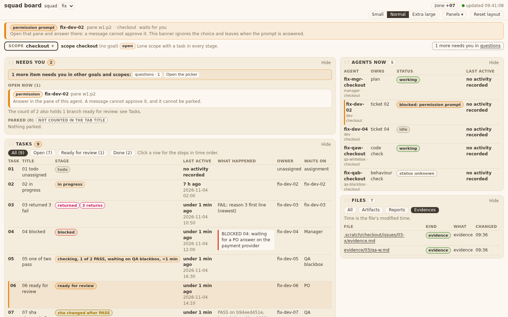
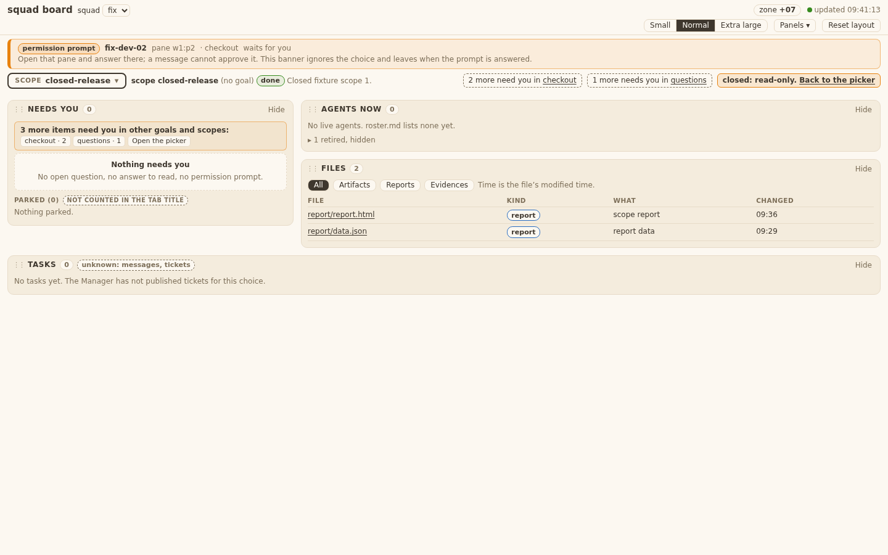
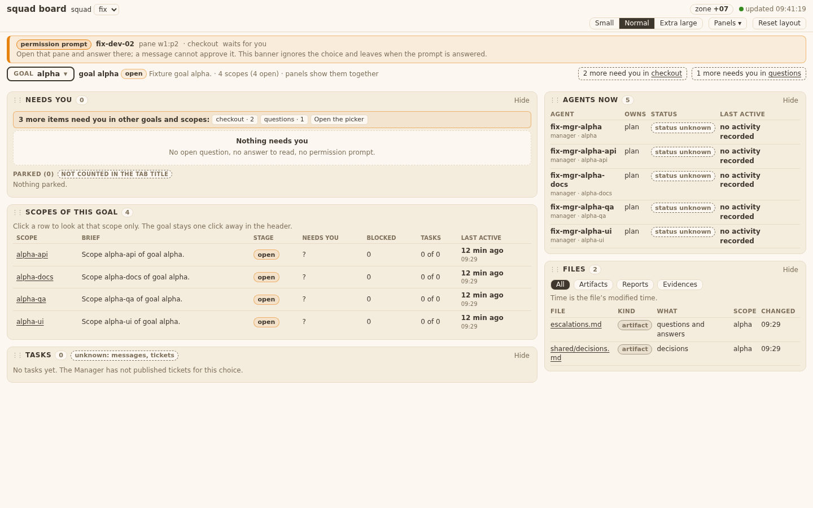

# Evidence 14 files (data + panel)

## Behaviour
Real server on the ticket-02 fixture, extended in a temp copy (`squad-board --squad <fixture> --port 8791`), Chrome 1440 px, light Mango Parrot tokens.
- T14.AC1: a scope with a feature list, a prototype and `promote.md` lists each with file, kind, what, and the file time in the zone of the page (`BOARD.fmtTime`, test `T14_AC1_AC2_TA3`). 
- Filters All / Artifacts / Reports / Evidences. 
- T14.AC2: a click on a `.md` link opens a new tab drawn as headings, lists and tables, no raw `#` marks (built with `createElement`/`textContent`; a `<script>` and `` in the file stay text, `window.__x` stays undefined). An HTML file opens through `/api/file` as a page. 
- T14.AC3: `../` and absolute paths outside the squad folder and `.scratch` answer `{"error": "path not allowed"}` and no content (route of ticket 03; test `T14_AC3`).
- T14.AC4: a live scope without a report shows `report/report.html` with the chip "no report yet (made at close)", first in the list. (same screenshot as the live scope above)
- T14.AC5: a closed scope lists `report/report.html` and `report/data.json`. 
- T14.AC6: an agent HTML page opens with `Content-Security-Policy: sandbox` (no `allow-same-origin`); its `fetch('/api/state')` never runs and the board sees no such request (headless Chrome test `T14_AC6_TA4`). 
- Goal view: `shared/*.md` and `escalations.md`, with the Scope column. 
- No route added: `/api/files` is a new reader route only; `squadboard.py` is not edited. The allow-list is `squadboard._under` (one copy).

## Known limits and differences from the design
- No Owner column (design: off by default): no data says who wrote a file.
- "Scope" column is shown only in a goal view; in a scope view every row has the same scope.
- Kinds in the data are fine (ticket, design, prototype, promote, report, data, evidence, decision, answer, other); the page groups them into artifact / report / evidence for the filter and the chip.
- `escalations.md` is listed as "questions and answers" (kind `answer`); answers are not split out per question.
- The new markdown tab uses system colours, not the board tokens (a new window cannot see them).
- Not listed: ADRs, messages, inbox, roles, locks (tests).

## Tests
`tests/test_squadboard_files.py` (8), `test_squadboard_panels.py` Panels14 + Static14 (5), `test_squadboard_page.py` (file-list line, +1 name). Also run: `test_windows_safe`, `test_no_bare_bash`, `test_old_language_inventory`, `test_squadboard_server`, `test_squadreport_rollup`, `test_squadreport_rollup_ui` (grep hits).
Grep: `grep -rl 'templates/board\|index.html\|panel_agents.js' tests/` -> test_squadboard_page, test_squadboard_panels, test_squadreport_rollup, test_squadreport_rollup_ui.
