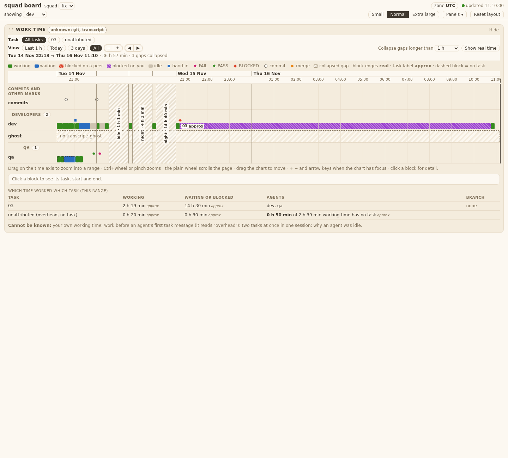
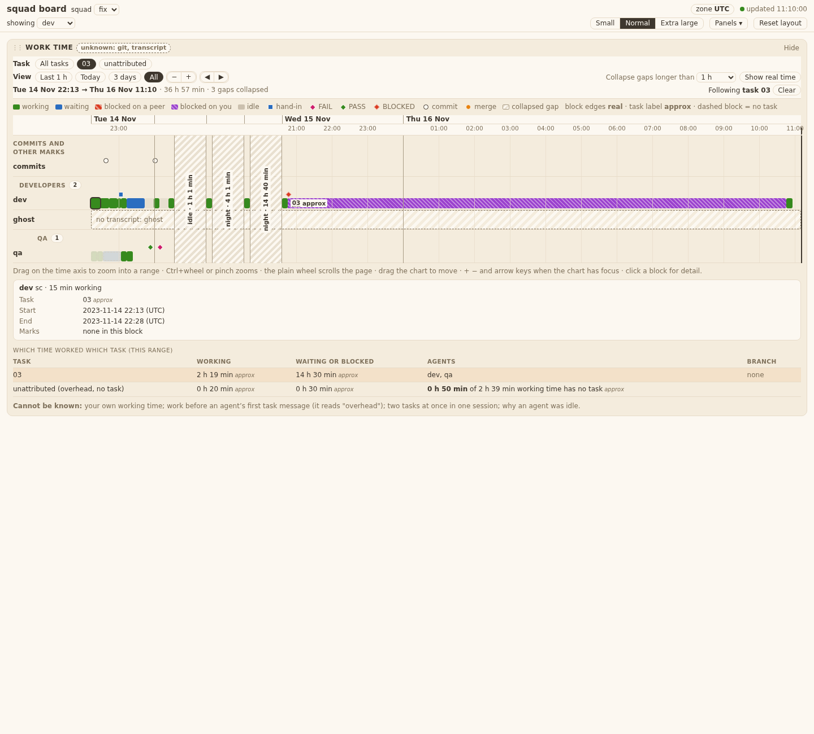
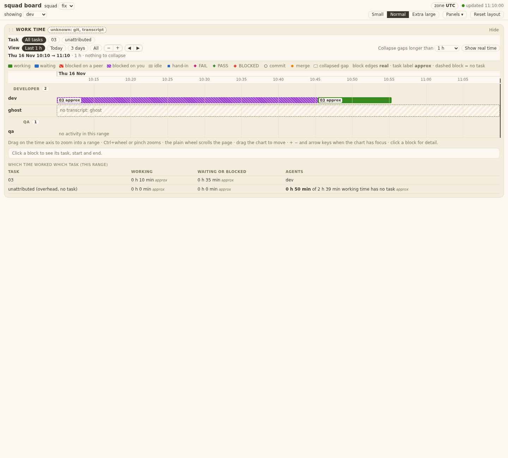
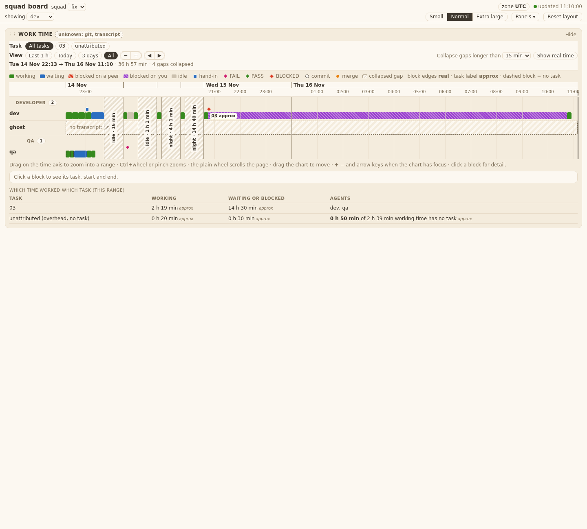
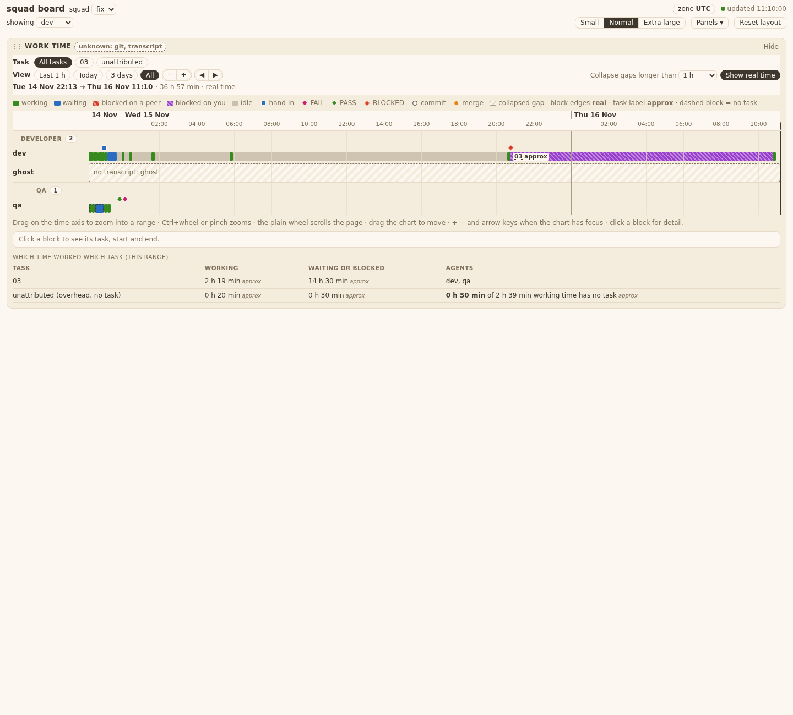
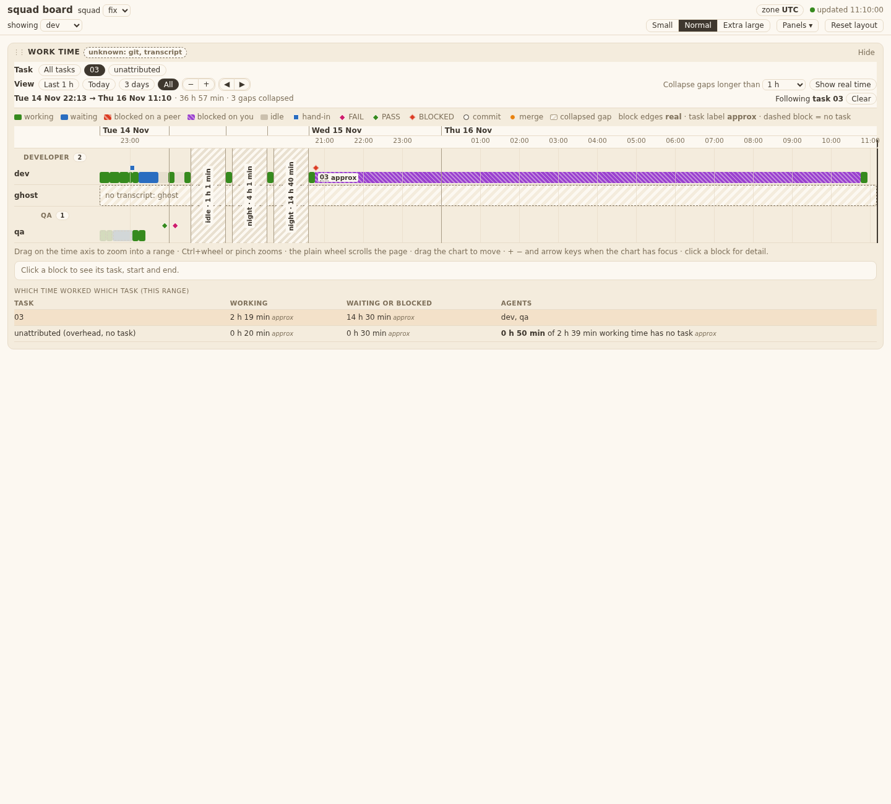
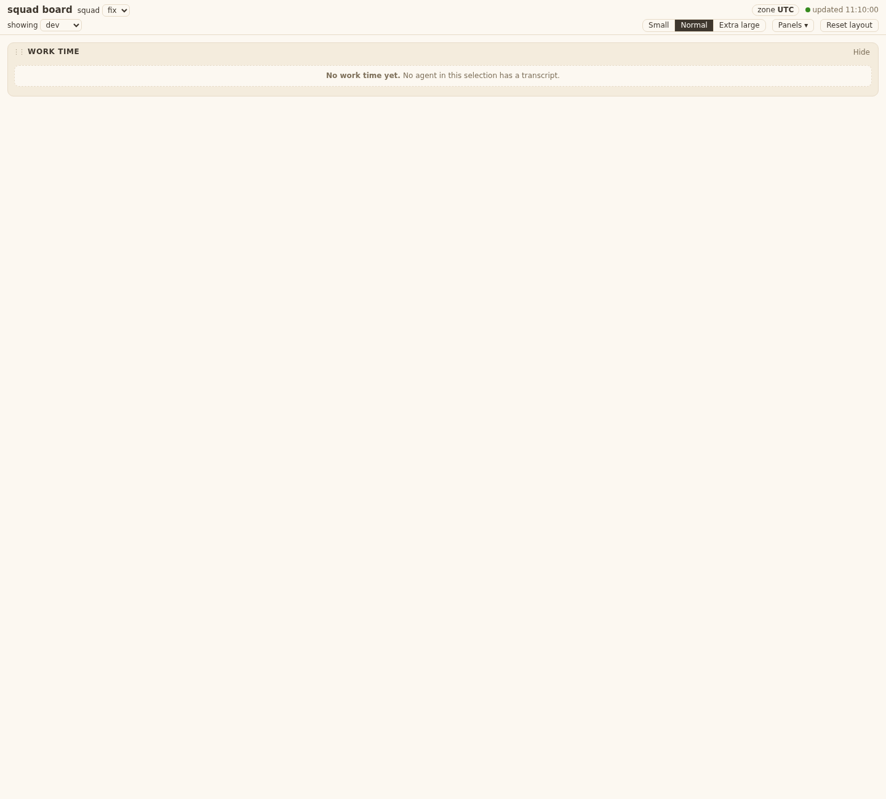

# Evidence 16 work time page

## Behaviour
New panel `templates/board/timeline.js` (id `worktime`, "Work time", swimlanes). Rules are plain functions on `BOARD.TIMELINE`. Tests: `tests/test_squadboard_timeline.py` (22 tests, id in each name), headless Chrome, data from the real `/api/worktime` reader of ticket 15 (`squadboard_worktime.read`) on its own test helpers. Screenshots are the page in that harness (scope `dev`, fake clock, zone UTC).

| AC | What I saw |
|---|---|
| T16.AC1 | Developer on task 03 for 1 h working + 30 min waiting: blocks `data-task=03` in the `dev` lane, green and blue from the legend. A click shows Task, Start, End in local time (`2023-11-14 22:13 (UTC)`). |
| T16.AC2 | The unattributed row reads "0 h 50 min of 2 h 39 min working time has no task approx"; no `%` in the panel. Every task block has `data-approx=true`; no mark has it (checked per element). |
| T16.AC3 | Preset "Last 1 h" asks `from=NOW-3600&to=NOW`; the axis has a date row (`Tue 14 Nov`) and `HH:MM` ticks in the browser zone; the range line shows the same. |
| T16.AC4 | `dragZoom` on the axis gives one request with the new `from`/`to`; a Ctrl+wheel event is `preventDefault`ed and zooms (one request once the wheel rests); a plain wheel event is not prevented, the page scrolls. |
| T16.AC5 | Gaps over the setting show a hatched break: `idle · 1 h 1 min`, `night · 4 h 1 min`, `night · 14 h 40 min`. "Show real time" removes all breaks. |
| T16.AC6 | A 14 h night blocked on the PO stays a purple block; even when every piece is forced `collapsible`, no break touches a waiting or blocked piece. |
| T16.AC7 | Task chip 03, then a zoom: the chip is still on, other blocks stay dimmed, the new request carries `scope=dev&squad=fix`. |
| T16.AC8 | Setting 15 min gives 4 breaks (16 min, 61 min, 241 min, 14 h 40 min; the 15 min gap is not "over" 15), 1 h gives 3, 4 h gives 2. 14 and 241 clamp to 15 and 240. |
| T16.AC9 | A 3 h idle gap across the 2026-03-29 change in Europe/Berlin reads `idle · 3 h` in Berlin, New York and UTC (local subtraction would say 4 h). |
| T16.AC10 | The agent with no transcript shows "no transcript: ghost" in its lane (dashed). |

## Screens

States: loading (skeleton), empty ("No work time yet."), unknown / board version (the board's own note; the panel's note for its own requests), lane with no activity in range ("no activity in this range"), odd piece (no `end`, bucket outside the four) drawn dashed as "unknown" and logged to the console once per kind.

Technical points: one timer (the board's 5 s poll reads the panel's route, which follows the current range); a zoom is its own GET with a request id, an older answer arriving last is dropped (test). The panel redraws only when the data changes. Writes: only `PUT /api/ui` (key `timeline`: idle break, preset or range), with the board's token; the test records every call of a scripted session. Layout of 20 agents x 2000 pieces: under 200 ms; sub-pixel pieces merge for drawing, the sum of seconds is kept (test).

Files outside the ticket list (needed): `templates/board/index.html` (one `<script>` line), `templates/board/board.js` (two hook calls, `snapshot` and `applySaved`, so the panel's keys are saved), `tests/test_squadboard_page.py` (the file-list test names `timeline.js`). Commit marks carry no agent in ticket 15's data, so they sit in their own lane "Commits and other marks". Not built: artifact marks and "blocked on you, open now" (not in the ticket or the data).

Live run (real server, this scope): `/api/worktime` gave 24 agents, 4511 pieces, 70 marks, unattributed `7 h 22 min`. The page drew 18 developer lanes plus the other roles, a "night · 5 h 30 min" break, commits in their own lane, no console error. Server stopped after the run.
