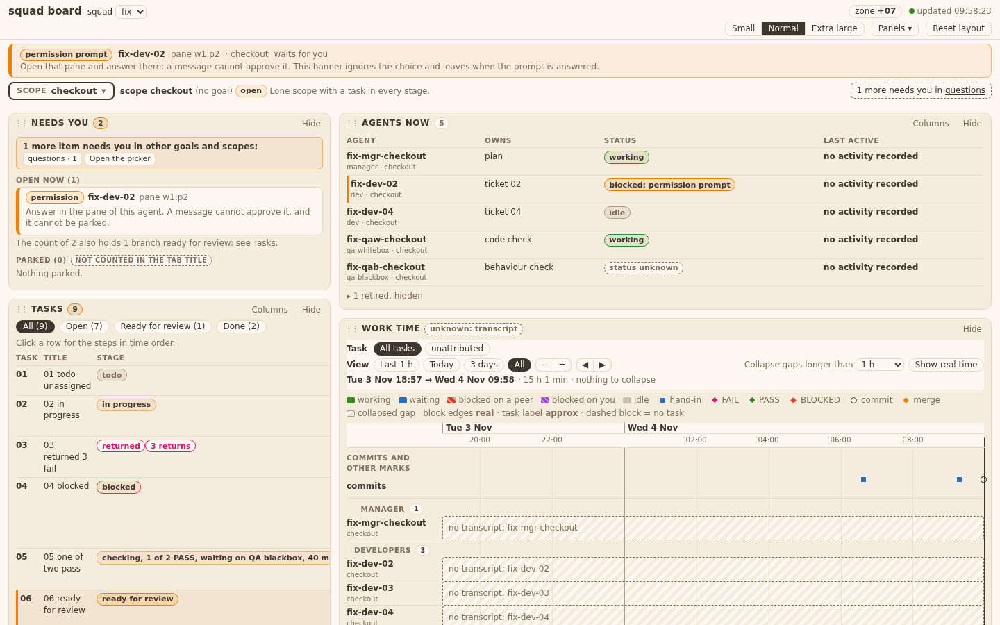
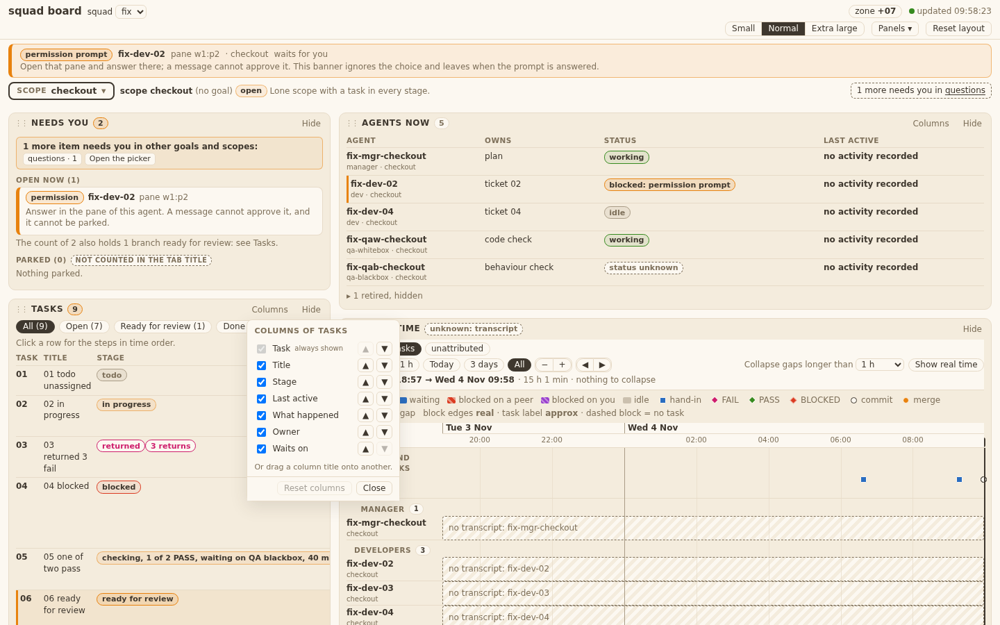
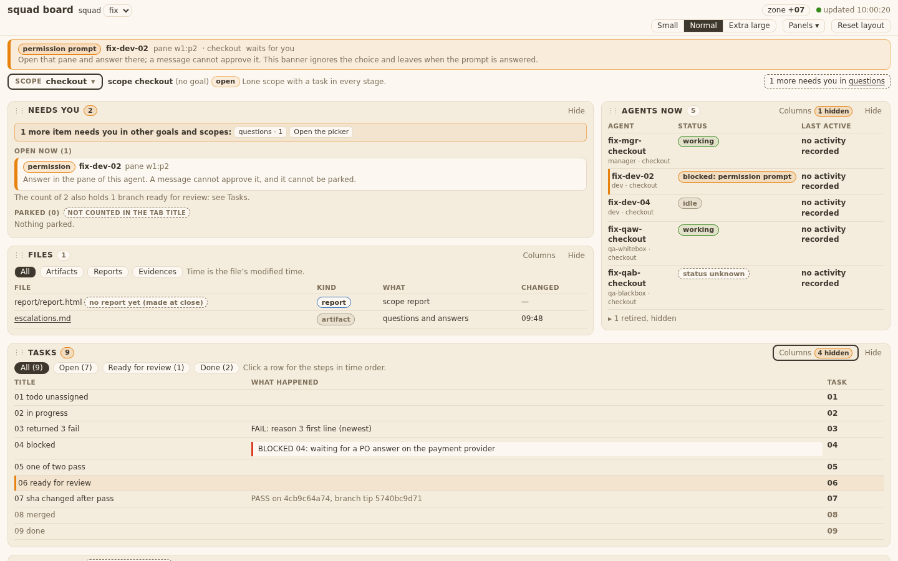
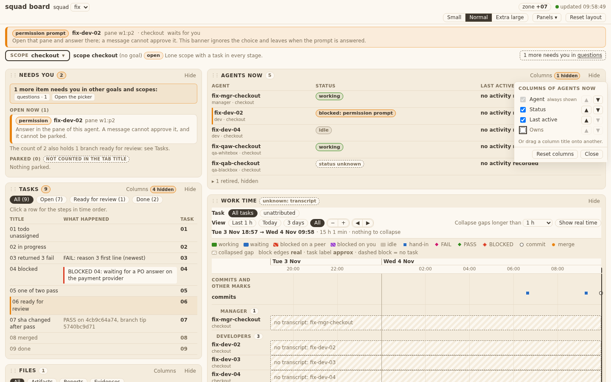
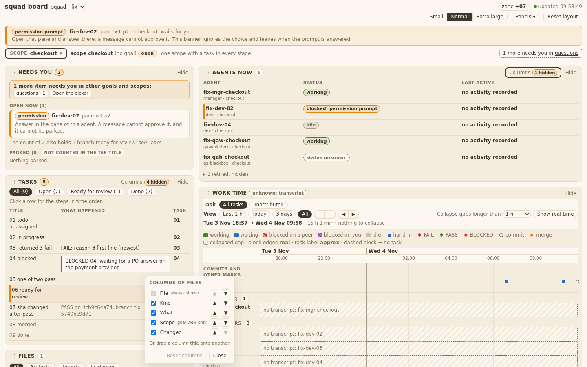
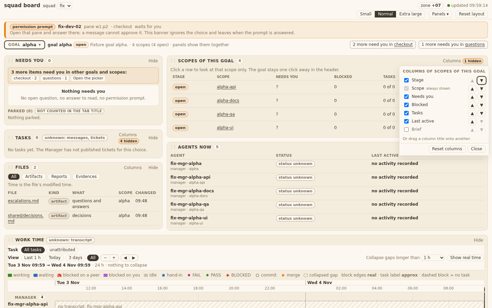
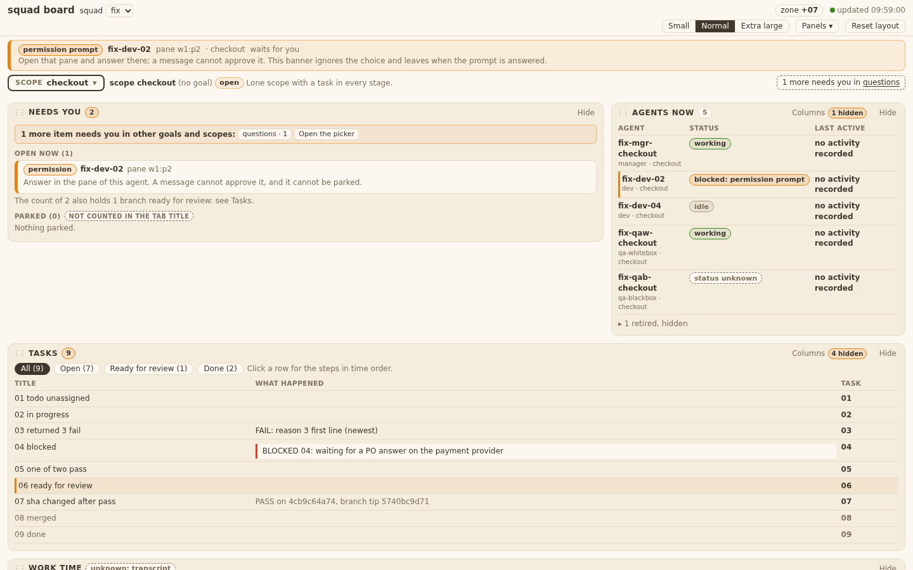
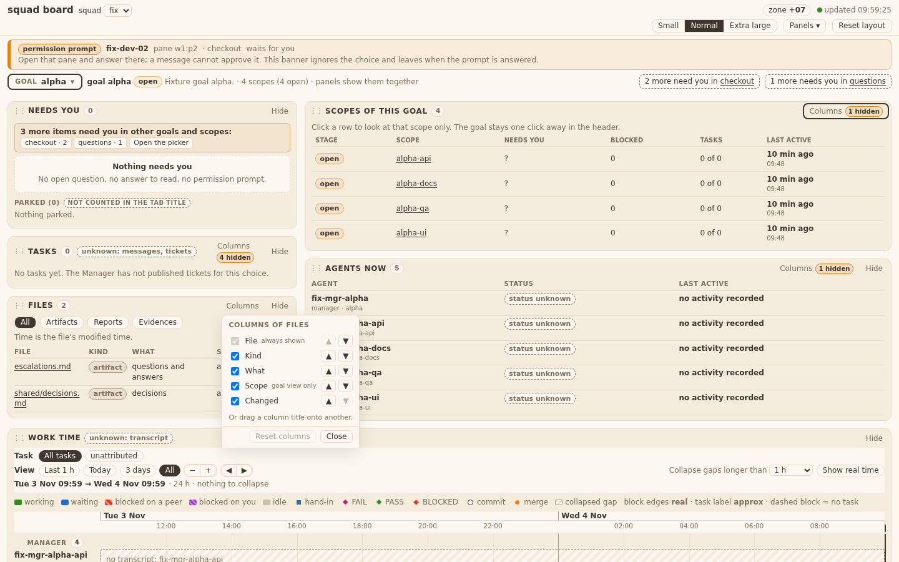
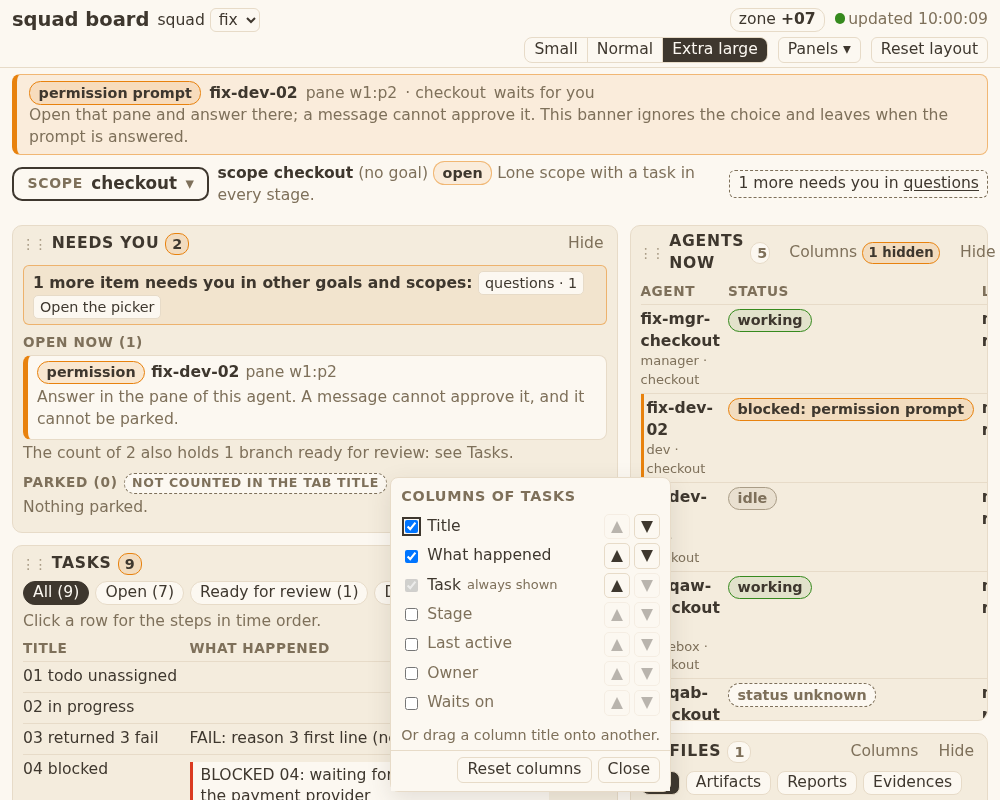
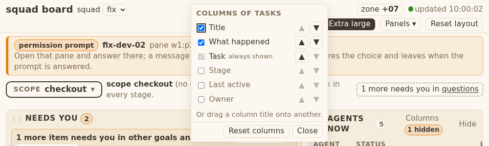

# Evidence 20 column picker

## Behaviour
Real server on the ticket-02 fixture (`squad-board --squad <fixture> --port 8795`), Chrome via playwright-cli, 1440 px (1000 px for Extra large), light Mango Parrot tokens.
- Columns control: a `Columns` button in the header of Tasks, Agents now, Files and Scopes of this goal (one shared builder in `board.js`; Needs you and Work time have none). When a default column is hidden a mango `N hidden` tag sits in the button (tooltip names them). 
- T20.AC1: the control lists every column the panel really has today, in order, one check box each; Task is checked, disabled, "always shown", and still has the arrows. Tasks: Task, Title, Stage, Last active, What happened, Owner, Waits on. 
- T20.AC1/AC2/AC3: with Stage, Last active, Owner and Waits on cleared and Task moved last, the table shows Title, What happened, Task and the button says `4 hidden`. Clearing a box removes the `th` and every `td` at once; arrows move a column; focus stays on the pressed button. 
- T20.AC2: same control, same behaviour in Agents now (Owns cleared) , Files  and the Scopes strip of a goal (Brief cleared, Stage moved) .
- T20.AC4: the choice is saved in `board-ui.json` (`columns: {"tasks": ["title","happened","task"], "agents": [...]}`, version 1). A second, fresh browser (empty local storage) shows the same columns from the file.  Unwritable file: the existing "Settings not shared" note and browser copy (ticket 09/21 path, unchanged; same `touch()` and `PUT /api/ui`).
- T20.AC5: Files in a goal view lists Scope ("goal view only") ; in a scope view the column is not drawn but its place stays in the saved list and comes back in the goal view (test `T20_TA4_AC1_AC5_AC9`).
- T20.AC6: hiding a column never changes the needs-you count, the tab title or the ready-for-review rows (test `T20_AC1_AC2_...`: `document.title`, count, `tr.need` same before and after; the control code never touches them).
- T20.AC7: "Reset columns" resets one panel only; "Reset layout" resets every panel's columns and keeps font size and choice (test `T20_AC7_AC10`).
- T20.AC8: Extra large at 1000 px: the control opens inside the window ; at 300 px high the list scrolls and `Reset columns` / `Close` stay in view . Esc, Close or a click outside closes it; Esc and Close give the focus back to the Columns button.
- T20.AC9: saved columns for an unknown panel are kept in the file but ignored; unknown column ids are dropped; if nothing valid is left the panel shows its defaults; a non-object `columns` is ignored; the server drops a bad stored `columns` to `{}` and still returns the rest (tests `T20_AC4_AC9_AC5`, `T20_TA2`).
- T20.AC10: Needs you and Work time have no Columns control (test `T20_AC1_..._TA6`).

## Known limits and differences from the design
- Tasks has no "Agents involved" or Scope column and no Returns/Branch columns today (no data / not built); the control lists only what the panel shows (FINAL 20). In Tasks the scope stays a prefix of the Task cell.
- Files: Kind/What/Scope/Changed follow the same rule; the "no report yet" row follows the shown columns.
- Column drag (a column title onto another) is built with HTML5 drag and drop and is not covered by a browser test; the arrow buttons are the tested, keyboard way.
- Header tag `N hidden` uses mango as design-v6 says; the ticket-10 mango test now allows the `colhid` class.

## Tests
`test_squadboard_ui.py` ColumnsTest (4), `test_squadboard_panels.py` Panels20 (5) + Static20 (1), `test_squadboard_page.py` (mango rule). Also run (grep hits for board.js, panel files, squadboard_ui): `test_squadboard_timeline`, `test_squadboard_files`, `test_squadboard_page`.
