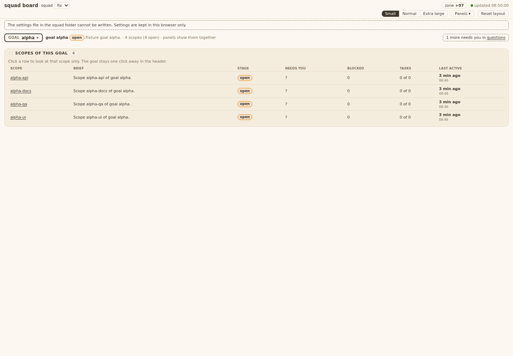

# Evidence 21 stale token save

## Behaviour
Change: `put()` in `templates/board/board.js`. A save answered `403` with JSON `{"error":"token required"}` gets a new token from `GET /api/session` (stored in `S.token`) and ONE re-send of the same snapshot (same body string). Any other answer ends the save at once: `403 host not allowed`, 400/413/415/507/5xx, network error, or a second refusal. The notes area is not touched until the final answer, so the PO sees no message while the retry runs. `bin/squadboard.py` is not in the diff. The only write call is still `PUT /api/ui`; the session fetch is a GET; no new storage key.

Test: `tests/test_squadboard_page.py` `StaleToken` (headless Chrome, stub fetch). Run: `python3 -m unittest tests.test_squadboard_page` (22 ok); `tests.test_squadboard_panels` and `tests.test_squadboard_ui` also ok (they reference board.js / the token guard).

| Case | Calls seen | Result | AC |
|---|---|---|---|
| PUT 403 `token required`, session, PUT 200 | PUT, GET, PUT; 2nd PUT has `new` token, body equal to 1st; notes hidden at both PUTs | `ok`, no note | T21.AC1, TA2, TA6 |
| PUT 403 `host not allowed` | PUT | `failed` | TA1 |
| PUT 403 token twice | PUT, GET, PUT (no 3rd) | `failed`; next save again PUT, GET, PUT | TA3 |
| PUT 403 token, retry 507 | PUT, GET, PUT | `unwritable`, note starts "Settings not shared. " + the T09 explanation | T21.AC4, TA4 |

- T21.AC3 / TA7: server unchanged. Existing `test_T09_AC5_no_token_wrong_host_or_content_type_leaves_file_unchanged` in `tests/test_squadboard_ui.py` (made-up/missing token -> 403, file unchanged) passes.
- TA5: each `put` call retries at most once on its own; the code has no shared counter, so two parallel stale saves each make at most 2 PUTs. Not a separate test (no matrix).
- T21.AC2 (header returns to "updated") is the existing poller, not touched.

TA8 steps (real restart, for QA whitebox): start `squad-board` on a fixed port, open the page, stop and restart it on the same port, click a font size, wait 1 s, read `board-ui.json` in the squad folder: the font is saved and no "could not be saved" note showed.

Return fix (QA blackbox FAIL on T21.AC4, Manager FINAL): the unwritable note now starts with "Settings not shared. " followed by the old text ("The settings file in the squad folder cannot be written. Settings are kept in this browser only."). This also settles the older T09.AC2 wording. Tests grepped for the old text: only `tests/test_squadboard_page.py` (updated); `test_squadboard_page`, `test_squadboard_panels`, `test_squadboard_ui` re-run.

# Evidence: 21 21 stale token save

## QA whitebox review

### QA whitebox 21 (stale token save), c21f435: PASS (QA blackbox must pass too)
Clone /tmp/qaw21.SZqz. Diff vs 437f1a6: templates/board/board.js (put), tests/test_squadboard_page.py (StaleToken), evidence. bin/squadboard.py not in diff (TA7).
- TA1: retry only when status 403 and body error == "token required"; host refusal tested (1 PUT, failed). TA2: same body string re-sent after GET /api/session, new token in header; test compares bodies. TA3: second refusal -> 2 PUTs, 1 GET, failed; next save retries again (per-save). TA4: retry 507 -> unwritable with the T09 text. TA6: notes hidden at both PUTs, no text.
- TA5: no separate test (no shared counter in code, each put retries once). Accepted: the AC list for tests named TA1-4, TA6.
- TA7: existing test_T09_AC5_... (no token / wrong host / content type, file unchanged) passes. TA9: grep method -> only PUT /api/ui in board.js; session is GET; no innerHTML/http(s).
- Ran from tests/: page, ui, server, panels, windows_safe, no_bare_bash, old_language_inventory = 96 OK, browser tests ran.
- TA8 live (REV-5b): fixture copy /tmp/board-fixture-1rqvb01t, squad-board on port 8791, page opened with playwright-cli, server killed and restarted on the same port, clicked font xl: board-ui.json has font xl (saved_at 01:47:23), notes hidden and empty. Console shows one 403 on PUT /api/ui (the stale one), then the save succeeded. Server and browser stopped by PID / close.
#### Note (not blocking)
- N1 two stale saves overlapping: save A's retry waits for GET /api/session; a save B that starts meanwhile could land first and A's older snapshot then wins on the server. Saves are debounced 300 ms and the GET takes ms, so unlikely.

#### Re-check 779316b (after Manager FINAL 21, T21.TA4 amended)
- Diff c21f435..779316b: board.js:324 note starts "Settings not shared. " + old text; test_squadboard_page.py:453 pins it; evidence. Nothing else.
- test_squadboard_page: 22 tests OK (Chrome ran). No other test pins the old text (grep tests/ templates/ bin/).
- Clone: /tmp/tmp.qRl0D2f1bg/r (scratch, not deleted).
- Verdict: PASS (needs QA blackbox too).

## QA blackbox review

### QA blackbox, task 21 (stale token save), sha c21f435

Verdict: **FAIL** on T21.AC4 only (wording). AC1 (font size path), AC2, AC3 pass.
How: `git archive c21f435`, fixture `--now`, `squad-board --squad fix --no-open --port 18793`, Playwright; each restart = kill by PID, start again on the same port; page kept open. `board-ui.json` read from disk after each save.

| AC | What I did | What I saw | Result |
|---|---|---|---|
| AC1 | Page open (`&goal=alpha`), restarted the server, clicked Extra large; again restarted, clicked Normal. Reloaded. | No error text on the page. File on disk got `font: xl`, then `normal` (so the server file, not only the browser copy, saved). After reload the setting is kept. Network list shows per restart: PUT 403, GET /api/session, PUT 200 (one retry, silent); later PUTs 200 with no 403. | pass for font size |
| AC1 hide a panel | Looked for a hide control on the Scopes panel (goal view) and Panels menu | This build's panel has no Hide/close button, Panels menu says "No hidden panels." (the panel layer is later tickets). The AC's "(or font size)" is met by font size. Not tested: hide. | open, not a fail |
| AC2 | After the restart, watched the header | "updated hh:mm:ss" moved again within 5 s (08:47:38 -> 08:47:43). Save not lost (AC1). | pass |
| AC3 | `PUT /api/ui?squad=fix` with `X-Board-Token: MADEUPTOKEN12345`, and with no token | 403 both; `board-ui.json` md5 unchanged. | pass |
| AC4 | `chmod 444` file + `555` squad folder, restarted, clicked Small | Requests: PUT 403, GET /api/session, PUT 507, then nothing more (one retry only, no loop). Page shows banner "The settings file in the squad folder cannot be written. Settings are kept in this browser only." The words **"settings not shared"** appear nowhere (page text, title, aria-label, HTML).  | **FAIL**: AC quotes "settings not shared" |

Note for the Manager: the same wording is in T09.AC2, so the gap is older than 21; the banner text was never matched to the AC quote (my T09 PASS listed this as a page part still open). Either the page text changes to contain "settings not shared" or the BA changes the AC wording. Behaviour (browser copy keeps the setting, one retry) is right.
Scratch for PO: /tmp/qb21.20OI, /tmp/board-fixture-z21xu2mj, /tmp/qb21-img, /tmp/qb21*.log|pid|sh, /tmp/qb21_put.py. Permissions on the fixture folder restored; server and browser stopped.

#### Re-check 779316b (AC4 only + font save)
Fixture copy with board-ui.json 444 and squad folder 555. Clicked Extra large: banner reads "Settings not shared. The settings file in the squad folder cannot be written. Settings are kept in this browser only." = AC4 wording. After reload the font choice stays (kept in this browser). **PASS** T21 on 779316b.
Scratch: /tmp/qb21c.bckR, /tmp/board-fixture-2kuh_uos, /tmp/qb21c*.
