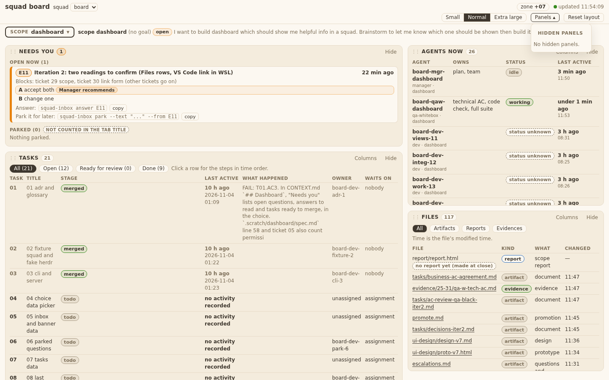
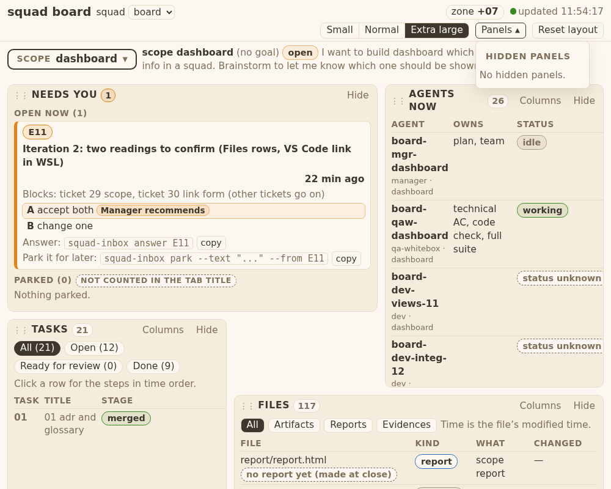
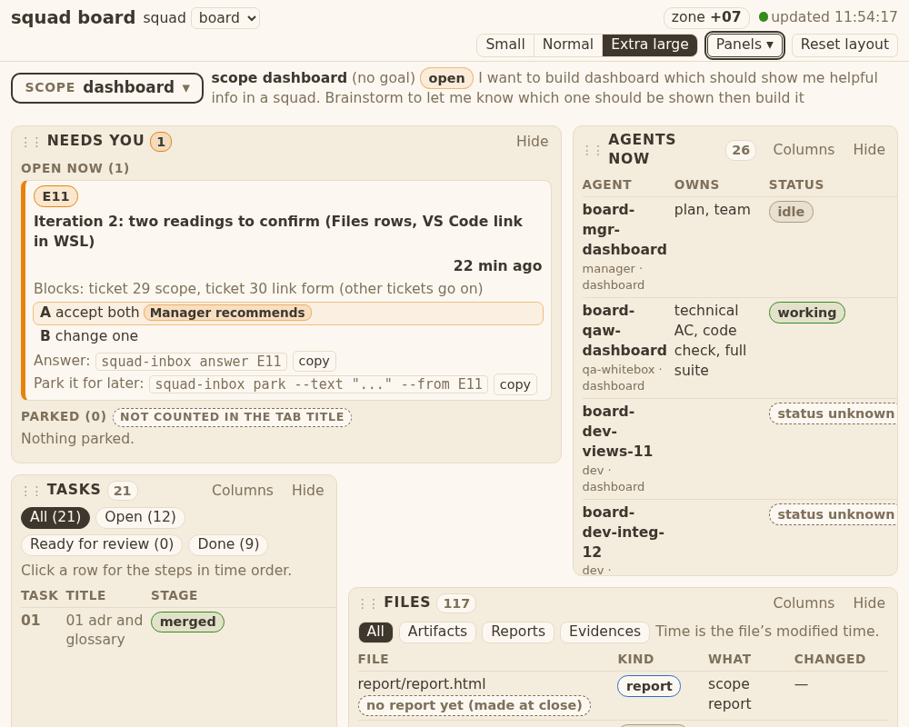
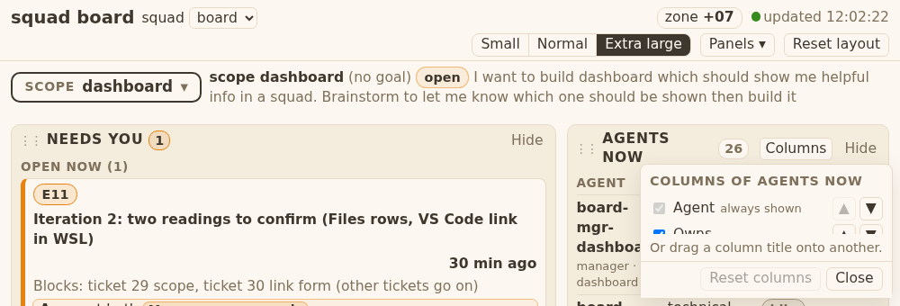

# Evidence 25: Panels dropdown opens under its button

## Behaviour
The Panels list and the Columns list now sit in a `position:relative` wrapper (`.popwrap`) with their button. The list is `position:absolute; top:calc(100% + 4px)`, so it scrolls with the button. `BOARD.popPlace` (pure) shifts it left to keep 8 px from the right edge and sets max height = window height - button bottom - 12. It never flips above. The Panels list has the title "Hidden panels", the caret is ▴ while open, and every close path returns focus to the button. The open Columns panel gets `z-index:40` so no later panel covers its list.

## AC table
| Id | Shown by |
|---|---|
| T25.AC1, AC2, AC3 | `tests/test_squadboard_panels.py` `Popover25.test_T25_AC1_AC2_AC3_TA1_...` (3 font sizes, scroll 300 px; gap, inside window); `board.js` `popPlace`, `placePop`; `board.css` `.popwrap`, `.pop` |
| T25.AC4 | same test: Esc closes, focus on button; `togglePop` focus on close; caret in `renderPop` |
| T25.AC5 | `test_T25_AC5_columns_popover_...` (Extra large, on top, footer, scroll); `placeColumns` |
| T25.AC6 | existing tests in `test_squadboard_page.py` (show hidden panel) pass unchanged |
| T25.TA1 | pure cases in the Popover25 test (shift, tiny viewport) |
| T25.TA5 | listeners added on open, removed on close (`togglePop`) |
| T25.TA6 | no `position:fixed` in `.pop`/`.cpop`; no hex outside `:root` |
| design-v7 s3 | caret ▴, title HIDDEN PANELS, 4 px, 12 px, no flip |

## Return 1 (QA whitebox findings)
1. Removed the 120 px floor in `placeColumns` (max height is now window - button bottom - 12). 3. `applyFont` re-places both lists at once and again after 250 ms (panels animate). 2, 4, 5, 6, 7: tests rewritten/extended: `Popover25` (Panels list: 1440x900 and 1000x800, 3 text sizes, scroll 600, open while scrolled, text size while open, Esc/outside close + focus + caret, resize while closed, `popPlace` fits/right/low/tiny) and `Panels20.test_T25_AC2_AC3_AC5_TA2_TA3_TA7...` (Tasks Columns list: same matrix; inside window, footer visible, on top at its bottom, so not cut by the panel). `run_page` and `Panels20.page` got an optional `size` argument.

## Return 2
`fitBox` (board.js) serves both lists: the list keeps a usable height (its own height, at most 280 px, never above window - 16); on open, if the room under the button is smaller, the page scrolls the button up (the button stays in view), so the whole list and its footer fit. The Columns test now runs 1440x900, 1000x900 and 1000x800 with no skip: at open (also when opened while scrolled) gap, inside window, footer visible, on top. Edited tests: my own two T25 tests only.

## Open gaps
- A button taller than the window, or a page too short to scroll the button up, is not handled.
- A click on a text-size button closes the list (outside click); the re-place on text-size change is tested by calling `setFont`.
- 1000x700 at Extra large is not tested (the button is below the window).

## qa-w

### QA whitebox 25: sha 049c43a (branch squad/board/dashboard/board-dev-pop-27) — FAIL (return 1)
Checked in a clone. Ran: test_squadboard_panels, test_old_language_inventory, test_windows_safe, test_no_bare_bash (70 ok); test_squadboard_page/timeline/worktime (70 ok). Grep TC.11 hits: the rest only `list.pop()`. Diff: only `board.js`, `board.css`, the test file, plus the ticket/evidence/tech files (allowed). No hex outside `:root`, no `http`, no `innerHTML`, no `position:fixed` left in `.pop`/`.cpop`. Listeners: Panels list adds/removes `resize`+`scroll` in `togglePop`; Columns removes `resize` on close.
I also ran my own headless script (scratch, not committed) at 1000x700/800/900 and 1440x900, Small/Normal/Extra large, scroll 600, open while scrolled, font change while open.

#### Findings
1. **FAIL T25.TA3 / T25.AC3 (code): Columns list leaves the window at 1000 px, Extra large.** `board.js` `placeColumns` (~l.677-681): `box.style.maxHeight = Math.max(120, pl.maxHeight)`. The 120 px floor overrides the room under the button. Repro: window 1000x900 (also 800), Extra large, Tasks Columns: popover height 120, bottom 920 > 900, footer (Close/Reset) not visible, list not on top. The same at 1440x900 passes only because the button is higher. `popPlace` already gives `max(0, room)`; the floor must go (or the list gets a min height only inside the box, with the footer pinned). What passes: at those sizes the list scrolls inside, the whole box is inside the window (8 px), footer visible.
2. **FAIL T25.TA2 (tests missing).** The Dev's test uses a 1440 window and a 300 px scroll. TA2 names 1000 and 1440 px, scroll 600, plus: open while already scrolled, text size changed while open (TA6 text of the tech file), for the Panels list and the Tasks Columns list. I ran all of these by hand: Panels list passes at every size; Columns passes except finding 1 and finding 3. Add them (one test per list is enough; reuse the loop).
3. **FAIL T25.TA2/TA6 (code): Columns list does not re-measure when the text size changes while open.** `openColumns` only listens to `resize` (l.629). Tech file: "On open, on `resize` and on a text-size change it measures once". The Panels list gets it through `placePop`; Columns does not. Fix: call `placeColumns` from the text-size change path while a list is open (or make both lists use one re-place hook).
4. **FAIL T25.TA3 (test missing)** for finding 1: one test at 1000 px wide, Extra large, a window height where the room under the button is small: popover inside the window, footer visible.
5. **FAIL T25.TA7 (test missing).** Tasks panel at a short height, Columns open: popover not cut by the panel. I checked it by hand at 1440x900: passes (popover bottom 541, panel bottom 281, visible), so only the test is missing.
6. **T25.TA1 (test incomplete).** Test has the overflow-right and tiny-viewport cases. Missing: "fits" and "button near the bottom (max-height = vh - bottom - 12, never < 0)". Add both to the same test (two asserts).
7. **T25.TA5 (test missing)**: one assert that `resize` while closed changes nothing (listeners removed). Code is right; add one line in the same test.

#### Notes (not findings)
- `popPlace` returns `{top,left,maxHeight}` and not the `{shift,maxHeight}` of the tech file; pure, tested for the shift case (1232). Accepted.
- The extra `scroll` listener (capture) on the Panels list is not needed (the list scrolls with the page by itself) but is harmless.

#### To pass (one return)
Fix 1 and 3 in `board.js`; add the tests for 2, 4, 5, 6, 7 to `Popover25` and the Columns test, in the existing test file; list in HANDIN the tests added; run the test file again. No other file.

---
### Return 2 check: sha d876a43 — FAIL (one finding left)
Checked in a clone. test_squadboard_panels: 48 ok. Items 2, 4 (partly), 5, 6, 7 and finding 3 (re-place on text size) are fixed and accepted: Panels list passes at 1000/1440, 3 sizes, scroll 600, open while scrolled, font change while open; Columns re-places on font change (applyFont hook).

#### Finding
1. **FAIL T25.TA3 / T25.AC3 (code and test): at Extra large, 1000x900, the Columns popover is 5 px high.** The floor is gone, so `maxHeight = room under the button` is now about 5 px and the popover is a sliver: footer (Close/Reset) not visible, not on top. Same at 1000x800 and 1000x700 (h 2, bottom 802 > 800). Repro: my script, `chk2.py <clone> 1000 900`, key `xl`: `h:5, foot:false, topmost:false`. At 1440x900 it passes (h 315). TA3 names exactly this case: "At 1000 px, Extra large: the whole popover is inside the window; when taller than the room, the list scrolls inside and the footer is visible."
   Why the Dev tests miss it: the Columns test uses 1000x800 and asserts inside/footer only when `vis` (button bottom + 12 < window height). At Extra large the button is below 800, so the case is skipped; 1000x900 is not tested at all.
   What passes (Dev may pick the way): the popover always keeps a usable height (min-height for the list plus the fixed title/hint/footer, list scrolls inside) AND, when the room under the button is smaller than that, the page scrolls the button up on open (e.g. `scrollIntoView`) so the whole box fits in the window with the 8 px margin. Also fixes the Panels list for the same low-room case if it shows it (Dev's open gap says it does). A button taller than the window can be left out (state it).
2. **Test (TA3):** add 1000x900 to the Columns test sizes and assert inside + footer + onTop at Extra large when the button is on screen at open time (after the open scroll). Do not skip a case just because room is small: that is the case under test. Drop or change the `vis` guard so it cannot hide this failure.

Note: the Dev's "Open gaps" lists this as a known gap. A known gap against a technical AC is a FAIL (QA rule), not an accepted limit.

#### To pass (one return)
Fix 1 in `board.js` (and `board.css` if needed); item 2 in the existing test file; run test_squadboard_panels again.

---
### Return 3 check: sha bd8e970 — PASS
Clone checked. Ran test_squadboard_panels, test_squadboard_page, test_old_language_inventory, test_windows_safe, test_no_bare_bash: 92 ok. Diff since d876a43: `board.js` (fitBox shared by both lists), the existing T25 Columns test, evidence.md.
My scripts: Columns list (chk2) at 1000x900, 1000x800, 1000x700, 1000x1000, 1440x900, Small/Normal/Extra large: gap 4, inside window, footer visible, on top, scroll 600 gap 4, focus back. Extra large height 280 (was 5). Short-panel case: not clipped. Panels list (chk) at 1000x900 and 1000x700: gap 4, inside, follows scroll 600, open while scrolled, text size while open. T25.TA1-TA7 met. Leftover gaps (button taller than window; 1000x700 xl not in the committed test) are outside the AC; I covered 1000x700 by hand.

## qa-b

### QA blackbox, task 25 (Panels dropdown under its button)
Sha 049c43a (branch squad/board/dashboard/board-dev-pop-27). Board run from that worktree on the real `board` squad, scope `dashboard`; Playwright (playwright-cli), measured with getBoundingClientRect on the running page.

| AC | What I did | What I saw | Result |
|---|---|---|---|
| T25.AC1 | 1440x900, scroll 0, Normal/Small/Extra large, click "Panels" | list top 4.0 px under the button bottom, left edge = button left (0 px). Right gap 35-43 px, so no shift was needed (the list is only 144 px wide). Not at page bottom | PASS |
| T25.AC1 (shift) | Columns of "Agents now" (button at x 1307) at 1440 | list left 1211, right gap 8 px from the window edge; top 4 px under button | PASS |
| T25.AC2 | list open, page scrolled to 600 (page max 435 at 1440x600) | still 4.0 px under button, left 0; opened at scroll 40: 4.0 px | PASS |
| T25.AC3 | 1000x800 and 1000x500 at Extra large: Panels and Columns | whole list inside window; Columns right gap 8.3 px. 1000x340 XL: max-height 149.86 px = 340-178.14-12; list scrolls inside; Close footer (297-323) in view; no flip above | PASS |
| T25.AC4 | Esc / outside click / second click on Panels; Esc / Close on Columns | closes each time; caret back to ▾; focus on "Panels" (Columns: on "Columns") | PASS |
| T25.AC5 | Columns of Agents now, third panel Columns, at 3 sizes and 1440/1000 | 4 px under its own button; shifts left to keep 8 px when needed | PASS |
| T25.AC6 | Hide a panel; open Panels; click "Show Needs you" | button `Panels (1 hidden) ▾`, list `HIDDEN PANELS` + `Show Needs you`; after Show the list stays open, reads `No hidden panels.`, button `Panels ▴` | PASS |

Title reads `HIDDEN PANELS` (uppercase style) and `No hidden panels.` when none hidden.

#### Observations (not AC failures)
- Clicking a text size button while the list is open closes it (it is an outside click). So "follows when font size changes" could only be checked between opens; each size gives 4 px.
- When less than 132 px is left under the button (tested 1000x300, button bottom 256), max-height stays 120 px, not window - bottom - 12, and the list passes the window bottom (list bottom 380 of 300). The AC formula would give 32 px. Extreme window only; the page can scroll to it. Developer may keep or tighten.
- Browser console: only a favicon 404 (not this task).

#### Re-check on d876a43 (return 1: no max-height floor, re-place on text-size change)
Re-ran the same measurements (3 sizes x 1440/1000, Panels and Columns, scroll, Esc/outside/second click, hide/show) on d876a43: all as before (top 4 px, left aligned or right edge 8 px, focus back on button).
- Note 1 fixed: 1000x300 XL, Columns max-height 109.86 px = formula; list bottom 292 of 300, Close in view; 1000x340: 149.86 px, scrolls, Close in view.
- Note 2: a text-size button (click or keyboard Enter) still closes the open list first, so "re-place after a size change" cannot be seen from the UI; every size gives 4 px at open.

Verdict: PASS on 049c43a and d876a43.
