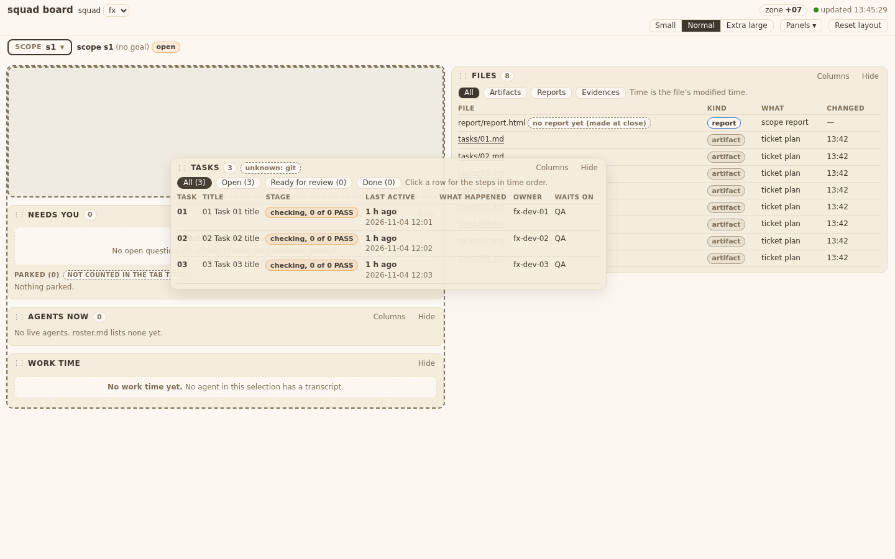
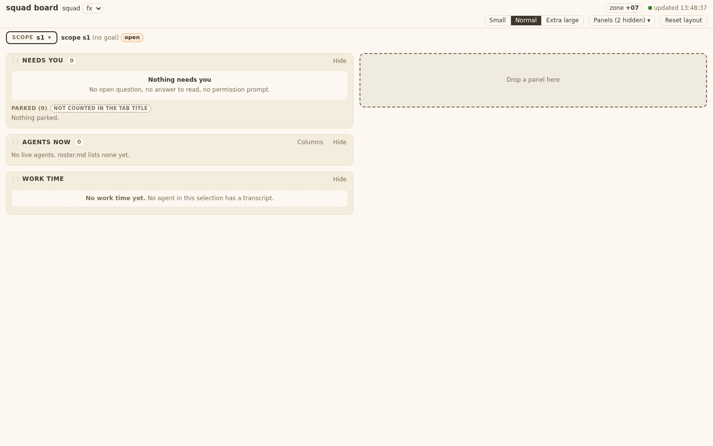
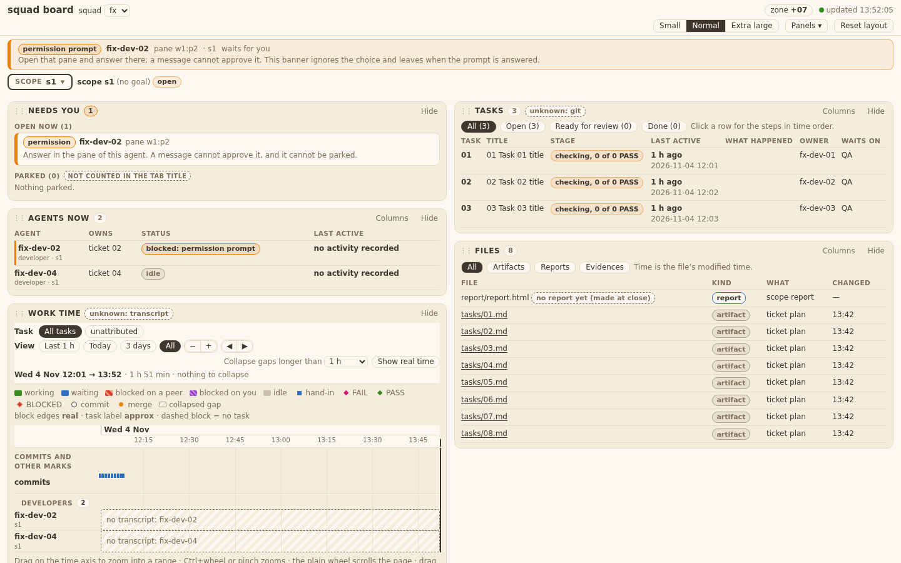
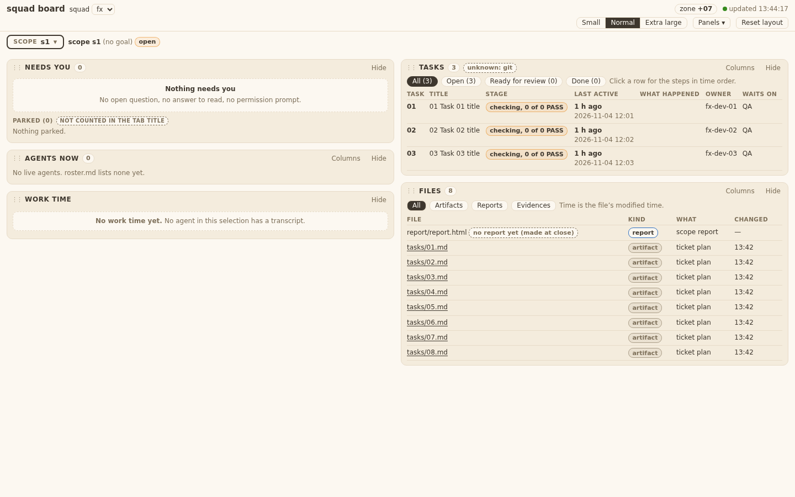
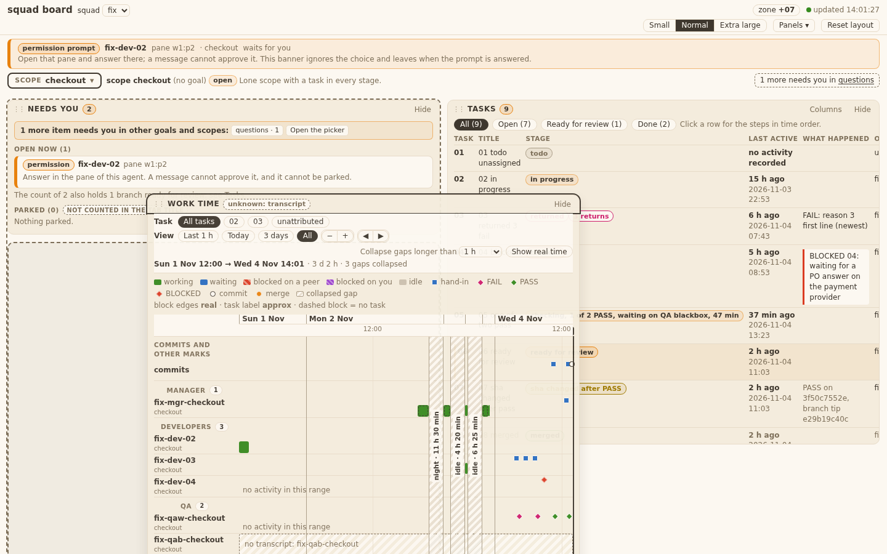
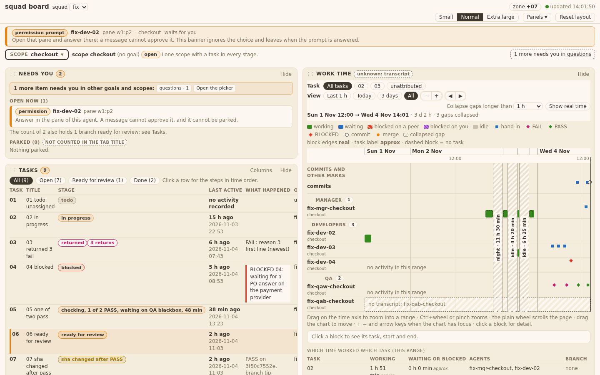
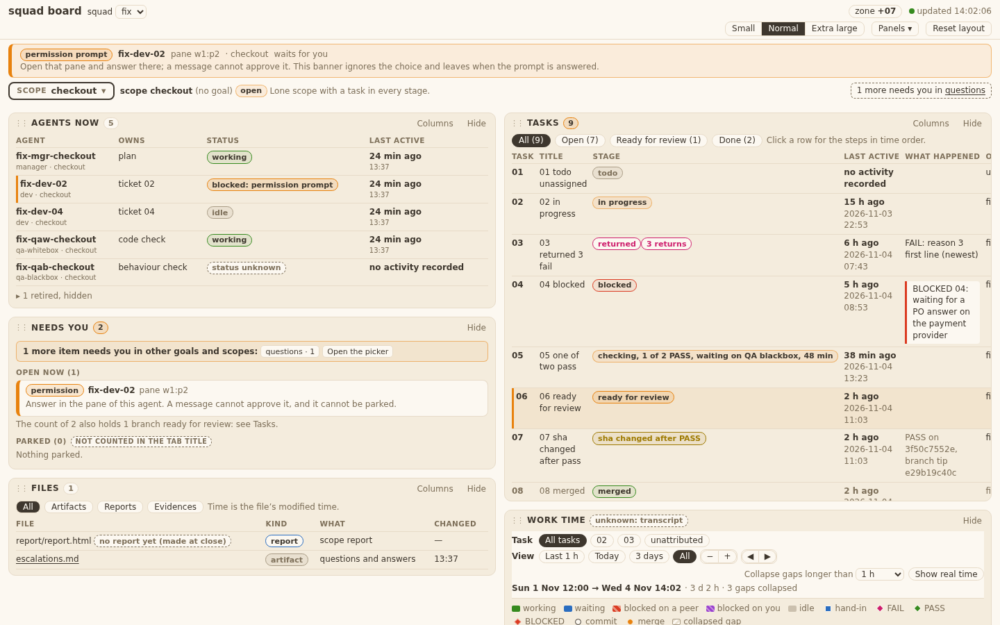

# Evidence 26: Layout by column

## Behaviour
`#canvas` is a CSS grid of N `.col` elements (12 px gap). N = `BOARD.layout.colCount(innerWidth, scale)`: 3 from W 1800, 2 from W 932, else 1 (W = width / text scale); not saved, no control. Panels are normal blocks in a column, so a short panel is as tall as its content and the next one starts 12 px under it. `layout.js` pure helpers: `colCount`, `place` (shortest column, leftmost on a tie), `norm` (clamps `col` for display only, skips hidden and no-col panels, sorts by `order`, tie by default order).
The default place runs on first load, Reset layout, a new choice, a text-size change and a change of column count, only while `auto` is true; never on a data refresh, hide or show. Drag: header, 4 px, dashed drop spot, column outline, Esc or a drop outside cancels, `Drop a panel here` in an empty column. Keyboard: Up/Down in the column, Left/Right to the next column, focus stays on the title; Shift+Up/Down 80 px. Resize: south edge and Fit only (east and corner handles removed).
Saved: per panel `col` (0..11, optional), `order` (place in the column), `hidden`, `max_height`; `span` is no longer written. A file without `col` shows the default place, keeps hidden panels hidden and heights, and nothing is written on load. A `col` above the count shows in the last column; the file keeps it. Server (`bin/squadboard_ui.py`): `col` optional integer 0..11, `span` optional. The Manager confirmed this (decisions-iter2 D2, FINAL 26).

## AC table
| Id | Shown by |
|---|---|
| T26.AC1, AC2, AC8, AC13 | `test_squadboard_page.py` `Layout.test_T26_AC1_AC2_AC8_AC13_...`: 1440 at 3 text sizes, 1000 small/xl, 1920: count, 12 px gaps, no overlap, content height; `layout.js` `colCount`, `board.css` `#canvas`, `.col` |
| T26.AC3, AC4, AC6, AC11, AC14, AC15 | `Layout.test_T26_AC3_AC4_AC6_AC11_AC14_AC15_...`: drop spot, landing, column closes up, save (`col`, `order`, `auto` false), Esc, keyboard and edges, focus, hide/show, reload, Reset; `layout.js` `drag`, `key` |
| T26.AC5, AC12 | `Layout.test_T26_AC5_AC12_...`: height grows, width same, below moves down, other column same, Fit; `layout.js` `resize`, `caps` |
| T26.AC7 | `Layout.test_T26_AC7_TA5_TA12_...` with `tests/fixtures/board/layout-26/board-ui-iter1.json` (hand-written to the iteration-1 shape, see gaps) |
| T26.AC9, TA11 | `Layout.test_T26_AC9_TA11_...`: banner outside `#canvas`, no `.rz.e/.rz.se` |
| T26.AC10 | counts 2/2/3 in the AC1 test (1440, 1000, 1920); place of each panel: `PureRules.test_T26_TA3_...` (design-v7 s2 case); look is QA blackbox's |
| T26.TA1, TA13 | `PureRules.test_T26_TA1_TA13_...` (norm); pure, no DOM |
| T26.TA2 | `PureRules.test_T26_TA2_...` (8 cases) |
| T26.TA3 | `PureRules.test_T26_TA3_...` (n=1, 2, 3, tie; goal view with Scopes at n=2, 3: return fix) |
| T26.TA4 | the AC1 test (12 px, no stretch, no overlap) |
| T26.TA5, TA12 | the AC7 test (no PUT, `col: 9` kept in the snapshot, mixed rows) |
| T26.TA6 | page drag/key test (`put` carries `col`, `order`, `auto`); `test_squadboard_ui.py` `test_T26_TA6_...` |
| T26.TA7, TA8 | drag/key and resize tests above |
| T26.TA9 | see HANDIN: `pack`, `autoPlan`, grid code deleted from `layout.js`; remaining `span` hits are table/CSS/timeline words and the panel definitions' unused `span:` field (files outside this ticket) |
| design-v7 s2, s7 | `board.css` `.col`, `.col.over`, `.col .empty` (min 110 px), `.ghost`, `.panel.drag` |

## Tests changed
Removed (they pinned the 12-column grid): `PureRules` `T10_AC5_AC6_short_beside_tall...`, `T10_TA1_same_state...`, `T10_AC8_taller_content_scrolls...`, `T10_TA10_fewer_columns_at_1000`; `Layout` `T10_AC3_to_AC9...` and `T10_AC1_AC2_AC7_move_resize...` (replaced by the T26 tests above). None skipped.

## Open gaps
- The iteration-1 fixture is written by hand in the shape of the iteration-1 docstring, not copied from a live iteration-1 build.
- Panel definitions (`panel_*.js`, `timeline.js`) still carry `span:`/`spans:` fields; they are unused. Left alone: those files are not in this ticket's touched list (TC.10).
- No screenshots: the look is QA blackbox's (design-v7).

## Return 2 (QA blackbox F1, F2; QA whitebox TA3)
| Finding | Fix | Shown by |
|---|---|---|
| QA whitebox: TA3 goal view | Scopes placed at n=2, 3 | `PureRules.test_T26_TA3_...` |
| F1 T26.AC14: drop outside every column cancels | `layout.js` `drag` `mv`: outside = x left of first / right of last column, y above the columns or below the window (was: only half a gutter and the window edge, so the top bar counted as inside) | `Layout.test_T26_AC3_AC4_AC6_AC11_AC14_AC15_...` `outSame`: release at y=1 and at x=1, layout and PUT count unchanged, no ghost; fails on 9af9c5f |
| F2 design-v7 s2: spot before the first panel whose middle is below the pointer | `layout.js` `drag` `mv`: the spot is taken out of the column before the middles are measured | no new test (decision: F1 only); QA blackbox re-checks with pointer y 260/300/340/380 |

## QA whitebox

### QA whitebox 26: sha 8b24ebb (branch squad/board/dashboard/board-dev-layout-28) — FAIL (return 1, one test missing)
Checked in a clone. Ran test_squadboard_page, test_squadboard_ui, test_squadboard_panels, test_squadboard_timeline, test_old_language_inventory, test_windows_safe, test_no_bare_bash: 140 ok, none skipped. Diff files are the tech file's list (layout.js, board.js, board.css, squadboard_ui.py) plus tests, fixture, ticket/evidence.
Code read in full (`layout.js` 295 lines): pure `colCount/place/norm` touch no DOM; no write on load (`opts.set` does not call `touch`); `norm` clamps `col` for display only and skips non-integer `col`; server `col` optional 0..11, `span` optional, `x y row size` still refused (TC.2/TC.5 ok); `rz.e/.se` gone; no hex added; no `innerHTML`. TA2 values match the tech file (cc = 2,3,2,2,1,1,2,3). PO case (n=2) right. TA5/TA12 test covers old file, `col: 9`, mixed rows, no PUT.

#### Finding
1. **FAIL T26.TA3 (test): goal view not covered.** TA3 says "Goal view adds Scopes in its place in the order." `PureRules.test_T26_TA3_...` uses `ORD = inbox, tasks, agents, files, worktime` only; `scopes` is never placed. Add `scopes` to a `place` case (n=2 and n=3): it is placed after Files and before Work time (the code is right: `layout.js` ORDER and `defaultRank`). One assert. Optional: heights in that test are invented (200/300/150/120/400), not "copied from `proto-v7.html`" as TA3 says; the proto has no fixed heights (only `max`), so I accept them.

#### Accepted notes (not findings)
- TA9: `span:`/`spans:` fields remain in `panel_*.js` and `timeline.js` definitions (unused data, files outside this ticket's list, TC.10). No use of the 12-column grid is left in the grep hits (they are table/CSS/timeline words). Remove them in a later cleanup if the TL wants.
- Iteration-1 fixture is hand-written in the shape of the old docstring; the PO's live `board-ui.json` has the same shape (`order`, `span`, `auto: true`, no `col`), so it is a fair sample.

#### To pass (one return)
Add `scopes` to the `place` test (TA3). Run test_squadboard_page again.

### QA whitebox 26: sha 9af9c5f (branch squad/board/dashboard/board-dev-fix-30) — PASS (return 1 re-check)
Re-check of the changed files only: diff 8b24ebb..9af9c5f touches `tests/test_squadboard_page.py` (+5) and the 26 evidence row. The TA3 test now places Scopes in the goal view (order inbox, tasks, agents, files, scopes, worktime) at n=2 and n=3 and asserts the columns. No code change. Ran test_squadboard_page in a clone: 24 ok. Finding 1 closed.

### QA whitebox 26: sha 89254f0 (branch squad/board/dashboard/board-dev-fix-30) — PASS (return 2, final sha)
Re-check of the changed files: `layout.js` `drag` mv() (2 lines) and `tests/test_squadboard_page.py` (+10 -1). F1: "outside" is now x left of the first / right of the last column, y above the first column's top or below the window; a drop there cancels (`slot.remove(); over = null`, so `done` saves nothing). Matches T26.TA7 / AC14 "a drop outside every column cancels"; a gutter between columns is still inside (nearest column wins). F2: `slot.remove()` before the panel middles are measured, so the spot no longer shifts the middles; `el` is the floating panel and is excluded from the kids list. Mutation check: with the 9af9c5f `layout.js` the T26 drag test FAILS (outSame); with 89254f0 it passes. Ran in a clone: test_squadboard_page 24, test_squadboard_panels 48, test_squadboard_timeline 26, test_squadboard_ui 20: all ok. No old test edited. F2 has no own test (the placement rule is covered by the existing spot/gaps assertions, which pass). Earlier PASS on 9af9c5f is replaced by this one.

## QA blackbox

### QA blackbox, task 26 (Layout by column)
Sha 8b24ebb (branch squad/board/dashboard/board-dev-layout-28; a later commit 9af9c5f adds only a test). Board run from that worktree on a scratch squad `fx` (scope s1: 3 tickets in the Tasks panel, 8 files, a herdr fixture for the banner), Playwright, measured with getBoundingClientRect. Design: `ui-design/design-v7.md` s2.

| AC | What I did | What I saw | Result |
|---|---|---|---|
| T26.AC1 | Reset layout at 1440x900 | 2 columns of 702 px; left Needs you, Agents now, Work time; right Tasks, Files. Gaps 12.0 px in both columns; heights = content (Needs you 152, Agents 63, Tasks 211) | PASS |
| T26.AC2 | Short Agents (63) above Work time; Files 8 rows, at Small / Normal / Extra large (1440) | gap 12 px each time | PASS |
| T26.AC3 | Dragged Tasks to the left column; reload; opened a second port on the same squad | landed where the spot was; right column closed up (Files at y107); same after reload and on the other port | PASS |
| T26.AC4 | Hide Agents; Panels > Show Agents now | panels below moved up (Work time y346 to y271); Show returned it to its place | PASS |
| T26.AC5 | South-edge drag +100 on Needs you; Fit | below panels moved down 100, right column unchanged, width 702 unchanged; Fit back to 152. East edge has no resize | PASS |
| T26.AC6 | Unchecked a Files table column, XL, moved panels, Reset layout | places default, Kind column back, text size stays Extra large | PASS |
| T26.AC7 | Real iteration-1 `board-ui.json` (written by main 89998b1: `span`, `order`, files hidden) with an empty browser copy | no error text, default column layout, Files stays hidden | PASS |
| T26.AC8 | 1000 px at Small / Normal / XL; 931 / 900 px | no overlap; 2 columns (486 px), XL 1 column; under 1000 px the page scrolls sideways | PASS |
| T26.AC9 | herdr fixture with a blocked agent | banner full width (12 to 1428 px) above both columns, no Hide button, no grip | PASS |
| T26.AC10 | 1000 / 1440 / 1920 px | 2 / 2 / 3 columns, places per the default rule (1920: Needs you, Work time \| Tasks \| Agents, Files), no count control; the drop spot rule differs from the design (F2 below) | FAIL (design point F2) |
| T26.AC11 | Dragged Work time up inside the left column | spot between Needs you and Agents (y271), landed there, gaps 12, same after reload | PASS |
| T26.AC12 | Fit after a taller panel | back to content height | PASS |
| T26.AC13 | Window 1920/1800/1799/1440/1000/932/931/900; text sizes; Needs you moved to column 3 then 1440 and back | counts follow the table (1800: 3, 1799: 2, 932: 2, 931: 1; XL 1800: 2, XL 2400: 3; Small 1650: 3), columns never under 460 px; panel from column 3 sits last at 2 columns and returns at 3; no count in the saved file | PASS |
| T26.AC14 | Esc during drag; drop above all columns; empty column | Esc: panel returns. Empty column shows dashed `Drop a panel here` (110 px). **Drop with the pointer over the top bar (y=20) is not cancelled: the panel lands in the first column and is saved** | **FAIL (F1)** |
| T26.AC15 | Keys on the Tasks title | Up on first, Down on last, Left in left-most, Right in right-most: nothing moves; Left/Right to the next column, last place in a shorter column; focus stays on the title; saved after reload | PASS |

#### FAIL list (one return)
**F1. T26.AC14 / design s2: a drop outside every column must cancel.** Work time dragged and released with the pointer at (300, 20), over the top bar: the spot sat at the top of the left column during the drag, and on release Work time moved from place 2 to place 1 in that column and the layout was saved (still there after reload). The same happens at the page margins (x=5 and x=1436, y=500). Expected: panel returns to where it was, nothing saved.

**F2. design s2 drop spot rule (T26.AC10 "every state matches").** Design: the spot goes before the first panel whose middle is below the pointer. Observed: the spot is decided with the layout that includes the spot itself, so it sticks at the top of the column. At rest the left column middles are Needs you 183, Agents 302, Work time 389. Pointer at y 260, 300, 340, 380 (a spot after Needs you expected for 260, after Agents for 340): spot stays first. It only moves after Needs you at y 420 and after Agents at y 560. A person who points just under Needs you gets a spot above it.

#### Observations (not counted)
- Panels button reads `Panels ▾` on load when a saved layout hides a panel (menu lists `Show Files`); after hiding by the button it reads `Panels (1 hidden) ▾` (T25.AC6). Likely an integration point with ticket 25.
- Shift+Down twice on Needs you gave 880 px, above its 720 px maximum of design s2; the south-edge drag was not tried past the maximum.
- A change of text size recomputes the default place with heights measured at the old size; at 1000 px the result after Small/XL/Normal differs from a fresh load. Reset layout is consistent.

Verdict on 8b24ebb: FAIL, T26.AC14 (F1) and the design drop-spot rule behind T26.AC10 (F2). All other AC pass.

---
### Return 2 re-check: sha 89254f0 (branch squad/board/dashboard/board-dev-fix-30) — PASS
Board run from the Dev worktree on the fixture squad (`tests/board_fixtures.py --now`, scope checkout), 1440 x 900, Playwright. Checked F1, F2, AC3, AC11 once, as agreed (LC-3b).

| Item | What I did | What I saw | Result |
|---|---|---|---|
| F1 / T26.AC14 | Dragged Work time and released at (300,20) over the top bar, (5,500), (1436,500), (700,960) below the window | No spot shows, the panel returns, the saved layout is byte-identical each time | PASS |
| T26.AC14 Esc | Esc during a drag, 7 times | Panel returns to its place | PASS |
| F2 / design s2 | Dragged Work time into the left column (Needs you mid y271, Agents mid y534, Files mid y759); pointer at 211, 266, 276, 331, 529, 539, 594, and 820 | Spot: before Needs you (211, 266); before Agents (276, 331, 529); before Files (539, 594); last (820). The spot follows the pointer around each middle.  | PASS |
| T26.AC3 | Dragged Tasks to the left column at y300; reloaded | Landed between Needs you and Agents; same after reload.  | PASS |
| T26.AC11 | Dragged Agents up above Needs you, reloaded, dragged it down below Files | Order changed each time, gaps 12 px, same after reload.  | PASS |

Verdict on 89254f0: PASS. F1 and F2 closed; AC3, AC11 hold. Observations from the first round (Panels "(N hidden)" on load, Shift+Down past 720) stay open, not counted.
