# Evidence 27: Work time filter block restyle

## Behaviour
Only the `CSS` array of `templates/board/timeline.js` changed (no hex colour, tokens only), plus one DOM move in `toolbar()`: the gap select and `Show real time` now sit in the range line (right side), as design-v7 s4 says; the `.tl-rng` error text is in `` (`--err`). Handlers, ids and `dataset` are the same.
- Block: `--panel2`, 1 px `--border`, radius 8 px, padding .75em, sticky, opaque.
- Chips: height 2.2em, padding .85em, `--bg` / `--border` / `--ink`, hover border `--ink`; active chip `--t-need`, `--mango`, bold.
- Row label: muted small caps in a 3.4em column; a wrapped row hangs under the chips.
- Range line: dashed `--border` rule above; `· loading` muted, `· could not load this range` `--err`.
Test: `tests/test_squadboard_timeline.py` `Safety.test_T27_filter_block_look_active_chip_sticky_opaque_no_percent` (computed style in headless Chrome). Run with test_squadboard_timeline, test_squadboard_page, test_squadreport_ui: 76 ok.

## AC table
| Item | Shown by |
|---|---|
| T27.AC1 / TA2 block bg, border, radius | timeline.js `.tl-bar` rule; the T27 test (bg = resolved --panel2, 1px, 8px) |
| T27.AC2 padding >= 8 px, text >= 6 px | T27 test (padding), chip `padding:0 .85em` |
| T27.AC3 two rows on one line, 8 px gaps | `.tl-r` `gap:.67em`, rows built in `toolbar()` (Task row, View row); one line at 700 px, wrap at 330 px: Return 1 test |
| T27.AC4 active chip, focus ring | `.tc.on` rule; T27 test (on/off colours, weight); focus ring is the page rule (unchanged) |
| T27.AC5 / TA1 tokens only | `grep -nE "#[0-9a-fA-F]{3,8}\b\|rgba?\(" templates/board/timeline.js`: no hit; T27 test resolves tokens |
| T27.AC6 / TA5 behaviour unchanged | test_squadboard_timeline (all pass, none edited) |
| T27.AC7 states | loading/error text in `toolbar()` r3; look of each state: QA blackbox |
| T27.AC8 hover, tooltips | `.tc:hover` rule; T27 test (tips Zoom out, Zoom in, Earlier, Later) |
| T27.AC9 / TA4 sticky, opaque, no strip above | timeline.js `fit()` sets `--bt` = minus the scrolling panel top padding; `.tl-bar{top:var(--bt)}`; T27 sticky tests (computed top `-2px` on the page, gap < 1.5 px in a host with 2px 10px 8px padding, bg `rgb(...)`) |
| T27.AC10 / TA7 no `%` | T27 test (`textContent` of the block) |
| Design s4 Real time chip in range line | timeline.js `toolbar()` `r3.appendChild(g)`; T27 test (`.tl-rng button[data-real]`) |

## Return 1 (QA whitebox)
- TA2/TA3: `Safety.test_T27_TA2_TA3_TA4_three_sizes_narrow_wrap_and_sticky_in_a_scrolling_panel` runs Small, Normal, Extra large (padding >= 8, chip height >= 2.2em, side padding >= .85em, first chip inset >= 8 px, no overlap, nothing cut; Task and View one line each at 700 px for Small and Normal) and a 330 px host (the 1000 px window case): a row wraps, no overlap, nothing cut.
- TA4: the host scrolls 200 px; `.tl-bar` stays at the host top (gap < 1.5 px) and its background is `rgb(...)` (alpha 1).
- Open gap: none. At Extra large the View row may take two lines at 700 px (allowed by T27.AC3).

## Return 2 (QA blackbox F1)
- F1: the panel body `.pb` has `padding:2px 10px 8px`, and sticky `top:0` sticks below that padding, so lanes showed in the 2 px above the bar. `fit()` in `templates/board/timeline.js` now reads the top padding of the nearest scrolling ancestor and sets `--bt` to its negative; `.tl-bar` uses `top:var(--bt,0px)`, `.tl-axis` uses `calc(var(--barh) + var(--bt))` so the axis still sits right under the bar.
- Tests: the scroll test host now has the real `.pb` padding and still asserts gap < 1.5 px; the T27 look test expects `top` `-2px`. `test_squadboard_timeline` 28 OK, `test_squadboard_page` 22 OK.
- Open gap: none.

## QA whitebox

### QA whitebox 27: sha bbd3f77 (branch squad/board/dashboard/board-dev-hook-29) — FAIL (return 1, tests missing)
Checked in a clone. Ran test_squadboard_timeline, test_squadboard_page, test_squadreport_ui, test_old_language_inventory, test_windows_safe, test_no_bare_bash: 98 ok. Diff of ticket code: only `timeline.js` (CSS array + the range line moves the "real time" control and the error text into `.tl-rng`; ids, `data-preset`, handlers unchanged) and one test. TA1: no hex or `rgb(` in the diff; all colours `var(--...)`. TA5: existing timeline tests pass unedited. TA7: no `%` asserted. The `.tl-rng` DOM move and the `span.err` are the Designer's v7 §4 range line; accepted.

#### Findings
1. **FAIL T27.TA2 / TA3 (test): one window, one text size.** The new test runs at 1440x900 and Normal only. TA2 and TA3 say "Small/Normal/Extra large" (one test, three sizes) and TA3 adds "at a 1000 px window the rows wrap and nothing overlaps or is cut". The Dev's own open gap says this is not automated. A known gap against a technical AC is a FAIL. What passes: the same assertions (padding >= 8, chip height >= 2.2em, side padding >= .85em, first chip inset >= 8 px) in a loop over the three text sizes, plus a 1000 px window run asserting no two controls overlap and none passes the bar's right edge.
2. **FAIL T27.TA4 (test missing).** Sticky and opaque: the test only reads `position:sticky; top:0` and that the background is not white. TA4 asks to scroll the lanes by 200 px and assert `.tl-bar` is still at the panel top and the background alpha is 1. Note: in my plain harness (window scroll, no board panel) the bar left the view after a 200 px scroll (top 100 -> -100); the real panel scroll container is what counts, so the test must use the real panel structure (board page or a panel wrapper with `overflow:auto`), not window scroll. If the bar is not sticky inside the real panel, that is a code finding and I will say so on re-check.

#### To pass (one return)
Extend the one T27 test for 1 and 2 (no change to code expected unless 2 shows the bar is not sticky). Run test_squadboard_timeline again. List any old test edited (none expected).

### QA whitebox 27: sha 8788d45 (branch squad/board/dashboard/board-dev-hook-29) — PASS (return 1 re-check)
Changed files only: `tests/test_squadboard_timeline.py` (+37, one new test; no old test edited) and evidence. No code change since bbd3f77. The test now loops Small/Normal/Extra large (padding >= 8, chip height >= 2.19em, side padding >= .84em, inset >= 8, no overlap, none cut), asserts the View row wraps with no overlap or cut at a 330 px host (stricter than the 1000 px window), and scrolls an `overflow:auto` host 200 px: bar stays at the top (gap < 1.5 px) and the colour is `rgb(` (alpha 1). The host mimics the real `.pb{overflow:auto}` (board.css:56) and `.tl-bar` is `position:sticky;top:0` (timeline.js:544). Ran test_squadboard_timeline in a clone: 28 ok. Findings 1 and 2 closed.

### QA whitebox 27: sha 4a9dc45 (branch squad/board/dashboard/board-dev-strip-31) — PASS (return 2, final sha; code 51def03)
Re-check of the changed files (diff 8788d45..4a9dc45): `timeline.js` (CSS tokens `--bt`, plus 4 lines in `fit()`), `test_squadboard_timeline.py` (2 lines), evidence. `fit()` finds the nearest ancestor with overflow-y auto/scroll and sets `--bt` = -(its padding-top); `.tl-bar` top is `var(--bt,0px)` and `.tl-axis` top is `calc(--barh + --bt)`, so the axis still sits right under the bar. The real panel body is `.pb{overflow:auto;padding:2px 10px 8px}` (board.css:56), so `--bt` = -2px there. `fit()` runs at the end of each render, after the block is in the page. No hex added. Mutation check: with the 8788d45 `timeline.js`, both the T27 look test and the T27 sticky test FAIL (padded host); with 4a9dc45 they pass. Ran in a clone: test_squadboard_timeline 28 ok, test_squadboard_page 22 ok. No old test weakened (one expected value changed from 0px to -2px for the same reason).

## QA blackbox

### QA blackbox 27: sha 8788d45 (code bbd3f77, branch squad/board/dashboard/board-dev-hook-29) — FAIL (1 finding); return 1 re-check on 4a9dc45: PASS (last section)
Board served from the Dev worktree on the fixture squad (`tests/board_fixtures.py --now`), scope checkout, Playwright, 1440 x 900. The fixture has tasks 02 and 03 only (not 01 to 04); "many tasks" and the error / loading states were made by answering `/api/worktime` with extra tasks, a 500, and a held request. Design checked: design-v7 s4.

| AC | What I did | What I saw | Result |
|---|---|---|---|
| T27.AC1 | Computed style of `.tl-bar` at 1440 | bg rgb(240,230,214) = `--panel2`; border 1px rgb(231,219,200) = `--border`; radius 8; not white. 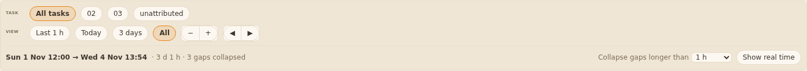 | PASS |
| T27.AC2 | Distances edge to first control, text to own border | Edge to controls 10 px on all four sides (1 border + 9 padding); chips side padding 10.2 px, buttons 8.4 px | PASS |
| T27.AC3 | Rects of every chip and button at 1440, 1000, Extra large; Small and Normal too | Task row one line (label, All tasks, 02, 03, unattributed); View row one line (label, Last 1 h, Today, 3 days, All, − +, ◀ ▶); chips 8.0 px apart, button pairs 8.0 px from the chip before and after; rows separate. 1000 px and Extra large: no overlap, nothing cut, rows still fit on one line each. 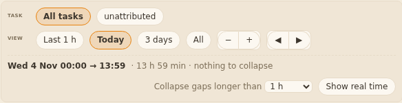 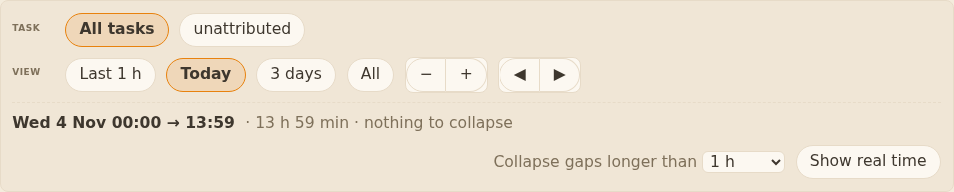 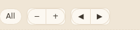 | PASS |
| T27.AC4 | Chose task 02, Today, Real time on; Tab through the block | Active: bg `--t-need`, border `--mango`, text `--ink`, bold 700; others `--bg`/`--border`/`--ink`, 400. Every control in the block shows a solid 2 px `--ink` outline, offset 1 px. 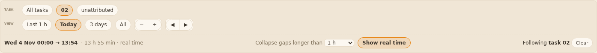 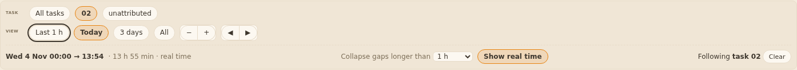 | PASS |
| T27.AC8 | Hovered Today, 02, Zoom in, Show real time; read titles | Border turns `--ink` on each; titles Zoom out, Zoom in, Earlier, Later. 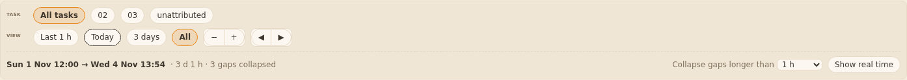 | PASS |
| T27.AC5 | Every colour (text, bg, 4 borders) of every element in the block vs the tokens | Only `--panel2 --border --bg --ink --muted --t-need --mango --err`; no shadow; dashed range rule is `--border`; error text rgb(176,16,16) = `--err` | PASS |
| T27.AC6 | Task 03, then 3 days, Zoom in, Zoom out, Earlier, Later, Last 1 h | Task 03 stayed chosen all along; range and view chips changed each time | PASS |
| T27.AC7 | Each state of s4 | Normal, active, hover, focus, Extra large, 1000 px: see above. No tasks (Today view: only All tasks, unattributed): 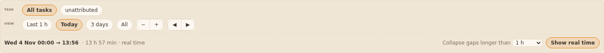. Many tasks (34 chips): wrap to a second line that starts under the first chip, label column stays: 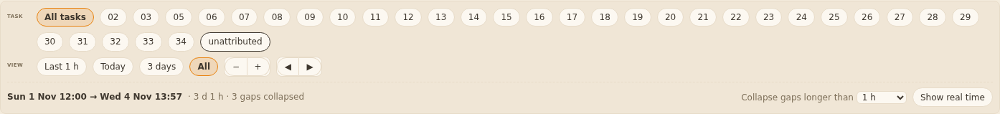. Error: `· could not load this range` in `--err`: 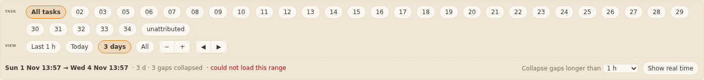. Loading: `· loading`: 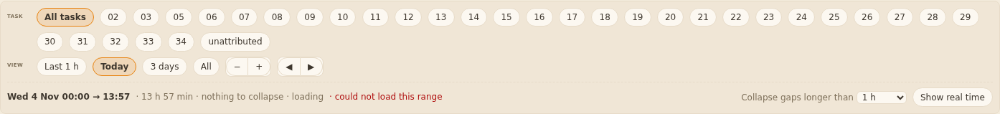 | PASS |
| T27.AC9 | Shrank the panel, scrolled the lanes 200 px | Bar stays at the top and is opaque (lanes do not show through it). But the bar sits 2 px below the top of the panel body, and the lane heading text ("COMMITS AND OTHER MARKS") is visible, cut off, in that 2 px strip above the bar. 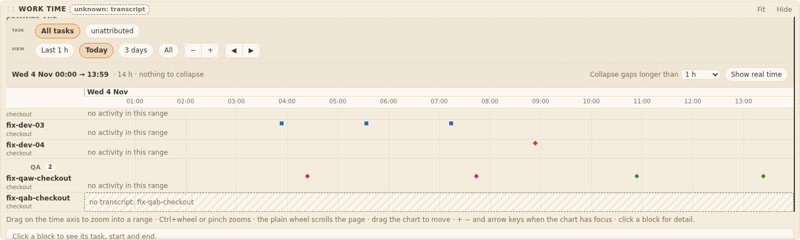 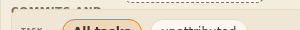 | FAIL (F1) |
| T27.AC10 | Searched text and tooltips of the block in every state | No `%` | PASS |

#### Findings
1. **F1 T27.AC9 / design-v7 s4 ("stays at the top of the panel body"):** with the lanes scrolled, the bar is stuck 2 px below the top edge of the panel body, so lane text scrolls into view above it, cut in half. To pass: the bar covers the whole top of the body (no strip above it; lanes never visible above the bar), at scroll 200 and 250.

Observations (not counted): a failed range keeps `· could not load this range` next to `· loading` while the next request runs. When a task is chosen the range line also shows `Following task 02` + `Clear` at the right (older behaviour, not in s4).

#### To pass (one return)
Fix F1. Re-check will be F1 only (LC-3b).

---
### Return 1 re-check: sha 4a9dc45 (code 51def03, branch squad/board/dashboard/board-dev-strip-31) — PASS
F1 only (LC-3b). Board from the Dev worktree on the fixture squad, 1440 x 900; shrank the Work time panel by 320 px; scrolled the lanes to 0, 200, 250.

| Item | What I did | What I saw | Result |
|---|---|---|---|
| F1 / T27.AC9 | Looked at the top 5 px of the panel body at each scroll, at three x positions | At 200 and 250 the bar's top is at 0 and covers every probed point from 0.5 px down (40, 300, 900 px across); no lane text above the bar; bar background still rgb(240,230,214) = `--panel2`, opaque. Unscrolled: bar 2 px below the top, as before. The axis stays directly under the bar (0.3 px). 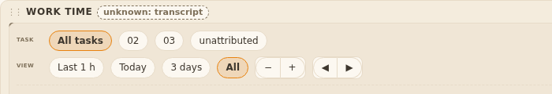 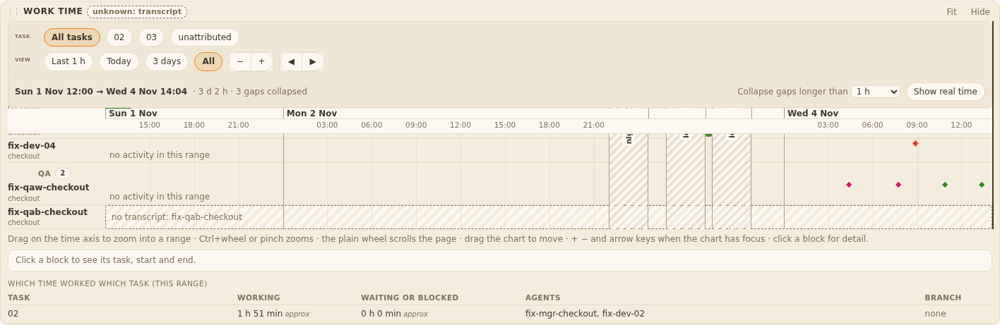 | PASS |
| Look at rest | Reset layout, measured the bar | bg `--panel2`, padding 9, first control 10 px in: unchanged | PASS |

Verdict on 4a9dc45: PASS. AC1-AC10 and every s4 state hold (round 1 on bbd3f77 plus this re-check of the one changed file).
