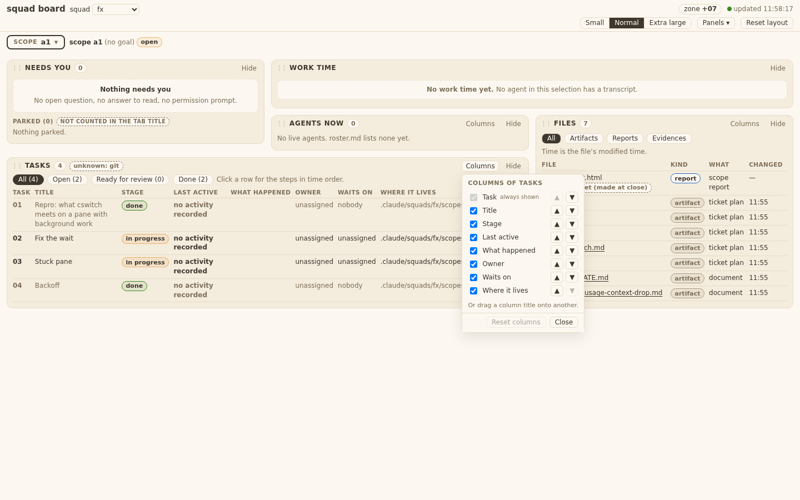
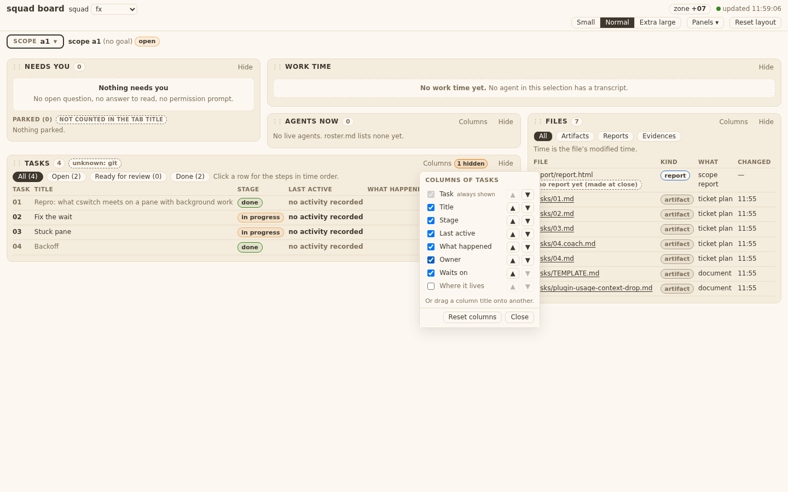
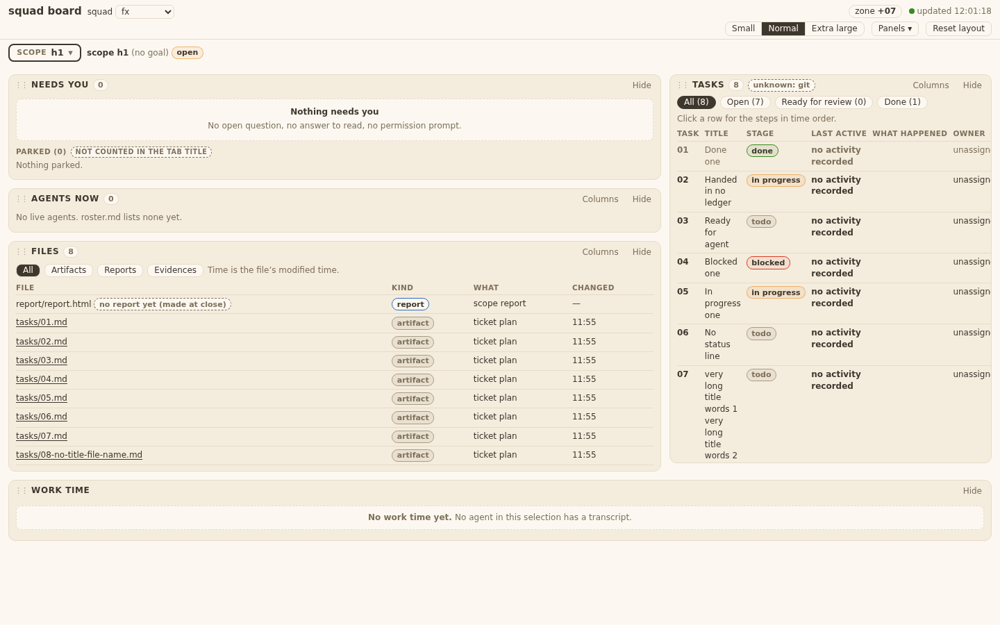
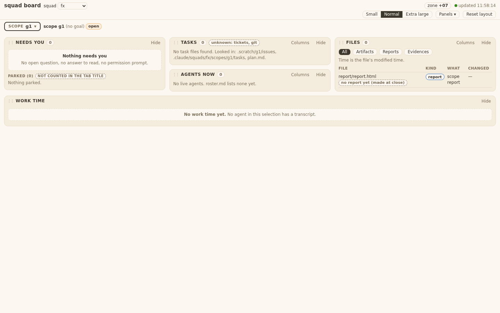
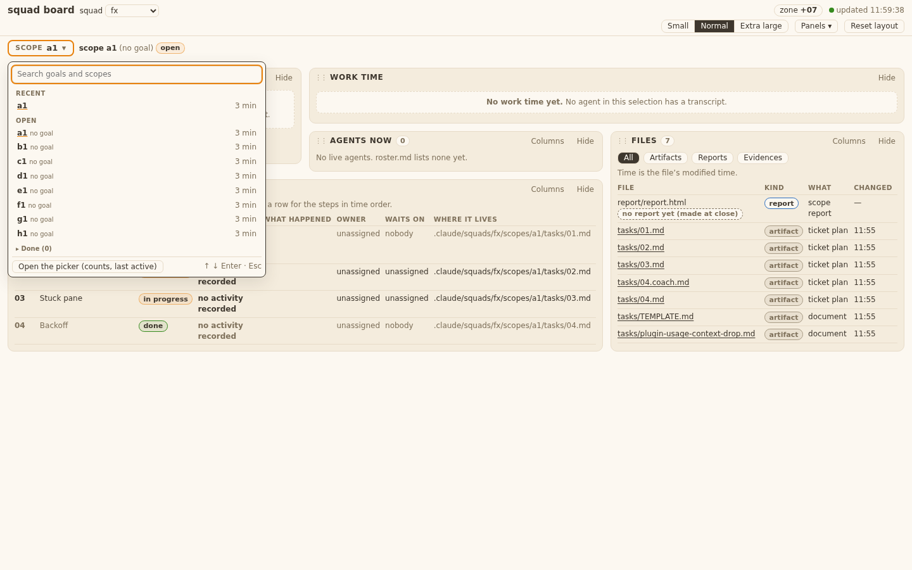
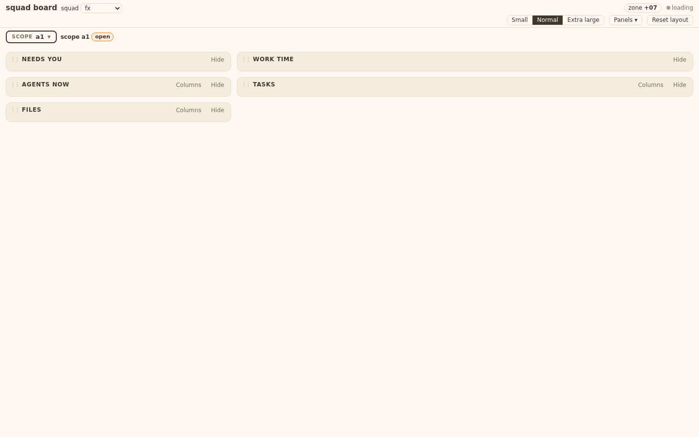
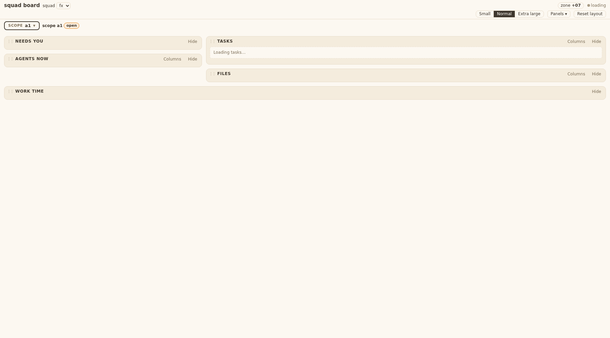
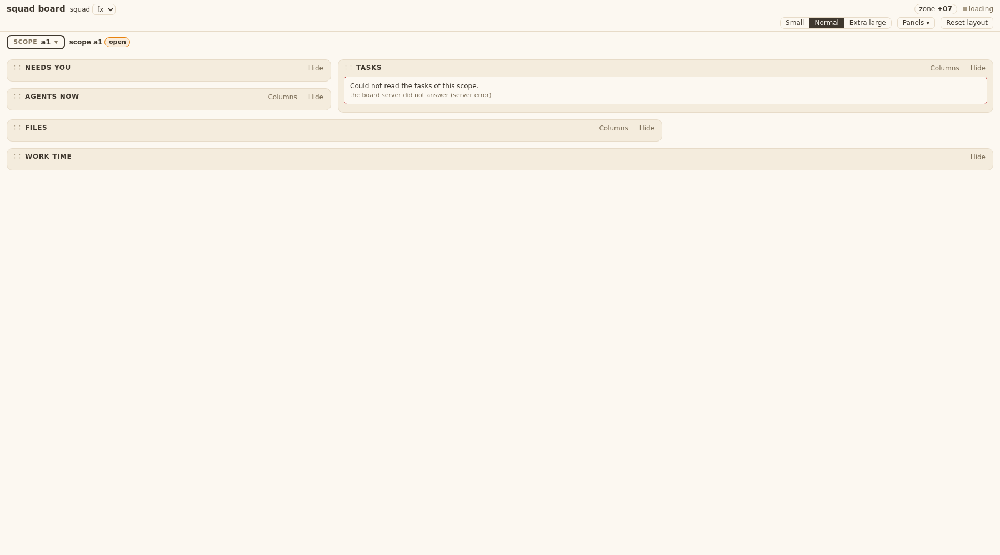
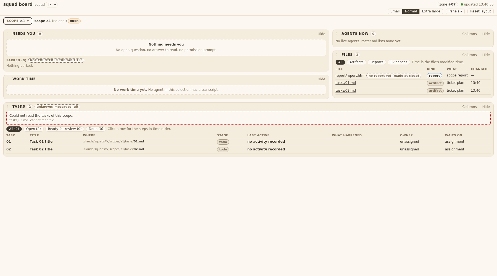

# Evidence 28: tasks from the scope's definition

## Behaviour
One function, `squadtickets.scope_tasks(scope_home, repo_root, name)`, now decides the tasks of a scope. Order: `tickets:` line, `.scratch/<scope>/issues`, the scope's `tasks/NN*.md` and `tasks/issues/NN-*.md`, a plan table. First source with a task wins; no guess from other scopes. The board reader, the scope picker and the report all call it. Rows gain `where`, `abs`, `ticket_status`. The Tasks panel has a "Where it lives" column (last, on by default) and the empty text "No task files found. Looked in: ...".

Live run (read-only), `python3 -c` calling `squadtickets.scope_tasks` on the real folders:
- `.claude/squads/accounts/scopes/cswitch-bg`: source `scope`, 4 tasks 01-04, status `done`.
- `.claude/squads/board/scopes/dashboard`: source `scratch`, 21 tasks (main repo `.scratch/dashboard/issues`).

## AC table
| Item | Shown by |
|---|---|
| T28.AC1/AC2 cswitch-bg 4 rows, title, where | tests/test_squadboard_tasks.py `ScopeFilesShape`; live run above |
| T28.AC3/AC5/AC12 source order, fall-through | tests/test_squadtickets.py `test_T28_TA1_source_order_and_fall_through` |
| T28.AC4/AC8 no other scope's folder | `test_T28_TA2_no_guess_from_other_scope` |
| T28.AC5 plan table, "plan table, plan.md" | `test_T28_AC14_drafts_and_plan_and_looked` |
| T28.AC6 status words and stages | `test_T28_TA5_status_word`; bin/squadboard_tasks.py `stage()` |
| T28.AC7 empty text with folders | panel_tasks.js draw(); `Tasks28` in test_squadboard_panels.py |
| T28.AC9 report same function | bin/squadtickets.py `find_tickets` adapter; test_squadreport_tasks.py (fixture `tickets: feat`) |
| T28.AC10 Where column default on | panel_tasks.js COLS; test_squadboard_panels.py Panels20 pins |
| T28.AC13 evidence folders, TEMPLATE, non-numbered not rows | `test_T28_TA1_...` (TEMPLATE.md, `03-evidence/`) |
| T28.AC14 dashboard drafts in `tasks/issues` | `test_T28_AC14_...` |
| T28.AC15 picker y = rows | bin/squadboard_list.py `_tickets` uses `scope_tasks` |
| T28.AC11 goal view rows carry scope + where | bin/squadboard_tasks.py row dict (scope set in `read`) |
| TA1 one rule | `grep -n "scope_tasks" bin/*.py`; test_T19_same_folder_rule_as_list |
| TA4 row keys | `ScopeFilesShape` |
| TA6 list agrees | `ScopeFilesShape` (`_tickets` -> done/handed in) |

## Open gaps
- A user's saved column list (board-ui.json) that lacks `where` hides it (`board.js` colFull is not in my files). It shows after "Reset columns".
- Plan source reads `plan.md` and `tasks/plan.md` only, not "the iteration plan the scope names".

## Tests changed on purpose
- test_squadtickets.py: old token-favour test kept (still true: `tickets:` line wins); "falls back" test still passes.
- test_squadboard_tasks.py `test_T19_same_folder_rule_as_list`: now compares `_tickets` with `scope_tasks`.
- test_squadreport_tasks.py `build()`: one line `tickets: feat`.
- test_squadboard_panels.py: Tasks column pins (7 -> 8 columns) in Panels12 and Panels20.
- None skipped.

## Tests run
`grep -rl "squadtickets\|_ticket_folder\|find_tickets\|_tickets\|panel_tasks\|No tasks yet" tests/` hits: test_squadboard_page, test_squadboard_panels, test_squadboard_tasks, test_squad_evidence, test_squadreport_ui, test_squadtickets. All run OK, plus test_squadboard_list, test_squadreport_tasks, test_windows_safe, test_no_bare_bash, test_old_language_inventory. (test_squad_evidence run below.)

## Return 1 (fc32dc4 + this commit)
QA whitebox 1-8: `.coach.md`/`.summary.md` refused (`NOT_TASK`); `TEXT_MAX` 256 KB cap on ticket and plan reads; `iterations/N.md` read newest first; `_plan_ids` deleted; tests: `test_T28_AC13_TA1_I_...`, `test_T28_TA13_TA1_H_...`, `Tasks28` (rendered DOM, untrusted title, empty state), real heads in `tests/fixtures/board/t28/`, layout C + symlink, goal rows, REV-8, picker y.
QA blackbox, design-v7 s5: label `Where`, column right after Title, Title bold + 2-line clamp + tooltip, no title = italic muted file name (`untitled` row flag), Where = muted folder + bold file name (`data-abs` for ticket 30; plan-table rows muted), dashed empty note with one line per source (`scope.md (tickets: line)` first).
Return 3: `board.js` `renderPanel` hook (PANEL_TEXT table, `stateNote`, `failWhy`; one call in `makePanel`, one in `onFail`; CSS `.pstate` at the end of board.css): `Loading tasks…` (muted) until the first answer; dashed `--err` note `Could not read the tasks of this scope.` + file and reason on `resp.error`, on an answer with no data, or on a failed load (500); `resp.errors` keeps the rows and adds the note above. Tests: `Tasks28.test_T28_design_v7_s5_loading_note_then_error_note_and_rows_stay`, and the saved-columns block (list without `where`: renders, Columns offers Where) in `test_T28_TA7_...`. The Where click/link is ticket 30, not a gap of 28.
Pins changed (Tasks column order/count): test_squadboard_panels Panels12, Panels20.

## QA whitebox

### QA whitebox 28: sha 229bd0c (branch squad/board/dashboard/board-dev-tasks-25) — FAIL (return 1)
Checked in a clone. Ran: test_squadtickets, test_squadboard_tasks, test_squadboard_list, test_squadreport_tasks, test_old_language_inventory, test_windows_safe, test_no_bare_bash (72 ok); panels, page, test_squad_evidence, test_squadreport_ui (142 ok). Diff files are all in the ticket's touched list (TC.10). No write calls in the diff (TC.2). `grep` of folder search in squadboard_tasks/list/squadreport_tasks: none left; all go through `scope_tasks` (T28.TA1 grep ok).
Live run (REV-5b, T28.TA8), read-only: `accounts/cswitch-bg` -> source `scope`, ids 01-04, titles right (`01` = "Repro: what cswitch meets on a pane with background work"), status done/handed in/handed in/done, `where` = `.claude/squads/accounts/scopes/cswitch-bg/tasks/0N.md`, `abs` present, `looked` = [.scratch/cswitch-bg/issues, .../tasks]. Dashboard -> source `scratch`, 21 rows (committed ones), `abs` inside repo. Picker on 29 rows: 0.02 s.

#### Findings
1. **FAIL T28.AC13 / T28.TA1 case I (code): `*.coach.md` and `*.summary.md` become task rows.** `squadtickets.py` `NUM_FILE = ^(\d+)(?:-.*)?\.md$` matches `03-x.coach.md`. Repro (scratch scope `tasks/`: `03-x.md`, `03-x.coach.md`, `05-y.summary.md`, `07.md`): rows 03, 05, 07, and 03 points to `03-x.coach.md` (it sorts before `03-x.md`, so the wrong file wins its title/status). Expected: 03 and 07 only, 03 from `03-x.md`. What passes: the pattern refuses a name that has a second dot part (`.coach`, `.summary`), or an explicit refusal list, and the noise table (case I) tests `.coach.md` and `.summary.md`.
2. **FAIL T28.TA13 (code): plan file read unbounded.** `_plan_rows` -> `_text(f)` reads the whole file. Tech file: read at most N KB of a plan file (name N in the code), source 4 only when 1-3 gave nothing (that part is right). What passes: a size cap (e.g. 256 KB) and one test with a large `plan.md`.
3. **FAIL BA ticket 28 Rule 4 / T28.TA1 H (code): the iteration plan is not read.** Dev's own open gap: only `plan.md` and `tasks/plan.md`. BA Rules: "or the iteration plan the scope names". Tech design 4: `iterations/<n>.md` newest. What passes: add `iterations/*.md` (newest number first) as the third plan candidate, with the same row rule; `where` = `plan table, <file name>`. If the Dev thinks it is too much, ask the BA (BA ticket wins until changed).
4. **FAIL T28.TA7 (test): the panel test checks the JS source text, not the panel.** `Tasks28` only does `assertIn(...)` on `panel_tasks.js`. TA7 needs a rendered check: with rows that carry `where`, the title and the path are in the DOM as text (a title `` stays text, `window.__x` undefined, TU.3); the empty state shows "No task files found. Looked in: ..." with the folders; a saved column list without `where` renders without an exception.
5. **SETTLED (TL agreed, TA7 relaxed) T28.TA7 clause "saved list without `where` still shows `where`" (TL decision, blocks nothing yet).** Dev says `board.js` `colFull` treats a missing id as hidden, so a PO with a customised Tasks column list will not see Where until "Reset columns". The PO's live `board-ui.json` has `columns: {}`, so he is not affected. I cannot see a clean fix inside `panel_tasks.js` (the file is 25/26's `board.js`; a list cannot tell "hidden" from "new"). I asked the Tech Lead to relax TA7 to: "renders without error; Where available in the Columns control". If he agrees, finding 5 is closed with a test that the Columns list offers `where` for a list without it.
6. **FAIL T28.TA3 (test): not a real sample (REV-4).** Fixture is two synthetic lines. TA3 asks for the head copied from the real `accounts/.../tasks/01.md` and `04.md` (22 and 13 lines) plus a normal `.scratch` ticket, and the stage through `squadboard_tasks.read_scope`. Copy the two heads in.
7. **FAIL T28.TA4 (test): row key set for layout C missing.** Only layout B (`tasks/NN.md`) is asserted. Add layout C (`.scratch/<scope>/issues`): keys, and `abs` only when inside the roots (include a symlinked ticket pointing outside: listed, no `abs`).
8. **FAIL T28.TA10, TA11, TA12 (tests missing).** (a) picker "x of y": y = number of Tasks rows on layouts B and C; (b) goal view: rows carry `scope` and the same `where`; (c) message token `REV-8` with no ticket gives no row. One assert each, in existing tests; TA12 goes in the TA2 test.

#### Accepted
- Row shape, `looked`, fall-through (AC12), source order (D layouts), `status_of` words, stage mapping incl. `handed in` without HANDIN -> in progress, report adapter and the `tickets: feat` fixture line, `_ticket_folder` and `_tickets` copies gone (`_plan_ids` in `squadboard_tasks.py` is now unused: delete it), Windows/inventory tests.

#### To pass (one return)
Fix 1, 2, 3 in `squadtickets.py`; delete `_plan_ids`; add tests for 1-4, 6-8 in the existing test files (no new file); list the tests added/changed in HANDIN. Finding 5: wait for the Tech Lead's ruling.

---
### Return 2 check: sha 92e6fa3 — FAIL (one test missing)
Clone checked. Ran test_squadtickets, test_squadboard_tasks, test_squadboard_list, test_squadreport_tasks, test_squadboard_panels, test_old_language_inventory, test_windows_safe, test_no_bare_bash: 123 ok. Live (REV-5b): cswitch-bg -> source scope, 4 rows 01-04 (done, handed in, handed in, done), `abs` present; dashboard -> source scratch, 21 rows; 0.001-0.003 s.
Accepted: findings 1 (NOT_TASK; test), 2 (TEXT_MAX 256 KB; test), 3 (iterations/N.md newest first; test), 4 (rendered DOM test: untrusted title as text, empty state), 6 (real heads in tests/fixtures/board/t28), 7 (layout C + outside symlink), 8 (TA10, TA11, TA12), `_plan_ids` deleted. The design-v7 panel edits are QA blackbox's.

#### Finding
1. **FAIL T28.TA7 (test missing, relaxed clause).** The agreed TA7 says: a saved column list without `where` renders without error AND the Columns control offers `where`. `Tasks28.test_T28_TA7_panel_dom_..._and_saved_list` is named for it but never saves a list (`saved=None`, no `columns` payload, no Columns-list assert). Add to that test: a saved `columns` for Tasks that has no `where`; assert the panel renders (rows present, no exception) and the Columns list (`.cpop`) has a `where` entry. No code change expected.

#### To pass
Add that one assert block; re-run test_squadboard_panels.

---
### Return 3 check: sha a3889c2 (branch squad/board/dashboard/board-dev-hook-29) — PASS
Clone checked. Diff since 92e6fa3: board.css (+2), board.js (renderPanel Loading/error hook, tasks only via `PANEL_TEXT`), test file (+35), evidence. Ran test_squadtickets, test_squadboard_tasks, test_squadboard_list, test_squadreport_tasks, test_squadboard_panels, test_squadboard_page, test_old_language_inventory, test_windows_safe, test_no_bare_bash: 146 ok.
Finding 1 (TA7) fixed: saved Tasks list without `where` renders rows, no Where column, and the Columns list offers Where.
Notes (not findings): the `board.js` hook is outside the original TA for 28 (TC.10 said 28 does not edit `board.js`); it was ordered through the roster for the QA blackbox findings, and tested. Colours use `--border/--err/--muted/--ink`, no hex. Merge of this branch with 25 (`board.js`, same file) and later 26 is for the integration step; I did not test the merge.

## QA blackbox

### QA blackbox, task 28 (Tasks from the scope's definition)
Sha 229bd0c (branch squad/board/dashboard/board-dev-tasks-25). Board run from that worktree on: scratch squad `fx` (scopes a1 accounts-style, b1 empty `tickets:` folder, c1 plan only, d1 `tickets:` + tasks, e1 `.scratch/e1` + tasks + other feature, f1 tasks only, g1 nothing + REV-8 token, h1 all statuses + long/no title, goal G with s1,s2), real squads `accounts` and `board`. Playwright (playwright-cli).

| AC | What I did | What I saw | Result |
|---|---|---|---|
| T28.AC1 | real accounts/cswitch-bg; fixture a1 | 4 rows 01-04, titles from `# NN` line; real: all `merged`; fixture: 01,04 `done`, 02,03 `in progress` (no HANDIN). None todo, no "No tasks yet" | PASS |
| T28.AC2 | Where cell on both | repo-relative path shown (`.claude/squads/accounts/scopes/cswitch-bg/tasks/0N.md`). It is plain text: not a link, no underline, a click does nothing (ticket 30 not built) | FAIL (click/link part; see AC12) |
| T28.AC3 | d1 | row from `.scratch/some-slug/issues/01-x.md` only | PASS |
| T28.AC4 | f1; e1 | f1 lists its tasks; `.scratch/otherfeature` never used | PASS |
| T28.AC5 | e1; c1 | e1 lists the `.scratch/e1` file only; c1 rows show `plan table, plan.md` | PASS |
| T28.AC6 | h1 | done→done, handed in→in progress, ready-for-agent→todo, blocked→blocked, in progress→in progress, none→todo | PASS |
| T28.AC7 | g1 | `No task files found. Looked in: .scratch/g1/issues, .claude/squads/fx/scopes/g1/tasks, plan.md.`; needs-you count 0 as before | PASS (text); layout see AC12 |
| T28.AC8 | g1 (REV-8 in messages) | no row | PASS |
| T28.AC9 | `squad-report cswitch-bg` (data.json) vs board | same 4 ids and titles. Fixture scopes have no transcripts, so the report lists none there (could not compare) | PASS (real data) |
| T28.AC10 | Tasks Columns control on a1 | "Where it lives" listed, checked; moved up twice, unchecked (column gone), re-checked | PASS |
| T28.AC11 | goal G | each row shows `s1/01`, `s2/01` plus the same Where | PASS |
| T28.AC12 (2nd, panel vs design s5) | h1, g1, forced loading and 500 | see list below | FAIL |
| T28.AC12 (1st, `tickets:` folder without NN files) | b1 | falls through to tasks/ and lists it | PASS |
| T28.AC13 | a1 with `tasks/01/`, `05-evidence-slug/`, `issues-tech/`, TEMPLATE.md, `plugin-usage-context-drop.md`, `04.coach.md` | none is a row (4 rows) | PASS |
| T28.AC14 | board/dashboard real data | 21 rows (`.scratch/dashboard/issues` has 01-21 committed, so source 2 wins). Tickets 22-30 sit only in `tasks/issues` and do not show. AC says 01 to 30 | PASS under Manager ruling FINAL (a): 21 rows now, 30 once 22-30 are committed to `.scratch` (tasks/decisions-iter2.md) |
| T28.AC15 | header count vs rows; goal-view "TASKS x of y" | header count equals rows (4/4, 8/8, 21/21; goal 1 of 1, 0 of 1). Picker list gets no row (Manager ruling: checked on header and goal table) | PASS |

#### FAIL list for T28.AC12 and design-v7 s5 (one return)
1. Column label is `Where it lives`; design and AC say `Where`.
2. Where column is last. Design s5: "right after Title".
3. Title cell is not bold (weight 400, muted colour). Design: bold.
4. A very long title (h1 task 07) is not cut at 2 lines; the cell is 2713 px tall; no ellipsis; no tooltip with the whole title.
5. No-title row (h1 file `08-no-title-file-name.md`) shows `no-title-file-name` plain; design: file name, italic, muted.
6. Where cell is one plain string: folder part not muted, file name not bold, not a link (no underline, no hover path). Plan-only `plan table, plan.md` is plain (not muted).
7. Empty state is a plain muted sentence, no dashed border; "Looked in:" is not one line per source; `scope.md (tickets: line)` and `tasks/plan.md` are not named (design lists the four sources).
8. Loading: while the tasks request is held 7 s, the panel shows only the header, no `Loading tasks…`.
9. Error: tasks request answered 500: panel shows only the header, no `Could not read the tasks of this scope.` note.

Verdict: FAIL on 229bd0c (AC2 and the AC12 design points). AC14 and AC15 pass under the Manager ruling.

#### Re-check on 92e6fa3 (return 1)
Board from the Developer's worktree on a rebuilt scratch squad `fx` (scopes a1 flat tasks, b1 empty `tickets:` folder, c1 plan only, d1, g1 nothing, h1 long title / no title). Measured with Playwright at 1800 px.

| Design point (T28.AC12 / AC2) | What I saw on 92e6fa3 | Result |
|---|---|---|
| 1 Label `Where` | header `Where` | PASS |
| 2 Column right after Title | order Task, Title, Where, Stage, ... | PASS |
| 3 Bold title | weight 700 | PASS |
| 4 2-line clamp + tooltip | clamp 2, cell height 34 px (2 x 16.8) for a 340-char title; tooltip holds the whole title | PASS |
| 5 No title: italic muted file name | `no-title-file-name`, italic, 400, muted | PASS |
| 6 Where cell: muted folder, bold file, plan-table muted no link | folder muted, file name bold; c1 `plan table, plan.md` muted, no link | PASS (link part: see AC2) |
| 7 Dashed empty note, one line per source | dashed box: `scope.md (tickets: line)`, `.scratch/g1/issues`, `.claude/squads/fx/scopes/g1/tasks`, `plan.md, tasks/plan.md, iterations/` (b1 also lists the `tickets:` slug folder) | PASS |
| 8 Loading: `Loading tasks…` | request held: panel shows only header, no text | FAIL |
| 9 Error: dashed note `Could not read the tasks of this scope.` | `/api/tasks` answered 500: panel shows only header, no note | FAIL |
| T28.AC2 click opens the file | Where cell has no link, no underline; click does nothing (ticket 30 not built) | FAIL (waits for ticket 30) |

Earlier screenshots of the two states are unchanged:  

Developer says points 8 and 9 sit in `board.js renderPanel` outside his files and asked the Manager; the AC does not carve them out.

Verdict: FAIL on 92e6fa3, T28.AC12 points 8 and 9, and T28.AC2 (click) unless the Manager rules it moves to ticket 30. Points 1-7 pass.

#### Re-check on a3889c2 (return 2, Developer board-dev-hook-29; points 8 and 9 only)
Per Manager FINAL: 8 and 9 only; the AC2 click goes to ticket 30 (pass 2). Board run from the worktree on a scratch squad (scope a1, 2 tasks); Playwright route to hold, fail or extend the `/api/tasks` answer.

| Design point | What I did | What I saw | Result |
|---|---|---|---|
| 8 Loading | held `/api/tasks`, looked at the panel | `Loading tasks…` in a muted note; after release the 2 rows show and the note is gone | PASS |
| 9 Error | answered `/api/tasks` with 500 | dashed note, red (`--err`) border: `Could not read the tasks of this scope.` + `the board server did not answer (server error)`; no table | PASS |
| 9 Readable tasks stay | answer with 2 rows plus `errors: [tasks/03.md: cannot read file]` | note names file and reason; the 2 rows still in the table | PASS |

Verdict on a3889c2: PASS for T28.AC12 points 8 and 9. With points 1-7 (92e6fa3) all AC12 points pass. T28.AC2 click is checked with ticket 30.
