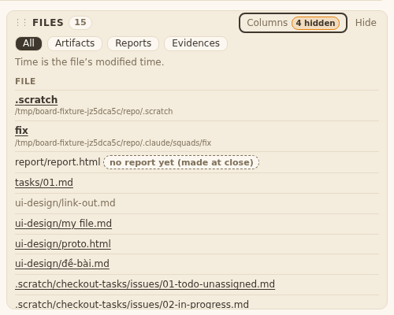
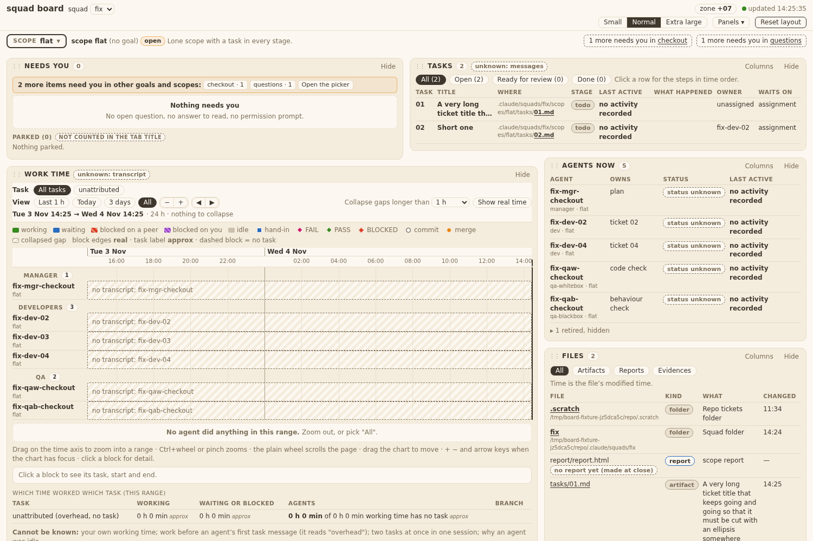
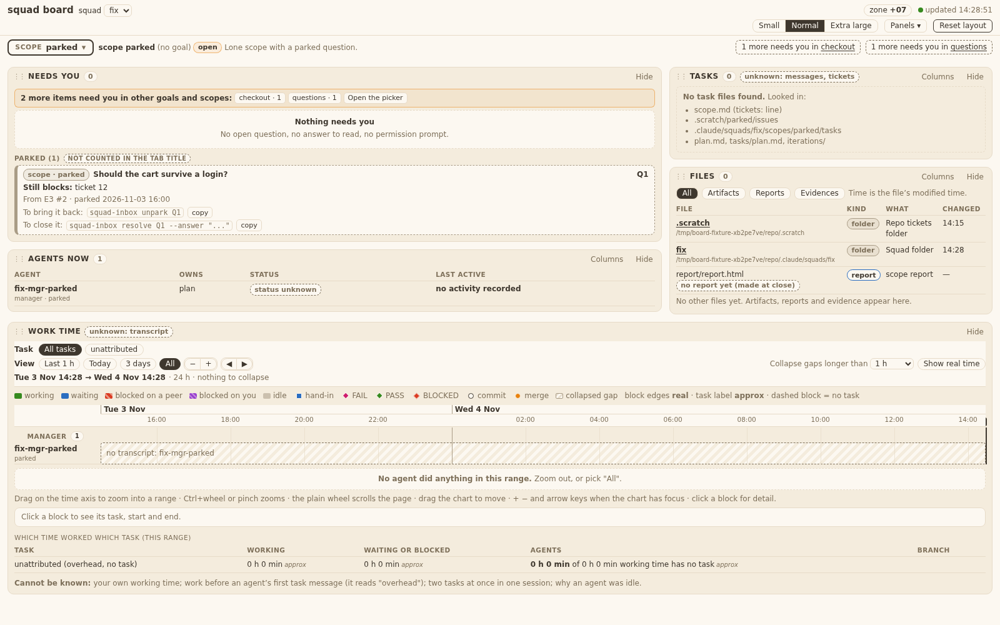
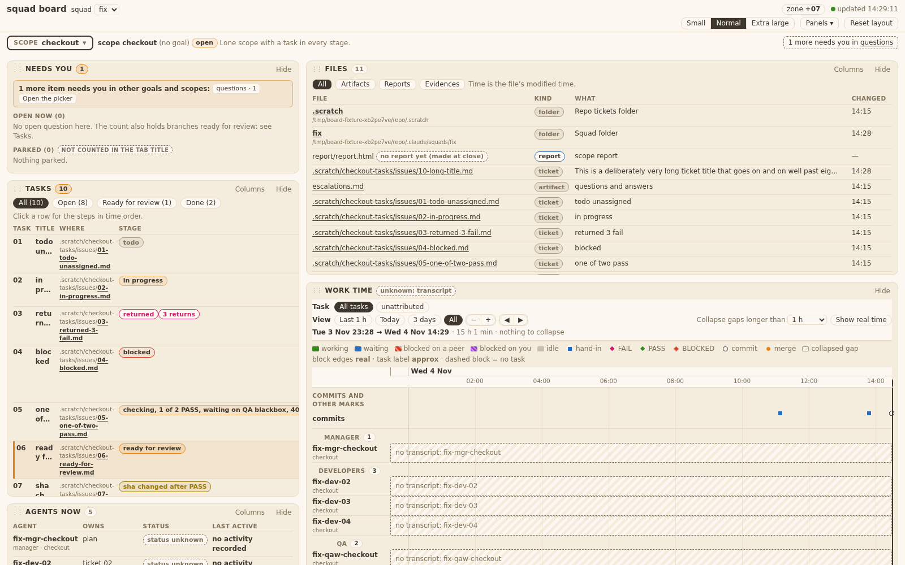

# Evidence 29: Files folder rows and ticket rows
sha: 519cf22
## Behaviour
`bin/squadboard_files.py` only (plus `tests/test_squadboard_files.py`). Ticket rows come from `squadtickets.scope_tasks` (ticket 28, merged at a3889c2); What = ticket title. Folder rows are a separate `folders` list (`.scratch`, squad folder), not in `rows`. PO confirmed O2 (E11): folder rows kept.
Tests run: `test_squadboard_files.py` (12 OK), `test_squadboard_panels.py` (48 OK) = the two hits of `grep -rl "squadboard_files\|api/files" tests/`.
Old tests changed: `test_T14_AC1_TA1_TA2...` (also asserts `folders`). None skipped.

## AC table
| AC | Where shown |
|---|---|
| T29.AC1, AC2 | `squadboard_files.py` `_folder_row`, `list_files` (folders for scope and goal); test `test_T14_AC1_TA1_TA2` (names, What, abs, no folder in rows) |
| T29.AC3 | folders built before the file walk, always; panel empty-note text is ticket 30 (open gap for 29: data only) |
| T29.AC4 | `test_T29_AC4_flat_scope_tasks...` (flat `tasks/NN.md`), `test_T29_AC4_AC5_AC9...` (`.scratch/<slug>/issues`) |
| T29.AC5 | `test_T29_AC4_AC5_AC9...` (`.scratch/other` not listed) |
| T29.AC6 | `_folder_row` resolve + `_under`; missing `.scratch` gives no row. test `test_T29_AC6_AC3_TA3` (no `.scratch`, symlinked `.scratch`: no row) |
| T29.AC7, AC10 | panel side (ticket 30); data: folders are not in `rows`/`files_seen` |
| T29.AC9 | `_Walk.listed` set; same test asserts unique paths |
| T29.AC11 | `w.add(..., t["title"])`; same test asserts What = title |
| T29.AC8 | existing T14 tests green |
| T29.TA3 (600 files) | `test_T29_AC6_AC3_TA3` (folders not counted in the cap); existing cap test covers 500 rows |
| T29.TA6 | `/api/file` test over every row in `rows` still 200 |

## Return (QA blackbox FAIL on e89b7c2)
Code change in `templates/board/panel_files.js` only; tests in `test_squadboard_panels.py` (class Panels30, no old test edited).

| Finding | Fix | Test |
|---|---|---|
| F1 T29.AC3 | `empty = !R.total`: the note shows after the folder rows and the report placeholder | `test_T29_AC3_empty_note_shows_...` |
| F2 T29.AC4 | the Kind pill reads `ticket` for ticket rows (`raw` kind kept; filter group still Artifacts) | `test_T29_AC4_AC11_ticket_row_pill_...` |
| F3 T29.AC11 | What is cut at 80 characters with an ellipsis, full title is the tooltip | same test |

Runs: panels 56, page 22, files 14, server 18, all OK.

## QA whitebox (final)

### QA whitebox 29: sha c04e8e0 (branch squad/board/dashboard/board-dev-files-26) — FAIL (return 1, tests missing)
Checked in a clone. Diff a3889c2..c04e8e0 code: `bin/squadboard_files.py` only (+36 -7) and `tests/test_squadboard_files.py` (+46). Ran test_squadboard_files (12 ok) and test_squadboard_panels (48 ok) = the two hits of the TC.11 grep. Code reads right: `folders` is a separate additive key, built after the walk and never touching `rows`, `files_seen`, `truncated`; `_folder_row` rejects a symlink, a non-dir and a path outside the roots, never raises; ticket rows come from `scope_tasks` with title as What; `_Walk.listed` dedupes by resolved path, ticket rows first. Architecture §1 allow-list holds.
Live run (REV-5b), read-only, on the real board squad, scope `dashboard`: folders = `.scratch` (Repo tickets folder) and `board` (Squad folder), abs = real path, mtime ints; 147 rows = files_seen 147, no folder in rows; 22 ticket rows from `.scratch/dashboard/issues` with the title as What; paths unique; no other scope's ticket. Matches TA1/TA4/TA5 on real data.

#### Findings
1. **FAIL T29.TA1 (test): too little asserted.** TA1: both rows with `abs` equal to the real folder and `mtime` equal to `os.stat` of the folder, "one test over both views" (scope and goal). The test (`test_T14_AC1_TA1_TA2`, test_squadboard_files.py:75-79) checks names, What, kind and key set only, in the scope view. Goal view `folders` is asserted nowhere (the goal test at "test_T14_TA1_goal_lists..." never reads `folders`). What passes: in that one test (or one new one) assert for scope and goal that `abs == str(resolved folder)` and `mtime == int(os.stat(folder).st_mtime)` and the two names/What.
2. **FAIL T29.TA2 (test): the empty scope is not tested.** TA2: a scope with no files at all still gives both rows; `files_seen`, `truncated` and `len(rows)` do not count them. The only related test (`test_T29_AC6_AC3_TA3`) patches MAX_ROWS=3 on a scope that still has files and asserts folder names only. What passes: a scope with no listed files (a new scope home, or the fixture emptied) gives `folders` of 2, `rows == []`, `files_seen == 0`, `truncated is False`.

#### Accepted notes (not findings)
- TA6 "`abs` present" on file rows: rows have no `abs` yet. Ticket 30 TA3 adds `abs` to every row (tech file 29 design notes say so too), and I check it there. The `/api/file` round trip over every listed row stays in test_T14_TA3 (200 for all, tickets included).
- Stale comment at squadboard_files.py:26 names `declared_folder`; the code uses `scope_tasks`. Cosmetic, fix when next touched.

#### To pass (one return)
Extend tests for 1 and 2 (no code change expected). Run test_squadboard_files again.

### QA whitebox 29: sha 68b5134 (branch squad/board/dashboard/board-dev-files-26) — PASS (return 1 re-check)
Re-check of the test change (diff 850fdce..68b5134: `tests/test_squadboard_files.py` +11, no code). New `test_T29_TA1_TA2`: scope and goal view each give `.scratch` and `fix` folder rows with `abs` equal to the resolved folder and `mtime` equal to `os.stat`; an empty scope gives folders 2, rows [], files_seen 0, truncated False. Findings 1 and 2 closed. The 29 folder-row code is unchanged since c04e8e0 (the commit 850fdce between them is ticket 30's server part, touching `add` rows only; I check it under 30). Ran test_squadboard_files in a clone: 13 ok. TA6 `abs` on rows is now delivered by 850fdce (ticket 30), checked under 30.

### QA whitebox 29: sha 519cf22 (branch squad/board/dashboard/board-dev-tests-32) — PASS (return after QA blackbox FAIL, re-check)
Diff e856a55..519cf22: `templates/board/panel_files.js` (+8 -3), `tests/test_squadboard_panels.py` (+31), evidence/img. Read the code diff in full: `empty = !R.total` (`total` is `all.length`, the unfiltered row count, so an empty filter still shows "No file in this filter."); Kind pill reads `ticket` via new `raw` field, filter group unchanged; ticket What cut at 80 (79 chars + "…", trailing space trimmed), full title as `title`; only for `raw === "ticket"`. BA T29.AC3, AC4, AC11 match. No Python change.
Ran panels, files, tasks, page, server in a clone: 127 OK, none skipped. Mutations (each reverted): old `empty` formula → AC3 test fails; pill back to `r.kind` → AC4/AC11 test fails; cut disabled → same test fails.

## QA blackbox (final)

### QA blackbox, ticket 29 (Files: folder rows, ticket rows)

Checked on the running board of branch board-dev-files-26, commit e89b7c2 (tests-only e856a55 changes no behaviour). Fixture `tests/board_fixtures.py --now` plus extra files in `ui-design/`, a flat `tasks/NN.md` scope and a squad without `.scratch`. Verdict: **FAIL** (3 AC).

| AC | What I did | What I saw | Result |
|---|---|---|---|
| AC1 | Opened scope checkout Files | First two rows `.scratch` and `fix`, kind folder, abs path small muted under the name, What `Repo tickets folder` / `Squad folder`, Changed 11:34 / 14:11 = folder mtime on disk | PASS |
| AC2 | Goal view `alpha` (data) | Same two folder rows | PASS |
| AC3 | Scope `parked` (no files, count 0) and `done-02` | Two folder rows + report placeholder row, but the note `No other files yet. Artifacts, reports and evidence appear here.` never shows (searched the whole page) | **FAIL** (see F1) |
| AC4 | Scope checkout (.scratch tickets) and a flat `tasks/01.md, 02.md` scope | Rows are listed, but the kind pill reads `artifact`, not `ticket` | **FAIL** (F2) |
| AC5 | Scope `search` | Only `.scratch/search/issues/*`; none of `checkout-tasks` | PASS |
| AC6 | Squad `other` (no `.scratch`) | Only the squad folder row, no error | PASS |
| AC7 | Columns: hid What, Changed, Kind, Scope | Folder rows and others stay, abs path under the name  | PASS |
| AC10 | Count | Count 15 / 2 / 0 = files only, folders not counted | PASS |
| AC11 | Ticket with a 120-char title | What shows the full title wrapped on 8 lines, no ellipsis . Short titles show without the number (`todo unassigned`). | **FAIL** (F3) |
| AC9 | tasks/NN.md that is also in the old list | Listed once | PASS |
| AC8 | T14.AC1/3/4/5 | Symlink to outside file: muted text, no link, `cannot be opened: outside the squad folders` | PASS |

#### Findings
- **F1 (T29.AC3):** in a scope with no files, the empty note is missing. Count 0, no note.
- **F2 (T29.AC4, design-v7 s6):** ticket rows show kind `artifact`; the data says `ticket`, the page does not.
- **F3 (T29.AC11, design-v7 s6):** long ticket title is not cut with an ellipsis.

#### Re-check on 519cf22 (F1-F3 only, LC-3b): **PASS**

Fixture `tests/board_fixtures.py --now`, board of branch board-dev-tests-32 at 519cf22, plus one extra ticket with a 133-char title.

| Finding | What I did | What I saw | Result |
|---|---|---|---|
| F1 (AC3) | Scopes `parked` and `done-02` (no files), Files panel | Note `No other files yet. Artifacts, reports and evidence appear here.` shows under the two folder rows (in `parked` also with the report placeholder row). Scope `checkout` (has files): no note.  | PASS |
| F2 (AC4) | Scope `checkout`, ticket rows | Kind pill reads `ticket` on every `.scratch/.../issues/*.md` row; `escalations.md` stays `artifact`. | PASS |
| F3 (AC11) | Ticket with a 133-char title | What cell cut at 80 chars with `…`; hover title holds the full title.  | PASS |

T30: Dev says only the Files Kind pill and What cell changed since e89b7c2 (verified by F2/F3 above); click, link and status line unchanged. My earlier T30 PASS stands.
