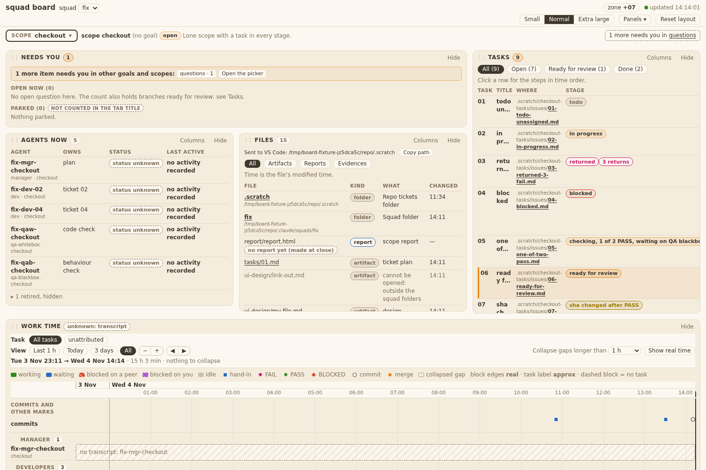
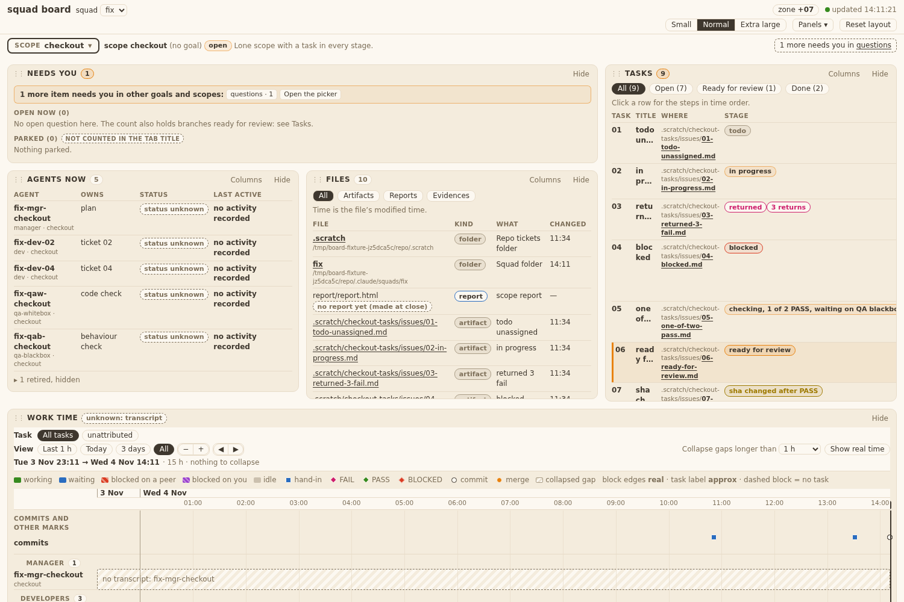

# Evidence 30: a file click opens VS Code
sha: e856a55
## Behaviour
- `templates/board/panel_files.js`: `BOARD.vscodeUrl(abs, distro)` is the one link function (`vscode://file/<abs>`, or `vscode://vscode-remote/wsl+<distro>/<abs>` when `data.wsl_distro` is set; each segment encoded). Every row of the Files panel is a link (no `target`, `rel=noopener noreferrer`, tooltip `<abs> — opens in VS Code`). The new-tab and markdown-window code is deleted (`openMarkdown`, `_blank`, `root.open`). A click sets a `role=status` line `Sent to VS Code: <abs>` with `Copy path`, kept 8 s (`BOARD.filesStatusMs`) and redrawn if the panel redraws. Folder rows (the `folders` list of ticket 29) come first, name in bold with the absolute path under it. Empty note: `No other files yet. Artifacts, reports and evidence appear here.`
- `bin/squadboard_files.py`: rows carry `abs`; a symlink pointing outside the allow-list is kept as a row `{kind: other, abs: null, blocked: true, what: "cannot be opened: outside the squad folders"}` (the target path is never given); data gets `wsl_distro`.
- `templates/board/panel_tasks.js`: the file name in the Where cell is a link through `BOARD.vscodeUrl`.
- **Deviation:** `bin/squadboard_tasks.py` also returns `wsl_distro` (one line) because the Tasks panel needs the distro for the link and `/api/tasks` did not carry it.
- Tests run: `test_squadboard_files.py` 13, `test_squadboard_panels.py` 52, `test_squadboard_tasks.py` 16, `test_squadboard_page.py` 22, `test_squadboard_server.py` 18, `test_windows_safe.py`, `test_old_language_inventory.py`: all OK, none skipped.
- Tests changed on purpose: `test_squadboard_panels.py` `test_T14_AC1_AC2_TA3...` (was `_blank` + `/api/file`, now `vscode://`, no target); `test_squadboard_files.py` symlink-out test (blocked row kept) and `ROW` (adds `abs`).
- Not tested here: opening VS Code (QA blackbox by hand); live headless `--dump-dom` with `WSL_DISTRO_NAME` set/unset (QA whitebox, TA10).

## AC table
| AC | Where shown |
|---|---|
| T30.AC1, AC2, AC10 | `vscodeUrl` + `fileRow` in `panel_files.js`; `test_T14_AC1_AC2_TA3...`, `test_T30_TA2_no_new_tab_code...` |
| T30.AC3, AC13 | `fileRow` (folder: bold name link + `.fpath` line); `test_T30_AC3_AC7_AC9...` |
| T30.AC4 | `panel_tasks.js` Where cell; `test_T30_TA11_AC4...` |
| T30.AC5 | `test_T30_TA1_AC5_url_function_table` |
| T30.AC6 | same test (Debian form) and `wsl_distro` in the data; PO agreed O1 (E11) |
| T30.AC7 | `squadboard_files.py` `add` (blocked row), `fileRow` (muted, no link); `test_T14_TA1_goal...` and `test_T30_AC3_AC7...` |
| T30.AC8 | no new route; no write added |
| T30.AC9 | link `title`; `test_T30_AC3_AC7_AC9...` |
| T30.AC11, AC12 | `sent`, `showStatus`, `copyPath` (status line in the Files panel only); `test_T30_AC3_AC7_AC9...` (status text, Copy path clipboard, gone after the timer) |
| T30.TA4 | `test_T30_...` blocked row name `` shown as text |

## Return 1 (tests only since e89b7c2; no code change)
Old tests edited: `test_T30_TA2_no_new_tab_code_in_the_panels` (now all `templates/board/*.js`), `test_T30_TA11_AC4_...` (distro `Ubuntu`, one row without abs). New: `test_T30_TA6_TA8_...`, `test_T30_TA7_...` (panels); `test_T30_TA3_wsl_distro_set_and_unset` in test_squadboard_files and test_squadboard_tasks.

| QA-W finding | Test |
|---|---|
| 1 TA6 status line | `test_T30_TA6_TA8_second_click_restarts_the_line_redraw_keeps_it_no_alert_no_write` |
| 2 TA3 distro set/unset | `test_T30_TA3_wsl_distro_set_and_unset` (files, tasks) |
| 3 TA11 `wsl+<distro>`, no-abs row | `test_T30_TA11_AC4_...` |
| 4 TA7 File column only | `test_T30_TA7_folder_row_path_line_stays_with_only_the_file_column` |
| 5 TA8 read-only | same test as 1: every request during clicks and redraw is `GET /api/files`. Open gap: no file-hash of a squad folder (the page runs on stubbed data) |
| 6 TA2 wide grep | `test_T30_TA2_...` globs `*.js` |

Runs: panels 54, files 14, tasks 17, all OK.

## QA whitebox

### QA whitebox 30: sha e89b7c2 (branch squad/board/dashboard/board-dev-files-26) — FAIL (return 1, tests missing; code OK)
Checked in a clone. Diff 68b5134..e89b7c2 (and 850fdce, the server part) read in full: `panel_files.js`, `panel_tasks.js` (Where cell), `squadboard_files.py`, `squadboard_tasks.py` (+1 key), tests. Ran test_squadboard_files 13, _tasks 16, _page 22, _server 18, _panels 52, test_windows_safe 14, test_no_bare_bash 6, test_old_language_inventory 2: all ok, none skipped. No new server route (`squadboard.py` not in the diff). `grep -nE "_blank|window\.open|root\.open" templates/board/*.js`: no hit. No `openMarkdown`, `fileUrl`, `data-md` left anywhere in tests or templates (TA9).
Code: `vscodeUrl` matches TA1 (fixed prefix, per-segment `encodeURIComponent`, drive colon kept, null on empty); the link `href` is set by property, no `target`, `rel` set; names and the status path go through `textContent`; the blocked row has no link and no target path (`path` is the link's squad-relative path, `abs` null, counted in `files_seen`); the status timer lives in module state and `draw()` re-shows it; the click handler does not `preventDefault`, and a row click calls `a.click()` once (no double `sent`).
DECISION 30 (the Manager's FINAL on the touch list): `bin/squadboard_tasks.py` adds only `"wsl_distro": os.environ.get("WSL_DISTRO_NAME") or None` to the returned data. `os` is already imported, no other key or path changed, test_squadboard_tasks (28's tests, 16) passes unedited, so 28's passed behaviour is unchanged. Accepted.
Live run (TA10, REV-5b): the real board server from the clone on the real squad (`--scope dashboard`, port 48731, stopped by PID after), headless Chrome `--dump-dom`. With `WSL_DISTRO_NAME=Debian`: 171 row links, `href="vscode://vscode-remote/wsl+Debian/home/chieule/workspace/squad/.claude/squads/board/scopes/dashboard/escalations.md"` etc, the squad folder row `vscode://vscode-remote/wsl+Debian/home/chieule/workspace/squad/.claude/squads/board`. With the variable unset: `vscode://file/home/chieule/workspace/squad/.claude/squads/board/...`, `.scratch` row `vscode://file/home/chieule/workspace/squad/.scratch`, `.fpath` lines under both folder rows. No `target="_blank"` in either DOM. Opening VS Code itself is QA blackbox's.

#### Findings (all tests; code passes the AC I could run)
1. **FAIL T30.TA6 (test): status line only half covered.** TA6 asks for: a second click within 8 s shows the new path and restarts the timer; a panel re-render inside the 8 s keeps the line; a click that opens nothing changes no other state (panel layout, scroll, saved UI) and shows no `alert` or error text. `test_T30_AC3_AC7_AC9_...` clicks once, checks text, Copy path, kept at 100 ms, gone after the 400 ms timer. What passes: in that test (or one more) click row A, then row B before the timer ends and assert the text is B's path and the line outlives A's original deadline; call the panel's redraw (poll or resize path) inside the window and assert the line is still there; assert no `alert` call and the saved layout object is unchanged after the clicks.
2. **FAIL T30.TA3 (test): `wsl_distro` is not tested set and unset.** TA3: "test sets and unsets `WSL_DISTRO_NAME`". The files test (`test_T14_TA1_goal...`) compares `d["wsl_distro"]` with whatever the environment holds, so it passes with a constant on one machine. What passes: `mock.patch.dict(os.environ, {"WSL_DISTRO_NAME": "Debian"})` gives "Debian", and with the variable removed gives `None`. Same one-line check for the new `squadboard_tasks` key (test_squadboard_tasks), since the Tasks link depends on it.
3. **FAIL T30.TA11 (test): the Tasks link is tested in one form and one row type.** The test checks `vscode://` prefix, no target and the title. TA11 says the link `href` is `vscodeUrl(abs, distro)` and a row without `abs` (plan rows) shows text only. What passes: set `wsl_distro` in the Tasks payload and assert the `wsl+<distro>` form; assert a plan row (no `abs`) has a `.wf` with no `<a>`.
4. **FAIL T30.TA7 (test): path line with only the File column.** TA7: the folder row's path line is still there with only the File column shown. Not tested (the folder test shows all columns). What passes: hide the other columns through the existing column setting and assert `.fpath` is still in the folder row.
5. **FAIL T30.TA8 (test): no read-only check over a click session.** TA8: hash the fixture squad before and after a session of clicks; nothing changes except `board-ui.json`. No such test in the diff. What passes: a snapshot of the fixture squad files (as `test_T14_TA6_listing_writes_nothing` does) around the clicks of finding 1.
6. **FAIL T30.TA2 (test): grep narrower than the AC.** `test_T30_TA2_no_new_tab_code_in_the_panels` scans `panel_files.js` and `panel_tasks.js`; TA2 names `templates/board/*.js`. I ran the wide grep: clean. What passes: loop over `TPL.glob("*.js")`.

#### To pass (one return)
Extend tests for 1-6 (no code change expected). List any old test edited. Run test_squadboard_panels, test_squadboard_files, test_squadboard_tasks again.

### QA whitebox 30: sha e856a55 (branch squad/board/dashboard/board-dev-tests-32) — PASS (return 1 re-check)
Diff e89b7c2..e856a55: 3 test files + evidence.md only; no code file changed (stat read). Ran test_squadboard_panels, _files, _tasks (85 tests): OK, none skipped.
Mutations in a scratch clone (each reverted): timer not cleared on 2nd click → TA6 test fails; `.fpath` line removed → TA7 test fails; `wsl_distro` constant "Debian" (files) → TA3 test fails; `wsl_distro` constant None (tasks) → TA3 test fails.
Findings: 1 TA6 covered (2nd click, redraw inside window, no alert, layout same). 2 TA3 covered (files, tasks, set/unset via mock.patch.dict). 3 TA11 covered (`wsl+Ubuntu` form, one no-abs row text only). 4 TA7 covered (columns.files=['file']). 6 TA2 covered (glob `*.js`).
5 TA8: the AC says hash the fixture squad around a click session. The page test runs on stubbed data, so no hash. Accepted instead: the test asserts every request during two clicks and a redraw is `GET /api/files` (a click can write only through a request), `squadboard.py` has no diff (no new route, checked in return 0), and `test_T14_TA6_listing_writes_nothing` hashes the squad around the listing. No other write path exists in a `vscode://` click.

## QA blackbox

### QA blackbox, ticket 30 (file click opens VS Code)

Branch board-dev-files-26, commit e89b7c2 (e856a55 only adds tests; same behaviour per the Developer). Two boards on one fixture: `WSL_DISTRO_NAME` unset (port 8771) and `Debian` (8772). The headless browser freezes after a `vscode://` navigation, so click tests ran with a document listener that cancels the navigation after the page's own handler (the page's behaviour is unchanged). Verdict: **PASS** on all AC I can test; AC6 form is the BA proposal, still waiting for the PO (O1).

| AC | What I did | What I saw | Result |
|---|---|---|---|
| AC1, AC2 | Read hrefs of markdown and html rows, both boards; clicked, counted tabs | unset: `vscode://file/<abs>`; set: `vscode://vscode-remote/wsl+Debian/<abs>`; no `target`, tabs 3 → 3 | PASS |
| AC3 | Folder rows | link = same form of the folder abs path | PASS |
| AC4, AC13 | Tasks Where link | text = repo-relative path (file name bold), link = abs path, same form; no status on click | PASS |
| AC5 | `my file.md`, `đề-bài.md` | `…/my%20file.md`, `…/%C4%91%E1%BB%81-b%C3%A0i.md`, `/` kept | PASS |
| AC6 | WSL board | WSL form shown (BA proposal; PO answer O1 not seen) | PASS, O1 open |
| AC7 | Symlink to a file outside | muted text, no link, What `cannot be opened: outside the squad folders` | PASS |
| AC8 | Files changed after my clicks | only `board-ui.json` (and my own fixture files) | PASS |
| AC9 | Tooltip | `<abs path> — opens in VS Code` | PASS |
| AC10 | Whole page | 0 `target` attributes; all file links `vscode://` | PASS |
| AC11 | Where click; Files hidden then Where click | no status line either time; page unchanged | PASS |
| AC12 | Click folder, ticket, file, `đề-bài.md` rows | `Sent to VS Code: <abs>` + `Copy path` at top of Files body, `role=status` ; 2nd click within 8 s shows the new path; line gone between 6 s and 9 s; Copy path puts the abs path in the clipboard | PASS |

Links list: 
