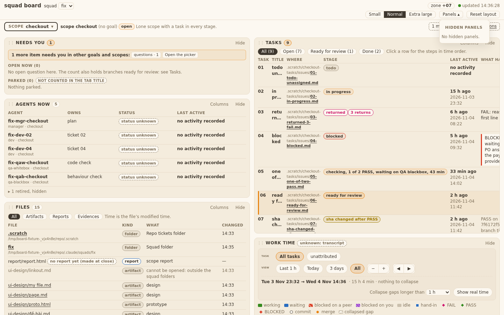
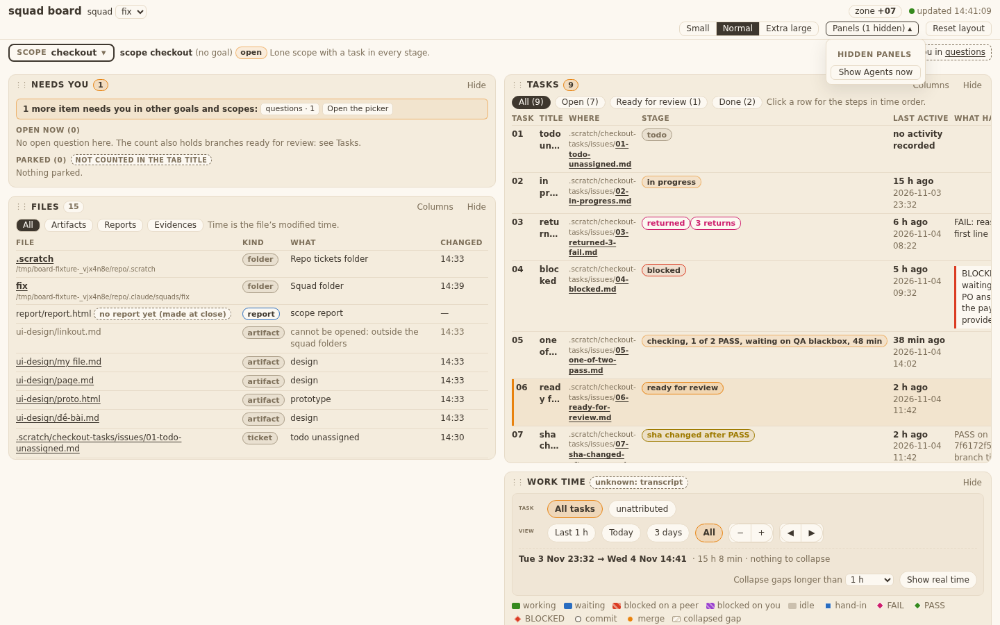
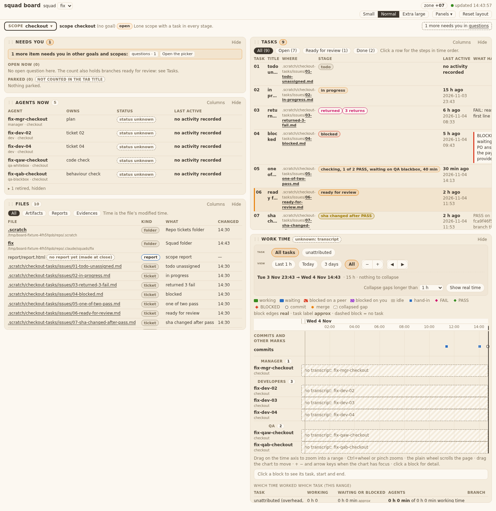
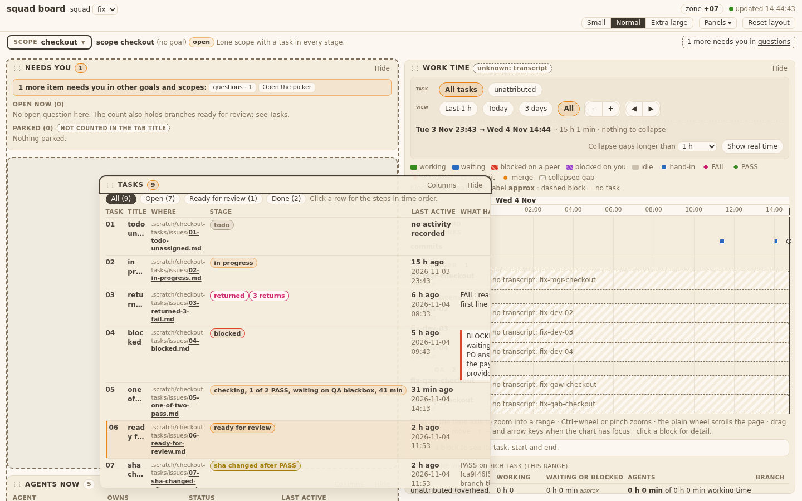
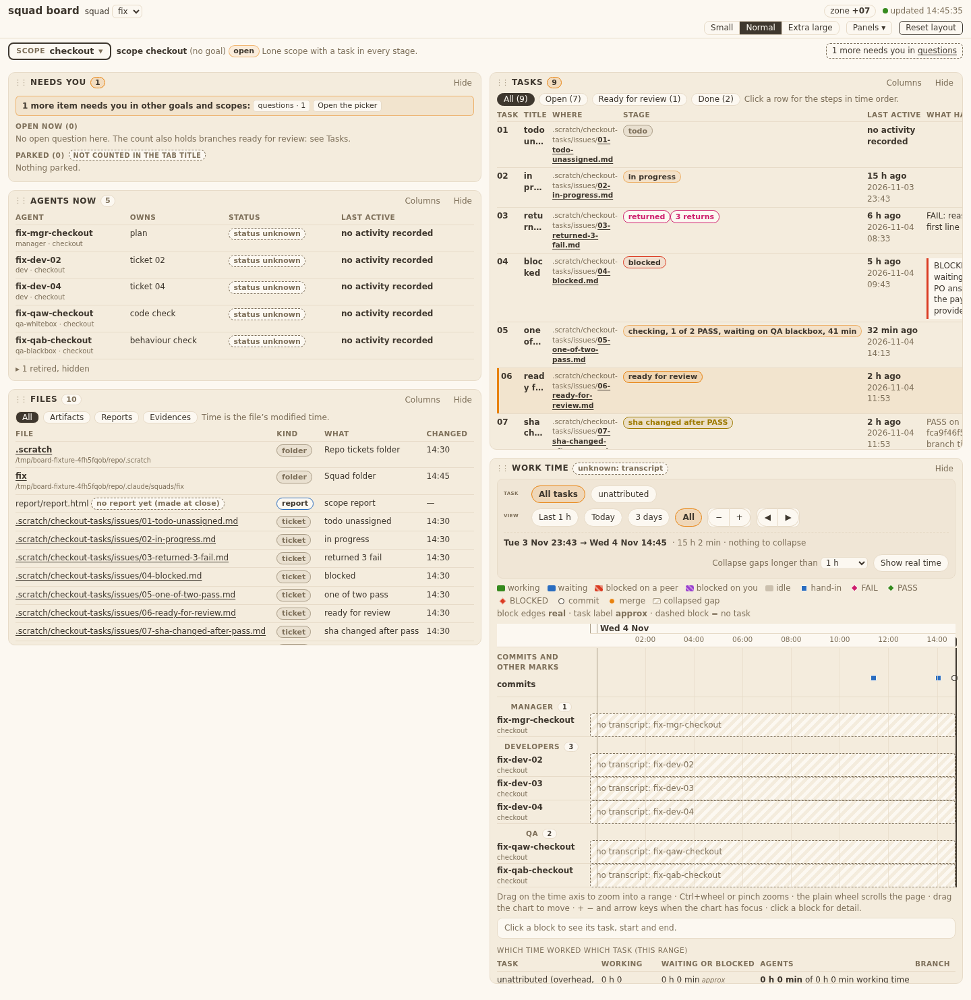
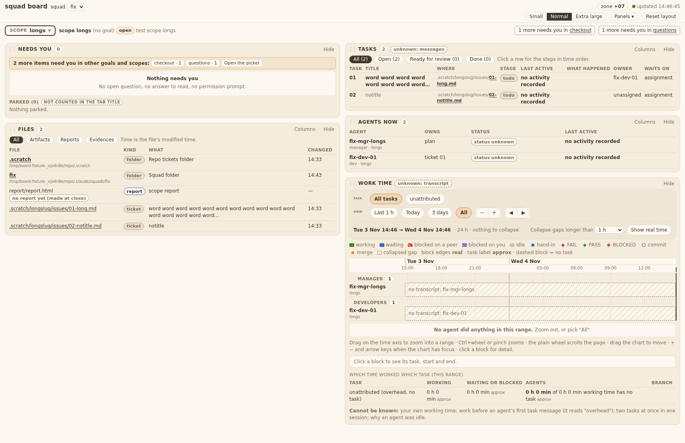
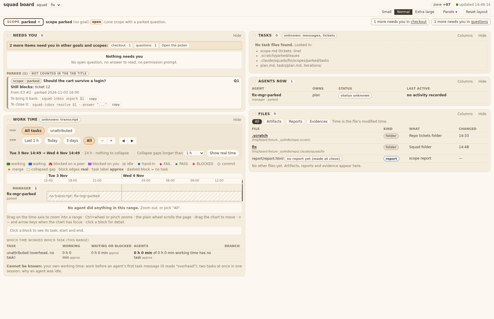
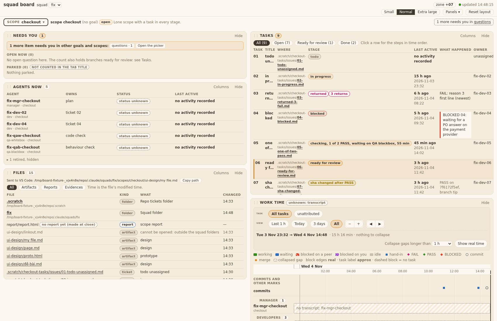

## Behaviour
Merges with `--no-ff`: 25, 26 (fix-30) and 27 (strip-31) onto 29, 30, 28. Conflicts: ticket files of 25 and 26 (took the passed fix-30 versions) and `tests/test_squadboard_panels.py` (kept both test classes). `board.js`, `board.css` merged without conflict. Touched test files and grep hits pass (page 24, panels 58, timeline 28, ui 20, files 14, tasks 17, server 18, worktime 22, tickets 6).

## AC table
| Item | Shown by |
|---|---|
| Passed ACs of 25-30 kept | QA whitebox and QA blackbox pass 2 on 61bee77, sections below |
| No conflict marker left | no `<<<<<<<` in touched files; `node --check templates/board/*.js` ok |

# Evidence: 33 33 Integration of 25-30
sha: 61bee77

## QA whitebox

### QA whitebox 33 (INTEG 25-30, pass 2): sha 61bee77 — PASS; and 31 promotion text on 5c78367 (PROMO-8) — PASS
Checked in a clone of branch squad/board/dashboard/board-dev-integ-33.

#### 1. Integration 61bee77
- Merge diff vs first parent 11953ed read for board.js, layout.js, board.css, timeline.js, squadboard_ui.py. Test inventory: the merged test_squadboard_panels has 58 tests; the only test gone against 29/30's side is `test_T14_AC1_AC2_TA3_...links_open_in_a_new_tab` (replaced by ticket 30 on purpose); 26/27's classes are kept.
- Ran tests/test_squadboard_{page 24, panels 50 as a file, 58 as a module, timeline 28, files 14, tasks 17, server 18, worktime 22, ui 20}: all OK, none skipped. The full suite is the Tech Lead's (SUITE-2b).
- Live (REV-5b): the real board server from the clone on the real squad, scope dashboard, port 48731, headless Chrome --dump-dom at window 1000/1400/2400: 1, 2, 3 page columns (data-col 0; 0,1; 0,1,2), 5-6 panels, 174 `vscode://` links, 0 `_blank`, 21 task rows. Server stopped by PID. Presentational values left to QA blackbox.
- Conflicts named by the Developer (ticket files of 25/26, panels test file) resolved as said; board.js/board.css merged with all of 25 (popPlace), 26 (columns), 28/30 behaviour covered by the merged tests above.

#### 2. PROMO-8 on 5c78367 (diff 61bee77..5c78367)
- Files changed: plugin.json (0.7.0 → 0.7.1, one line, own commit 82aa08f, plugin.json only), README.md (one table row), ADR 0020 (+5 lines, one amendment), ticket 31 evidence. Nothing else.
- Text vs promote.md (string compare): README Tasks sentence and Files sentence are in the row word for word; the old `tickets:` sentence is gone; the `See docs/adr/0020-...` ending and the single `bin/squad-board` row stay (count 1). ADR bullets 2 and 3 equal promote.md; bullet 1 equals it minus the editor marks "(verified)" and "**verify ...**", as promote.md says to do.
- True to merged code: source order and empty-folder fall-through (`squadtickets.py` _scope_tasks loop), `tasks/NN*` + `tasks/issues/NN-*` in the scope source, "No task files found." in panel_tasks.js, `scope_tasks` used by page, picker and report adapter, `COL_MAX = 11`, span optional in `squadboard_ui.py`, width rule 1/2/3 in layout.js, `abs` rows and `wsl+<distro>` form, server binds 127.0.0.1. Nothing outside what promote.md says (no CONTEXT.md, no process rules).
- tests/test_promotion_0_6_0.py: 3 OK; plugin.json parses, version 0.7.1.

## QA blackbox

### QA blackbox, pass 2 (INTEG 33): tickets 25-30 together

Sha checked: 61bee77 (branch squad/board/dashboard/board-dev-integ-33). Final sha 5c78367 is docs and evidence only after it. Running board from that worktree on a fresh fixture (`tests/board_fixtures.py --now`, squad `fix`) plus my extra scopes (flat tasks, status variants, `tickets:` with empty folder, `tickets:` plus tasks, `.scratch/<scope>`, plan table only, nothing, message token only, long and missing titles) and extra Files rows (`my file.md`, `đề-bài.md`, `proto.html`, a symlink out). Two boards: `WSL_DISTRO_NAME=Debian` and unset. Playwright, one fresh browser per script. **Verdict: PASS (25, 26, 27, 28, 29, 30).**

| Ticket | What I did | What I saw | Result |
|---|---|---|---|
| 25 AC1, AC2 | 1440x900, click Panels, scroll 600 | List top 4 px under the button, left edge equal; at scroll 583 still 4 px  | PASS |
| 25 AC3 | 1000 wide, Extra large, heights 340 and 800; Panels and Columns lists | Inside window (right margin 8-35 px), max height = window - button bottom - 12 (264.9 px at 340), Columns footer (Reset columns, Close) at y 323 of 340, no flip above | PASS |
| 25 AC4 | Esc, outside click, second click, Enter, Space | Closes each time, focus on Panels, caret back to ▾; Enter and Space open it | PASS |
| 25 AC5 | Columns of Agents, Files, Tasks | 4 px under the button; Tasks one shifts left (left diff -96) to keep an 8 px margin | PASS |
| 25 AC6 | Hide Agents now, open list, Show | `Panels (1 hidden) ▾`, list `Show Agents now`; after Show the list stays open and reads `No hidden panels.`  | PASS |
| 26 AC1 | Reset layout 1440x900, plain fixture | 2 columns of 702 px; left Needs you 163, Agents 282, Files 380; right Tasks 560, Work time 780; gaps 12. Differs from the example list because Tasks is now at its max (ticket 28 Where column). Manager FINAL 26: AC1 is the rule, record as PASS  | PASS (rule followed, FINAL 26) |
| 26 AC10, AC13 | 1000, 1440, 1920, 1799, 1800, 932, 931, XL 1000 | 2, 2, 3, 2, 3, 2, 1, 1 columns; no count control | PASS |
| 26 AC3, AC14 | Drag Tasks to the left column; Esc during drag; drop outside; reload | Esc and outside drop leave the layout; drop lands between Needs you and Agents, column it left closes up (gap 12), same after reload  | PASS |
| 26 AC4 | Hide Agents now, then Show | Panels under it move up, then return to the same order | PASS |
| 26 AC15 | Tasks title focused, Up, Right, Left, Left, Down, Down | Up on first and Right in the right-most column move nothing; Left goes to the left column; Left again nothing; Down moves one place each; focus stays on the title | PASS |
| 27 AC1, AC2, AC4, AC5, AC8, AC10 | Computed style of the filter block at 1440 | bg rgb(240,230,214)=--panel2, border 1 px rgb(231,219,200), radius 8, padding 9 px; active chips bg #E8820E at 15%, border mango, bold, ink; others --bg, 400; hover border ink; focus ring 2 px ink; tooltips Zoom out/Zoom in/Earlier/Later; no `%`  | PASS |
| 27 AC3, AC7, AC9 | Rows, 1000 Normal and Extra large, sticky | Task row and View row on separate lines; chips 8 px apart; at 1000 rows wrap, no overlap, no cut; block sticky with opaque bg | PASS |
| 28 AC1, AC2, AC10 | Scope `flat` (accounts style) | 4 rows with titles from `# NN`; stages 01 done, 02 in progress, 03 in progress, 04 done (no HANDIN in ledger); Where = repo-relative path, link; evidence folder, TEMPLATE, issues-tech, non-numbered file are not rows | PASS |
| 28 AC3-AC6, AC12 | Scopes `prec`, `src2`, `slugmiss`, `planonly`, `stat` | Counts 1, 1, 1, 2, 5: source 1 beats tasks, source 2 beats tasks, empty `tickets:` folder falls through to tasks, plan rows show `plan table, plan.md` muted no link; stages todo/blocked/in progress/todo/done follow the table | PASS |
| 28 AC7, AC8, AC12 states | Scopes `nonesc`, `tokonly`, `longs` | Dashed note `No task files found. Looked in:` with 4 lines; REV-8 token gives no row; 133-char title cut at 2 lines, bold, tooltip full; missing title shows the name in italic muted  | PASS |
| 29 AC1-AC4, AC9, AC11 | Scope checkout, flat, prec | Two folder rows first; ticket rows kind `ticket`; What = title (80 chars then `…`); `.scratch/<slug>/spec.md` listed once | PASS |
| 29 AC3, AC10 | Scopes `parked`, `done-02` | Two folder rows (+ report row in parked), then `No other files yet. Artifacts, reports and evidence appear here.`; count 0  | PASS |
| 30 AC1-AC5, AC9, AC10 | Both boards, all Files rows, Where link | WSL board: `vscode://vscode-remote/wsl+Debian/<abs>`; non-WSL: `vscode://file/<abs>`; names with space and Vietnamese percent-encoded per segment; tooltip abs path + `opens in VS Code`; no `target=_blank`, `window.open` never called, tab count unchanged | PASS |
| 30 AC7 | Symlink out of the squad folder | Muted text, no link, `cannot be opened: outside the squad folders` | PASS |
| 30 AC11-AC13 | Click file, folder, html, Where; Copy path; wait 8 s; hide Files then click Where | Status line `Sent to VS Code: <abs>` + `Copy path` at the top of the Files body (role=status); 2nd click changes the path; gone after 8.8 s; clipboard holds the path; Where click and hidden-Files click show no status line, no error  | PASS |

Notes (no AC fails):
- In a scope that uses source 1 or 2, a `tasks/NN.md` file that is not a task still shows in Files as kind `ticket`, What `ticket plan` (old ticket-plan listing; T29 says the rest of T14 stays).
- T28.AC14 (real `dashboard` scope, 21 / 30 rows) and T28.AC15 on a goal with tasks not re-run here: I do not run the board on the real squad; goal `alpha` of the fixture has no tasks (0 of 0 everywhere). My earlier PASS of 28 stands.
- T30.AC6 (WSL link form) built as the BA proposal; the PO agreed (E11).
