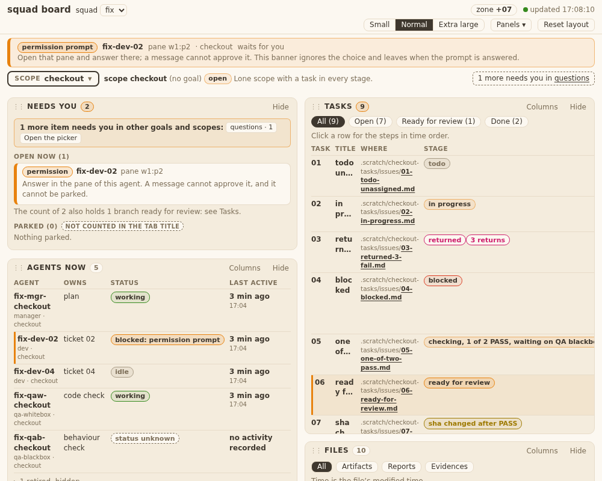
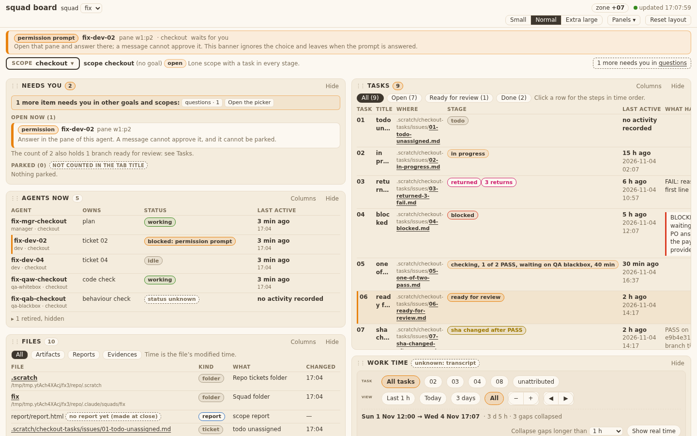
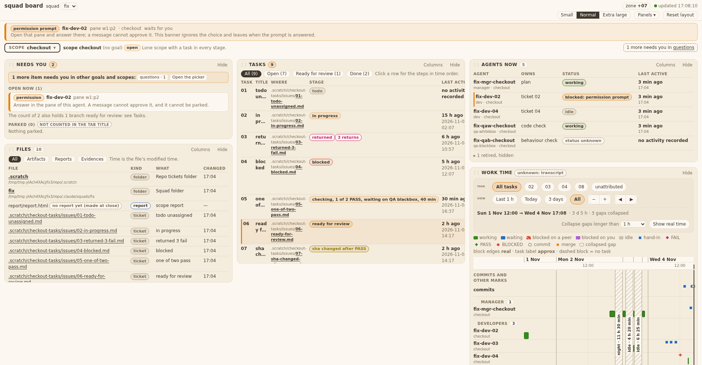

## Behaviour
The page lays panels out on a grid of N tracks (N = 4 at 1000 and 1440, 6 at 1920). Panels are placed first-fit by `BOARD.layout.place`, so a short panel fills the hole beside a tall one. A 5 s data refresh keeps every panel's grid column and the order (`refresh`, never `place`). First load places once, after the first data of all panels (T35.TA2b first-settle test). Code sha: 31ec56a. Tests run on it: test_squadboard_grid, test_squadboard_ui, test_squadboard_page (61 OK); test_squadboard_panels + test_squadboard_timeline (86 run, 1 fail: test_T12 `1 d ago`, known, red on main too).

What I saw in the shots (headless Chrome, the real board server on the ticket-02 fixture):
- 1000 x 800: two grid columns, no overlap, 12 px gaps; Files sits in the hole under Needs you and Agents.
- 1440 x 900: two columns; Needs you, Agents, Files stack on the left, Tasks and Work time on the right.
- 1920 x 1000: three columns; Files fills the hole under Needs you; Work time runs past the window bottom, so the page scrolls.

Known, not from this ticket: the Tasks table is wider than its panel and scrolls inside it (cut-off columns in the shots).

## AC table
Technical AC (SQ-6): test file is tests/test_squadboard_grid.py, class Grid, unless named.

| AC | Test | Result |
|---|---|---|
| T35.TA1 pure functions (place, refresh, migrate, dropIndex, colCount) | `Grid::test_T35_TA1_pure_functions` | pass |
| T35.TA2 holes, gutters, no overlap at 1000/1440/1920 | `Grid::test_T35_TA2_geometry_holes_gutters_no_overlap_at_three_sizes` | pass |
| T35.TA2b refresh: columns kept, `place` 0 calls, `refresh` ran | `Grid::test_T35_TA2b_refresh_keeps_columns_and_calls_no_place` | pass |
| T35.TA2b PO action: `place` spy sees 1 call | `Grid::test_T35_TA2b_first_settle_places_after_first_data_of_all_panels_not_on_loading` (after-count 1) | pass |
| T35.TA2b first load: first `place` after the answers of all five panels (one answers "unknown"); a hanging panel is placed by the 5 s timer | same test | pass |
| T35.TA3 order and hidden | `Grid::test_T35_TA3_dom_order_follows_saved_order_and_hidden_is_out_of_the_grid` | pass |
| T35.TA4 drag, Esc, keyboard persist | `Grid::test_T35_TA4_drag_esc_and_keyboard` | pass |
| T35.TA5 migration, first save drops col/span | `Grid::test_T35_TA5_old_layout_migrates_and_first_save_drops_col_and_span` (fixture iter2) | pass |
| T35.TA6 no column code, no innerHTML, tokens | `Grid::test_T35_TA6_no_column_code_and_tokens_only` | pass |
| T35.TA7 text scale, nothing leaves the window | `Grid::test_T35_TA7_text_scale_recomputes_columns_and_nothing_leaves_the_window` | pass |
| T35.TA8 min width 1000 stays | no new test: CSS rule `#app{min-width:1000px}` untouched (git diff) | open gap: no test named |

Business AC (QA blackbox owns the live check; the test that also covers it, if any):

| AC | Shown by |
|---|---|
| T35.AC1, AC2 default placement, N by window | TA2 test; shots grid-1000/1440/1920 |
| T35.AC3 no gap down a column | TA2 test (top = 12 px under the box above, 3 px delta) |
| T35.AC4 fills holes | TA1 (hole case), TA2; shot grid-1920 (Files under Needs you) |
| T35.AC5 hide and show | `Grid::test_T35_AC5_hide_and_show_round_trip_returns_to_the_place` |
| T35.AC6a-c drag, drop, cancel | TA4 test; real mouse is QA blackbox |
| T35.AC6d empty grid | `Grid::test_T35_AC6d_empty_box_when_every_panel_is_hidden` (fixture files6) |
| T35.AC7 height by south edge | `Grid::test_T35_AC7_south_edge_changes_height_only_and_fit_returns` |
| T35.AC8 old saved layouts | TA5 test (fixture iter2) |
| T35.AC9 Reset layout | `Grid::test_T35_AC9_reset_returns_default_order_and_drops_max_height` (fixture files6) |
| T35.AC10 stable on refresh | TA2b tests |
| T35.AC11 keyboard | TA4 test |
| T35.AC12 banner and goal view | `Grid::test_T35_AC12_goal_view_has_scopes_in_the_grid_and_banner_outside` |
| T35.AC13 matches design-v8 at 3 widths | shots grid-1000/1440/1920 (looked at each); full design check is QA blackbox |

## Edits to old `.col` pins (git diff 181b048, the base of the 35 branch)
- tests/test_squadboard_page.py (129 lines, mostly deletions):
  - `colCount` pin now `[4,6,4,2,2,2,4,6]` (grid tracks); the `place` and `norm` pins in the page script were removed (moved to Grid TA1).
  - Deleted `test_T26_TA3_default_place_is_the_shortest_column_leftmost_on_a_tie`, `test_T26_TA1_TA13_norm_clamps_col_skips_hidden_and_no_col_and_ties_by_default_order`, `test_T26_AC3_AC4_AC6_AC11_AC14_AC15_drag_keys_hide_save_reload_reset`, `test_T26_AC7_TA5_TA12_old_saved_layout_loads_without_error_or_write`. Covered now by Grid TA1, TA4, TA5.
  - Banner test: `canvasKids` no longer expects every child to be `.col`, it expects no `.bannerslot` in the canvas; the handle check is `.bannerslot .rz,.rz.se` (the banner has no handle; the east handle exists on panels, ticket 36).
- tests/test_squadboard_ui.py: `GOOD` body uses `tracks`; `test_T26_TA6_col_is_kept_checked_and_span_is_optional` replaced by `test_T36_TA4_tracks_bounds_and_old_keys` (ticket 36).
- tests/test_squadboard_panels.py and tests/test_squadboard_timeline.py: not edited (git diff empty). Panels: 1 fail, test_T12 `1 d ago`, clock-dependent, red on main too.

## Fixtures check
tests/fixtures/board/layout-35/ (added by this branch):
| File | Used by |
|---|---|
| board-ui-iter2.json | `Grid::test_T35_TA5_...` |
| board-ui-files6.json | `Grid::test_T35_AC9_...`, `test_T35_AC6d_...`, `test_T35_bad_tracks_values_fall_back_and_files_at_six_twelfths`, `Resize::test_T36_TA3_...` |
| board-ui-bad-tracks.json | `Grid::test_T35_bad_tracks_values_fall_back_and_files_at_six_twelfths` |
