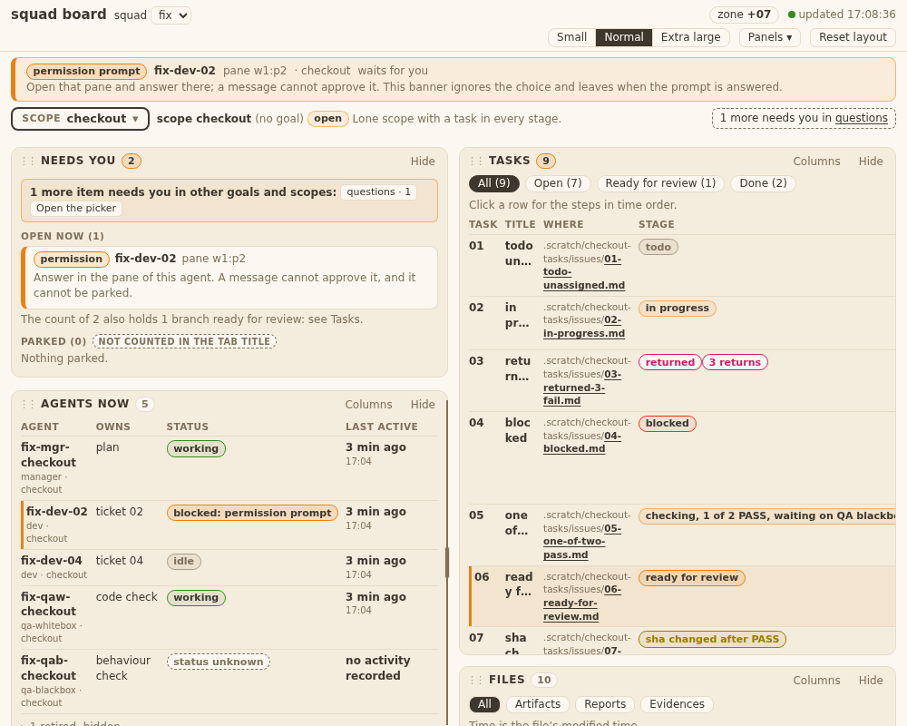
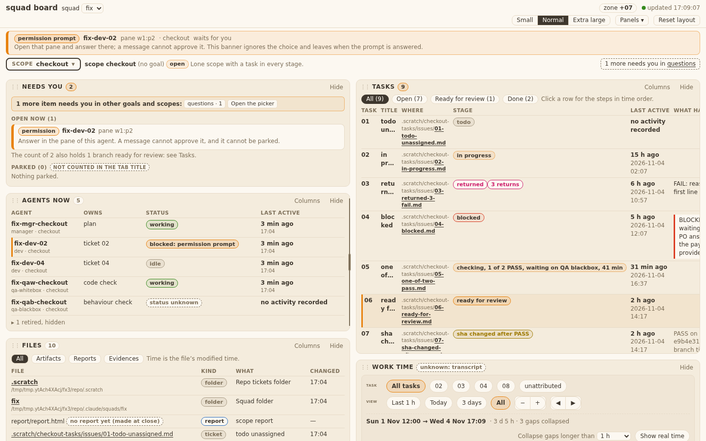
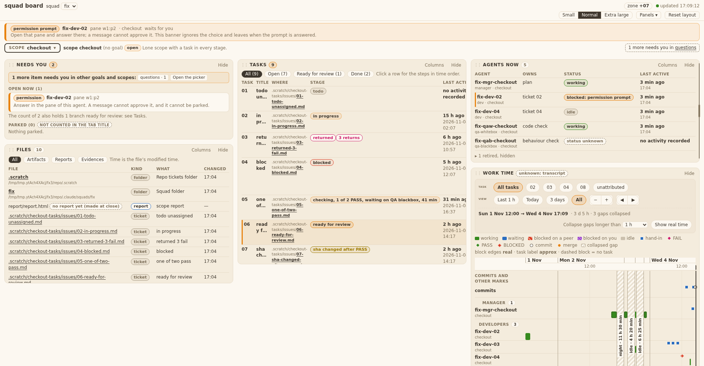
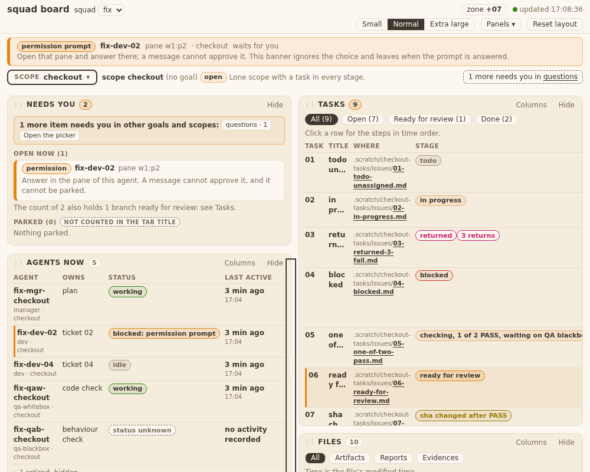
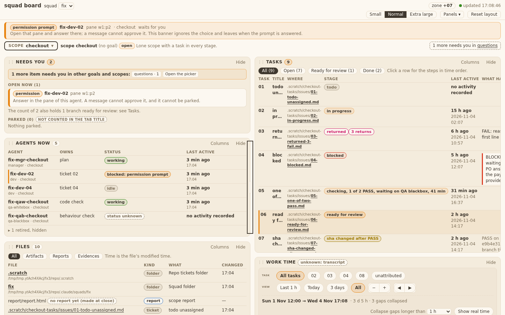
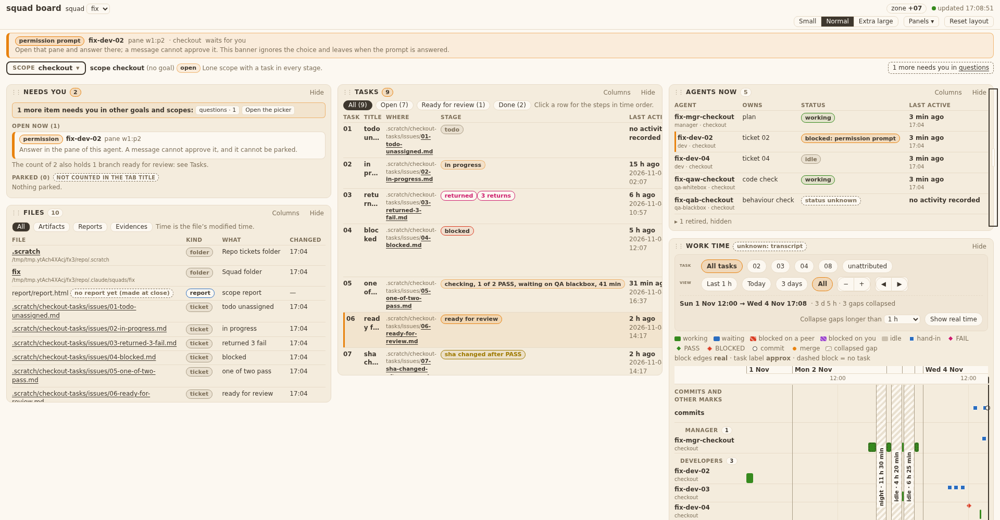
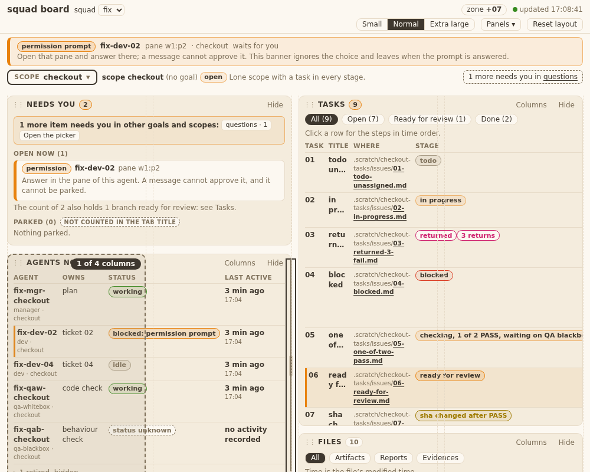
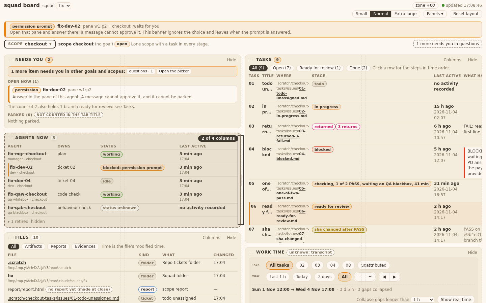
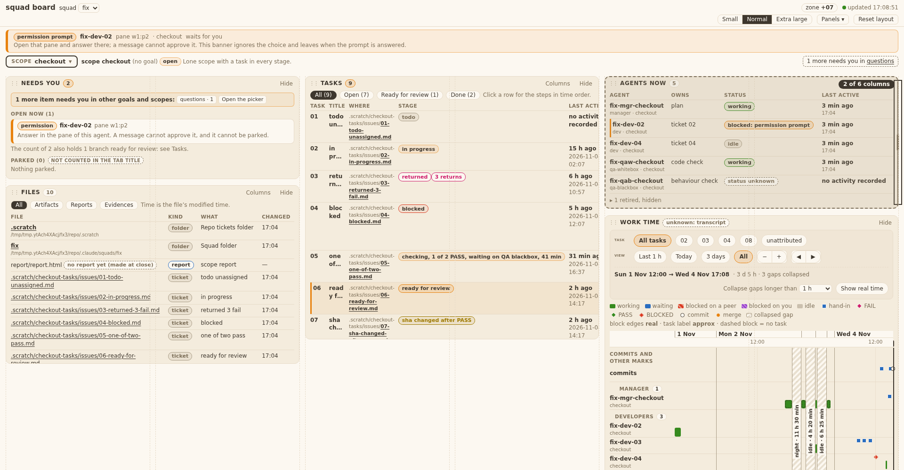
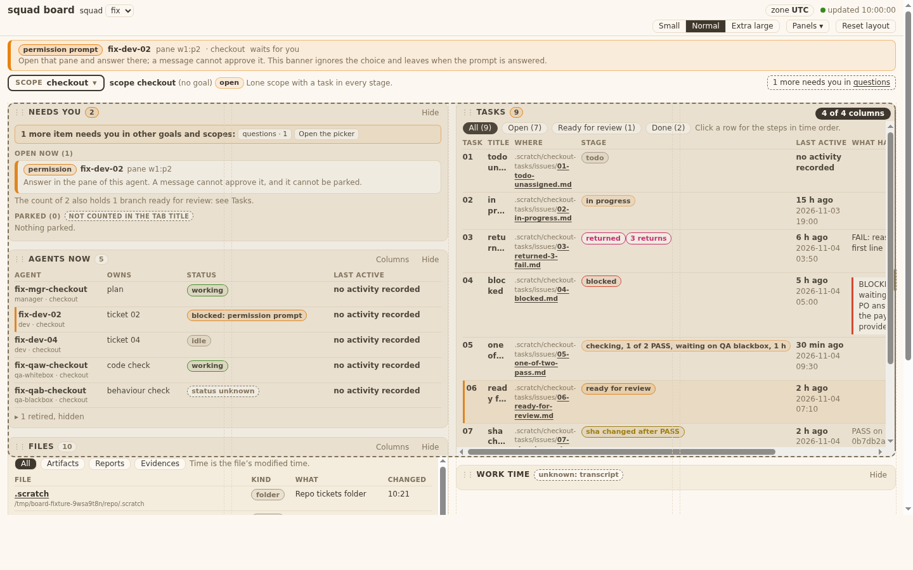

## Behaviour
Every panel has an east-edge handle `.rz.e` (a focusable separator). A drag shows a dashed outline, a pill `k of G columns` and guides; nothing moves until release. On release one save writes `tracks` (twelfths, 1..12) and `place` runs once. Esc cancels, double-click removes `tracks`, Left/Right change the span by one. `PUT /api/ui` keeps `tracks` 1..12 and drops `col`, `span`, `auto`. Code sha: 8e2c743 (flush-right widen added on top of 31ec56a). Tests: test_squadboard_grid, test_squadboard_ui, test_squadboard_page 61 OK.

What I saw (headless Chrome, real server, fixture, Agents panel handle; shots at 1000/1440/1920):
- Hover: a thin vertical line on the panel's east edge (at 1920 the Agents handle is at the window edge, so the line is faint).
- Focus: a dark frame the full panel height and 12 px wide on the east edge. Clear, but heavy.
- Drag: dashed outline over the panel, dark pill `2 of 4 columns` at its top right, vertical guides over the page; other panels stay put.
- I found no CSS fault small enough to fix and none that blocks use. Open for the Designer: the focus frame is heavier than the hover line.

Flush-right panel (ruling D, option A). Tasks sits flush right at 1440 (G = 4). Dragging its east handle to the canvas right edge or past it shows the pill `4 of 4 columns`; the dashed outline is clamped inside the canvas (it shows where the panel lands after `place`). On release one save writes tracks 12 and the panel is as wide as the canvas content (1402 px at this size; the canvas is 1401 px wide, not 1416). A click with no travel changes nothing. The pointer must have moved 4 px right of the grab point (same as the panel drag threshold), so a grab on the gutter half of the 12 px handle still reaches full width; a smaller move keeps the snap (2 of 4).

## AC table
Technical AC (SQ-6): tests/test_squadboard_grid.py, class Resize, unless named.

| AC | Test | Result |
|---|---|---|
| T36.TA1 `edgeSpan` (new pure helper) | `Resize::test_T36_TA1_pure_functions` (o.edge) | pass |
| T36.TA1 `snapTracks` | `Resize::test_T36_TA1_pure_functions` (o.snap) | pass |
| T36.TA1 `widthToTracks` | `Resize::test_T36_TA1_pure_functions` (o.w2t, round trip) | pass |
| T36.TA1 `tracksToWidth` | `Resize::test_T36_TA1_pure_functions` (o.t2w, round trip) | pass |
| T36.TA2 drag saves `tracks` only, reload draws it | `Resize::test_T36_TA2_drag_saves_tracks_only_and_reload_draws_it` | pass |
| T36.TA3 narrow window keeps the saved share | `Resize::test_T36_TA3_narrow_window_keeps_the_saved_share` | pass |
| T36.TA4 server bounds, old keys, bad saved values | tests/test_squadboard_ui.py::test_T36_TA4_tracks_bounds_and_old_keys; page reader: `Grid::test_T35_bad_tracks_values_fall_back_and_files_at_six_twelfths`; iteration-1 file: `Grid::test_T35_TA5_T36_TA4_iteration_1_file_loads_with_no_panel_wider_and_saves_without_span` | pass |
| T36.TA5 Esc, double-click, keyboard | `Resize::test_T36_TA5_esc_dblclick_and_keyboard` | pass |
| T36.TA6 `place` once on pointerup, none while dragging; after widening Files 2 to 3 tracks no overlap and no gap (tops 0 or 12 under the box above). The fill-the-hole case is T35.TA1 `hole` (`Grid::test_T35_TA1_pure_functions`): widening here pushes Needs-you's neighbour down, no panel has a hole to fill | `Resize::test_T36_TA6_place_runs_once_on_pointerup_and_panels_do_not_move_while_dragging` | pass |
| T36.TA7 handle attributes | `Resize::test_T36_TA7_handle_is_a_focusable_separator_and_the_banner_has_none` | pass |

Business AC (QA blackbox owns the live check):

| AC | Shown by |
|---|---|
| T36.AC1 handle exists | TA7 test; shots hover-*/focus-* |
| T36.AC2a, AC2b span and snap (a flush-right panel too) | TA1, TA2 tests; flush-right widen test above (layout.js `edgeSpan`) |
| T36.AC3 limits, flush-right widen by mouse | TA1 test (minSpan, beyond G, `edgeSpan`); `Resize::test_T36_AC3_flush_right_panel_widens_by_mouse_to_the_canvas_edge` (pointer at the window edge, 1440, pill, outline inside, tracks 12, width = 4 tracks + 3 gaps of the measured canvas, no overlap); `Resize::test_T36_AC3_click_without_travel_on_a_flush_right_panel_changes_nothing`; `Resize::test_T36_AC3_grab_on_the_gutter_half_of_the_handle_needs_4px_of_travel` (3 px keeps 2 of 4 and saves nothing, 4 px gives 4 of 4); shot drag-flush-1440 (layout.js `edgeSpan`, `resizeEast` mv/show) |
| T36.AC4 live outline, pill, no move | TA6 test; shots drag-1000/1440/1920 |
| T36.AC5 Esc | TA5 test |
| T36.AC6 neighbours re-place | TA6 test; T35 TA2 geometry |
| T36.AC7 saved | TA2 test |
| T36.AC8 window narrower and wider | TA3 test (fixture files6) |
| T36.AC9 bad saved values | `Grid::test_T35_bad_tracks_...` (fixtures bad-tracks, files6) |
| T36.AC10 keyboard | TA5 test |
| T36.AC11 Reset, hide, show | `Grid::test_T35_AC9_...` (tracks back to default) |
| T36.AC12 height independent | `Grid::test_T35_AC7_...` (width and side stay) plus TA2 (no max_height in the PUT) |
| T36.AC13 nothing cut off | open gap: no test; QA blackbox. Shot at 1000: Tasks table scrolls inside its panel (known, from before 35) |
| T36.AC14 matches design-v8 | shots; QA blackbox |

## Edits to old `.col` pins
Same as ticket 35 (one branch, one diff vs 181b048); see ../35-smart-grid.evidence/evidence.md. The edit that belongs to 36: the banner test in test_squadboard_page.py looks for a handle only in `.bannerslot` (before it looked for any `.rz.e`, which now exists on panels), and test_squadboard_ui.py: `test_T36_TA4_tracks_bounds_and_old_keys`.

## Fixtures check
See ticket 35's table. For 36: board-ui-files6.json is used by `Resize::test_T36_TA3_...`; board-ui-bad-tracks.json by `Grid::test_T35_bad_tracks_values_fall_back_and_files_at_six_twelfths` (T36.AC9).
