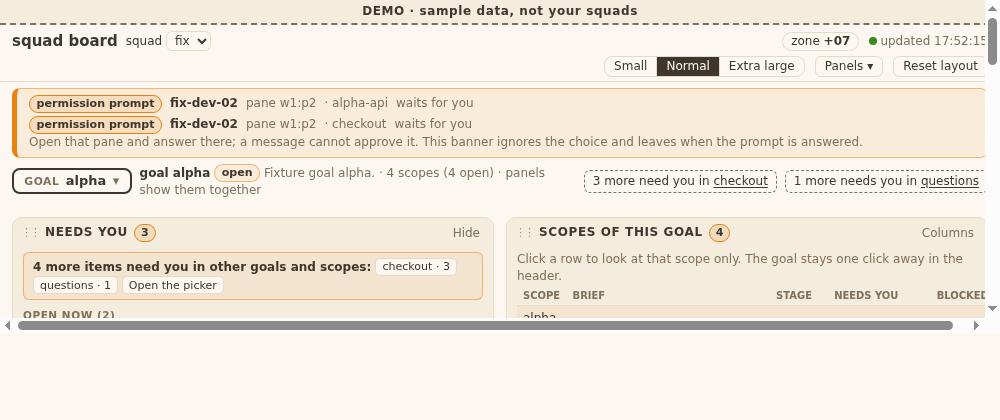
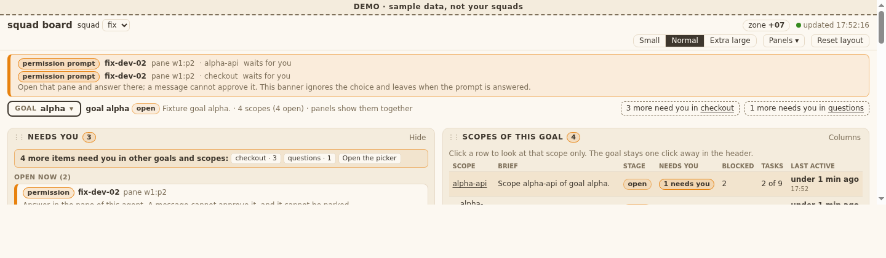

# Evidence 37: squad-board --demo (wrapper and label step 37b)

## Behaviour
`bin/squad-board --demo [--port N] [--no-open]` copies the fixture to `/tmp/squad-board-demo-*` (times = now), extends the copy
in code (`bin/squadboard_demo.py:extend`), points HOME, USERPROFILE and CLAUDE_CONFIG_DIR into the copy, drops `SQUAD_*`,
does `chdir` into the copy, sets `GIT_CEILING_DIRECTORIES`, prints `demo: sample data in <path>` and runs `squadboard.main`
on goal `alpha`. The copy is removed in `finally` (Ctrl-C and SIGTERM). The fixture is not edited.
A click in the demo opens a copy file, deleted at exit (the click route is ticket 34; see the open gap).
Run by hand on port 8791-8793: goal `alpha` and scope `checkout` answer every panel route with rows, `unknown == []`.

## Label (37b)
`squadboard.main(..., demo=True)` (the only flag, passed by `squadboard_demo.run`) sets `server.demo`; the `/api/squads` picker route
(`bin/squadboard_list.py:picker`) then adds `"demo": true`; a normal run has no key. `templates/board/board.js` shows one `role=note` line
`DEMO · sample data, not your squads` (textContent, no control) as the first element of `#app`, and `paintTitle` prefixes `[demo] `.
`board.css` `.demo`: light strip (`--panel`, `--ink`, bold, `.05em`, `2px dashed var(--muted)`), sticky, in flow, so banner, picker and top bar are not pushed over.
Shots of the running demo (with the permission banner):  

## Open gaps (HANDIN)
- (closed) T37.TA5 click line: QAB ran it on eb82f5e: PASS, toast `Sent to VS Code: <copy path>`.
- SIGKILL leaves the copy in the temp dir (out of scope).
- `test_squadboard_list::test_T04_AC1_rows_order_and_done_list` fails on the clean base too (last_active 09:30:49 vs 09:30:00); not caused by 37.
- `test_squadboard_panels::Panels12` inbox age `1 d ago` fails on main too; not caused by 37.

## AC table
| Id | Shown by |
|---|---|
| T37.AC1 | bin/squadboard_demo.py:run (refusals, exit codes); tests/test_squadboard_demo.py::Flags::test_T37_TA5_AC1_exit_codes |
| T37.AC2, AC3 | test_squadboard_demo.py::RunningDemo::test_T37_TA2_AC2_AC5_every_panel_has_content (goal and scope views). Empty-board texts: panel API rows > 0 |
| T37.AC4 | same test, nine stages in `checkout` |
| T37.AC5 | same test: question + blocked agent, working/idle/blocked, 11 h gap, DST |
| T37.AC6 | bin/squadboard.py:main(demo), templates/board/board.js (strip, paintTitle), board.css `.demo`; Label::test_T37_TA4_AC6_flag_only_in_demo_and_strip_is_light_and_stays; shots above |
| T37.AC7 | ::test_T37_TA1_AC7_AC8_nothing_real (REALSQUAD name in no API answer) |
| T37.AC8 | ::test_T37_TA6_AC8_AC10_read_only_and_cleaned |
| T37.AC9 | templates/board/board.js:444 (no layout write in the demo) and :871 (no read), `!S.demo`; bin/squadboard_demo.py:build (new copy per start); tests/test_squadboard_demo.py::Browser::test_T37_AC9_hidden_panel_does_not_survive_a_demo_restart (one Chrome profile, same port: hide Files + Extra large, no `squad-board-ui:` key, restart, all 6 panels shown) |
| T37.AC10 | Flags::test_T37_TA5_AC10_sigterm_removes_copy |
| T37.AC11 | bin/squadboard_demo.py:extend (inbox `ts` of both copies and of the `questions` scope set 25 min before now; fixture file unedited); tests/test_squadboard_demo.py::Browser::test_T37_AC11_no_age_in_days_in_the_rendered_demo (rendered text of every non-`_done` view, no `\d+ d/day/y ago`, non-empty, E1 reads `min ago`); ::test_T37_TA3_AC11_ages_are_recent ("40 min") |
| T37.AC12 | the two shots in ## Label (1000 and 1440 px); the same test at 1000 and 1440 px (strip first, sticky, top bar starts under it) |
| T37.TA1 | ::test_T37_TA1_AC7_AC8_nothing_real, Flags::test_T37_TA1_copy_removed_when_main_raises |
| T37.TA2 | ::test_T37_TA2_AC2_AC5_every_panel_has_content (routes read from templates/board/*.js by pattern, fails if < 6) |
| T37.TA3 | ::test_T37_TA3_AC11_ages_are_recent |
| T37.TA4 | tests/test_squadboard_demo.py::RunningDemo::test_T37_TA4_AC6_demo_flag_is_true_in_the_demo, ::Label::test_T37_TA4_AC6_flag_only_in_demo_and_strip_is_light_and_stays (no key in a normal run; text; stays after a poll and Reset layout; computed bg/color/border/letter-spacing equal board.css tokens; title prefix) |
| T37.TA5 | Flags::test_T37_TA5_AC1_exit_codes, ::test_T37_TA5_AC10_sigterm_removes_copy, ::test_T37_TA5_help_documents_demo |
| T37.TA6 | ::test_T37_TA6_AC8_AC10_read_only_and_cleaned: one PUT /api/ui, `board-ui.json` exists in the copy, then git status, fixture hash, HOME hash equal |
| T37.TA7 | grep run: test_board_fixtures, test_squadboard_{active,agents,files,inbox,list,server,tasks}, test_squad_{respawn,start}, test_squadruntime, test_squadboard_page (82 tests with panels), test_squadboard_panels (only known red: Panels12 `1 d ago`, fails on main); test_windows_safe, test_no_bare_bash, test_old_language_inventory pass |
| T37.TAx | Each technical AC above is covered by the test named in its row (a completed action, window and fixture asserted, no always-true assert). TA4: tests named in its row. TA5 click line: run by QAB (PASS), no test in this repo |
