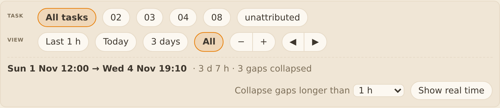
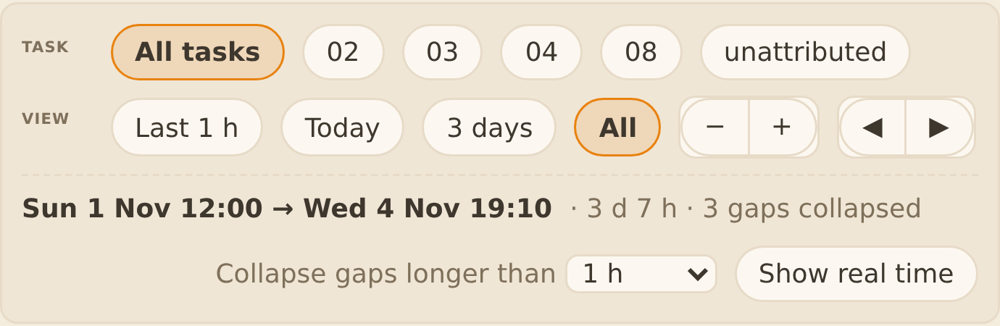
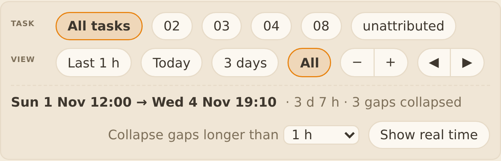
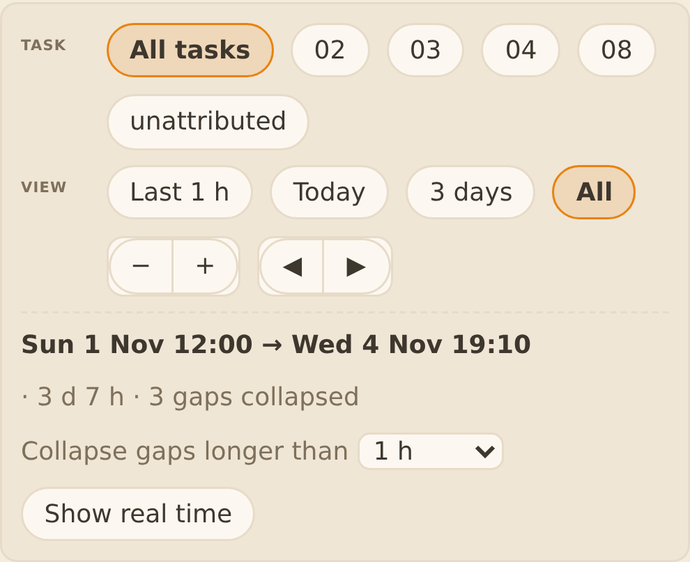
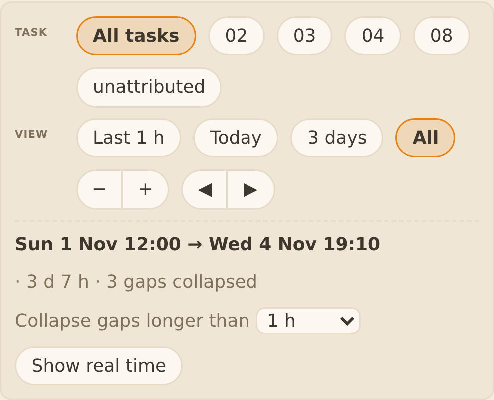
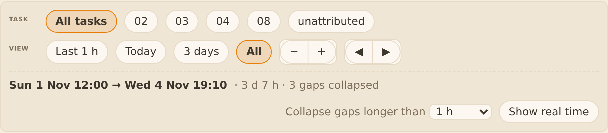
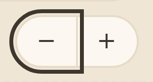
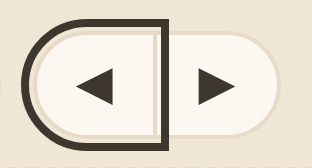
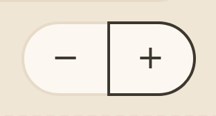
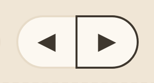

# Evidence 40: Work time control corners

## Behaviour
One CSS rule changed (`templates/board/timeline.js:549`): `.tl .seg` loses the 1px border, 8px corner and `overflow:hidden` it inherited from `board.css`. The `−+` and `◀▶` groups were a 28px box with an 8px corner around two pill buttons (double outline, clipped focus ring). Now the buttons carry the round ends alone: segment 62.4x26.4 instead of 64.4x28.4.

Finding about the "All" pill: `All` and `All tasks` are 999px on all four corners at rest, hover, focus, active, at 1000 px, Extra large and a narrow panel, **before and after** the fix. The square look the PO saw came from the two segments, not from the pill.

Crops (Playwright, device scale 3, not browser zoom; script `shots-40.js` next to this file; "before" serves `timeline.js` from `00d8ca7~1`). Taken on the demo (`--demo`, `?squad=fix&goal=alpha&scope=checkout`).

| Case | Before | After |
|---|---|---|
| 1440 |  |  |
| 1000 |  |  |
| Wrapped (Extra large, 1.3 font) |  |  |
| Narrow panel |  |  |
| Hover |  |  |

The 1000 and wrapped crops are identical: the bar has the same width at both; the narrow crop shows the wrapped rows.

## Return 1: segment states (QAB FAIL T40.AC6)
QAB found two defects in the first version: the focus ring of `−` and `◀` lost its right edge (the next button painted over it), and on hover of `+` and `▶` the inner (left) edge stayed light. Cause: later siblings paint over an outline, and the last button has `border-left:0`. Fix in `templates/board/timeline.js:550`: every segment button is `position:relative`, hover and focus-visible get `z-index:1`, and the last button on hover draws `box-shadow:-1px 0 0 var(--ink)` over the seam. No size change. Crops at device scale 4, real Tab focus and real mouse hover, demo, script `shots-40-states.js`:

| State | After the fix |
|---|---|
| focus `−` |  |
| focus `◀` |  |
| hover `+` |  |
| hover `▶` |  |

## AC table
All proofs are in `tests/test_squadboard_timeline.py::Safety::test_T40_TA1_TA2_TA3_pills_and_segments_are_round_and_not_clipped` (l.436-506), which loops 4 cases: 1440x900, 1000x700, 1000x700 Extra large (20.8px), 1440x900 narrow panel (parent 330 px, asserted <= 360).

| Item | Claim | Proof |
|---|---|---|
| T40.AC1 | every `.tl-bar .tc`: 4 radii >= half height | test l.469-490 (count >= 8 asserted); crops 1440 |
| T40.AC2 | segment ends round, inner corners 0, 1px line between | test l.469-486; templates/board/timeline.js:549-550 |
| T40.AC3 | same at 1000x700, both buttons on one line | test case 1000x700, `whole` l.480; crops 1000 |
| T40.AC4 | same at Extra large | test case 1000x700 Extra large; crops wrapped |
| T40.AC5 | same in a narrow panel | test case narrow panel; crops narrow; see gap 2 |
| T40.AC6 | hover, focus, active keep corners; ring not clipped and not covered by the neighbour; active chip mango | TA7 test; test l.487-499 (focus ring inside clipping ancestor for `−`, `▶`, `All`, `All tasks`; hover rules copied to a class, hovRules >= 1); crops hover |
| T40.AC7 | demo gives the same | crops (demo); see gap 1 |
| T40.AC8 | nothing else moves, zoom/pan work | test l.484 (heights 26 px); timeline, worktime, page, grid, panels pins green |
| T40.TA1 | computed corners at 1440 | test l.469-486 |
| T40.TA2 | nothing clipped, all states, All pill radii at rest/hover/focus/active/narrow | test l.487-499, `All` and `All tasks` asserted 999px |
| T40.TA3 | nothing else moves; Text size / Sort keep 8px + hidden | test l.484 and l.501 |
| T40.TA4 | demo | screenshots + computed values only (gap 1) |
| T40.TA5 | before/after crops 1440 and 1000, scale 3, wrapped, script kept | this file; shots-40.js |
| T40.TA6 | diff only timeline.js + test | `git diff --stat 02de472..HEAD -- templates tests/test_squadboard_timeline.py`: timeline.js (rules l.549-550), test_squadboard_timeline.py; no board.css |
| T40.TA7 | state button above its neighbour; hover seam edge `--ink`; nothing moves; pixel right of focused `−` is `--ink` | tests/test_squadboard_timeline.py::Safety::test_T40_TA7_segment_state_paints_above_the_neighbour (fails on 5ccab11 css: `static/auto` != `relative/1`); crops above |
| T40.TAx | counts asserted so an empty loop fails | test l.469 (segs == 2), chips >= 8 |

Fails without the fix: with `timeline.js` from `00d8ca7~1` the test fails.
Pins run (after return 1): test_squadboard_timeline (30 OK), worktime (22 OK), page (20 OK), grid (28 OK), panels (58, 1 known fail), test_squadreport_tasks (14 OK), test_squadreport_ui (27 OK).

## Known / open gaps
1. TA4: the demo is covered by crops and computed values taken on the demo, not by a test loop over two servers.
2. Narrow panel is set by the parent width (330 px, asserted <= 360), not by the T36 resize handle.
3. The test_T12 `1 d ago` failure in test_squadboard_panels.py also fails on main.
