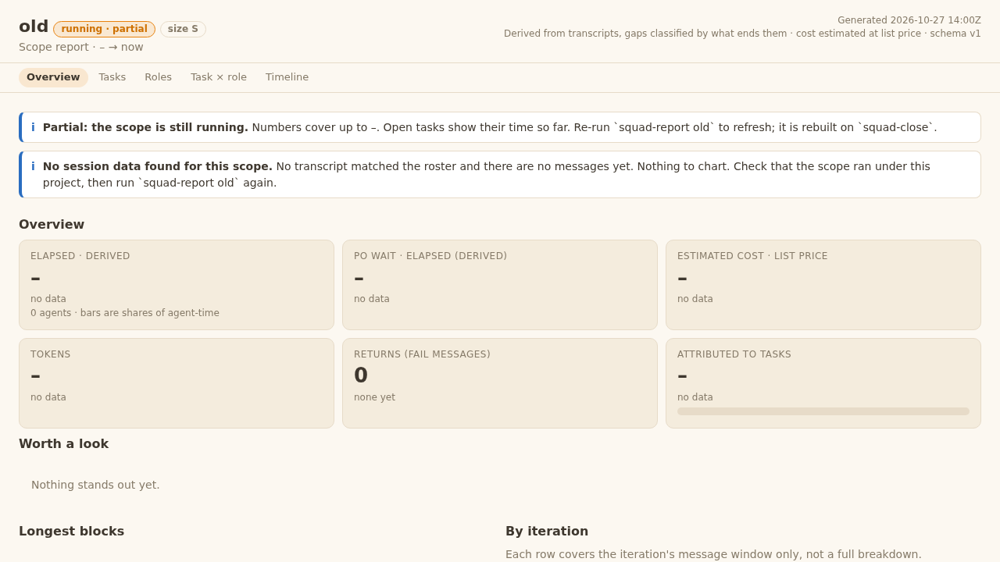
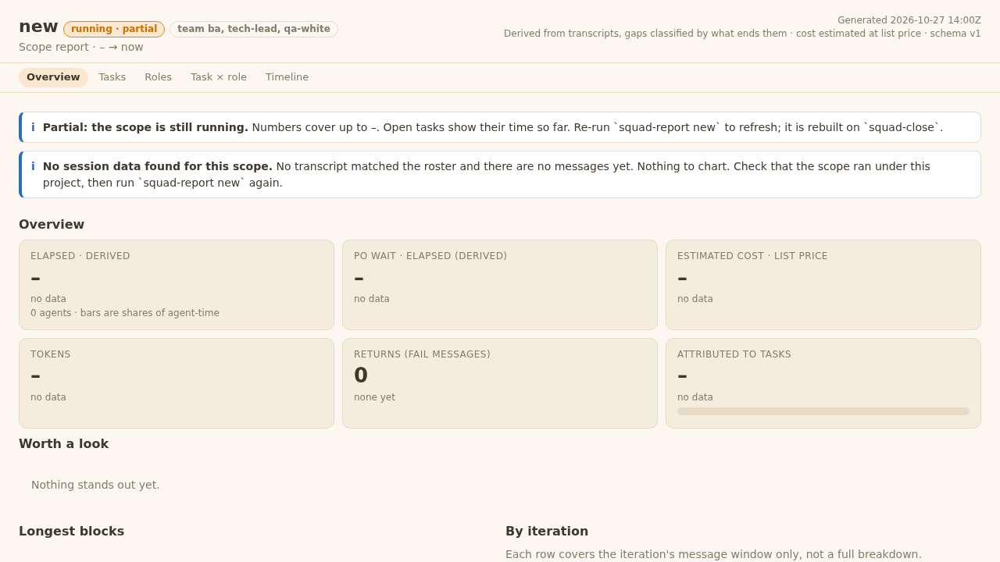

# Evidence: 09 Report and scope template
sha: 0bccec6

## Behaviour
- Scope data (`squadreport.collect`/`base_data`): `scope` has both `size` (old `size:` first token, as written) and `team` (display text of the `team:` line, trailing `(note)` dropped, `""` when absent/blank/no scope.md). Nothing derives one from the other (`size: L` + `team: qa-white` shows both).
- Rollup rows (`row_from`): `size` and `team` always strings (`""` for null/missing in an old data.json). Error and no_data rows: `size: None`, `team: None` (one rule, tested on both keys).
- `report.js` header chip: `team <text>` when a team is recorded, else `size <S>` (`size ?` when both empty). `rollup.js`: drawer line and name-cell suffix show team, else size. The Size filter still filters old sizes only.
- `templates/scope/scope.md`: one `team:` line; `size:`, `qa:`, `design:`, `architecture:` removed; "Done means" no longer cites Sizes.
- Tests: `TeamSizeScope` (collect), `TeamSizeKeys` (rollup), `RollupTeamChip` (browser: rollup folder served by `python3 -m http.server` on 127.0.0.1, stopped by PID; asserts the old row shows `L` and the team row `qa-white, qa-black`), header chip test in `test_squadreport_ui.py`.
- Lint baseline (G2b), `bin/squad-process lint`: base 6ec3a75 empty, exit 0; branch empty, exit 0.
- Changelog v9: no rule ID changed in this ticket.
- `tests/test_instructions.py` (addition to the file list, Tech Lead ANSWER): the two template asserts (`design: no`, `architecture: no`) now assert `\nteam:\n`; file green.
- Red until 03 merges: `tests/test_squad_migrate.py` `ToPerScopeTest.test_moves_everything_and_writes_scope_md` and `ToPerScopeTest.test_no_size_row_and_no_bold_line_still_give_a_valid_scope_md`. Reason: `bin/squad-migrate` does `re.sub(r"^size:.*$")` on the template and finds no `size:` line in the new `team:` template. Owner: ticket 03 (Dev dsz-3).

## QA whitebox review

### QA whitebox 09 (code sha 95bfcf2, evidence 472d2e9, branch squad/plugin/drop-scope-size/plugin-dev-dsz-9, base 6ec3a75)

#### Passed (run by me)
- Diff read vs ticket AC (design 07, AC 23, C8, REV-6): `team` and `size` on every scope object and rollup row; error/no_data rows None on both; chips via textContent.
- Tests OK: test_squadreport_collect 45, _rollup 18, _rollup_ui 11, _ui 41, _tasks 13, test_instructions 29, test_squadruntime 64, test_team_models 20, test_team_duties 39, test_squad_start 48, test_squad_spawn 65. `squad-process lint` empty, exit 0 (= base). No stray http.server left after the run.
- Red, accepted by the TL (tl-review.md) and owned by 03 (03 owns squad-migrate:77-190): test_squad_migrate ToPerScopeTest, 2 tests (`size:\n` assert; migrate's `re.sub(^size:)` finds no line in the `team:` template). I confirmed the 2 failures. I re-run test_squad_migrate at 03; it must be green there.

#### Findings (style/robustness, one return, REV-17)
- F1 `tests/test_squadreport_rollup_ui.py:209-218` (RollupTeamChip): the server is started in `setUpClass` (209) but `tearDownClass` (218) does not run when `setUpClass` raises. `_wait_port` (212) raising RuntimeError, or the Chrome `subprocess.run(..., timeout=90)` raising TimeoutExpired, leaves the `http.server` process running and the temp dir behind (SAFE-3 "close what you open"). Pass: register the kill/cleanup right after Popen with `cls.addClassCleanup(...)` (kill by PID, wait, `tmp.cleanup()`), or wrap the rest of setUpClass in try/except that runs the same teardown and re-raises.
- F2 `tests/test_squadreport_rollup.py:198` (`test_null_in_data_json_becomes_empty_string`): `with tempfile.TemporaryDirectory() as t:` creates a directory nothing uses (`t` unused; `row_from` takes a dict). Pass: drop the `with`.

#### Forward notes
- 03: migrate must write `team:` (or drop the size sub) so ToPerScopeTest is green; tests assert `team:\n`.
- Size filter in rollup.js:178 only matches old sizes (design). Fine.

#### Re-check (LC-3b) on 0bccec6 (evidence-only 6a25f51)
- F1 closed: `addClassCleanup(tmp.cleanup)` right after creation, `addClassCleanup(_stop)` right after Popen; LIFO order stops the server (kill by PID, wait) before the temp dir goes. F2 closed: unused tempdir dropped.
- Diff 95bfcf2..0bccec6 = those two test files only. test_squadreport_rollup 18 OK, rollup_ui 11 OK, no http.server left, lint empty exit 0, evidence check ok.
- Verdict: PASS.

## QA blackbox review

### QA blackbox, task 09 (code sha 95bfcf2, branch squad/plugin/drop-scope-size/plugin-dev-dsz-9)

Scratch squad: three scopes (`size: S`; `team: ba, tech-lead, qa-white`; neither line). `squad-report` per scope, then `squad-report rollup` on the three data.json files; folders served with `python3 -m http.server` on localhost, browsed with Playwright; servers stopped by PID, browser closed. Verdict waits for the Tech Lead's final sha (REV-3).

| AC / check | What I did | What I saw | Result |
|---|---|---|---|
| AC 23: mixed old and new rows | rollup of the old (S) and new (team) scopes (plus a hand-made one) | exit 0, "3 of 3 included"; rows read `old · sq S`, `new · sq ba, tech-lead, qa-white`, `hand · sq` (blank) | PASS |
| Each data.json `scope` has both keys | read the three data.json | old `size S, team ""`; new `size "", team "ba, tech-lead, qa-white"`; hand `size "", team ""` | PASS |
| Report header chip, old | open report.html | `size S` | PASS |
| Report header chip, new | open report.html | `team ba, tech-lead, qa-white` | PASS |
| Scope template | `templates/scope/scope.md` | one `team:` line, no `size:`, `design:`, `architecture:`, `qa-b:` line | PASS |

Notes (not AC failures):
- A scope with neither line (hand-made or undecided) shows the chip `size ?` in its report. It reads as a size even though sizes are gone. `team undecided` would fit better. AC 23 doesn't cover it; Developer's call.
- The rollup still has a "Size" filter (all/S/M/L). Choosing S shows only the old row; a team scope matches no S/M/L value. Consistent with "old size shown as written", but a team scope can only be seen under "all".
- AC 29 (no word "size" in PO-visible output) does not list squad-report, so neither note breaks it.
