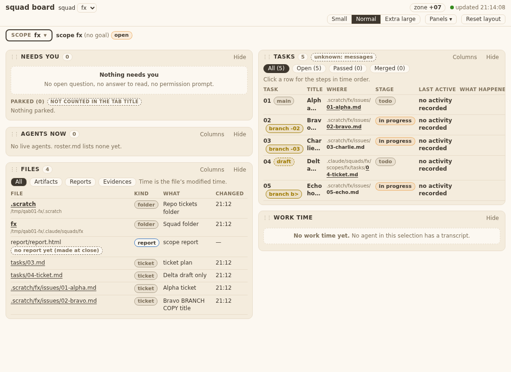
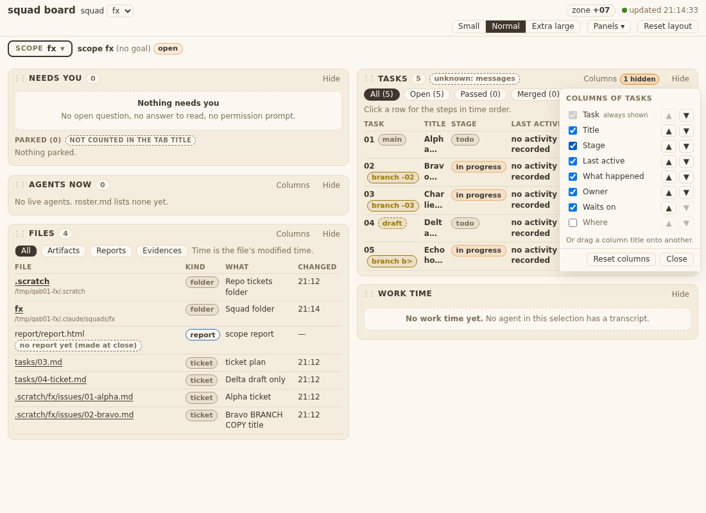
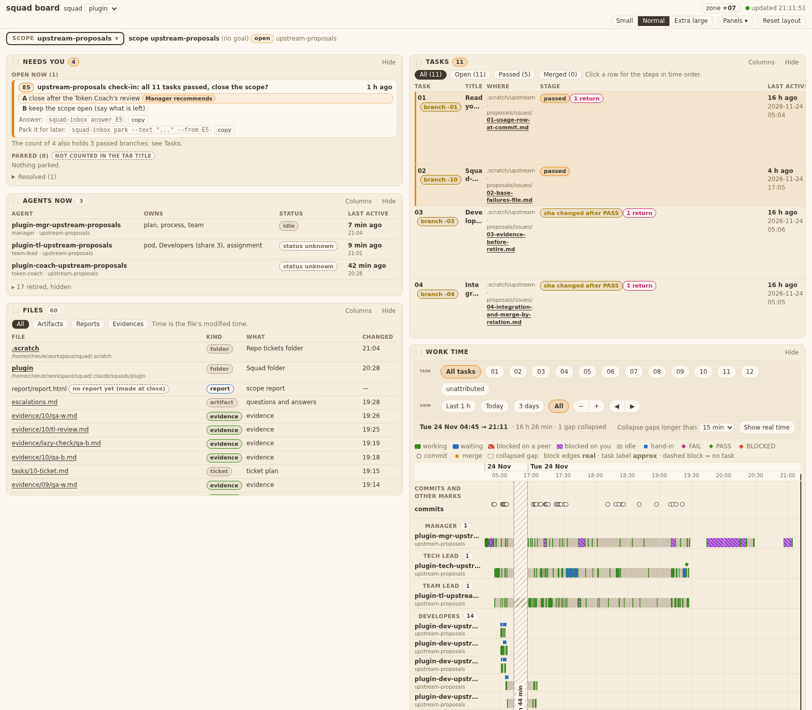
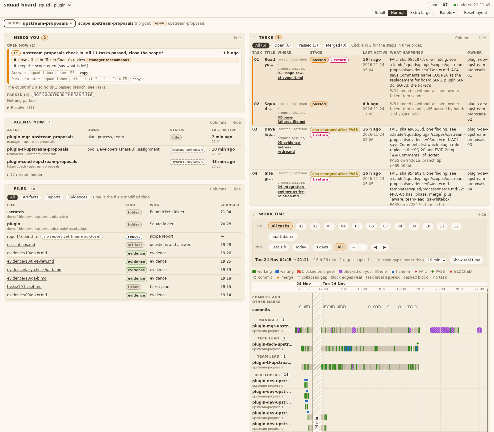

# Evidence 01: board shows every ticket
sha: 4629bb8
## Behaviour

`squadtickets.scope_tasks` now merges tickets by number from main's `.scratch/<folder>/issues/`, the scope's unmerged Dev branches (read with `for-each-ref`, `merge-base`, `ls-tree`, `show` only, 2 s budget (below the reader's 3 s)) and drafts `tasks/NN-ticket.md`. Each row gets `origin` (main|branch|draft), `origin_ref`, `on_main`; the Tasks panel shows a tag in the Task cell (`main` grey, `branch -NN` amber, `draft` amber dashed).

Run with `SQUAD_*` unset, `PYTHONDONTWRITEBYTECODE=1`, from `tests/`: `python3 -m unittest -q test_squadtickets test_squadboard_tasks test_squadboard_list test_squadboard_git test_squadboard_files test_squad_review_pack test_squadtask test_squadreport_tasks test_squad_report_cli test_squad_watchdog test_windows_safe test_utf8_helpers test_instructions test_squadboard_panels` -> Ran 353 tests, OK (includes the SQ-10 trio).

Tests added: `test_squadtickets.TicketMerge` (real `git init` repo: AC1, AC2 and pick order, equal-to-main and merged branch, no git / spent budget, 40-hex refusal, cache, AC3 report=picker=panel, git=False grep) and `test_squadboard_panels.Panels30.test_T01_tasks_source_tag...` (tag DOM, textContent only, no tag without origin).

Deviations from the design notes (sent to the Tech Lead):
- A branch copy counts only if the branch changed that ticket since its merge-base with main. Otherwise a branch cut from an older main shows main's old copy of every other ticket as "newer". The "not merged into main" rule falls out of the same check (a merged branch changes nothing).
- Two `for-each-ref` reads (squad branches + main) are one call, shared 2 s by every scope of the squad, so a picker of 30 scopes asks once. The picker's git-call bound in `test_squadboard_list` went from 2 to 3 (not in the Files line); `test_squadboard_tasks` T26 now counts only `merge-base`/`diff` calls as the evidence check.
- A draft alone does not make a folder: the old `tasks/issues` scope source still reads it.

## QA whitebox

### QA whitebox, ticket 01, sha 4629bb8 (re-checks of 3c90e21: budget 5->2 s and one shared git deadline)

Verdict: PASS (no AC or test broken). Ran: the Dev's 14 test files, 353 OK (SQ-10 trio included), from a detached worktree; live `scope_tasks` on `upstream-proposals` (lists 01-11, tags correct, 0.04 s cold) and `po-clarity` (01 on its branch, 02-06 main).
Checked: T01-1 one merge in `squadtickets.scope_tasks`; T01-3 git read-only, no git/spent budget fall back; T01-4 `ls_tree_blobs`/`show_blob`/`merge_base` refuse non-40-hex; T01-5 `origin` carried to the row and tag via textContent; T01-6 cache; T01-8 watchdog and reviewpack pass `git=False`; AC5 ADR line. Existing tests unchanged except the two loosened below.

#### Follow-ups (not FAIL)
1. (closed in 4629bb8: `_blob_text` shares the phase deadline.)
2. `bin/squadtickets.py` `_folder_rows`: "own Dev branch" is `-0*NN$` on the branch name. Here Developer branches end in the Developer index (`plugin-dev-po-clarity-1`), not the ticket number, so Dev 2 on ticket 03 would count as "own" for ticket 2. Only the preference order is affected, not which tickets show.
3. Deviation from the ticket text for Chieu to see: main beats draft (ticket says draft beats main), and branches merged into main are ignored. The ADR line states both. AC1-AC5 pass either way.
4. Loosened tests: `test_squadboard_list` git-call bound 2 -> 3, `test_squadboard_tasks` T26 counts only merge-base/diff. Both reasoned in evidence.md.
5. `abs` of a branch-won row points to main's file when the file names differ; edge only.

## QA blackbox

### QA blackbox, task 01: board shows every ticket (final sha 4629bb8)

Ran `bin/squad-board` from the Developer's worktree at 4629bb8 (restarted after each new sha), on (a) the real `upstream-proposals` scope and (b) a scratch git repo `/tmp/qab01-fx` (tickets 01-02 on main, 02 also on its own branch with a different title/Status, 03 on a Dev branch only, 04 as `tasks/04-ticket.md` draft only, 05 on a branch with a hostile name). Baseline: main's board on the real scope.

| AC | live/shot | What I did | What I saw | Result |
|---|---|---|---|---|
| AC1 | live | Fixture board, Tasks panel | 01 main, 02, 03 branch, 04 draft, 05 branch: each once, 5 rows | pass |
| AC1 (real) | live | Real upstream-proposals, main vs dev board | main board: 6 tasks; dev board: 11 tasks (01-11) once each, 07-11 tagged `not on main` | pass |
| AC2 | live | Fixture: 02 on main ("Bravo on main", ready-for-agent) and on `-02` ("Bravo BRANCH COPY title", handed in) | Row shows the branch title; stage `in progress` (main copy would be `todo`); hover "on branch ... · also on main" | pass |
| AC3 | live | `squad-report` on the real scope, main vs dev | dev report lists 01-11 with titles (main: 07-11 title-less); board shows the same 11. A stray id `12` with no title is in both main and dev reports (pre-existing, not a ticket) | pass |
| AC4 | live | Browsed fixture board, diffed `git for-each-ref`, status, reflog before/after | no new refs, commits or files from the board (only my own fixture edits) | pass (the 5 s vs 2 s timeout is not observable; see follow-ups) |
| AC5 | live | read ADR 0020 | text contains "all sources merge by number, newest copy wins" | pass |
| AC6 / design | live | Walked ui-design/01.md states | `main` grey solid; `branch -NN` amber; `draft` amber dashed (computed border-style dashed); tag sits after the number in the Task cell and wraps under it in a narrow cell; hover titles as designed ("on main", "... · also on main", "... · not on main", "draft in tasks/, not committed"); Where column hidden via Columns: tags stay; hostile branch name `x<b>BOLD</b>` shows as escaped text (`branch b>`), no injected HTML; passed rows on the real board keep the amber tag | pass |

Screenshots:    

#### Follow-ups (not FAILs)
- Ticket text orders sources branch > newest scope branch > draft > main; ADR 0020 and the build say main beats a draft (a committed ticket's draft is stale). Sensible, but ticket and ADR differ: ticket 01 text could be aligned.
- AC4 says "the 5 s timeout `squadboard_git.py` already uses"; the Developer cut the read budget to 2 s in d78da64. Not visible in the UI; QA whitebox owns it.
- On a scope with many columns the Tasks table is wider than the panel and scrolls sideways (also on main with 6 rows); with 11 rows it is wider still. Not caused by the tag.
- Needs-you count went from 2 to 4 on the real scope because the 5 extra tickets now count as passed branches; that is the data, not a defect.

## Checks

<!-- checks for 01 -->
| AC | Dev: test or capture | QA whitebox: check | QA blackbox: check |
|---|---|---|---|
| AC1 | `test_squadtickets.TicketMerge.test_AC1_...` ok | `cd tests; python3 -m unittest -q test_squadtickets` (TicketMerge AC1) + live `scope_tasks` on upstream-proposals lists 01-11 once each | `squad-board` on scratch git fixture (main 01-02, branch 03, draft 04): Tasks panel lists each once; real upstream-proposals: 11 rows vs 6 on main. qa-b.md row AC1 |
| AC2 | `...test_AC2_T01_2_pick_order_...` ok | `python3 -m unittest -q test_squadtickets` (pick order, branch title/Status); live row 01 origin=branch | `squad-board` on fixture: 02 on main + own branch shows branch title and Status ("Bravo BRANCH COPY title", in progress). qa-b.md row AC2 |
| AC3 | `...test_AC3_report_picker_and_panel_...` ok | `python3 -m unittest -q test_squadtickets test_squadboard_list test_squadboard_tasks test_squadreport_tasks` (same ids from report, picker, panel) | `squad-report` vs board on real upstream-proposals: same 11 titled tickets (stray id 12 untitled on main too). qa-b.md row AC3 |
| AC4 | `...test_T01_4_helpers_refuse...`, `test_T01_3_no_git...` ok; git calls: for-each-ref, merge-base, ls-tree, show only (grep bin/squadtickets.py bin/squadboard_git.py) | `grep -n '_git("' bin/squadboard_git.py` shows only for-each-ref, merge-base, ls-tree, show; `test_squadboard_git` | `git for-each-ref`, `git status`, `git reflog` of the fixture before/after browsing: no change by the board. qa-b.md row AC4 |
| AC5 | `grep -n "all sources merge by number" docs/adr/0020-*.md` hit | `grep -n 'all sources merge by number' docs/adr/0020-*.md` hit | `grep -n "all sources merge by number" docs/adr/0020-*.md` hit. qa-b.md row AC5 |
| UI tag | `test_squadboard_panels.Panels30.test_T01_tasks_source_tag...` ok | `python3 -m unittest -q test_squadboard_panels` (tag DOM, textContent only); look is blackbox's | `squad-board` on fixture and real scope vs ui-design/01.md: grey main, amber branch, dashed amber draft, hovers, tag survives Where hidden. qa-b.md row AC6/design |
