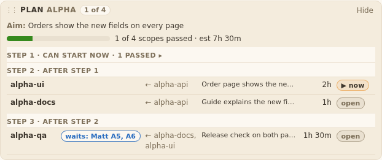
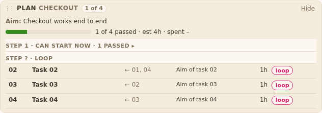
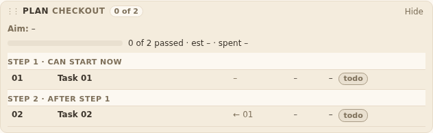
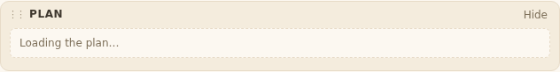
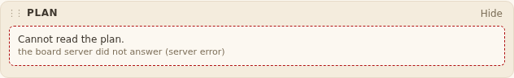
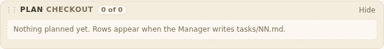
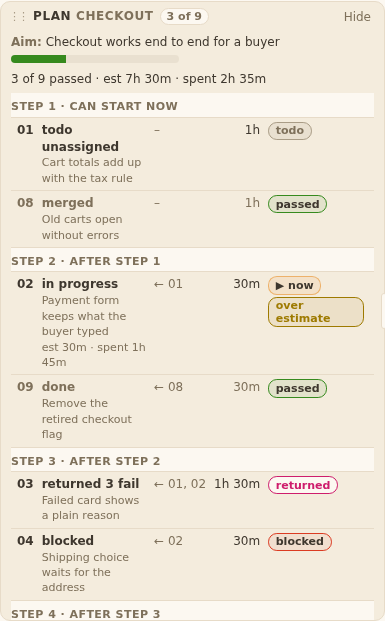

# 04 Plan panel: evidence

## Behaviour

Run with `bin/squad-board --demo --no-open`; Playwright screenshots of `[data-panel=plan]`. Browser console: only the `favicon.ico` 404.

Scope `checkout` (AC1, AC3, AC4, AC7): steps with `← NN`, `over estimate` chip with both numbers (task 02: est 30m, spent 1h 45m), passed step folded (`STEP 5 · … 1 PASSED ▸`), state chips.

Same page after a click on the fold button: the passed step opens.

Goal `alpha` (AC2, AC7): scope rows by step from "Depends on", outside waits as a `waits:` chip.

| AC | Evidence |
|---|---|
| AC1 | `test_squadboard_panels.Plan04.test_T04_AC1_steps_with_deps_arrows`; scope screenshot |
| AC2 | goal screenshot; `test_squadplan` goal rows |
| AC3 | `Plan04.test_T04_AC3_...` (90 min no chip, 91 chip, both numbers) |
| AC4 | `Plan04.test_T04_AC4_...` (`–`, loop chip, `STEP ? · loop`); `test_squadplan` loop; loop and missing-value shots above |
| AC5 | `test_processlint`, `test_rules_contract`, `test_rules_wording` OK; START-19c attaches to manager and team-lead |
| AC6 | `test_squadboard_server.PlanRouteTest` (bad Host 403, no write route) |
| AC7 | the three first screenshots; `test_squadboard_demo` |

### Other states (Manager UI check on 0945f9b)

Playwright 1.x against `bin/squad-board --demo`, `/api/plan` answered by route mocking (`page.route`), shots of `[data-panel=plan]`. Console (read by the script, not visible in a shot): no error, except the 500 on the error shot (by design). Panels other than Plan were not part of the shots.

Loop (AC4): rows in one `STEP ? · loop` step, each with the `loop` chip and its `← NN`; the passed step 1 stays folded above it.

Missing `Aim:` and `Estimate:` (AC4): `Aim: –`, `–` in the Aim and Est cells, `est –` in the progress line, no over-estimate chip.

Loading: the route is never answered, so the panel shows "Loading the plan…".

`/api/plan` fails: the route returns 500; "Cannot read the plan." and the muted reason line, the other panels unaffected.

Empty: the route returns no rows; "Nothing planned yet. Rows appear when the Manager writes tasks/NN.md." with `0 of 0`.

Narrow panel (under 560px): the viewport is 1600px and the panel is dragged by its east handle to one column (385px wide), so the real layout runs, no style injected. The Aim moves under the title as a second muted line; ID, `←`, Est and state stay on the first line.

Design fix found by this shot: at 385px the `over estimate` chip was cut off at the right edge (the table was 426px in a 363px body: state cell never wrapped, Title had a 9em minimum). In the narrow container query, `templates/board/panel_plan.js` now gives the Title cell a 5em minimum and lets the state chips stack and wrap their text (`.pl-st .chip{display:flex;width:fit-content;max-width:100%;white-space:normal;height:auto;...}`). Measured after: table 363px = body, no horizontal overflow. The wide layout is unchanged (the rule is inside `@container plan (max-width:560px)`).

Tests (SQUAD_* unset, from `tests/`), run on f2b3bfa: `test_squadboard_panels test_squadboard_page test_squadboard_timeline test_small_files_equivalence test_windows_safe test_utf8_helpers test_instructions test_rules_wording test_rules_contract test_processlint`: `Ran 238 tests ... OK`. Also OK: `test_squadboard_grid`, `test_squadboard_demo`, `test_squadboard_server.PlanRouteTest`, `test_squadplan`.
Notes: `test_squadboard_grid` does not load the plan panel (its fetch stub serves five routes); `test_squadboard_demo` counts now include `plan`; `templates/board/board.js` `PANEL_TEXT` got a `plan` entry (outside the Files line).

## Review

Code review since dfae8ac (`/mattpocock-skills:code-review`, two reviewers).

### Standards
No hard violation of CLAUDE.md or the test economy. Judgement calls:
- Dead `AIM_MAX` in `bin/squadplan.py`: removed.
- The passed rule (`passed`/`merged`) is written in `squadplan.py`, `squadboard_plan.py` and `panel_plan.js`: kept; a new state word needs edits in three places (follow-up).
- `squadplan._read` is used from `squadboard_plan.py` (private name across modules), and `plan_line_parts` is for ticket 05: kept, the design notes plan it.
- `fields_of` has a one-element tuple `("aim",)` and `# noqa: E731` lambdas: kept.

### Spec
- AC1-AC7 met; AC6 is Host-check only (Manager accepted).
- Goal state chips use their own word mapping, not `taskStageClass` (a goal status such as "open" shows idle): kept.
- "Aim at most 60 characters, no bare IDs" is not enforced by the panel; it clips and the reader reports `aim_bare_ids`: kept.
- The est and spent totals sum different sets of tasks when only some have both numbers, so the total `over estimate` chip can mislead: open, follow-up.
- `_split_cell` also splits goal dependency cells on " and ": open, follow-up.
- No DOM test for the 40-character `waits:` clip: follow-up.
- Aim cell is clipped visually at 15em besides the 60-character clip (design: never wraps): a difference from the design, for the Tech Lead.

### Review of the evidence commit (fresh-context subagent, diff 0945f9b..c93aeb8)
No blocking finding. The CSS edit is wholly inside `@container plan (max-width:560px)`, so the wide layout is unchanged; the six shots match their claims. Fixed in this file: the console and "other panels" claims now say they come from the script, not the shots. Left as is: the 426px (before) and 363px (after) numbers are from a measuring script, with no "before" shot; in the narrow state the two chips stack even when both would fit (design does not say side by side); no goal-variant narrow shot.

Tests after the CSS edit (c93aeb8, from `tests/`): `test_squadboard_panels test_squadboard_demo test_squadboard_page`: `Ran 96 tests ... OK`. The first run of the same three files reported one failure that I did not capture (output was cut to the last lines); the identical rerun passed, so it was a flake or a load effect, not reproduced. `bin/__pycache__` made by these runs was deleted before the commit.
