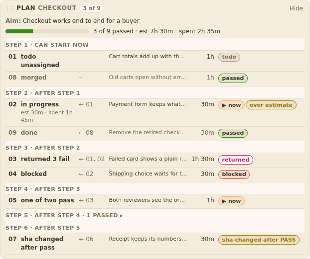

# 04 Plan panel: evidence

## Behaviour

Scope `checkout` in `squad-board --demo`: steps, arrows, `over estimate` chip, folded passed step, loop-free.

Goal `alpha`: scope rows by step, outside waits as a `waits:` chip.

Tests run (SQUAD_* unset, from `tests/`): `test_squadplan`, `test_squadboard_panels` (new `Plan04`), `test_squadboard_server` (new `PlanRouteTest`), `test_squadboard_page`, `test_squadboard_grid`, `test_squadboard_demo`: all OK. SQ-10 trio `test_windows_safe`, `test_utf8_helpers`, `test_instructions` plus `test_rules_wording`, `test_rules_contract`, `test_processlint`: OK.
Grid tests keep their fixed five-panel script list (the plan panel is not loaded there); demo panel counts now include `plan`.
