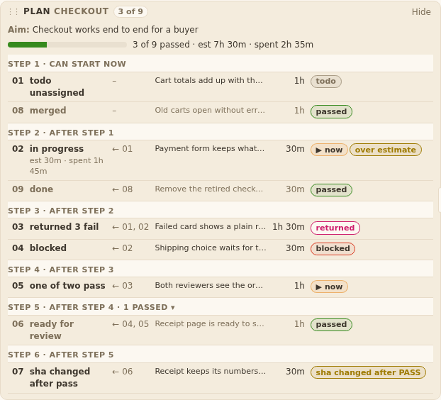

# 04 Plan panel: evidence

## Behaviour

Run with `bin/squad-board --demo --no-open`; Playwright screenshots of `[data-panel=plan]`. Browser console: only the `favicon.ico` 404.

Scope `checkout` (AC1, AC3, AC4, AC7): steps with `← NN`, `over estimate` chip with both numbers (task 02: est 30m, spent 1h 45m), passed step folded (`STEP 5 · … 1 PASSED ▸`), state chips.

Same page after a click on the fold button: the passed step opens.

Goal `alpha` (AC2, AC7): scope rows by step from "Depends on", outside waits as a `waits:` chip.

| AC | Evidence |
|---|---|
| AC1 | `test_squadboard_panels.Plan04.test_T04_AC1_steps_with_deps_arrows`; scope screenshot |
| AC2 | goal screenshot; `test_squadplan` goal rows |
| AC3 | `Plan04.test_T04_AC3_...` (90 min no chip, 91 chip, both numbers) |
| AC4 | `Plan04.test_T04_AC4_...` (`–`, loop chip, `STEP ? · loop`); `test_squadplan` loop |
| AC5 | `test_processlint`, `test_rules_contract`, `test_rules_wording` OK; START-19c attaches to manager and team-lead |
| AC6 | `test_squadboard_server.PlanRouteTest` (bad Host 403, no write route) |
| AC7 | the three screenshots; `test_squadboard_demo` |

Not captured as screenshots (covered by tests or by reading only): the loading, "Cannot read the plan." and empty texts, and the narrow (<560px) layout. A resize in Playwright did not narrow the panel, so no narrow shot is claimed.

Tests (SQUAD_* unset, from `tests/`), run on f2b3bfa: `test_squadboard_panels test_squadboard_page test_squadboard_timeline test_small_files_equivalence test_windows_safe test_utf8_helpers test_instructions test_rules_wording test_rules_contract test_processlint`: `Ran 238 tests ... OK`. Also OK: `test_squadboard_grid`, `test_squadboard_demo`, `test_squadboard_server.PlanRouteTest`, `test_squadplan`.
Notes: `test_squadboard_grid` does not load the plan panel (its fetch stub serves five routes); `test_squadboard_demo` counts now include `plan`; `templates/board/board.js` `PANEL_TEXT` got a `plan` entry (outside the Files line).

## Review

Code review since dfae8ac (`/mattpocock-skills:code-review`, two reviewers).

### Standards
No hard violation of CLAUDE.md or the test economy. Judgement calls:
- Dead `AIM_MAX` in `bin/squadplan.py`: removed.
- The passed rule (`passed`/`merged`) is written in `squadplan.py`, `squadboard_plan.py` and `panel_plan.js`: kept; a new state word needs edits in three places (follow-up).
- `squadplan._read` is used from `squadboard_plan.py` (private name across modules), and `plan_line_parts` is for ticket 05: kept, the design notes plan it.
- `fields_of` has a one-element tuple `("aim",)` and `# noqa: E731` lambdas: kept.

### Spec
- AC1-AC7 met; AC6 is Host-check only (Manager accepted).
- Goal state chips use their own word mapping, not `taskStageClass` (a goal status such as "open" shows idle): kept.
- "Aim at most 60 characters, no bare IDs" is not enforced by the panel; it clips and the reader reports `aim_bare_ids`: kept.
- The est and spent totals sum different sets of tasks when only some have both numbers, so the total `over estimate` chip can mislead: open, follow-up.
- `_split_cell` also splits goal dependency cells on " and ": open, follow-up.
- No DOM test for the 40-character `waits:` clip: follow-up.
- Aim cell is clipped visually at 15em besides the 60-character clip (design: never wraps): a difference from the design, for the Tech Lead.
