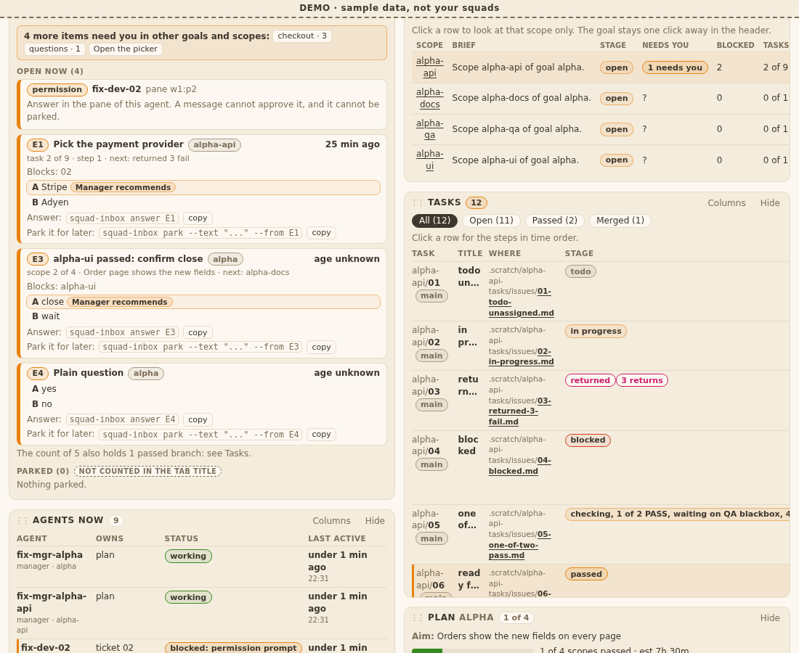
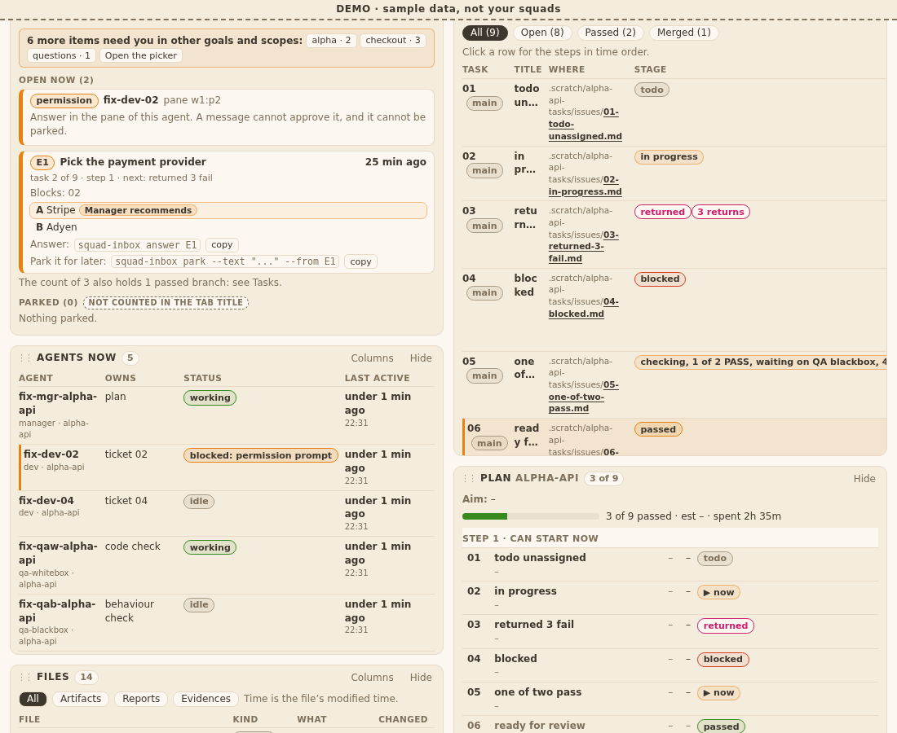
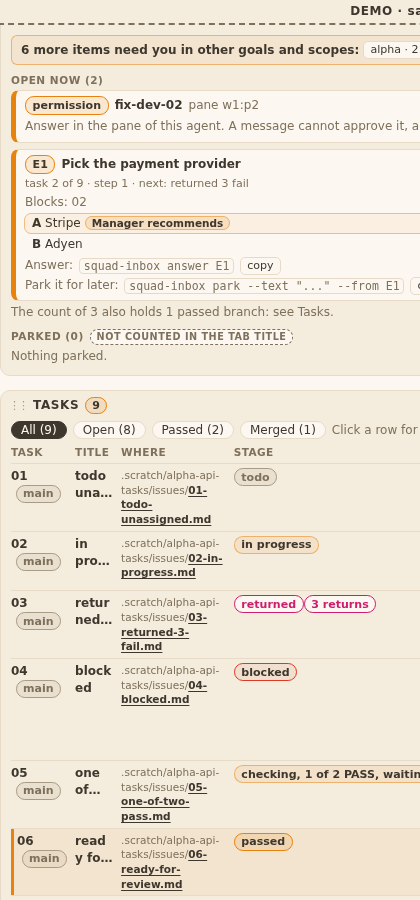

# 05 Inbox item shows its plan row: evidence

## Behaviour

Two surfaces, two palettes: the board inbox panel uses the Mango Parrot light tokens (`.muted`); the po-inbox pane is a terminal and uses `dimColor` only (no hex).

`squad-board --demo --no-open`, items added to the demo homes (goal home: `E3` blocks `alpha-ui`, `E4` blocks nothing; scope `alpha-api`: `E1` blocks `02`). Playwright at 1100 and 420 px; console: only the `favicon.ico` 404.

Goal home, AC1: E3 shows `scope 2 of 4 · Order page shows the new fields · next: alpha-docs` right under the title, above `Blocks:`. E4 (blocks nothing, AC2) has no line and no gap.



Scope home, AC1b: E1 (blocks `02`) shows `task 2 of 9 · step 1 · next: returned 3 fail`; this demo task has no aim, so its part and dot are left out.



Narrow panel (420 px): one line, cut with an ellipsis, full text in `title` (computed `text-overflow: ellipsis`, `white-space: nowrap`).



Pane (rows drawn by the real mod in `claude plugin test`, [pane-states.txt](pane-states.txt)): line right under the title at 80 columns; 40 columns drops the aim first; no plan gives no row; a done item keeps the line, dim. Style asserted in `item.test.ts`: `dimColor` true, no colour, no bold.

```text
--- E23 at 80 columns ---          --- E24 at 40 columns ---
  E23 · blocks erd13 · 5h            E24 · blocks 10 · 5h
erd13 passed: confirm close         Task ten done: confirm
scope 13 of 15 · ERD v12 rewritten · next: promotion      task 10 of 11 · step 4 · next: 11
```

| AC | Evidence |
|---|---|
| AC1 | `Panels12.test_T05_AC1_AC2_plan_line_...`; `PlanFieldTest.test_T05_3_...` (scope 2 of 3 · Pane shows the plan · next: PI-08); `board-goal.png` |
| AC1b | `InboxPlanTest.test_AC1b_...`; `board-scope.png` |
| AC2 | `PlanFieldTest.test_T05_2_...` (unknown, `nothing`, none, no table, unreadable `goal.md`: `plan: null`, exit 0, other fields unchanged); E4 in `board-goal.png` |
| AC3 | pane: `item.test.ts` "05 plan line", `core.test.ts` planLine (run by `claude plugin test`); board: `Panels12` test |

Tests run (targeted, from `tests/`): `test_po_inbox_contract`, `test_squadboard_inbox`, `test_squadplan`, `test_squadboard_panels`, `test_po_inbox_mod`, plus the `grep -rl` hits of the touched files (`test_promotion_0_6_0`, `test_squadboard_grid`, `test_squad_start`, `test_squadruntime`, `test_squadupgrade`, `test_squadboard_page`, `test_old_language_inventory`, `test_squadinbox_body_crlf`, `test_squadinbox_win`) and the SQ-10 trio (`test_windows_safe`, `test_utf8_helpers`, `test_instructions`): all OK. `claude plugin test`: 652 pass, 0 fail. No `bin/__pycache__` left.

Version: `.claude-plugin/plugin.json` 0.11.0; changelog `## v31` ("Plugin 0.11.0", one bullet each for 01, 03, 04, 05 and the LC-9c bullet that had landed headless under v29). `grep -rn '0\.10\.10' .claude-plugin skills`: only v28 history lines. Merging with `main` (v30 / 0.10.12) is left to the integration task (Manager's decision).

Cost (design notes): the plan is read once per snapshot, in a thread capped at 2 s (`PLAN_CAP_S`), only by `list --json`; `test_T05_cost_no_git_...` patches `subprocess.run` to raise and shows a slow reader gives `plan: null` for every item inside the cap.

## Review

REVIEW_PLACEHOLDER
