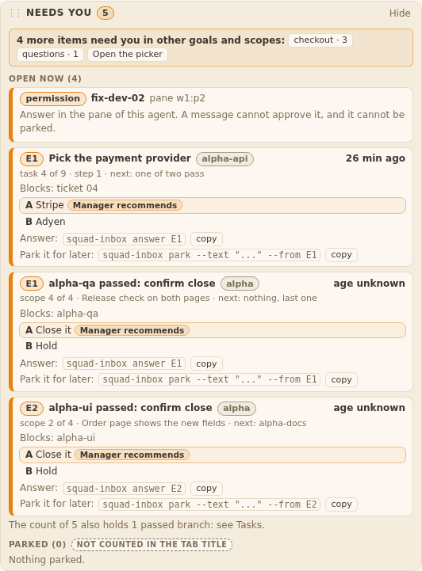

# 05 Inbox item shows its plan row: evidence

## Behaviour

Two surfaces, two palettes: the board inbox panel uses the Mango Parrot light tokens (`.muted`); the po-inbox pane is a terminal and uses `dimColor` only (no hex).

`squad-board --demo --no-open`, items added to the demo homes (goal home: `E3` blocks `alpha-ui`, `E4` blocks nothing; scope `alpha-api`: `E1` blocks `02`). Playwright at 1100 and 420 px; console: only the `favicon.ico` 404.

Goal home, AC1: E3 shows `scope 2 of 4 · Order page shows the new fields · next: alpha-docs` right under the title, above `Blocks:`. E4 (blocks nothing, AC2) has no line and no gap.


Scope home, AC1b: E1 (blocks `02`) shows `task 2 of 9 · step 1 · next: returned 3 fail`; this demo task has no aim, so its part and dot are left out.


Last row of the plan (design States, "Last row in the plan"): the goal home, `alpha-qa` is scope 4 of 4, so the line ends `next: nothing, last one`. The board panel is at its widest here (532 px) so the whole line shows. (The same shot also shows the scope item `E1` of `alpha-api` and `E2`.)



Narrow panel: the panel handle was dragged in with the mouse (Playwright) until the panel was 260 px wide (the layout's smallest), with a long aim on the last-row item (`Release check passes on both pages with every field shown`). All three lines are one line, cut with `…`, full text in `title`; measured: `scrollWidth > clientWidth`, computed `text-overflow: ellipsis`, `white-space: nowrap`, `title` equal to the text. Console: only the `favicon.ico` 404.


Pane (rows drawn by the real mod in `claude plugin test`, [pane-states.txt](pane-states.txt)): line right under the title at 80 columns; 40 columns drops the aim first; no plan gives no row; a done item keeps the line, dim; the last row of the plan ends `next: nothing, last one` (80 columns `scope 4 of 4 · Release check on both pages · next: nothing, last one`; 40 columns `task 11 of 11 · next: nothing, last one`, step and aim cut first, `next:` kept). Style asserted in `item.test.ts`: `dimColor` true, no colour, no bold.

```text
--- E23 at 80 columns ---          --- E24 at 40 columns ---
  E23 · blocks erd13 · 5h            E24 · blocks 10 · 5h
erd13 passed: confirm close         Task ten done: confirm
scope 13 of 15 · ERD v12 rewritten · next: promotion      task 10 of 11 · step 4 · next: 11
```

| AC | Evidence |
|---|---|
| AC1 | `Panels12.test_T05_AC1_AC2_plan_line_...`; `PlanFieldTest.test_T05_3_...` (scope 2 of 3 · Pane shows the plan · next: PI-08); goal-home shot above |
| AC1b | `InboxPlanTest.test_AC1b_...`; scope-home shot above |
| AC2 | `PlanFieldTest.test_T05_2_...` (unknown, `nothing`, none, no table, unreadable `goal.md`: `plan: null`, exit 0, other fields unchanged); E4 in the goal-home shot has no line |
| AC3 | pane: `item.test.ts` "05 plan line", `core.test.ts` planLine (run by `claude plugin test`); board: `Panels12` test |

Tests run (targeted, from `tests/`): `test_po_inbox_contract`, `test_squadboard_inbox`, `test_squadplan`, `test_squadboard_panels`, `test_po_inbox_mod`, plus the `grep -rl` hits of the touched files (`test_promotion_0_6_0`, `test_squadboard_grid`, `test_squad_start`, `test_squadruntime`, `test_squadupgrade`, `test_squadboard_page`, `test_old_language_inventory`, `test_squadinbox_body_crlf`, `test_squadinbox_win`) and the SQ-10 trio (`test_windows_safe`, `test_utf8_helpers`, `test_instructions`): all OK. `claude plugin test`: 652 pass, 0 fail. No `bin/__pycache__` left.

Version: `.claude-plugin/plugin.json` 0.11.0; changelog `## v31` ("Plugin 0.11.0", one bullet each for 01, 03, 04, 05 and the LC-9c bullet that had landed headless under v29). `grep -rn '0\.10\.10' .claude-plugin skills`: only v28 history lines. Merging with `main` (v30 / 0.10.12) is left to the integration task (Manager's decision).

Cost (design notes): the plan is read once per snapshot, in a thread capped at 2 s (`PLAN_CAP_S`), only by `list --json`; `test_T05_cost_no_git_...` patches `subprocess.run` to raise and shows a slow reader gives `plan: null` for every item inside the cap.

## Review

Run: `/mattpocock-skills:code-review` since the task base 34191f3, two sub-agents (sonnet, high). Findings and what I did:

### Standards
No firm violation of CLAUDE.md or an ADR (the mod still talks only to the CLI; `plan` is an optional field in `types/index.d.ts`). Judgement calls:
- Test economy: 11 new tests, two overlap on the `plan` shape and `test_T05_2` lists five null cases. Kept: each maps to an AC line (AC1, AC1b, AC2, AC3) or a design-note risk (T05-2, T05-3, T05-5, cost); the five null cases are the cases AC2 and T05-2 name. Not trimmed.
- Duplicated `HEAD` table header in `test_squadplan.py`: fixed, it now reuses `po_inbox_fixtures.HEAD`.
- Magic number `room >= 8` in `planLine`: fixed, named `MIN_NEXT_CELLS`.
- The join-with-` · ` logic exists in TS (pane) and JS (board): two runtimes, so kept; the cut order lives only in the pane because the board clips by width (design).
- `plan_line_parts` returns formatted strings, `snapshot(plans=...)` flag, thread-join cap, `planLine(plan: unknown)`: all by design (parts in the contract, "one reader", a hard 2 s cap as `call_reader` does, an older CLI sends no `plan`). Not changed.

### Spec
- First token: the design says "the first token of `--blocks` that is a scope name or a task number". The code tested only the first word. Fixed: the first word that names a row wins (`ticket 02, other` gives task 2); test line added in `test_plan_line_parts_goal_and_scope`.
- "Full line in Details" on a narrow pane: the Details page (`detail` view) draws the unclipped line (`planLine(it.plan, detail ? null : cols)`); no extra row needed. Not changed.
- CSS is inline in `panel_inbox.js` (the file's own pattern for every `.nb-item` rule); `board.css` already holds `.muted`. Not moved.
- `inbox.jsonl` byte test: `list --json --no-write` writes nothing; the default `list` writes only the existing `seen` events, never a plan. Not changed.
- Changelog v31 restates tickets 01, 03, 04 and moves the headless 06 text out of v29: the scope's plugin bump needs one entry for what the scope ships (design: "the entry for 02, 06 and 05"; 02 added no rule text in this branch). Main has v30 and 0.10.12: the integration task resolves the number (Manager's decision).
- `step` is now only for a scope home, per the UI design ("scope home only"); the 04 test line moved with it.
- Not asked for and kept: `plan_model` and the `model=` parameter (one plan read per snapshot, the design's "cache by home").
