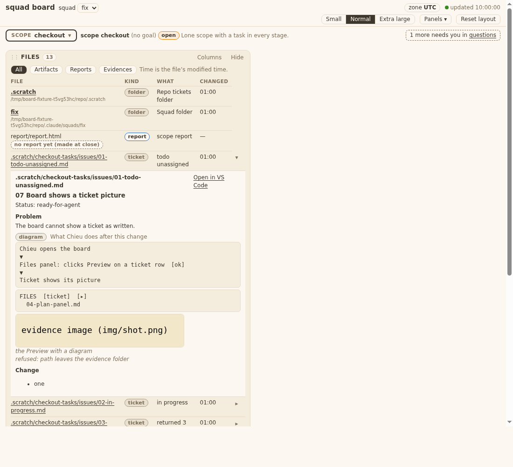

# Evidence: 07 Board shows a ticket's picture

## Behaviour

Preview on a Files-panel ticket row (fixture page, `fetch` stubbed): a `diagram` fence with its caption above a `<pre>`, a `text` fence with its spacing, an image shown from the evidence folder, and a refused image (`../../etc/passwd`) shown as alt text only (no request).

Tests run (SQUAD_* unset, `PYTHONDONTWRITEBYTECODE=1`):
- `test_squadboard_panels` (new: `T07_AC1_AC2_AC4_AC5…`, `T07_states…`), `test_squadboard_server` (new `T07_AC3…`), `test_squadboard_files`, `test_squadboard_open`, `test_squadboard_demo`, `test_squadboard_grid`, `test_squadboard_page`: OK.
- SQ-10 trio `test_windows_safe`, `test_utf8_helpers`, `test_instructions`: 44 tests OK. `bin/squadboard.py` prints no new text.
- Static14 (no innerHTML, no hex colours in the panel file) passes.
