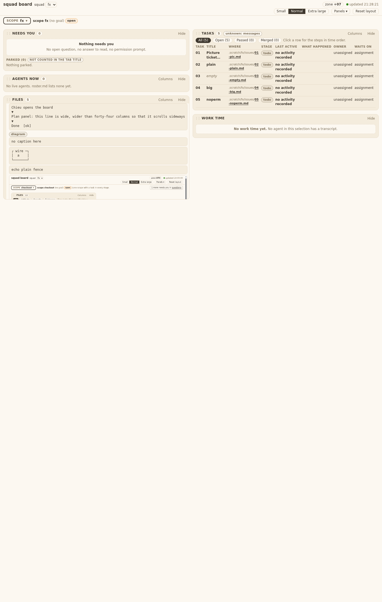
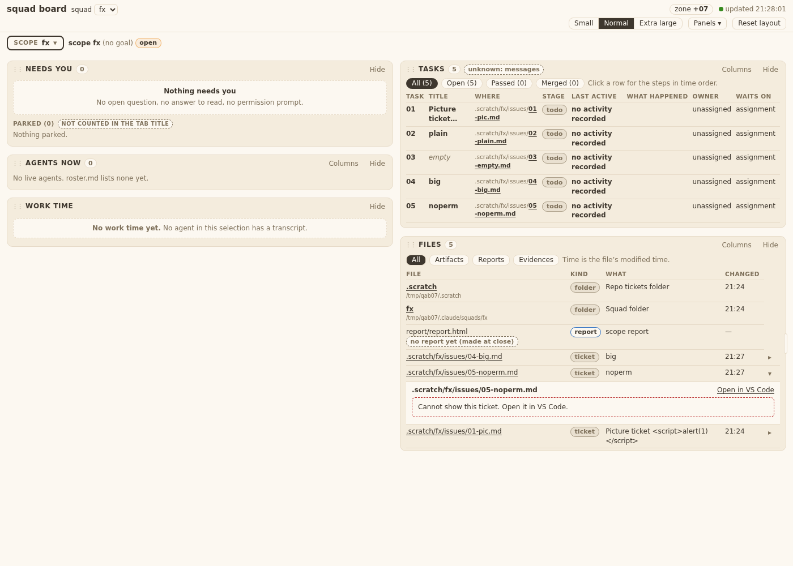
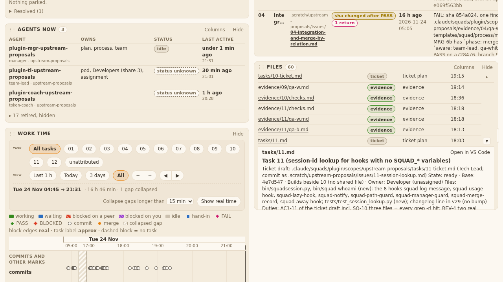

# Evidence: 07 Board shows a ticket's picture

## Behaviour

Preview on a Files-panel ticket row (fixture page, `fetch` stubbed): a `diagram` fence with its caption above a `<pre>`, a `text` fence with its spacing, an image shown from the evidence folder, and a refused image (`../../etc/passwd`) shown as alt text only (no request).

Tests run (SQUAD_* unset, `PYTHONDONTWRITEBYTECODE=1`):
- `test_squadboard_panels` (new: `T07_AC1_AC2_AC4_AC5…`, `T07_states…`), `test_squadboard_server` (new `T07_AC3…`), `test_squadboard_files`, `test_squadboard_open`, `test_squadboard_demo`, `test_squadboard_grid`, `test_squadboard_page`: OK.
- SQ-10 trio `test_windows_safe`, `test_utf8_helpers`, `test_instructions`: 44 tests OK. `bin/squadboard.py` prints no new text.
- Static14 (no innerHTML, no hex colours in the panel file) passes.

## QA whitebox

### QA whitebox 07, sha 87c730d (base 5c0d5cd)

Verdict: PASS. Method: detached worktree at 87c730d, SQUAD_* unset, PYTHONDONTWRITEBYTECODE=1.

#### Checked
- Tests, all OK: test_squadboard_panels (60, incl. T07 x2), test_squadboard_server (19, incl. T07_AC3), test_squadboard_files, _open, _demo, _grid, _page, test_windows_safe, test_utf8_helpers, test_instructions.
- `grep -rl 'renderMd\|mdBlocks\|/api/file' tests/` hits: files, panels, demo, server: all in the run.
- Server image mode (bin/squadboard.py `_file`): png/jpg/svg only (400 otherwise), `base` required and resolved, base under squad or `.scratch`, file (already resolved, so symlinks count) under base, svg `image/svg+xml` with CSP `sandbox`, size cap kept; without `img=1` the old path is unchanged (tested: svg stays text/html).
- Client (panel_files.js): `imgPath` refuses scheme, leading slash, backslash, `..`, empty segment, control chars, `?#%`, wrong extension; text reaches the DOM through textContent/setAttribute; no innerHTML added. A refused path builds no ``, so no request (tested with 4 bad paths).
- Row click sends no /api/file (AC5 test); Preview is a separate button with aria-expanded; Esc closes and returns focus; loading/empty/error states tested.
- ADR 0020 amendment line and the panel_files.js header comment are rewritten (ticket 30 reversal). No changelog, no version file (T06-6).
- AC6 and AC8 look (spacing, caption bar, screenshot) are QA blackbox's (REV-18a); the screenshot exists in the commit.

#### Follow-ups (not blocking)
- Image mode lets `base` be the squad folder itself, so "inside base" is then no limit. The path was already readable under the plain route, so nothing new is exposed.
- The Dev's checks.md is in the ticket folder on the branch; my column is in `evidence/07/checks.md` (this folder) for the Developer to copy across. `squad-evidence checks` on it says ok.
- Row-click request check says `/api/open` may still be sent (ticket 34); the test pins only /api/file.

#### Re-check eaab72e (diff 87c730d..eaab72e: panel_files.js, T07_states test)
Verdict: PASS. Document-level Esc listener (guarded by `PV` and `body.isConnected`), and `draw()` keeps focus on the Preview button across a redraw. The test now blurs and sends Esc on `document`. test_squadboard_panels (60), _files, _open, _page all OK. Follow-up: other panels (panel_tasks) also close on Esc at document level; one Esc may close both a task detail and a preview. Not an AC.

## QA blackbox

### QA blackbox, task 07: board shows a ticket's picture (sha 87c730d)

Ran the Developer's `bin/squad-board` on a scratch git repo `/tmp/qab07` (scope `fx`, ticket 01 with a captioned `diagram` fence, a caption-less one, a `text` fence, a `bash` fence, 9 image links incl. traversal / absolute / scheme / .txt / missing / symlink / svg, `<script>` in title, caption and alt; tickets 02 plain, 03 empty, 04 19 MB, 05 unreadable). Real browser, live `/api/file` requests, no stubs.

| AC | live | What I did | What I saw | Result |
|---|---|---|---|---|
| AC1 | live | Preview on 01 | `diagram` fence: grey `diagram` chip + caption text above a `<pre>` (white-space pre, overflow-x auto); caption-less diagram: chip only; `text` and `bash` fences: plain `<pre>`, no caption bar | pass |
| AC2 | live | list of resource requests after Preview | requests only for the allowed images (a, missing, link, s); none for `../../etc/passwd`, `/etc/passwd`, `https://...`, `img/n.txt`; refused ones show italic alt text only; missing and symlink show alt with title "image not found"; good png loads (1100 px wide), svg shows through `` and its script does not run | pass |
| AC3 | live | curl on `/api/file` | png 200 image/png; svg with `img=1` image/svg+xml + CSP sandbox; svg without `img=1` text/html; path outside base 403; `../` path 404; symlink out of base 403; `.txt` 400 "not an image"; base `/etc/` 403; base repo-root not found; wrong Host 403 | pass |
| AC4 | live | `<script>` in title, caption, alt | all shown as text; page title stayed `fx` (no script ran) | pass |
| AC5 | live | clicked a ticket row, listed `/api/file` requests | 0 requests; only the Preview button reads the ticket; only `ticket` rows have the button | pass |
| AC6 | live | walked ui-design/07.md states | one preview open at a time; empty file "This ticket is empty."; 19 MB and unreadable file: "Cannot show this ticket. Open it in VS Code." with the "Open in VS Code" link in the header; preview survives the board's refresh; keyboard: Enter opens/closes, Esc closes and keeps focus on the button when the button has focus. **Esc after a mouse click does nothing** (focus is on BODY right after the click, also after clicking inside the preview) | **FAIL** (design: "[▾] or Esc closes it and returns focus to the button") |
| AC7 | not run | tests are QA whitebox's | - | n/a |
| AC8 | shot | read the Developer's the shot in Behaviour | captioned diagram, image and refused image shown (fixture with stubbed fetch); my live shots confirm the same | pass |

 

#### Finding (FAIL)
1. Esc does not close the preview unless the Preview button has keyboard focus. Mouse flow: click `▸` on a ticket row, press Esc: preview stays open, `document.activeElement` is BODY (the board re-draws the row and drops focus). Design 07 says Esc closes it and focus returns to the button.

#### Follow-ups (not FAILs)
- The Files panel is about 350 px high at Normal, so a preview shows a few lines and then scrolls inside the panel, inside the preview's own scroll.
- Loading state ("Loading ticket…") too brief to see against a local server; not verified.

#### Re-check at eaab72e (Esc only)
Ran the Developer's `bin/squad-board` on the real scope `upstream-proposals` (ticket rows with Preview), real mouse clicks and real `Escape` keypresses via playwright-cli.

| Step | What I saw | Result |
|---|---|---|
| mouse click `▸` on tasks/11.md, press Esc | preview closes, focus on the Preview button | pass |
| open, click inside the preview header with the mouse (focus BODY), wait 12 s, Esc | preview closes, focus on the button | pass |
| open, move focus to BODY, Esc | preview closes, focus on the button | pass |
| keyboard: focus button, Enter opens, Esc closes | as designed | pass |

AC6 now passes (design: "[▾] or Esc closes it and returns focus to the button").

Follow-up (not a FAIL, design 07 does not require it): with a preview open and the button focused, a later board refresh (seen after about 50 s) leaves focus on BODY, so the redraw does not always keep focus on the button as the HANDIN says. Esc still works from there.

## Checks

| AC | Dev: test or capture | QA whitebox: check | QA blackbox: check |
|---|---|---|---|
| AC1 | test_squadboard_panels T07_AC1…: spacing, caption, no bar for bash: OK; the shot in Behaviour | `cd tests; python3 -m unittest test_squadboard_panels -k T07` at 87c730d: OK (spacing kept, caption only on diagram) | live at 87c730d: caption chip on diagram, plain pre for text/bash: OK |
| AC2 | same test: 2 image requests, 4 refused paths alt only: OK | same test: 2 image requests with `img=1&base=`, `../`, absolute, scheme, .gif show alt only; imgPath read in panel_files.js | live at 87c730d: 4 safe image requests, refused paths alt only: OK |
| AC3 | test_squadboard_server T07_AC3: outside base 403, symlink 403, .txt 400, svg sandbox, no img=1 text/html: OK | `python3 -m unittest test_squadboard_server -k T07` OK; read `_file` image branch in bin/squadboard.py (base under squad or .scratch, file under base, resolved path) | live at 87c730d: curl on /api/file, 403/400/CSP as written: OK |
| AC4 | same panel test: script in alt shown as text, `__x` undefined: OK | same panel test: script in alt and caption shown as text, no script element, `window.__x` undefined; no innerHTML in diff | live at 87c730d: script in title, caption, alt shown as text: OK |
| AC5 | same panel test: row click sends no /api/file, Preview sends one: OK | same panel test: row click sends no /api/file, Preview sends one; Static14 passes | live at 87c730d: row click sends 0 /api/file requests: OK |
| AC6 | T07_states (loading, err, empty, Esc focus) + the shot in Behaviour | QA blackbox owns the look (REV-18a); T07_states test (error, empty, Esc returns focus) OK | live: states walked at 87c730d; Esc re-checked live at eaab72e after mouse click, from BODY, and from keyboard: closes, focus on button: OK |
| AC7 | 7 test files listed in Behaviour: OK | `grep -rl "renderMd, mdBlocks, /api/file (grep -E)" tests/` hits (files, panels, demo, server) all OK, plus open, grid, page; SQ-10 trio OK | not run by blackbox (whitebox owns tests) |
| AC8 | the shot in Behaviour (diagram, image, refused image in one shot) | the shot in Behaviour exists in the commit; judged by QA blackbox | live shots match the Developer the shot in Behaviour: OK |

## QA blackbox shots

