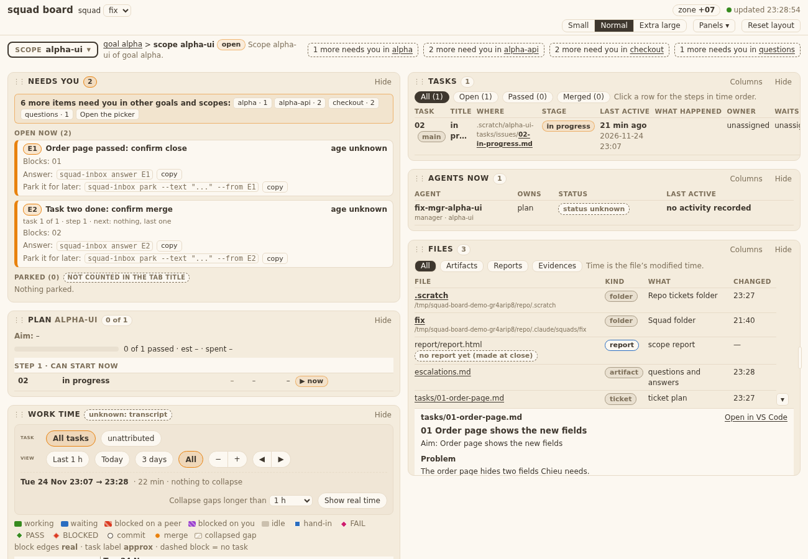

# integration: 02, 07 and main merged into 05's branch: evidence

## Behaviour

Merge order on 05's branch (`e0ab63b`): 02 (`e2b05c8`), 07 (`eaab72e`), then `main` (`9b74b02`). Conflicts: only `skills/squad-process-update/changelog.md` (02, main) and `.claude-plugin/plugin.json` (main).
- `plugin.json` keeps 0.11.0; changelog v31 sits above main's v30; v29 (0.10.11) is untouched; ADR 0034 comes from main.
- 02's own `## v29` heading (ITER-19 text) is not kept: its bullet is in v31 (the plan said one heading), with the ITER-19 word added to the process-update line of Deploy.
- v31 now has one bullet each for 01, 03, 04, 07, 05, 02 and LC-9c. Deploy names 0.11.0, a `squad-board` restart (07's image mode of `/api/file`), the po-inbox restart, and the `squad-inbox add` bare-ID refusal every Manager meets (exit 2); Rollback says the refusal goes with the revert.

Second pass (Manager FAIL: 03's passed sha was not an ancestor): merged the 03 branch (`5f0288f`, evidence-only on top of code `2daf416`) into the integration branch; no conflict. 03's `evidence.md` now has `## Review` on the integrated tree. Ancestor check, `git merge-base --is-ancestor <sha> HEAD` exit 0 for every passed sha of the scope:
- 01 `932173b` and `4629bb8`, 02 `e2b05c8`, 03 `5f0288f` (and its code `2daf416`), 04 `34191f3`, 05 `e0ab63b`, 06 `6bab9f1`, 07 `eaab72e`, `main` `9b74b02`.
- The 03 merge changes only `03-inbox-refuses-bare-ids/evidence.md` (+19 lines), so no retest was needed; the SQ-10 trio and the two fixed tests ran again on the merged tree: 119 tests OK.

Two tests failed on the integrated tree and on their own bases, so both were fixed here (one line each):
- `test_squadinbox::ProjectionTest::test_contract_shape`: red on 05's sha `e0ab63b` (the `KEYS` set lacks the `plan` key 05 added). `KEYS` now has `plan`.
- `test_session_lookup::HookTest::test_every_squad_hook_of_hooks_json_calls_the_lookup`: red on `main` (the new `squad-handin-gate` hook is in `hooks.json` but not in `HOOKS`); `bin/squad-handin-gate` calls `squad-whoami`, so it belongs there. `HOOKS` now has it.

Tests (SQUAD_* unset, `PYTHONDONTWRITEBYTECODE=1`, from `tests/`, foreground, `< /dev/null`), all OK on the final tree:
- Named set: `test_squadboard_panels` (66), `test_rules_wording` (31), `test_instructions` (16), `test_processlint` (31).
- SQ-10 trio: `test_windows_safe` (14), `test_utf8_helpers` (14), `test_instructions` (16).
- Others touched or merged in: `test_hooks_json` (6), `test_squadtask` (19), `test_squadboard_server` (20), `test_squadinbox` (59), `test_session_lookup` (16).
- `grep -rl` hits of the changed paths: `test_po_inbox_contract`, `test_squadplan`, `test_squadboard_inbox`, `test_squadboard_files`, `test_squadboard_page`, `test_squadboard_tasks`, `test_squadtickets`, `test_squad_evidence`, `test_templates`, `test_squadcompose`, `test_squadupgrade`, `test_old_language_inventory`, `test_squad_merge_check`, `test_squad_review_pack`, `test_squad_close`, `test_squad_start`, `test_squad_team`, `test_squad_log_message`, `test_promotion_0_6_0`, `test_run_suite`, `test_squadboard_list`, `test_squadboard_grid`, `test_squadruntime`.
- `squad-process lint` exit 0. `claude plugin test`: 652 pass, 0 fail (po-inbox pane, incl. 05's plan line).
- Full suite: not run (no yes from Chieu; the Tech Lead runs the SQ-10 trio and asks).

Board, both changes on one page (`squad-board --squad <demo copy> --scope alpha-ui`, demo copy of the fixture; inbox item E2 blocks task `02`, ticket `tasks/01-order-page.md` added). E2 shows 05's plan line `task 1 of 1 · step 1 · next: nothing, last one` under its title, and the Files panel row for the ticket has 07's Preview open (title, Aim, Problem), with no clash between the two panels. Browser and both servers were closed after.

## Review

Run: `/mattpocock-skills:code-review` since 05's sha `e0ab63b` (two sub-agents, sonnet, high).

### Standards
No violation of a documented standard (repo `CLAUDE.md`, ADR 0020 and 0034, the changelog format, version match 0.11.0 = v31). Judgement calls, none changed:
- Mysterious Name: v31 bullets carry ticket numbers "(01)".."(07)"; v29 does the same and each has words beside it, so no bare ID.
- Duplicated Code in 07's merged code (`real.suffix.lower()` twice in `bin/squadboard.py`; `BOARD.page.state.squad` twice in `panel_files.js`): minor, reviewed in 07, not touched here.
- Shotgun Surgery: the hook list in `HOOKS` of `test_session_lookup.py` is one more place to edit when a hook is added; v29 says "eight hooks" and stays history.
- `squad-handin-gate` repeats part of the session lookup the other hooks use: main's reviewed code, not judged here.

### Spec
- Fixed: the merge dropped the blank line between v29's Deploy paragraph and `## v28`, so v29 was not byte-for-byte main's. Blank line restored; `git diff main -- skills/squad-process-update/changelog.md` now only adds v31.
- Evidence of this task was not committed when the reviewer ran; it is now.
- 02's bullet does not name the `[warn] full suite: not answered` line on a check-in or merge item; the bullet already says the ask is non-blocking. Not added.
- 07's bullet leaves out Esc to close and the "Open in VS Code" link; harmless, not added.
- Everything else matched: heading order v31, v30, v29, v28; no conflict markers; `plugin.json` 0.11.0 and only that line differs from main; ADR 0034 present; bullets for 01, 03, 04, 05, 02, 07, LC-9c; Deploy and Rollback name 0.11.0 and the `squad-inbox add` refusal. No scope creep: only the two test-list lines are new.

## Checks

| AC | Dev: test or capture | QA whitebox: check | QA blackbox: check |
|---|---|---|---|
| Merges | `git merge-base --is-ancestor` of every passed sha (01 `932173b` `4629bb8`, 02 `e2b05c8`, 03 `5f0288f`, 04 `34191f3`, 05 `e0ab63b`, 06 `6bab9f1`, 07 `eaab72e`, `main` `9b74b02`) against HEAD: all true; 03's `evidence.md` has `## Review` | - | - |
| plugin.json 0.11.0 | `grep version .claude-plugin/plugin.json` = 0.11.0 = changelog top heading v31; v30 below it, v29 untouched | - | - |
| Changelog v31 | bullets for 01, 03, 04, 07, 05, 02 and LC-9c; Deploy names 0.11.0 and the `squad-inbox add` refusal; no conflict markers | - | - |
| ADR 0034 kept | `ls docs/adr/0034-handin-evidence-gate-blocks.md` | - | - |
| Shared tests | see `## Behaviour`: all OK | - | - |
