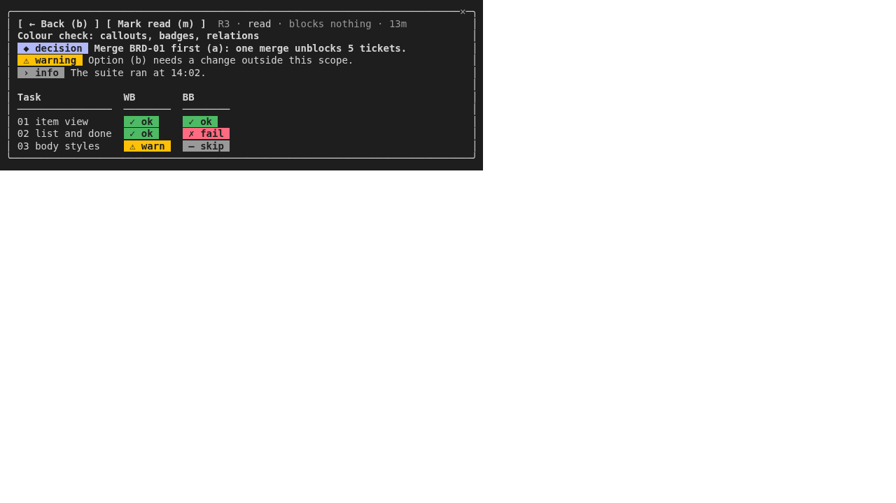
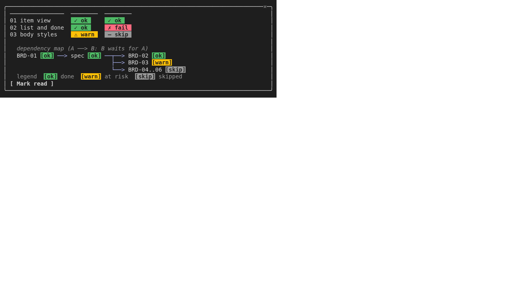
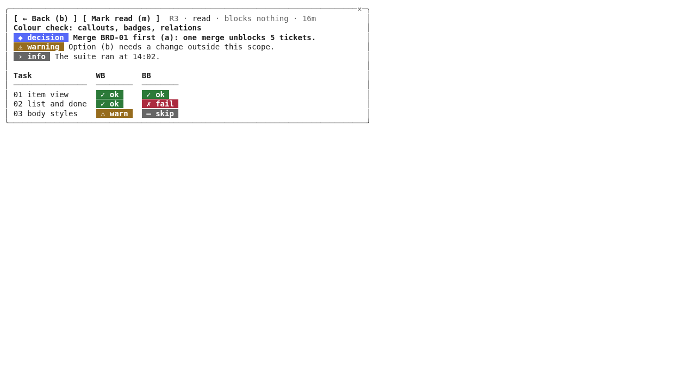
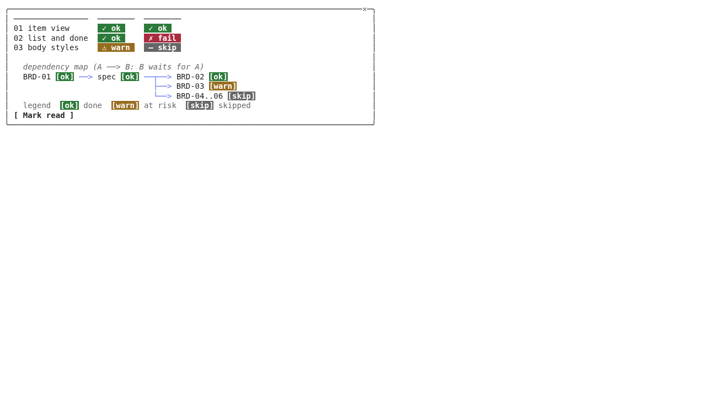

# Evidence: ticket 03, body styles

## Behaviour

Real-pane captures: `claude --plugin-dir <this worktree>` in a pty (24 or 40 terminal rows, 80, 60 or 47 columns), the screen read through a pyte terminal model, with the plugin's own `bin/squad-inbox` seeding a scratch inbox from the fixtures `guideE1`, `guideR1`, `diagramWide`, `chips` + `relations` (`hooks/po-inbox/fixtures/visual.ts`). Built on commit `e485f05` (code); the review fixes are in it. Each item was opened with its number key, then paged with PageDown and `Details` (Tab to the button, Enter). Pages that repeat are shown once. Body rows the host gives: 6 at 24 rows, 11 at 40. Only the pane box is shown; theme: dark.

What the captures show (design sections 3 to 5 and 9):
- **Callouts** are filled chips (`◆ decision`, `⚠ warning`, `› info`) then the sentence; the text wraps under column 0 (47 columns: 2 rows).
- **Badges** are filled chips in table cells; the columns widen by the chip (the `ok` chip is 6 cells, `fail` 8).
- **Tables** keep their aligned columns from 40 columns (the E1 options table is 59 cells wide, so it aligns at 80 and 60 and stacks as `column: value` at 47).
- **Diagram** has no `│` gutter, is never wrapped, and when wider than the pane every wide line ends in `›` and a footer names both widths.
- **Links** are `label <url>`, no escape sequence.

Colour is checked in the "Colour" section below: the same body on a dark and a light theme, with the exact colours the pane resolved.

## Captures (dark theme)

### E1 answer item (design section 6, example 1)

**24 rows x 80 columns**

Page 1:

```
╭────────────────────────────────────────────────────────────────────────────✕─╮
│ [ ← Back ]  E1 · blocks BRD-02..06 · 10h                             ↓ send  │
│ Which branch merges first: BRD-01 for BRD-02..06?                            │
│ ○ (a) PO merges BRD-01 as soon as it passes                            ✓ rec │
│ ○ (b) Developers stack on squad/dev-board-1                                  │
│ ○ (c) PO merges each passed branch as it passes                              │
│ Note (optional):                                                             │
╰──────────────────────────────────────────────────────────────────────────────╯
```

Page 2:

```
╭────────────────────────────────────────────────────────────────────────────✕─╮
│ ○ (c) PO merges each passed branch as it passes                              │
│ Note (optional):                                                             │
│ [ Send answer ]                                                              │
│ Context                                                                      │
│  ◆ decision  Merge BRD-01 first (a): one merge unblocks 5 tickets.           │
│ … 18 more rows [ Details ]                                                   │
╰──────────────────────────────────────────────────────────────────────────────╯
```

Page 3:

```
╭────────────────────────────────────────────────────────────────────────────✕─╮
│ [ ← Decide (b) ]  E1 · answer · blocks BRD-02..06 · created 10h ago          │
│ Which branch merges first: BRD-01 for BRD-02..06?                            │
│ ✓ recommends: (a), one merge unblocks 5 tickets                              │
│                                                                              │
│ Context                                                                      │
│  ◆ decision  Merge BRD-01 first (a): one merge unblocks 5 tickets.           │
╰──────────────────────────────────────────────────────────────────────────────╯
```

Page 4:

```
╭────────────────────────────────────────────────────────────────────────────✕─╮
│                                                                              │
│ Option                    Unblocks     Risk                                  │
│ ────────────────────────  ───────────  ────────────────────                  │
│ (a) merge BRD-01 now      5 tickets    low                                   │
│ (b) stack on dev-board-1  5 tickets    needs a spawn option                  │
│ (c) merge each branch     1 per merge  slow                                  │
╰──────────────────────────────────────────────────────────────────────────────╯
```

Page 5:

```
╭────────────────────────────────────────────────────────────────────────────✕─╮
│                                                                              │
│   merge order if (a)                                                         │
│   BRD-01 ──merge──> spec ──┬─ BRD-02                                         │
│    (QA ok)                 ├─ BRD-03                                         │
│                            └─ BRD-04..06                                     │
│                                                                              │
╰──────────────────────────────────────────────────────────────────────────────╯
```

Page 6:

```
╭────────────────────────────────────────────────────────────────────────────✕─╮
│  ⚠ warning  Option (b) needs a squad-spawn change outside this scope.        │
│                                                                              │
│ Why: (a) costs one PO merge now; (b) and (c) cost a Manager ping on every    │
│ branch.                                                                      │
│                                                                              │
│ Spec: BRD-01 plan <https://github.com/acme/squad/pull/42>                    │
╰──────────────────────────────────────────────────────────────────────────────╯
```

Page 7:

```
╭────────────────────────────────────────────────────────────────────────────✕─╮
│                                                                              │
│ Why: (a) costs one PO merge now; (b) and (c) cost a Manager ping on every    │
│ branch.                                                                      │
│                                                                              │
│ Spec: BRD-01 plan <https://github.com/acme/squad/pull/42>                    │
│ [ ← Decide (b) ]                                                             │
╰──────────────────────────────────────────────────────────────────────────────╯
```

**24 rows x 60 columns**

Page 1:

```
╭────────────────────────────────────────────────────────✕─╮
│ [ ← Back ]  E1 · blocks BRD-02..06 · 10h         ↓ send  │
│ Which branch merges first: BRD-01 for BRD-02..06?        │
│ ○ (a) PO merges BRD-01 as soon as it passes        ✓ rec │
│ ○ (b) Developers stack on squad/dev-board-1              │
│ ○ (c) PO merges each passed branch as it passes          │
│ Note (optional):                                         │
╰──────────────────────────────────────────────────────────╯
```

Page 2:

```
╭────────────────────────────────────────────────────────✕─╮
│ Note (optional):                                         │
│ [ Send answer ]                                          │
│ Context                                                  │
│  ◆ decision  Merge BRD-01 first (a): one merge unblocks  │
│ 5 tickets.                                               │
│ … 26 more rows [ Details ]                               │
╰──────────────────────────────────────────────────────────╯
```

Page 3:

```
╭────────────────────────────────────────────────────────✕─╮
│ [ ← Decide (b) ]  ↓ more below                           │
│ E1 · answer · blocks BRD-02..06 · created 10h ago        │
│ Which branch merges first: BRD-01 for BRD-02..06?        │
│ ✓ recommends: (a), one merge unblocks 5 tickets          │
│                                                          │
│ Context                                                  │
╰──────────────────────────────────────────────────────────╯
```

Page 4:

```
╭────────────────────────────────────────────────────────✕─╮
│  ◆ decision  Merge BRD-01 first (a): one merge unblocks  │
│ 5 tickets.                                               │
│                                                          │
│ Option: (a) merge BRD-01 now                             │
│ Unblocks: 5 tickets                                      │
│ Risk: low                                                │
╰──────────────────────────────────────────────────────────╯
```

Page 5:

```
╭────────────────────────────────────────────────────────✕─╮
│                                                          │
│ Option: (b) stack on dev-board-1                         │
│ Unblocks: 5 tickets                                      │
│ Risk: needs a spawn option                               │
│                                                          │
│ Option: (c) merge each branch                            │
╰──────────────────────────────────────────────────────────╯
```

Page 6:

```
╭────────────────────────────────────────────────────────✕─╮
│ Unblocks: 1 per merge                                    │
│ Risk: slow                                               │
│                                                          │
│   merge order if (a)                                     │
│   BRD-01 ──merge──> spec ──┬─ BRD-02                     │
│    (QA ok)                 ├─ BRD-03                     │
╰──────────────────────────────────────────────────────────╯
```

Page 7:

```
╭────────────────────────────────────────────────────────✕─╮
│                            └─ BRD-04..06                 │
│                                                          │
│  ⚠ warning  Option (b) needs a squad-spawn change        │
│ outside this scope.                                      │
│                                                          │
│ Why: (a) costs one PO merge now; (b) and (c) cost a      │
╰──────────────────────────────────────────────────────────╯
```

**24 rows x 47 columns**

Page 1:

```
╭───────────────────────────────────────────✕─╮
│ [ ← Back ]  E1 · blocks BRD-02..06 · 10h    │
│ Which branch merges first: BRD-01 for       │
│ BRD-02..06?                                 │
│ ○ (a) PO merges BRD-01 as soon as it… ✓ rec │
│ ○ (b) Developers stack on squad/dev-board-1 │
│ ○ (c) PO merges each passed branch as it p… │
╰─────────────────────────────────────────────╯
```

Page 2:

```
╭───────────────────────────────────────────✕─╮
│ Note (optional):                            │
│ [ Send answer ]                             │
│ Context                                     │
│  ◆ decision  Merge BRD-01 first (a): one    │
│ merge unblocks 5 tickets.                   │
│ … 26 more rows [ Details ]                  │
╰─────────────────────────────────────────────╯
```

Page 3:

```
╭───────────────────────────────────────────✕─╮
│ [ ← Decide (b) ]  ↓ more below              │
│ E1 · answer · blocks BRD-02..06 · created   │
│ 10h ago                                     │
│ Which branch merges first: BRD-01 for       │
│ BRD-02..06?                                 │
│ ✓ recommends: (a), one merge unblocks 5     │
╰─────────────────────────────────────────────╯
```

Page 4:

```
╭───────────────────────────────────────────✕─╮
│ tickets                                     │
│                                             │
│ Context                                     │
│  ◆ decision  Merge BRD-01 first (a): one    │
│ merge unblocks 5 tickets.                   │
│                                             │
╰─────────────────────────────────────────────╯
```

Page 5:

```
╭───────────────────────────────────────────✕─╮
│ Option: (a) merge BRD-01 now                │
│ Unblocks: 5 tickets                         │
│ Risk: low                                   │
│                                             │
│ Option: (b) stack on dev-board-1            │
│ Unblocks: 5 tickets                         │
╰─────────────────────────────────────────────╯
```

Page 6:

```
╭───────────────────────────────────────────✕─╮
│ Risk: needs a spawn option                  │
│                                             │
│ Option: (c) merge each branch               │
│ Unblocks: 1 per merge                       │
│ Risk: slow                                  │
│                                             │
╰─────────────────────────────────────────────╯
```

Page 7:

```
╭───────────────────────────────────────────✕─╮
│   merge order if (a)                        │
│   BRD-01 ──merge──> spec ──┬─ BRD-02        │
│    (QA ok)                 ├─ BRD-03        │
│                            └─ BRD-04..06    │
│                                             │
│  ⚠ warning  Option (b) needs a squad-spawn  │
╰─────────────────────────────────────────────╯
```

**40 rows x 80 columns**

Page 1:

```
╭────────────────────────────────────────────────────────────────────────────✕─╮
│ [ ← Back ]  E1 · blocks BRD-02..06 · 10h                                     │
│ Which branch merges first: BRD-01 for BRD-02..06?                            │
│ ○ (a) PO merges BRD-01 as soon as it passes                                  │
│       ✓ recommended: (a), one merge unblocks 5 tickets                       │
│ ○ (b) Developers stack on squad/dev-board-1                                  │
│ ○ (c) PO merges each passed branch as it passes                              │
│ Note (optional):                                                             │
│ [ Send answer ]                                                              │
│ Context                                                                      │
│  ◆ decision  Merge BRD-01 first (a): one merge unblocks 5 tickets.           │
│ … 18 more rows [ Details ]                                                   │
╰──────────────────────────────────────────────────────────────────────────────╯
```

Page 2:

```
╭────────────────────────────────────────────────────────────────────────────✕─╮
│ [ ← Decide (b) ]  E1 · answer · blocks BRD-02..06 · created 10h ago          │
│ Which branch merges first: BRD-01 for BRD-02..06?                            │
│ ✓ recommends: (a), one merge unblocks 5 tickets                              │
│                                                                              │
│ Context                                                                      │
│  ◆ decision  Merge BRD-01 first (a): one merge unblocks 5 tickets.           │
│                                                                              │
│ Option                    Unblocks     Risk                                  │
│ ────────────────────────  ───────────  ────────────────────                  │
│ (a) merge BRD-01 now      5 tickets    low                                   │
│ (b) stack on dev-board-1  5 tickets    needs a spawn option                  │
╰──────────────────────────────────────────────────────────────────────────────╯
```

Page 3:

```
╭────────────────────────────────────────────────────────────────────────────✕─╮
│ (c) merge each branch     1 per merge  slow                                  │
│                                                                              │
│   merge order if (a)                                                         │
│   BRD-01 ──merge──> spec ──┬─ BRD-02                                         │
│    (QA ok)                 ├─ BRD-03                                         │
│                            └─ BRD-04..06                                     │
│                                                                              │
│  ⚠ warning  Option (b) needs a squad-spawn change outside this scope.        │
│                                                                              │
│ Why: (a) costs one PO merge now; (b) and (c) cost a Manager ping on every    │
│ branch.                                                                      │
╰──────────────────────────────────────────────────────────────────────────────╯
```

Page 4:

```
╭────────────────────────────────────────────────────────────────────────────✕─╮
│   BRD-01 ──merge──> spec ──┬─ BRD-02                                         │
│    (QA ok)                 ├─ BRD-03                                         │
│                            └─ BRD-04..06                                     │
│                                                                              │
│  ⚠ warning  Option (b) needs a squad-spawn change outside this scope.        │
│                                                                              │
│ Why: (a) costs one PO merge now; (b) and (c) cost a Manager ping on every    │
│ branch.                                                                      │
│                                                                              │
│ Spec: BRD-01 plan <https://github.com/acme/squad/pull/42>                    │
│ [ ← Decide (b) ]                                                             │
╰──────────────────────────────────────────────────────────────────────────────╯
```

**40 rows x 60 columns**

Page 1:

```
╭────────────────────────────────────────────────────────✕─╮
│ [ ← Back ]  E1 · blocks BRD-02..06 · 10h   ↓ more below  │
│ Which branch merges first: BRD-01 for BRD-02..06?        │
│ ○ (a) PO merges BRD-01 as soon as it passes              │
│       ✓ recommended: (a), one merge unblocks 5 tickets   │
│ ○ (b) Developers stack on squad/dev-board-1              │
│ ○ (c) PO merges each passed branch as it passes          │
│ Note (optional):                                         │
│ [ Send answer ]                                          │
│ Context                                                  │
│  ◆ decision  Merge BRD-01 first (a): one merge unblocks  │
│ 5 tickets.                                               │
╰──────────────────────────────────────────────────────────╯
```

Page 2:

```
╭────────────────────────────────────────────────────────✕─╮
│ Which branch merges first: BRD-01 for BRD-02..06?        │
│ ○ (a) PO merges BRD-01 as soon as it passes              │
│       ✓ recommended: (a), one merge unblocks 5 tickets   │
│ ○ (b) Developers stack on squad/dev-board-1              │
│ ○ (c) PO merges each passed branch as it passes          │
│ Note (optional):                                         │
│ [ Send answer ]                                          │
│ Context                                                  │
│  ◆ decision  Merge BRD-01 first (a): one merge unblocks  │
│ 5 tickets.                                               │
│ … 26 more rows [ Details ]                               │
╰──────────────────────────────────────────────────────────╯
```

Page 3:

```
╭────────────────────────────────────────────────────────✕─╮
│ [ ← Decide (b) ]  ↓ more below                           │
│ E1 · answer · blocks BRD-02..06 · created 10h ago        │
│ Which branch merges first: BRD-01 for BRD-02..06?        │
│ ✓ recommends: (a), one merge unblocks 5 tickets          │
│                                                          │
│ Context                                                  │
│  ◆ decision  Merge BRD-01 first (a): one merge unblocks  │
│ 5 tickets.                                               │
│                                                          │
│ Option: (a) merge BRD-01 now                             │
│ Unblocks: 5 tickets                                      │
╰──────────────────────────────────────────────────────────╯
```

Page 4:

```
╭────────────────────────────────────────────────────────✕─╮
│ Risk: low                                                │
│                                                          │
│ Option: (b) stack on dev-board-1                         │
│ Unblocks: 5 tickets                                      │
│ Risk: needs a spawn option                               │
│                                                          │
│ Option: (c) merge each branch                            │
│ Unblocks: 1 per merge                                    │
│ Risk: slow                                               │
│                                                          │
│   merge order if (a)                                     │
╰──────────────────────────────────────────────────────────╯
```

Page 5:

```
╭────────────────────────────────────────────────────────✕─╮
│   BRD-01 ──merge──> spec ──┬─ BRD-02                     │
│    (QA ok)                 ├─ BRD-03                     │
│                            └─ BRD-04..06                 │
│                                                          │
│  ⚠ warning  Option (b) needs a squad-spawn change        │
│ outside this scope.                                      │
│                                                          │
│ Why: (a) costs one PO merge now; (b) and (c) cost a      │
│ Manager ping on every branch.                            │
│                                                          │
│ Spec: BRD-01 plan                                        │
╰──────────────────────────────────────────────────────────╯
```

Page 6:

```
╭────────────────────────────────────────────────────────✕─╮
│                            └─ BRD-04..06                 │
│                                                          │
│  ⚠ warning  Option (b) needs a squad-spawn change        │
│ outside this scope.                                      │
│                                                          │
│ Why: (a) costs one PO merge now; (b) and (c) cost a      │
│ Manager ping on every branch.                            │
│                                                          │
│ Spec: BRD-01 plan                                        │
│ <https://github.com/acme/squad/pull/42>                  │
│ [ ← Decide (b) ]                                         │
╰──────────────────────────────────────────────────────────╯
```

**40 rows x 47 columns**

Page 1:

```
╭───────────────────────────────────────────✕─╮
│ [ ← Back ]  E1 · blocks BRD-02..06 · 10h    │
│ Which branch merges first: BRD-01 for       │
│ BRD-02..06?                                 │
│ ○ (a) PO merges BRD-01 as soon as it passes │
│       ✓ recommended: (a), one merge         │
│       unblocks 5 tickets                    │
│ ○ (b) Developers stack on squad/dev-board-1 │
│ ○ (c) PO merges each passed branch as it    │
│       passes                                │
│ Note (optional):                            │
│ [ Send answer ]                             │
╰─────────────────────────────────────────────╯
```

Page 2:

```
╭───────────────────────────────────────────✕─╮
│       ✓ recommended: (a), one merge         │
│       unblocks 5 tickets                    │
│ ○ (b) Developers stack on squad/dev-board-1 │
│ ○ (c) PO merges each passed branch as it    │
│       passes                                │
│ Note (optional):                            │
│ [ Send answer ]                             │
│ Context                                     │
│  ◆ decision  Merge BRD-01 first (a): one    │
│ merge unblocks 5 tickets.                   │
│ … 26 more rows [ Details ]                  │
╰─────────────────────────────────────────────╯
```

Page 3:

```
╭───────────────────────────────────────────✕─╮
│ [ ← Decide (b) ]  ↓ more below              │
│ E1 · answer · blocks BRD-02..06 · created   │
│ 10h ago                                     │
│ Which branch merges first: BRD-01 for       │
│ BRD-02..06?                                 │
│ ✓ recommends: (a), one merge unblocks 5     │
│ tickets                                     │
│                                             │
│ Context                                     │
│  ◆ decision  Merge BRD-01 first (a): one    │
│ merge unblocks 5 tickets.                   │
╰─────────────────────────────────────────────╯
```

Page 4:

```
╭───────────────────────────────────────────✕─╮
│                                             │
│ Option: (a) merge BRD-01 now                │
│ Unblocks: 5 tickets                         │
│ Risk: low                                   │
│                                             │
│ Option: (b) stack on dev-board-1            │
│ Unblocks: 5 tickets                         │
│ Risk: needs a spawn option                  │
│                                             │
│ Option: (c) merge each branch               │
│ Unblocks: 1 per merge                       │
╰─────────────────────────────────────────────╯
```

Page 5:

```
╭───────────────────────────────────────────✕─╮
│ Risk: slow                                  │
│                                             │
│   merge order if (a)                        │
│   BRD-01 ──merge──> spec ──┬─ BRD-02        │
│    (QA ok)                 ├─ BRD-03        │
│                            └─ BRD-04..06    │
│                                             │
│  ⚠ warning  Option (b) needs a squad-spawn  │
│ change outside this scope.                  │
│                                             │
│ Why: (a) costs one PO merge now; (b) and    │
╰─────────────────────────────────────────────╯
```

Page 6:

```
╭───────────────────────────────────────────✕─╮
│                            └─ BRD-04..06    │
│                                             │
│  ⚠ warning  Option (b) needs a squad-spawn  │
│ change outside this scope.                  │
│                                             │
│ Why: (a) costs one PO merge now; (b) and    │
│ (c) cost a Manager ping on every branch.    │
│                                             │
│ Spec: BRD-01 plan                           │
│ <https://github.com/acme/squad/pull/42>     │
│ [ ← Decide (b) ]                            │
╰─────────────────────────────────────────────╯
```

### R1 check-in (design section 6, example 2)

**24 rows x 80 columns**

Page 1:

```
╭────────────────────────────────────────────────────────────────────────────✕─╮
│ [ ← Back (b) ] [ Mark read (m) ]  R1 · read · blocks nothing · 9m            │
│ Iteration 1 passed: all 3 tasks                                              │
│  › info  All 3 tasks passed QA whitebox and blackbox. Branches are ready for │
│ your review.                                                                 │
│                                                                              │
│ Task              WB      BB                                                 │
╰──────────────────────────────────────────────────────────────────────────────╯
```

Page 2:

```
╭────────────────────────────────────────────────────────────────────────────✕─╮
│ ────────────────  ──────  ────────                                           │
│ 01 item view       ✓ ok    ✓ ok                                              │
│ 02 list and done   ✓ ok    ✓ ok                                              │
│ 03 body styles     ✓ ok    ⚠ warn                                            │
│                                                                              │
│  ⚠ warning  03 passed blackbox with one note: links over 200 characters      │
╰──────────────────────────────────────────────────────────────────────────────╯
```

Page 3:

```
╭────────────────────────────────────────────────────────────────────────────✕─╮
│ 03 body styles     ✓ ok    ⚠ warn                                            │
│                                                                              │
│  ⚠ warning  03 passed blackbox with one note: links over 200 characters      │
│ wrap.                                                                        │
│ … 8 more rows [ Details ]                                                    │
│ [ Mark read ]                                                                │
╰──────────────────────────────────────────────────────────────────────────────╯
```

**24 rows x 60 columns**

Page 1:

```
╭────────────────────────────────────────────────────────✕─╮
│ [ ← Back (b) ] [ Mark read (m) ]  R1 · read · 10m        │
│ Iteration 1 passed: all 3 tasks                          │
│  › info  All 3 tasks passed QA whitebox and blackbox.    │
│ Branches are ready for your review.                      │
│                                                          │
│ Task              WB      BB                             │
╰──────────────────────────────────────────────────────────╯
```

Page 2:

```
╭────────────────────────────────────────────────────────✕─╮
│ ────────────────  ──────  ────────                       │
│ 01 item view       ✓ ok    ✓ ok                          │
│ 02 list and done   ✓ ok    ✓ ok                          │
│ 03 body styles     ✓ ok    ⚠ warn                        │
│                                                          │
│  ⚠ warning  03 passed blackbox with one note: links over │
╰──────────────────────────────────────────────────────────╯
```

Page 3:

```
╭────────────────────────────────────────────────────────✕─╮
│ 03 body styles     ✓ ok    ⚠ warn                        │
│                                                          │
│  ⚠ warning  03 passed blackbox with one note: links over │
│ 200 characters wrap.                                     │
│ … 10 more rows [ Details ]                               │
│ [ Mark read ]                                            │
╰──────────────────────────────────────────────────────────╯
```

**24 rows x 47 columns**

Page 1:

```
╭───────────────────────────────────────────✕─╮
│ [ ← Back (b) ] [ Mark read (m) ]  R1 · read │
│ Iteration 1 passed: all 3 tasks             │
│  › info  All 3 tasks passed QA whitebox and │
│ blackbox. Branches are ready for your       │
│ review.                                     │
│                                             │
╰─────────────────────────────────────────────╯
```

Page 2:

```
╭───────────────────────────────────────────✕─╮
│ Task              WB      BB                │
│ ────────────────  ──────  ────────          │
│ 01 item view       ✓ ok    ✓ ok             │
│ 02 list and done   ✓ ok    ✓ ok             │
│ 03 body styles     ✓ ok    ⚠ warn           │
│                                             │
╰─────────────────────────────────────────────╯
```

Page 3:

```
╭───────────────────────────────────────────✕─╮
│ 03 body styles     ✓ ok    ⚠ warn           │
│                                             │
│  ⚠ warning  03 passed blackbox with one     │
│ note: links over 200 characters wrap.       │
│ … 12 more rows [ Details ]                  │
│ [ Mark read ]                               │
╰─────────────────────────────────────────────╯
```

**40 rows x 80 columns**

Page 1:

```
╭────────────────────────────────────────────────────────────────────────────✕─╮
│ [ ← Back (b) ] [ Mark read (m) ]  R1 · read · blocks nothing · 11m           │
│ Iteration 1 passed: all 3 tasks                                              │
│  › info  All 3 tasks passed QA whitebox and blackbox. Branches are ready for │
│ your review.                                                                 │
│                                                                              │
│ Task              WB      BB                                                 │
│ ────────────────  ──────  ────────                                           │
│ 01 item view       ✓ ok    ✓ ok                                              │
│ 02 list and done   ✓ ok    ✓ ok                                              │
│ 03 body styles     ✓ ok    ⚠ warn                                            │
│                                                                              │
╰──────────────────────────────────────────────────────────────────────────────╯
```

Page 2:

```
╭────────────────────────────────────────────────────────────────────────────✕─╮
│  ⚠ warning  03 passed blackbox with one note: links over 200 characters      │
│ wrap.                                                                        │
│                                                                              │
│ • Merge in order: 01, 02, 03 (all touch hooks/po-inbox/draw.tsx).            │
│ • Evidence: tasks/issues/NN-*/evidence.md.                                   │
│ • Suite: python3 tests/run_suite.py --tz  ✓ ok  412 passed, 0 failed.        │
│                                                                              │
│ Next: review and merge; nothing is waiting on you.                           │
│                                                                              │
│ PR 12 <https://github.com/acme/squad/pull/12>                                │
│ [ Mark read ]                                                                │
╰──────────────────────────────────────────────────────────────────────────────╯
```

**40 rows x 60 columns**

Page 1:

```
╭────────────────────────────────────────────────────────✕─╮
│ [ ← Back (b) ] [ Mark read (m) ]  R1 · read · 12m        │
│ Iteration 1 passed: all 3 tasks                          │
│  › info  All 3 tasks passed QA whitebox and blackbox.    │
│ Branches are ready for your review.                      │
│                                                          │
│ Task              WB      BB                             │
│ ────────────────  ──────  ────────                       │
│ 01 item view       ✓ ok    ✓ ok                          │
│ 02 list and done   ✓ ok    ✓ ok                          │
│ 03 body styles     ✓ ok    ⚠ warn                        │
│                                                          │
╰──────────────────────────────────────────────────────────╯
```

Page 2:

```
╭────────────────────────────────────────────────────────✕─╮
│  ⚠ warning  03 passed blackbox with one note: links over │
│ 200 characters wrap.                                     │
│                                                          │
│ • Merge in order: 01, 02, 03 (all touch                  │
│   hooks/po-inbox/draw.tsx).                              │
│ • Evidence: tasks/issues/NN-*/evidence.md.               │
│ • Suite: python3 tests/run_suite.py --tz  ✓ ok  412      │
│   passed, 0 failed.                                      │
│                                                          │
│ Next: review and merge; nothing is waiting on you.       │
│                                                          │
╰──────────────────────────────────────────────────────────╯
```

Page 3:

```
╭────────────────────────────────────────────────────────✕─╮
│                                                          │
│ • Merge in order: 01, 02, 03 (all touch                  │
│   hooks/po-inbox/draw.tsx).                              │
│ • Evidence: tasks/issues/NN-*/evidence.md.               │
│ • Suite: python3 tests/run_suite.py --tz  ✓ ok  412      │
│   passed, 0 failed.                                      │
│                                                          │
│ Next: review and merge; nothing is waiting on you.       │
│                                                          │
│ PR 12 <https://github.com/acme/squad/pull/12>            │
│ [ Mark read ]                                            │
╰──────────────────────────────────────────────────────────╯
```

**40 rows x 47 columns**

Page 1:

```
╭───────────────────────────────────────────✕─╮
│ [ ← Back (b) ] [ Mark read (m) ]  R1 · read │
│ Iteration 1 passed: all 3 tasks             │
│  › info  All 3 tasks passed QA whitebox and │
│ blackbox. Branches are ready for your       │
│ review.                                     │
│                                             │
│ Task              WB      BB                │
│ ────────────────  ──────  ────────          │
│ 01 item view       ✓ ok    ✓ ok             │
│ 02 list and done   ✓ ok    ✓ ok             │
│ 03 body styles     ✓ ok    ⚠ warn           │
╰─────────────────────────────────────────────╯
```

Page 2:

```
╭───────────────────────────────────────────✕─╮
│                                             │
│  ⚠ warning  03 passed blackbox with one     │
│ note: links over 200 characters wrap.       │
│                                             │
│ • Merge in order: 01, 02, 03 (all touch     │
│   hooks/po-inbox/draw.tsx).                 │
│ • Evidence: tasks/issues/NN-*/evidence.md.  │
│ • Suite: python3 tests/run_suite.py --tz    │
│    ✓ ok  412 passed, 0 failed.              │
│                                             │
│ Next: review and merge; nothing is waiting  │
╰─────────────────────────────────────────────╯
```

Page 3:

```
╭───────────────────────────────────────────✕─╮
│   hooks/po-inbox/draw.tsx).                 │
│ • Evidence: tasks/issues/NN-*/evidence.md.  │
│ • Suite: python3 tests/run_suite.py --tz    │
│    ✓ ok  412 passed, 0 failed.              │
│                                             │
│ Next: review and merge; nothing is waiting  │
│ on you.                                     │
│                                             │
│ PR 12                                       │
│ <https://github.com/acme/squad/pull/12>     │
│ [ Mark read ]                               │
╰─────────────────────────────────────────────╯
```

### Wide diagram (58 columns)

**24 rows x 80 columns**

Page 1:

```
╭────────────────────────────────────────────────────────────────────────────✕─╮
│ [ ← Back (b) ] [ Mark read (m) ]  R2 · read · blocks nothing · 9m            │
│ Merge order, wide diagram                                                    │
│   merge order                                                                │
│   BRD-01 ──merge──> spec ──┬─ BRD-02 (ready)                                 │
│    (QA ok)                 ├─ BRD-03 (needs a second review)                 │
│                            └─ BRD-04..06 (still waiting)                     │
╰──────────────────────────────────────────────────────────────────────────────╯
```

Page 2:

```
╭────────────────────────────────────────────────────────────────────────────✕─╮
│ Merge order, wide diagram                                                    │
│   merge order                                                                │
│   BRD-01 ──merge──> spec ──┬─ BRD-02 (ready)                                 │
│    (QA ok)                 ├─ BRD-03 (needs a second review)                 │
│                            └─ BRD-04..06 (still waiting)                     │
│ [ Mark read ]                                                                │
╰──────────────────────────────────────────────────────────────────────────────╯
```

**24 rows x 60 columns**

Page 1:

```
╭────────────────────────────────────────────────────────✕─╮
│ [ ← Back (b) ] [ Mark read (m) ]  R2 · read · 10m        │
│ Merge order, wide diagram                                │
│   merge order                                            │
│   BRD-01 ──merge──> spec ──┬─ BRD-02 (ready)             │
│    (QA ok)                 ├─ BRD-03 (needs a second re› │
│                            └─ BRD-04..06 (still waiting) │
╰──────────────────────────────────────────────────────────╯
```

Page 2:

```
╭────────────────────────────────────────────────────────✕─╮
│   merge order                                            │
│   BRD-01 ──merge──> spec ──┬─ BRD-02 (ready)             │
│    (QA ok)                 ├─ BRD-03 (needs a second re› │
│                            └─ BRD-04..06 (still waiting) │
│   › 58 columns wide, the pane shows 54                   │
│ [ Mark read ]                                            │
╰──────────────────────────────────────────────────────────╯
```

**24 rows x 47 columns**

Page 1:

```
╭───────────────────────────────────────────✕─╮
│ [ ← Back (b) ] [ Mark read (m) ]  R2 · read │
│ Merge order, wide diagram                   │
│   merge order                               │
│   BRD-01 ──merge──> spec ──┬─ BRD-02 (read› │
│    (QA ok)                 ├─ BRD-03 (need› │
│                            └─ BRD-04..06 (› │
╰─────────────────────────────────────────────╯
```

Page 2:

```
╭───────────────────────────────────────────✕─╮
│   merge order                               │
│   BRD-01 ──merge──> spec ──┬─ BRD-02 (read› │
│    (QA ok)                 ├─ BRD-03 (need› │
│                            └─ BRD-04..06 (› │
│   › 58 columns wide, the pane shows 41      │
│ [ Mark read ]                               │
╰─────────────────────────────────────────────╯
```

**40 rows x 80 columns**

Page 1:

```
╭────────────────────────────────────────────────────────────────────────────✕─╮
│ [ ← Back (b) ] [ Mark read (m) ]  R2 · read · blocks nothing · 11m           │
│ Merge order, wide diagram                                                    │
│   merge order                                                                │
│   BRD-01 ──merge──> spec ──┬─ BRD-02 (ready)                                 │
│    (QA ok)                 ├─ BRD-03 (needs a second review)                 │
│                            └─ BRD-04..06 (still waiting)                     │
│ [ Mark read ]                                                                │
╰──────────────────────────────────────────────────────────────────────────────╯
```

**40 rows x 60 columns**

Page 1:

```
╭────────────────────────────────────────────────────────✕─╮
│ [ ← Back (b) ] [ Mark read (m) ]  R2 · read · 12m        │
│ Merge order, wide diagram                                │
│   merge order                                            │
│   BRD-01 ──merge──> spec ──┬─ BRD-02 (ready)             │
│    (QA ok)                 ├─ BRD-03 (needs a second re› │
│                            └─ BRD-04..06 (still waiting) │
│   › 58 columns wide, the pane shows 54                   │
│ [ Mark read ]                                            │
╰──────────────────────────────────────────────────────────╯
```

**40 rows x 47 columns**

Page 1:

```
╭───────────────────────────────────────────✕─╮
│ [ ← Back (b) ] [ Mark read (m) ]  R2 · read │
│ Merge order, wide diagram                   │
│   merge order                               │
│   BRD-01 ──merge──> spec ──┬─ BRD-02 (read› │
│    (QA ok)                 ├─ BRD-03 (need› │
│                            └─ BRD-04..06 (› │
│   › 58 columns wide, the pane shows 41      │
│ [ Mark read ]                               │
╰─────────────────────────────────────────────╯
```

## Colour: dark and light theme, 80 and 47 columns

Body: three callouts, a badge table and the relations diagram (fixtures `chips` + `relations`), 40 terminal rows. `p0` is the first page, `d0` the Details page after the table. Chips are `inverse` + a theme colour, so the letters take the terminal's own background (dark letters on the dark theme, white letters on the light theme); connectors are plain `permission` text. No `backgroundColor` appears anywhere (the test `over every fixture` guards it).

Colours the host resolved for each theme key, read from the pyte screen (fg of the chip cells, all `reverse bold`; the connectors `──>` are fg only):

| Theme key | Used by | Dark theme | Light theme |
|---|---|---|---|
| `success` | `[ok]` chip | `#4eba65` | `#2c7a39` |
| `error` | `[fail]` chip | `#ff6b80` | `#ab2b3f` |
| `warning` | `[warn]`, `[warning]` chips | `#ffc107` | `#966c1e` |
| `permission` | `[decision]` chip, connectors | `#b1b9f9` | `#5769f7` |
| `inactive` | `[skip]`, `[info]` chips, legend and caption text | `#999999` | `#666666` |

### Dark theme, 80 columns





### Light theme, 80 columns





### Dark theme, 47 columns

The pane gives the body 41 columns here, so the 50-cell relations diagram is cut: lines end in `›`, the tags cut by the width are plain text, the legend lists only the tag that is whole (`[ok]`), and the footer names both widths.


### Light theme, 47 columns


## Tests

`claude plugin test .` (the mod suite, 585 pass, 0 fail) on `e485f05`; `tests/test_promotion_0_6_0.py` and `tests/test_old_language_inventory.py` (the `grep -rl` hits of the changed strings) pass. The full suite was not run (PO rule).
