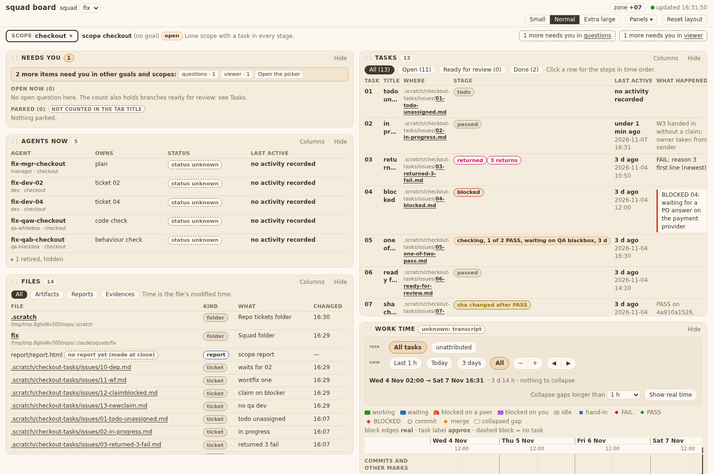

# Evidence 03

## Behaviour

The board reader (`bin/squadboard_tasks.py`) now folds the event store first, the ledger second, the ticket label third. Checked on a temp squad folder (never the real `task-events/`), 4 tickets, QA team and no-QA team:

| Case | Row shown |
|---|---|
| nobody claimed 01 | `todo`, owner `unassigned`, no last active |
| 03 has `Blocked by: 02`, 02 open | `blocked`, waits on `ticket 02`; claim on 03 gives `in progress` with the W1 note |
| 1 of 2 QAs PASS (plus a Manager PASS) | `checking, 1 of 2 PASS, waiting on QA blackbox, ...`; last active = newest event |
| both QAs PASS, tip matches or unknown | `passed`, waits on PO |
| same, branch tip moved | `sha changed after PASS` |
| no-QA team, evidence PASS by hook | `passed` (never `checking, 0 of 0`) |
| no-QA team, W9 on the handin | `in progress`, note `W9 evidence check failed: ...` |
| branch recorded in another scope, in `main` | `merged`, owner kept, tip found by the recorded branch |
| no events, a sibling scope with the same ticket folder has a HANDIN | owner and branch `squad/<squad>/<that scope>/<dev>`, M from that scope's roster |
| `Status: wontfix` | `wontfix` |
| bad lines or no store file | no crash, ledger or `todo` |

`ready for review` is gone, and the `ready_for_review` key is no longer in `/api/tasks` data. `squadboard_tasks.ready_by_scope` keeps its name for the Inbox and counts `passed` rows that have a branch tip. The picker (`squadboard_list`) counts a `merged` event as done and an open `blocked` event (or a return) as stuck. `squadboard_active` takes the newest event time as a ticket's last active.

## Review

| AC | Test or capture | How run |
|---|---|---|
| AC1 todo, unassigned, no time | `StoreReader.test_AC1_AC7_AC8_AC9_...` | `cd tests && python3 -m unittest test_squadboard_tasks` |
| AC3 checking, 1 of 2, names the missing QA | `StoreReader.test_AC3_AC5_...` | same |
| AC4 no QA: passed by evidence, W9 stays in progress | `StoreReader.test_AC4_...` | same |
| AC5 every QA PASS: passed, waits PO, Manager PASS not counted | `StoreReader.test_AC3_AC5_...`, `Tasks.test_T07_AC5_AC6_ready_list` | same |
| AC6 merged, built in another scope | `StoreReader.test_AC6_T9_...` | same |
| AC7 blocked from live `Blocked by:` | `StoreReader.test_AC1_AC7_...` | same |
| AC8 claim on an open blocker: in progress + W1 note | `StoreReader.test_AC1_AC7_...` | same |
| AC9 wontfix (also when blocked: waits on nobody) | `StoreReader.test_AC1_AC7_...` | same |
| AC7 turns `todo` by itself when the blocker passed | `StoreReader.test_AC1_AC7_...` | same |
| s2 one word per row; AC12 / AC20 `sha changed after PASS` | `Tasks.test_T07_AC1_AC2_AC3_stage_per_task`, `StoreReader.test_AC3_AC5_...` | same |
| s5 label table on read (`done` gives `passed`) | `Tasks.test_T07_AC1_...`, `ScopeFilesShape.test_T28_TA3_...` | same |
| `ready for review` dropped, tip unknown gives `passed` | `Tasks.test_T07_AC5_AC6_ready_list`, `StoreReader.test_AC3_AC5_...` | same |
| T8 slots / no QA | `StoreReader.test_AC4_...` | same |
| T19 read side (hook `evidence` pass gives `passed`; W9 in the note) | `StoreReader.test_AC4_...` | same |
| T24 override PASS, all-retired QAs keep their slots | `StoreReader.test_T24_...` | same |
| T9 other-scope branch; D8 sibling ledger | `StoreReader.test_AC6_T9_...`, `test_D8_...` | same |
| T10 bad or missing store never raises | `StoreReader.test_T10_...` | same |
| T11 targeted tests | files below | see below |
| last active from events (board, task picker) | `Active.test_T03_task_event_...`, `StoreReader.test_AC3_AC5_...` | `python3 -m unittest tests.test_squadboard_active` |
| tasks_done / stuck from events | `PickerTests.test_T03_task_events_feed_...` | `cd tests && python3 -m unittest test_squadboard_list` |

Runs (targeted, T11): `test_squadboard_tasks` 24 OK; `test_squadboard_active` 9 OK; `test_squadboard_inbox` 12 OK (real `ready_by_scope` wiring); `test_squadboard_list` 13, 1 failure that is also on base 125e654 (`test_T04_AC1_rows_order_and_done_list`, reads file mtimes); `test_board_fixtures` 4 OK.

Note: `test_squadboard_inbox` hung twice under a pipe, then passed in 3 s on a plain run; not tied to this change.

Team Lead ruling (ANSWER 03): the two assertions that named `ready for review` are changed in 03, one line each: `tests/test_squadboard_panels.py` (`test_T12_AC7_...`: stage list uses `passed`; ready list and filter count are 0 until 04 renames the JS flag) and `tests/test_squadboard_demo.py` (`STAGES` uses `passed`). Re-run: panels `Panels12.test_T12_AC7_...` OK, `test_squadboard_demo.RunningDemo` 5 OK. The other failures in those two files are on base 125e654 too.

## QA whitebox review

### QA whitebox, ticket 03 (board reader), sha 218ed71 (base 125e654)

Technical AC: ticket's T8-T11, T19 (design.md s8); design s6 reader order; T10 (never raises); T23 (temp store).
Run by me (plain, output to a file):
- `cd tests; python3 -m unittest test_squadboard_tasks test_squadboard_active test_squadboard_list` = 46 run, 1 FAIL (`test_T04_AC1_rows_order_and_done_list`).
- `test_squadboard_inbox test_squadboard_panels test_squadboard_demo.RunningDemo test_board_fixtures` = 79 run, 2 FAIL (panels T12_AC1, T14_AC1_AC2). The inbox file did not hang (35 s for all four files).
- Those 3 failures also fail on base 125e654 (I ran them on a full `git archive` of 125e654 in a temp dir): same 3 tests, same reason (time and mtime dependent). Not this change.
Diff read: squadboard_tasks.py (stage precedence = states.md s2; store first, then newest sibling ledger, then label; slots from the roster of the scope that built the ticket; `evidence` slot for no-QA; never `checking, 0 of 0`; wontfix before blocked), squadboard_active.py (event times), squadboard_list.py (merged_ts and open blocked count). `ready_for_review` key dropped; `ready_by_scope` keeps its name. Two assertions in 04's test files edited by the Team Lead's ruling (2 lines, the dropped word): acceptable.
REV-5b/REV-6 live (read-only on the real squad, nothing written; SQUAD_DIR listing unchanged): `squadboard_tasks.read` on scope task-claim-gates: quality exact, 7 rows, every row has id, stage, owner, waits_on, last_active, returns, branch, tip, detail_note; no `ready_for_review` key. Words: 01 passed, 02 todo, 03 checking 0 of 2 (waiting on both QAs), 04 blocked on ticket 03, 05 blocked on 02, 03, 06 and 07 `sha changed after PASS`.

#### Verdict: PASS

#### Follow-ups (not blocking, SQ-4)
1. Live data: 06 and 07 show `sha changed after PASS` only because the Developer's "assemble QA evidence" commit moved the tip after the QA PASS. Same rule as states.md AC12/AC20, so as designed, but every ticket will show this warning after its evidence commit. BA or Team Lead may want to ignore a tip that only adds files under the ticket's evidence folder.
2. Until ticket 04 renames the JS flag, the board's "Ready for review" panel counts 0 (the Team Lead's ruling, tests say so). Deploy 04 right after 03.
3. 3 tests fail on base (time and mtime dependent): `test_squadboard_list` T04_AC1, `test_squadboard_panels` T12_AC1 and T14_AC1_AC2. Someone should own them.

## QA blackbox review

### QA blackbox 03 (sha 218ed71)

Method: `live`. Dev's evidence.md has no shots, so I ran the board (`bin/squad-board --scope ...`, port 0) on a temp copy of the board fixture, with events written by `squad-task` and hook JSON (`from-message`), real temp git branches. Judged against tasks/states.md s9, AC1-AC9, AC12, AC16-AC20. Real store untouched.

| AC | Mode | What I did | What I saw | Result |
|---|---|---|---|---|
| AC1 | live | ticket nobody touched | `todo`, owner unassigned, `no activity recorded` | pass |
| AC2 | live | claim 12 | `in progress`, owner fix-dev-12, last active = claim time (<1 min) | pass |
| AC3 | live | handin 13, QA whitebox PASS (sender = roster QA) | `checking, 1 of 2 PASS`, `waiting on QA blackbox`; (fixture 05 shows same) | pass |
| AC4 | live | no-QA scope: HANDIN with no evidence | `in progress`, waits on Dev, W9 text in detail | pass |
| AC4 | live | same, branch with valid evidence.md, hook HANDIN | `passed`, waits PO, never `checking, 0 of 0` | pass |
| AC5 | live | 2nd QA PASS (an earlier manager-slot PASS on the sha ignored) | `passed`, waits PO | pass |
| AC6 | live | merge branch of 13 into main; also no-QA 01 | `merged`, waits nobody, owner kept; fixture 08 also from other scope | pass |
| AC7 | live | ticket 10 `Blocked by: 02` | `blocked`, waits on `ticket 02`; after 02 passed: `todo` | pass |
| AC8 | live | claim 12 (blocker 02 open) | `in progress` + `W1 started while ticket 02 is not yet passed` | pass |
| AC9 | live | `Status: wontfix` | `wontfix`, waits nobody | pass |
| AC12 | live | commit on 13's branch after PASS | `sha changed after PASS`, waits QA, note `PASS on 16cf6ebb69, branch tip d015a588dd` | pass |
| AC20 | live | no-QA 02 passed, commit on branch | `sha changed after PASS`, waits `evidence check` | pass |
| AC16 | live | fixture tickets with no events (08, 09 label `done`) | `merged`; `passed` (label mapped); no crash | pass |
| AC17 | live | open scope `viewer` (tickets folder of another scope) | all 13 tickets listed, built-elsewhere rows keep owner/branch/state from events | pass |
| AC18 | live | Tasks panel | same layout/columns/palette (see shot); no new column | pass |
| AC19 | live | claim on open blocker; merge | `in progress`+W1; `merged` wins | pass |
| R3 | live | scanned `/api/tasks` and panel | no stage word `done` or `ready for review` in a Stage cell | pass |

#### Follow-ups (not AC fails)
1. Panel chips still read `Ready for review (0)` and `Done (2)`, and the Needs-you text says "branches ready for review": the `passed` rows are not counted in the chip. Task 04 owns this (TL ruling); must be checked there (R3).
2. In a viewing scope whose roster lacks the dev, a ledger-only row (old ticket, no events) shows `in progress` with owner `unassigned` and "waits on unassigned" (fixture 02/04 in scope `viewer`). Old-ticket case only.
3. Earlier follow-ups still open: unknown `--slot` records silently; `pass --slot manager|team-lead` gives no W4.
4. Dev note: `test_squadboard_list` 1 failure also on base (not judged by me).

Verdict: PASS.
