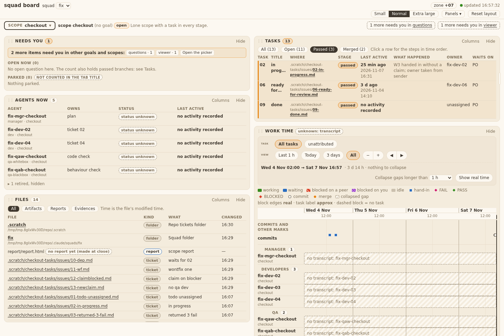
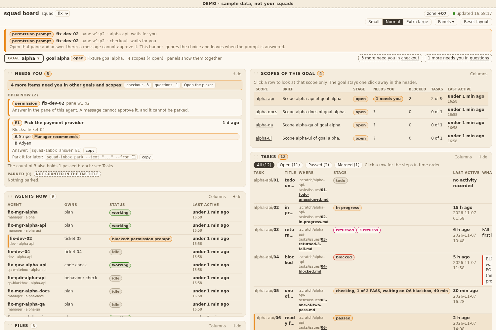

# Evidence 04
sha: 8e8a759
## Behaviour

The Tasks panel flag and filters now use the word `passed`; `done` and `ready for review` are no longer shown on the board. Checked in the panel browser test on the `checkout` fixture (rows 06 and 09 are `passed`):

| Where | Before | Now |
|---|---|---|
| Tasks rows flagged "need" | stage `ready for review` | stage `passed` (2 rows) |
| Tasks filter buttons | `Ready for review (n)`, `Done (n)` | `Passed (2)`, `Merged (n)` |
| Inbox note | "branches ready for review: see Tasks" | "passed branches: see Tasks" |
| `squadboard_inbox` hook and `unknown` name | `ready_for_review` | `passed` |

## QA blackbox

### QA blackbox 04 (sha 8e8a759)

Method: `live`. Dev evidence has no shots. I ran `bin/squad-board` of the Developer's worktree on my temp checkout fixture (13 tickets, events from task 03 checks) and on `--demo`, with Playwright. Judged against states.md AC5 (no `done`), s3, R3, and the dashboard spec AC4 wording as visible.

| Check | Mode | What I did | What I saw | Result |
|---|---|---|---|---|
| Filter buttons | live | open checkout scope | `All (13)`, `Open (11)`, `Passed (3)`, `Merged (2)`; no `Ready for review`, no `Done` | pass |
| Passed filter | live | click `Passed (3)` | rows 02, 06, 09 (all stage `passed`), flagged/highlighted, waits PO | pass |
| Merged filter | live | click `Merged (2)` | rows 08, 13 | pass |
| Open filter | live | click `Open (11)` | everything but the 2 merged | pass |
| Inbox text | live | Needs you panel | "The count also holds passed branches: see Tasks." (no "ready for review") | pass |
| R3 stage words | live | scanned page text for `done` / `ready for review` | only inside ticket titles and file names of fixture data (`06-ready-for-review.md`, `09-done.md`); never in a Stage cell, button or note | pass |
| Demo board | live | `squad-board --demo` | `Passed (2)`, `Merged (1)`, "count of 3 also holds 1 passed branch"; same words rule | pass |
| Layout | live | compare to task 03 shot | same layout, columns, palette; only words changed | pass |
| Console | live | page load | only `favicon.ico` 404 | n/a |

#### Follow-ups
1. Old ones still open: unknown `--slot` is silent; `pass --slot manager|team-lead` no W4; ledger-only old ticket in a viewing scope with no roster dev shows owner `unassigned`.
2. `Open (11)` includes `passed` rows (open until merged). Fine by spec; noting the count is not "needs work".

Verdict: PASS.

## QA whitebox

### QA whitebox 04 (8e8a759, code 1692ec1): PASS
Diff read (panel_tasks.js, panel_inbox.js, squadboard_inbox.py, 5 test files, dashboard spec). isReady flags `passed`; DONE = merged only; filters `Passed (n)` / `Merged (n)`; hook and `unknown` name `ready_for_review` -> `passed`; no caller of the old name left (grep).
Ran in worktree tcg-6: test_squadboard_inbox 12 OK; test_board_fixtures, tasks, panels, demo: 99 run, 3 fail = T12 AC1, T14 AC1/AC2, T37 AC11. All are clock-dependent ("4 d ago", "1 d ago" against fixed fixture dates), not in the diff; Developer says same on base.
`grep -rni "ready.for.review" bin templates`: no hit except docstring below. Scope panel `done` = scope status, not a task stage.
Follow-ups (not FAIL): squadboard_inbox.py:12 docstring still says "Ready-for-review branches"; squadtask.py:178 docstring same; `ready_by_scope` name kept (03 file); ticket Files line names test_squadboard_demo.py but no demo change was needed.
