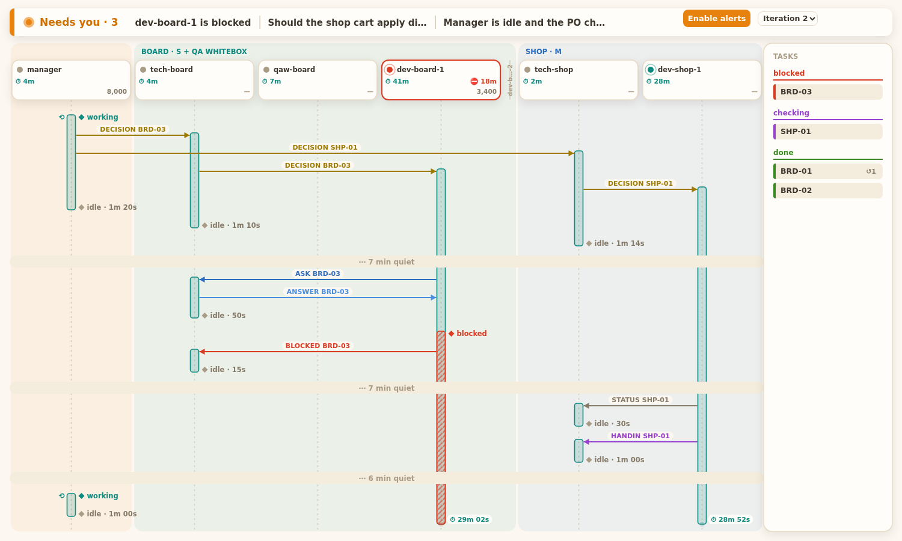
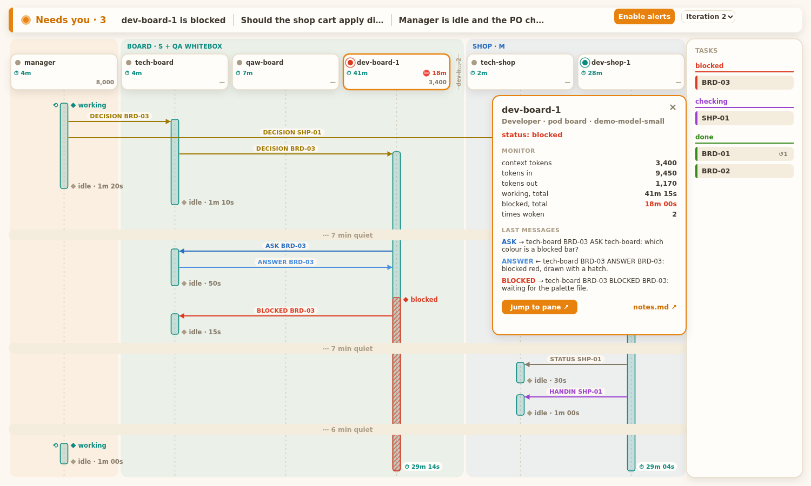
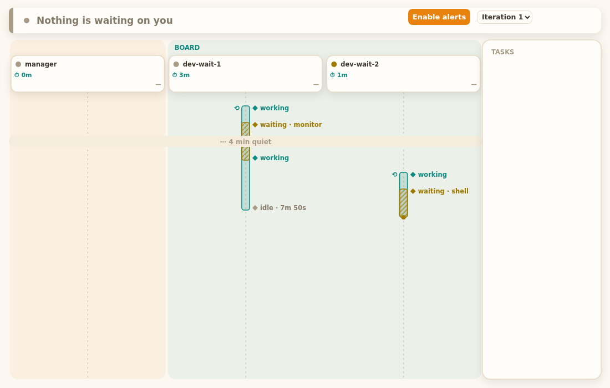

# Squad board: user guide

:::tip{title="What it is, and how to start it"}
The squad board is a live page that shows what your squad is doing: who works, who waits, who is blocked on you, and which messages fly between agents. **Start it with one command, from a herdr pane at your project root: `/squad:squad-board`** (it also opens by itself when you run `/squad:squad-start`). It prints one URL ending in `?token=…`; open it in your browser.
:::



*Screenshot: the demo data, opened with `--replay`. Timers on open bars keep counting.*

## 1. What the board shows

The board answers three questions without reading any pane: **does anything need me, who is busy, what is the state of each task.**

| Part | Where | What it tells you |
|---|---|---|
| **Needs-you bar** | top | What waits on you: a blocked agent, an escalation with no answer, an idle Manager whose PO check-in is empty. Empty reads "Nothing is waiting on you". |
| **Agent columns** | centre, grouped in pods | One column per rostered agent. The header card has the status dot, name, total working time, total blocked time, and context tokens. |
| **Sequence** | under the headers | Time runs downward. Arrows are messages, bars are working stretches, small diamonds are status changes. |
| **Tasks card** | right | Every task seen in messages, grouped by state. |
| **Side panel** | opens over the sequence | Click an agent's header card: its numbers, its last three messages, a Jump button and a link to its notes. |
| **Iteration picker** | top right | Look at an earlier iteration. The newest is live. |

:::note{title="Why bars, and why messages"}
A bar starts where a message woke the agent (or at a `working` record when nothing woke it), so cause and effect line up. A bar ends when the agent goes idle.
:::

### Needs-you alerts

- **Enable alerts** (orange button, top) asks the browser for notification permission once. After that, each *new* needs-you item shows a "Squad needs you" notification and a soft two-note chime. Items already there when you open the page do not ring.
- The tab title shows the count: `(2) squad board`.
- A blocked agent is also outlined in red in its header.

### Follow live and the iteration picker

- At the bottom of the page the board **follows**: new rows scroll into view by themselves.
- Scroll up and it **pauses**. A `↓ live · N` button appears; N counts the rows that arrived meanwhile. Click it to jump back and follow again.
- The picker lists `Iteration N`. Choosing an older one shows a **Replay of iteration N** banner and stops following; `↓ live` takes you back to the newest.

## 2. Start, stop, restart

| You want | Do this |
|---|---|
| Open the board (or find its URL again) | `/squad:squad-board`, or `squad-board-start [--squad NAME]` |
| Restart it (page will not load, URL lost, board died) | `/squad:squad-board restart`, or `squad-board-start --restart` |
| Stop it | Close its herdr tab (the one labelled `board`), or press Ctrl-C in that tab |

- `squad-board-start` runs `bin/squad-board` in a herdr tab labelled `board`, waits up to 10 s for its URL line, and prints it. A second call finds the running tab and prints its URL; it never starts a second board.
- **One board per herdr workspace.**
- The board listens on **127.0.0.1 only**, port **7420**. If that port is busy it tries 7421 to 7440, and the URL it prints shows the port it got.
- The **token** at the end of the URL is needed for the three actions that do something: **Jump to pane**, **notes.md**, and **show more** on a long message. Without it the page still draws, and the panel says "Jump needs the token". Always open the full printed URL.
- Needs: Python 3, herdr, `jq`, `git`, and `HERDR_ENV=1` (a herdr pane).

### Two folder layouts

| Layout | How to tell | What the board does |
|---|---|---|
| **Per-scope** (current) | `scopes/<scope>/` and `goals/<goal>/` under the squad folder | Reads every scope and goal. Each scope's Manager is checked against its own check-in. Agent names are unique across scopes, so one board shows them all. |
| **Flat** (legacy) | `roster.md` at the top of the squad folder, no `scopes/` | Reads it as before. |

### Replay mode: look at a copy of a squad

```bash
cp -r .claude/squads/<squad> /tmp/squad-copy
bin/squad-board --replay /tmp/squad-copy --now 2026-10-14T12:00:00Z --port 0
```

Replay serves a folder as it is: no recorder, no live pane status, and `--now` fixes the clock (an ISO time with a zone) so a page can be reproduced. `--port 0` lets the system pick a free port. Use a **copy**: the demo and test data live in `tests/fixtures/board/`. Without `--replay` the board needs a real squad folder (`SQUAD_DIR`, or `<git root>/squad`).

## 3. Reading the page

Colours come from the page's Mango Parrot light palette.

### Header cards and pods

| You see | It means |
|---|---|
| **Grey dot** (idle) | Not working. |
| **Teal dot**, pulsing ring | Working. |
| **Red dot**, pulsing ring, red outline | Blocked, probably on you. |
| **Yellow dot**, still | Waiting on background work (a shell or monitor it started). |
| **Orange outline** | The agent whose panel is open. |
| ⏱ teal figure | Total working time (blocked time included). |
| ⛔ red figure | Total blocked time; shown only when above zero. |
| Right-hand number | Context tokens now; `—` when unknown. |
| Thin rotated name | A retired agent with nothing in this iteration, folded to a stub. |
| Pod band | Orange and unlabelled is the Manager's pod; the others take teal, blue, purple, pink, green, yellow in turn, labelled with the pod name and size. |

Totals read `7m`, `1h05`. A long name keeps its number: `dev-bo…-10`.

### Bars

| You see | It means |
|---|---|
| **Teal bar** | The agent was working. |
| **Red hatched part** | Blocked in that stretch. |
| **Yellow hatched part** | Waiting on a background shell or monitor. Not idle, not active. |
| ⟲ left of the bar | Self-started: no message woke it (for example you typed to the Manager). |
| **Pulsing dot + `⏱ 4m 05s` pill** | Open bar: still working, with a live timer. |
| **Steady yellow dot, no timer** | Open and waiting. |
| `◆ idle · 1m 20s` | The bar ended; that is how long it ran. |
| `⋯ 7 min quiet` band | A quiet stretch of over 3 minutes between two rows, folded to one line. |

### Arrows

An arrow runs from sender to receiver; its label is the message type and the task. The colour is the type:

:chip[ASK]{info} :chip[ANSWER]{info variant=outline} :chip[DECISION]{warning} :chip[HANDIN]{color=primary} :chip[PASS]{success} :chip[FAIL]{danger variant=outline} :chip[STATUS]{gray} :chip[BLOCKED]{danger}

ASK is blue, ANSWER a lighter blue, DECISION amber, HANDIN purple, PASS green, FAIL pink, STATUS grey, BLOCKED red. An arrow whose two ends are the same column loops out to the right.

### Tasks card

Tasks are grouped **blocked, building, checking, returned, done** and take their state from message types:

| Message | Task state |
|---|---|
| DECISION or STATUS | building |
| HANDIN | checking |
| FAIL | returned |
| PASS | done |
| BLOCKED | blocked |

ASK and ANSWER only make a task appear (as building) when they name it first. `↺2` on a chip counts how often it came back; at 2 or more the chip gets an orange outline and pill. A late STATUS does not reopen a done task; HANDIN, FAIL and BLOCKED do. Too many tasks end in `+N more`.

### The side panel



Click a header card to open it; click again, press Esc, or click ×. It shows status, role, pod and model; **MONITOR** (context tokens, tokens in and out, working total, blocked total, times woken, and a `waiting` total only when above zero); and the **last three messages** the agent sent or received in the viewed iteration.

**Long messages.** The page carries only the first **140 characters** of a message, ending in `…`, with a **show more** button. Show more fetches the full text (needs the token); **show less** folds it back. If the fetch fails it says "full text not available" and the button reads show more again, so one click retries.

**Jump to pane ↗** focuses that agent's herdr pane. It is disabled for retired agents and without the token. **notes.md ↗** opens the agent's notes file.

### The waiting state



An agent is **waiting** when herdr calls it idle but the last line of its pane says a shell or monitor still runs (`N shells still running`, `N monitors`). The label shows which. Only that last line counts, so those words in the conversation do nothing. `← N agent` is in every pane and is ignored.

## 4. Common problems

| Problem | Why, and the fix |
|---|---|
| **No agents on the board** | The columns come from `roster.md`. Check that the agents are on it; the page reads the squad folder you started it for. In a per-scope squad each scope has its own roster. Restart with `--squad NAME` if you have several squads. |
| **The page says "reconnecting…" or will not load** | The board process is gone or stuck. Run `/squad:squad-board restart`. |
| **Board died, but `squad-board-start` prints the same old URL** | A known gap (BRD-21): a reused `board` tab whose board died still prints the old URL. Use `--restart`. |
| **"ports 7420..7440 are all busy"** | Something else holds the whole range. Free a port, or run `bin/squad-board --port N` yourself. |
| **`squad-board-start` says it is not inside herdr** | `HERDR_ENV` is not `1`. Open herdr and run it from a pane there. |
| **"Jump needs the token"** | You opened the page without `?token=…`. Use the printed URL, or ask for it again with `/squad:squad-board`. |
| **An agent shows idle when it is busy** | Status comes from herdr. A shell or monitor started in the pane shows as waiting, not working. A long silent tool run records nothing while the recorder is down (see below). |
| **An agent shows waiting when it is not** | Only the last pane line counts. If it still says `N monitors`, the agent has a monitor running. Stop it in its pane. |
| **A bar looks far too long** | The closing record was never written, because the recorder only runs while the board runs. A bar no status record backs is cut after 3 minutes of silence, but a bar that *is* backed can read hours long across a board restart (BRD-21). Treat it as unknown time, not work. |
| **Bars are missing before the board opened** | They grow from when the recorder first ran. Nothing is drawn for earlier time. |
| **A needs-you item does not go away** | Blocked clears when the agent works again. An escalation clears when its Answer cell in `escalations.md` is filled. The idle-Manager item clears when the PO check-in of the open iteration has text. |

## 5. Known limits

- **The recorder runs only while the board runs.** The board writes the status records (`activity.jsonl`) itself. While it is down, nothing is recorded, and `messages.jsonl` from the message hook keeps filling. Keep the board open while the squad works.
- **Many columns do not fit.** Each column keeps at least 84 px, so with many agents (about 13 or more on a normal screen) the page scrolls sideways, and the Tasks card does not stay in view (BRD-26, backlog).
- **Pixel tests are flaky under load.** Some page tests (`test_board_sequence` and others) fail now and then when the machine is busy and pass alone (BRD-21 items 19 and 26).
- **One board per herdr workspace.**
- **The waiting state sees only a shell or monitor** in the pane's last line.
- **The logs hold message text** and are git-ignored by `squad-init` (`*.jsonl`).
- **The board never changes your squad.** The only write action is Jump, which focuses a pane.
- Cosmetic: a waiting label can cross a neighbour's pill (BRD-21 item 23).
